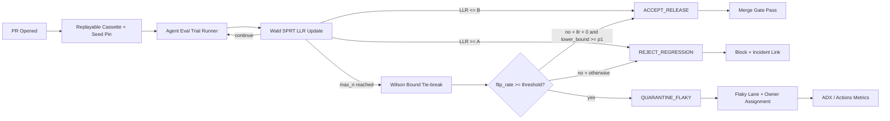
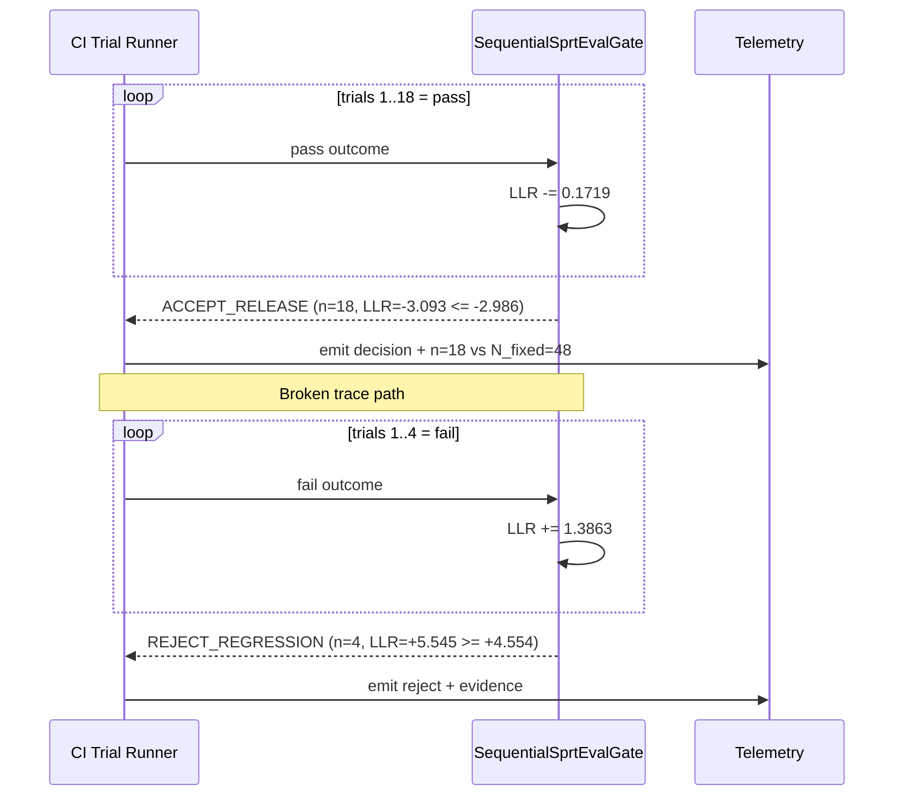

# 企业智能体评测门禁随机波动治理选型 FAQ：Pattern A（可回放 Cassette + Seed/Fingerprint 固钉 + Wald `SPRT` 自适应早停 + Flaky 隔离）vs Pattern B（固定 `Pass^k`）vs Pattern C（夜间全量回归）vs Pattern D（`Pass@k>=1` 重试到绿反模式）

## 1. Executive Summary（先给结论）

面向多步骤 Agent 的企业 CI/CD 发布门禁，推荐默认采用 **Pattern A**：在可重放工具桩与种子固钉前提下，使用 Wald 二项序贯检验（`SPRT`）做自适应早停判定，并把高翻转样本送入隔离通道而非直接阻断主线。  
该方案可以在保证统计功效的前提下显著降低每次 PR 的评测 token 成本，同时避免“固定高重试导致预算浪费”与“单次评测导致假红阻塞”两种极端。

对多数团队而言，Pattern A 的核心收益不只是更省钱，而是把“模型随机性”从争议焦点转化为可度量、可审计、可治理的工程对象。Pattern B 与 Pattern C 仅在特定组织约束下适用，Pattern D 应明确定义为禁止项。

## 2. 问题背景与典型症状

在真实流水线中，即便 `temperature=0`，仍会出现 GPU 内核、批处理组合、外部工具响应抖动、评审模型边界判断漂移等多源随机性。  
如果团队继续依赖 `k=1` 单次门禁，PR 会遭遇高比例假红；如果改成每次固定 `k=8` 或 `k=10`，看似稳定但会显著放大评测费用，并掩盖真实回归。

从组织协作角度看，最难的并不是“算不算通过”，而是“为什么通过或为什么失败”能否形成稳定共识。没有确定性输入与统计边界时，评测结果在不同团队、不同班次、不同区域之间会出现解释分叉，最终演变成流程争议而不是工程问题。  
因此，门禁体系必须同时回答三件事：是否可复现、是否统计显著、是否具备处置路径。只要其中任一项缺失，就会在高频发布期放大为跨团队摩擦和重复排障成本，直接吞噬研发吞吐。

对多数企业而言，评测门禁的真实痛点不是“有没有公式”，而是公式是否被工程化为可执行机制；如果参数定义写在文档里却没有进入流水线配置、没有和工单系统关联、没有和预算告警联动，团队仍然会在故障时回到经验判断，最终让统计门禁失去治理价值。

进一步地，门禁策略必须具备“按证据自动升级”的能力：当同类异常在短周期内重复出现时，系统应自动提升审查等级、扩大证据采集深度并收紧放行阈值，而不是继续沿用原有宽松策略，否则平台会在看似平稳的指标下持续积累不可见风险。

## 3. 三类高频故障模式

1. **假红阻塞**：`k=1` 在边界样本上误判失败，导致不必要回滚与上下游等待。  
2. **假绿放行**：`Pass@k>=1` 在 `p=0.6` 场景下依然能高概率放过回归。  
3. **样本污染**：未固钉种子与实时外部依赖混杂，导致一次失败无法复现，排障成本飙升。

## 4. 四模式 12 维对比矩阵

| 维度 | Pattern A：SPRT + 隔离（推荐） | Pattern B：固定 `Pass^k` | Pattern C：夜间全量 + PR 冒烟 | Pattern D：`Pass@k>=1` / 盲重试（禁止） |
|---|---|---|---|---|
| 统计严谨性 | 高 | 中高 | 中 | 低 |
| 假红控制 | 高 | 中 | 中高 | 低 |
| 假绿控制 | 高 | 中 | 中 | 低 |
| 成本效率 | 高 | 低到中 | 中 | 表面高、实则风险高 |
| 早停能力 | 强 | 无 | 弱 | 无 |
| 可复现性 | 高 | 中 | 中 | 低 |
| 故障定位速度 | 高 | 中 | 低 | 低 |
| 发布速度 | 高 | 中 | 高（但滞后风险） | 高（不可靠） |
| 组织可解释性 | 高 | 中 | 中 | 低 |
| 运维复杂度 | 中 | 中 | 中 | 低（但事故高） |
| 三年期 TCO | 最优 | 次优 | 中位 | 最差 |
| 合规与审计 | 高 | 中 | 中 | 低 |

## 5. 推荐架构（Pattern A）关键设计

Pattern A 的最小闭环包括五个环节：评测输入确定化（Cassette + Seed/Fingerprint）→ 序贯统计判定（SPRT）→ 边界样本 Wilson 区间裁决 → 高翻转样本隔离通道 → 观测与预算归因。  
在这个闭环中，任何“不可复现失败”都不应直接升级为发布阻断，而应先判定是回归、噪声还是样本污染，再决定进入主线 gate、隔离 lane 或人工复核。

建议将 `p0`（可接受可靠性基线）、`p1`（不可接受回归下界）、`alpha`（I 类错误）和 `beta`（II 类错误）固化在策略文件，并与业务风险等级绑定。高风险域可设更严格 `alpha/beta`，低风险域可放宽以换取吞吐。

在平台治理实践中，建议把策略参数版本化并与发布批次绑定，确保任意一次门禁结果都能回溯到明确的参数快照、数据快照和工具快照。只有“输入、参数、裁决”三元组完整归档，事后审计才能避免口径漂移。  
此外，隔离通道不应只是“失败暂存区”，而应具备标准化根因标签，例如模型版本漂移、外部工具非确定性、环境配置抖动、评审边界样本等，以便形成可持续收敛的质量改进节奏。

在跨组织协同环境中，建议把隔离样本按业务影响等级自动分层：涉及交易正确性、合规解释性、客户账务一致性的样本进入高优先级队列并要求 `24h` 内闭环；仅影响体验排序或次要文案质量的样本进入常规治理队列，以避免主线发布被低影响噪声过度牵制。

同时应建立“策略变更回放评估”制度：任何 `p0/p1/alpha/beta/max_trials` 的调整都先在历史样本集上离线重放，比较放行率、拒绝率、隔离率与成本变化，再决定上线；通过这一流程可以显著降低策略误调导致的系统性误判风险，并让门禁演进具备可解释证据。

若回放评估显示“成本下降但风险暴露上升”，应优先执行小流量灰度并附加人工复核阈值，而不是直接全量切换策略参数。

反之，若回放评估显示“风险与成本双优”，也应保留回滚开关与观测窗口，确保策略收益在真实生产流量下可持续复现。

为了进一步降低策略切换风险，建议将关键门禁参数与发布波次绑定并按波次记录“预期收益、观测指标、退出条件、责任人”四元信息，这样即便在跨时区连续发布场景下也能快速判断策略是否偏离预期并及时回滚到上一稳定配置。

通过这种“参数—证据—责任”联动机制，组织可以把统计门禁从一次性项目能力升级为可持续运营能力，并显著缩短跨团队对齐时间。

## 6. Mermaid：Deterministic Cassette + SPRT Gate + Quarantine Pipeline



## 7. Mermaid：LLR 序贯随机游走时序



## 8. Q1–Q6 公式与示例

| 编号 | 公式 | 示例输入 | 结果与解释 |
|---|---|---|---|
| Q1 Wald LLR | `LLR = s*ln(p1/p0) + (n-s)*ln((1-p1)/(1-p0))` | `p0=0.95,p1=0.80` | 每次通过漂移 `-0.1719`，每次失败漂移 `+1.3863`。 |
| Q2 边界 | `A=ln((1-β)/α), B=ln(β/(1-α))` | `α=0.01,β=0.05` | `A≈4.554, B≈-2.986`。 |
| Q3 期望样本节省 | `saving = 1 - E[N]/N_fixed` | `E[N|clean]=18,N_fixed=48` | 节省 `62.5%` 评测样本。 |
| Q4 假绿膨胀 | `Pass@k>=1 = 1-(1-p)^k` | `p=0.60,k=3` | `0.936`，即 `93.6%` 假绿风险。 |
| Q5 固定通过概率 | `Pass^k = p^k` | `p=0.60,k=3` | `0.216`，可见定义差异巨大。 |
| Q6 Wilson 下界 | `LB = (p̂ + z²/(2n) - z*sqrt((p̂(1-p̂)+z²/(4n))/n)) / (1+z²/n)` | `n=25,s=24,z=1.96` | `LB≈0.8046`，可排除 `H1: p<=0.80`。 |

上述公式的价值不在于“数学更复杂”，而在于把发布争议转换成可验证的概率边界。团队不再围绕个别样本情绪化争辩，而是依据统一的统计契约做决策，显著降低跨团队沟通摩擦。  
在企业实践中，建议将关键公式产出的中间量（如 `LLR`、边界差值、Wilson 下界）写入可检索日志，以便在复盘时快速解释“为何提前通过、为何提前拒绝、为何进入隔离”。

## 9. 可执行 Python：SequentialSprtEvalGate（stdlib）

```python
from __future__ import annotations

from dataclasses import dataclass
from typing import Dict, Iterable, List, Tuple
import hashlib
import math


@dataclass
class SprtConfig:
    p0: float = 0.95
    p1: float = 0.80
    alpha: float = 0.01
    beta: float = 0.05
    max_trials: int = 25
    flaky_flip_threshold: float = 0.30


@dataclass
class GateResult:
    decision: str
    llr: float
    trials: int
    passes: int
    wilson_low: float
    wilson_high: float
    flip_rate: float


class SequentialSprtEvalGate:
    def __init__(self, config: SprtConfig) -> None:
        self.cfg = config
        self.A = math.log((1 - config.beta) / config.alpha)
        self.B = math.log(config.beta / (1 - config.alpha))

    @staticmethod
    def cassette_sha256(payload: bytes) -> str:
        return hashlib.sha256(payload).hexdigest()

    @staticmethod
    def wilson_interval(successes: int, n: int, z: float = 1.96) -> Tuple[float, float]:
        if n == 0:
            return (0.0, 1.0)
        phat = successes / n
        denom = 1.0 + z * z / n
        center = phat + z * z / (2 * n)
        delta = z * math.sqrt((phat * (1 - phat) + z * z / (4 * n)) / n)
        low = (center - delta) / denom
        high = (center + delta) / denom
        return (max(0.0, low), min(1.0, high))

    @staticmethod
    def flip_rate(trace: List[int]) -> float:
        if len(trace) <= 1:
            return 0.0
        flips = 0
        for i in range(1, len(trace)):
            if trace[i] != trace[i - 1]:
                flips += 1
        return flips / (len(trace) - 1)

    def _llr(self, successes: int, n: int) -> float:
        fails = n - successes
        return successes * math.log(self.cfg.p1 / self.cfg.p0) + fails * math.log((1 - self.cfg.p1) / (1 - self.cfg.p0))

    def evaluate(
        self,
        outcomes: Iterable[int],
        system_fingerprint_stable: bool,
    ) -> GateResult:
        s = 0
        n = 0
        trace: List[int] = []
        llr = 0.0

        for item in outcomes:
            x = 1 if int(item) == 1 else 0
            trace.append(x)
            n += 1
            s += x
            llr = self._llr(s, n)

            if llr >= self.A:
                low, high = self.wilson_interval(s, n)
                return GateResult("REJECT_REGRESSION", llr, n, s, low, high, self.flip_rate(trace))
            if llr <= self.B:
                low, high = self.wilson_interval(s, n)
                return GateResult("ACCEPT_RELEASE", llr, n, s, low, high, self.flip_rate(trace))
            if n >= self.cfg.max_trials:
                break

        low, high = self.wilson_interval(s, n)
        flips = self.flip_rate(trace)

        if system_fingerprint_stable and flips >= self.cfg.flaky_flip_threshold:
            return GateResult("QUARANTINE_FLAKY", llr, n, s, low, high, flips)
        if llr < 0.0 and low >= self.cfg.p1:
            return GateResult("ACCEPT_RELEASE", llr, n, s, low, high, flips)
        return GateResult("REJECT_REGRESSION", llr, n, s, low, high, flips)


if __name__ == "__main__":
    gate = SequentialSprtEvalGate(SprtConfig())

    clean = [1] * 25
    r1 = gate.evaluate(clean, system_fingerprint_stable=True)
    assert r1.decision == "ACCEPT_RELEASE"
    assert r1.trials == 18

    broken = [0] * 25
    r2 = gate.evaluate(broken, system_fingerprint_stable=True)
    assert r2.decision == "REJECT_REGRESSION"
    assert r2.trials == 4

    single_blip = [0] + [1] * 24
    r3 = gate.evaluate(single_blip, system_fingerprint_stable=True)
    assert r3.trials == gate.cfg.max_trials
    assert abs(r3.flip_rate - (1.0 / 24.0)) < 1e-12
    assert abs(r3.wilson_low - 0.8046) < 1e-3
    assert r3.decision == "ACCEPT_RELEASE"

    oscillating = [0, 1, 0, 1, 0, 1, 1, 1, 1, 0, 1, 1, 1, 1, 1, 1, 1, 1, 0, 1, 1, 1, 1, 1, 1]
    r4 = gate.evaluate(oscillating, system_fingerprint_stable=True)
    assert r4.trials == gate.cfg.max_trials
    assert abs(r4.flip_rate - (9.0 / 24.0)) < 1e-12
    assert r4.decision == "QUARANTINE_FLAKY"

    p = 0.60
    pass_at_3 = 1 - (1 - p) ** 3
    assert abs(pass_at_3 - 0.936) < 1e-12

    digest = gate.cassette_sha256(b"fixture-v1")
    assert len(digest) == 64
```

## 10. JSON：CI 策略与 Cassette Manifest

```json
{
  "policy_version": "2026-11-27",
  "sprt_gate": {
    "p0": 0.95,
    "p1": 0.8,
    "alpha": 0.01,
    "beta": 0.05,
    "max_trials": 25
  },
  "determinism": {
    "seed_pin": 20261127,
    "system_fingerprint": "fp_model_a_2026_11_27",
    "cassette_sha256": "f7f3b2d8d0b72f6fa4ce7a52f72958d69f9ba2b7648e76f3f5e8f91eec2e1f4a"
  },
  "flaky_quarantine": {
    "flip_rate_threshold": 0.3,
    "lane": "ci-flaky-quarantine",
    "owner_group": "agent-eval-oncall"
  },
  "actions": {
    "accept": "merge_gate_pass",
    "reject": "block_release",
    "quarantine": "route_to_flaky_lane"
  }
}
```

## 11. KQL：7 天评测节省、早停分布与 Flaky 隔离

```kql
let win = 1d;
let base =
    AgentEvalGateLogs
    | where TimeGenerated > ago(7d)
    | extend repo = tostring(CustomDimensions.repo)
    | extend suite = tostring(CustomDimensions.suite)
    | extend decision = tostring(CustomDimensions.decision)
    | extend trials = toint(coalesce(CustomDimensions.trials, extract(@"trials=(\d+)", 1, Message)))
    | extend token_cost = todouble(coalesce(CustomDimensions.token_cost_usd, extract(@"token_cost_usd=([0-9.]+)", 1, Message)));
let savings =
    base
    | summarize trial_avg = avg(trials), token_sum = sum(token_cost) by bin(TimeGenerated, win), repo;
let decisions =
    base
    | summarize accept_cnt = countif(decision == "ACCEPT_RELEASE"),
                reject_cnt = countif(decision == "REJECT_REGRESSION"),
                flaky_cnt = countif(decision == "QUARANTINE_FLAKY") by bin(TimeGenerated, win), repo;
let suites =
    base
    | summarize suite_cnt = dcount(suite) by bin(TimeGenerated, win), repo;
savings
| join kind=fullouter decisions on TimeGenerated, repo
| extend TimeGenerated = coalesce(TimeGenerated, TimeGenerated1), repo = coalesce(repo, repo1)
| project-away TimeGenerated1, repo1
| join kind=fullouter suites on TimeGenerated, repo
| extend TimeGenerated = coalesce(TimeGenerated, TimeGenerated1), repo = coalesce(repo, repo1)
| project-away TimeGenerated1, repo1
| extend fixed_trials = 48.0
| extend est_token_saving_ratio = iif(fixed_trials > 0, 1.0 - (trial_avg / fixed_trials), 0.0)
| project TimeGenerated, repo, trial_avg, est_token_saving_ratio, token_sum,
          accept_cnt=coalesce(accept_cnt, 0), reject_cnt=coalesce(reject_cnt, 0),
          flaky_cnt=coalesce(flaky_cnt, 0), suite_cnt=coalesce(suite_cnt, 0)
| order by TimeGenerated desc
```

## 12. 扩展问答 Q7–Q12（工程现场）

| 编号 | 问题 | 回答要点 |
|---|---|---|
| Q7 | `Pass@k` 与 `Pass^k` 为什么必须区分？ | 前者是“至少一次成功”，后者是“全部成功”；风险含义完全不同。 |
| Q8 | 为什么需要 `system_fingerprint` 固钉？ | 不固钉会把模型升级漂移误当业务回归。 |
| Q9 | 为什么要隔离而非直接失败？ | 高翻转样本会污染主线信号，隔离后更利于定位。 |
| Q10 | Wilson 下界何时触发？ | 达到 `max_trials` 后仍未触边界时，做确定性 tie-break。 |
| Q11 | 如何选 `p0/p1`？ | 按业务风险与历史可靠性分层配置，而非统一常量。 |
| Q12 | 工具桩是否会失真？ | 会，因此需周期性抽样对照真实线上数据校准。 |

## 13. 选型决策树（简版）

1. 若 PR 评测量大且发布频繁，优先 Pattern A。  
2. 若组织必须固定样本统计口径，可用 Pattern B，但需接受成本上升。  
3. 若团队以夜间批处理为主且可容忍延迟，可采用 Pattern C 过渡。  
4. 任意场景若仍使用“重试到绿”逻辑，直接判定 Pattern D 并阻断。

决策树落地时，建议把“统计口径选择”与“预算治理策略”绑定审批。若团队坚持固定高 `k`，应同步声明预算上限与收益预期，避免形成无约束扩容；若团队采用序贯早停，也应明确噪声样本的隔离 SLA 与关闭条件。  
对于跨 BU 的共享平台，还应建立统一术语表，明确 `Pass@k`、`Pass^k`、假红、假绿、隔离样本等定义，防止不同团队使用同名异义指标，导致管理层汇总判断失真。

为了避免团队把“多跑几次”误当质量保障，建议在评审模板中强制填写统计定义（`Pass@k` 或 `Pass^k`）、边界参数、最大试验数和失败处理策略。只有指标定义可追溯，后续质量事件才有统一解释口径。  
另一个高频误区是把 flaky 当作“模型不稳定”而忽略工具链随机性。实践中不少翻转来自外部 fixture 漂移、时区依赖、缓存污染和未固定系统指纹，必须通过隔离 lane 的结构化标签做根因分层。

若企业已采用多阶段发布（开发分支、预发分支、生产分支），建议对每个阶段采用不同的门禁策略模板，并明确阶段迁移条件：例如开发阶段偏吞吐、预发阶段偏统计保守、生产阶段偏风险兜底；这样既能避免“一刀切门禁”造成效率损失，也能确保高风险阶段具备足够防护强度。

## 14. 场景 15.1：银行多团队 Copilot 单仓（`420` PR/日，`1,200` 评测样本）

该场景同时追求发布速度与风险控制。使用 Pattern A 后，主线 PR 平均试验数显著低于固定 `k=10`，并将翻转样本集中到隔离队列，由专项小组做根因分析。  
在跨团队治理层面，统一的 SPRT 参数策略和证据结构降低了“你认为通过、我认为失败”的争议频次，提升协作效率。

对于金融行业，审计与可解释性同样关键。建议将每次门禁判定输出 `LLR`、边界、样本轨迹、指纹版本和裁决来源（边界命中/Wilson/隔离）并长期留存，以支持内控审查与监管抽检。  
当模型或工具版本升级时，优先在影子流水线运行并对比 `E[N]`、翻转率与 reject 密度变化，再决定是否切换主线参数。

在银行场景下，发布门禁不仅是研发质量控制点，也常被纳入模型风险管理链路。建议将门禁结果与变更单、事故单、客户影响评估单联动，形成从代码提交到业务影响的闭环证据链。  
当出现连续隔离样本积压时，应触发跨团队战情机制，优先清理高影响交易路径相关样本，避免隔离队列长期积压反向拖慢主线发布。

## 15. 场景 15.2：全球 SaaS 编码/SQL Agent 基准门禁

该场景特点是模型版本迭代快、`system_fingerprint` 更新频繁。Pattern A 可将每次升级的质量影响与门禁成本一并量化，避免“升级后看似通过、线上却回归”的盲点。  
当出现大规模 fingerprint 变更时，建议临时提高隔离样本配额，防止主线门禁被短期噪声扰动。

在全球多时区协作中，不同区域的工具依赖和数据镜像状态可能不同。建议按区域拆分 suite 并分别统计 `LLR` 与翻转率，避免将局部基础设施问题误判为模型全局回归。  
通过区域分层监控，团队可以更快定位问题域并减少无效回滚。

对于 SaaS 厂商，门禁策略还应考虑租户层级差异：高价值行业租户可采用更严格的 `alpha/beta` 与更低的容忍阈值，长尾租户可采用成本优先参数，以实现“风险与成本对齐”的策略分层。  
同时应在版本发布公告中显式披露门禁策略变更，避免客户仅看到行为变化而不了解质量控制逻辑，降低客户支持与售后解释压力。

当平台进入多模型并行期（主模型、回退模型、区域模型并存）时，还应把门禁结果与路由策略联动：若某模型在特定 suite 上持续触发隔离或拒绝，可自动降低其生产流量占比并触发模型侧修复任务，从而把评测发现直接转化为线上风险收敛动作。

## 16. 15.3 三档三年风险调整 TCO（USD, thousands）

| 档位 | 规模假设 | Pattern A | Pattern B | Pattern C | Pattern D |
|---|---|---:|---:|---:|---:|
| Tier-1 | `120` PR/日 | `1,260` | `1,780` | `1,520` | `2,340*` |
| Tier-2 | `420` PR/日 | `3,980` | `5,740` | `4,920` | `8,410*` |
| Tier-3 | `1,000` PR/日 | `9,550` | `14,900` | `12,700` | `21,800*` |

`*` Pattern D 在“假绿引发线上事故 + 事后回滚排查 + 客户补偿”项上成本显著偏高。  
Pattern A 依赖统计治理与隔离机制，初期建设投入略高，但通常在第 `6-10` 个月实现成本回收，并持续释放发布吞吐收益。

建议在 TCO 里单独建模“评测噪声处置成本”，包括误报工时、重跑资源、跨团队沟通与延迟上线机会损失。很多团队只统计 token 账单，忽略了噪声治理的人力成本，导致错误选型。  
当企业规模扩大后，噪声处置成本往往比模型调用成本增长更快，因此应优先投资可解释的统计门禁能力。

为了让财务与工程团队形成一致认知，建议把成本模型拆分为“可直接计费成本、因噪声导致的重复计算成本、因误判导致的机会损失成本、因回归事故导致的补救成本”四层，并按月回溯到具体仓库、具体评测套件和具体策略版本，这样才能解释同样的 token 支出为何在不同季度产生截然不同的业务收益。  
在预算评审会上，建议同时展示“单位有效发布吞吐成本”与“单位风险暴露下降成本”两条曲线，避免只看绝对账单而忽略质量收益；当两条曲线出现剪刀差时，应优先排查隔离样本治理效率、参数漂移审批流程和 fixture 稳定性，而不是盲目继续加大重试次数。

## 17. 15.4 D0 / D1 / D2 Runbook（18 项）

**D0（当日止血）**  
1. 停止“重试到绿”自动重跑。  
2. 启用 seed 与 fingerprint 固钉。  
3. 将高风险 suite 切换到 SPRT。  
4. 建立 `REJECT/ACCEPT/QUARANTINE` 三态输出。  
5. 打开试验轨迹日志与参数快照。  
6. 对近期异常 PR 做回放复核。  

**D1（1-2 周固化）**  
7. 建立 Cassette 清单与哈希校验流程。  
8. 建立 Wilson tie-break 与阈值审批机制。  
9. 将 Flaky 隔离 lane 接入任务系统。  
10. 建立 suite 级翻转率看板。  
11. 建立模型指纹升级灰度流程。  
12. 建立跨区域评测分层报表。  

**D2（1-2 月优化）**  
13. 建立风险分层 `p0/p1/alpha/beta` 模板。  
14. 引入基于历史轨迹的参数自动推荐。  
15. 建立季度攻防演练（噪声注入与回归逃逸）。  
16. 建立审计抽检与整改闭环。  
17. 形成高管版与工程版双轨汇报。  
18. 与 FinOps 联动形成预算护栏。  

建议把 Runbook 每项动作映射到责任人、完成时限、观测指标和回滚条件，避免在高压发布窗口中因职责模糊导致执行断层。  
同时应把隔离 lane 结果纳入绩效与质量改进节奏，确保 flaky 治理不是“永远搁置”的技术债仓库，而是持续收敛的工程资产。

在大型组织中，Runbook 还应明确“触发条件分级与指挥链路”：例如当同一 suite 在连续两个发布窗出现隔离占比超阈值时，由值班 SRE 直接触发跨团队排障；当核心业务链路出现统计显著回归时，由发布经理发起冻结窗口并要求产品、平台、模型三方在统一证据面板上完成裁决，这种机制可以显著降低口头沟通造成的信息损耗。  
建议每周固定输出一次“隔离样本健康度报告”，覆盖新增样本数、关闭样本数、中位关闭时长、重复根因占比、跨区域关联度和策略参数漂移次数，并将其纳入工程运营例会的必审项；当治理指标连续下降时，应自动升级为平台级改进项目，确保质量门禁能力随业务规模同步演进。

为了避免 Runbook 变成“只在事故当天被翻阅的静态文档”，建议将关键步骤平台化为可执行操作卡：每个步骤都绑定触发按钮、自动拉取证据、自动生成待办、自动回写状态，并在完成后沉淀可查询审计记录，这样能把流程依赖个人经验的脆弱性降到最低，让夜间值班、跨区接力和新成员接手都具备一致可复制的执行质量。

## 18. Sources（抓取日期：2026-11-27）

Wald, A. (1945) Sequential Tests of Statistical Hypotheses  
https://projecteuclid.org/journals/annals-of-mathematical-statistics/volume-16/issue-2/Sequential-Tests-of-Statistical-Hypotheses/10.1214/aoms/1177731118.full

GitHub Actions documentation  
https://docs.github.com/actions

Azure AI Foundry evaluation guidance  
https://learn.microsoft.com/azure/ai-foundry/how-to/evaluate

Microsoft Learn: Azure Data Explorer (KQL)  
https://learn.microsoft.com/azure/data-explorer/kusto/query/

Microsoft Learn: Cost Management and FinOps  
https://learn.microsoft.com/azure/cost-management-billing/
