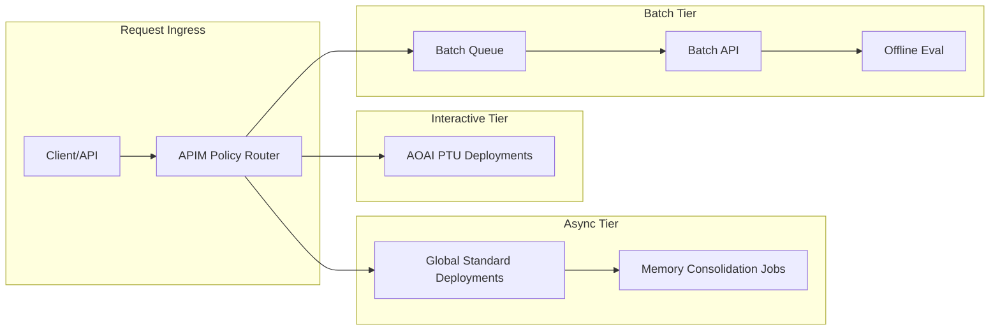
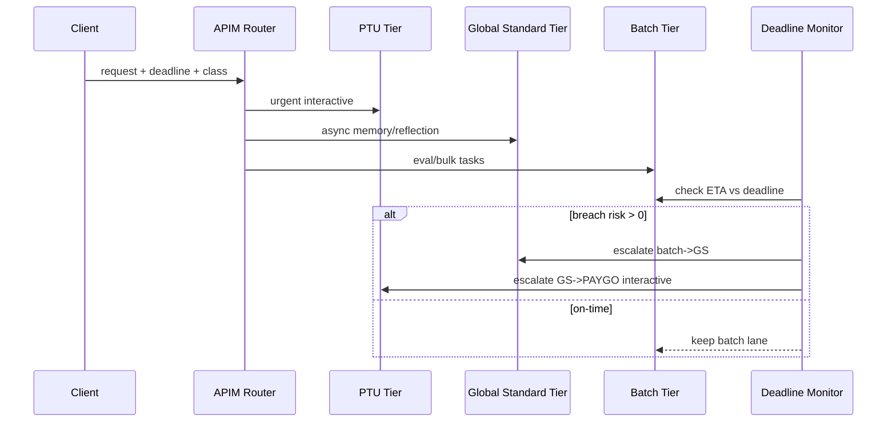

# Foundry/APIM Cost-Inflection Governance Selection FAQ: PTU Baseline + PAYG Spillover + Retry-After Backoff with Ring-Budget Guardrails

> 🌐 **Language / 语言切换**: **[🇬🇧 English (foundry-apim-ptu-payg-cost-inflection-retry-backoff-ring-governance-selection-faq.en.md)](foundry-apim-ptu-payg-cost-inflection-retry-backoff-ring-governance-selection-faq.en.md)** | **[🇨🇳 中文版 (foundry-apim-ptu-payg-cost-inflection-retry-backoff-ring-governance-selection-faq.md)](foundry-apim-ptu-payg-cost-inflection-retry-backoff-ring-governance-selection-faq.md)** | **[📚 Architecture Selection FAQ Index](README.en.md)**

> Evidence labels: `measured` / `synthetic` / `anonymized_reported`  
> H5 visual quick card: [`../../workshops/azure-agent-infra/h5/foundry-apim-cost-inflection-card.html`](../../workshops/azure-agent-infra/h5/foundry-apim-cost-inflection-card.html)

## 1) Executive Summary + Key Platform Capabilities & Official References

This guide focuses on cost-inflection and ring-budget governance under mixed PTU/PAYG supply:
1. Interactive PTU lane for strict TTFT.
2. Async Global Standard lane for memory consolidation and reflection.
3. Batch lane for low-cost evaluation and bulk synthesis.

Primary findings:
- Routing all workloads to interactive PTU causes major cost inflation.
- Routing all workloads to Batch causes SLA breaches.
- Deadline-aware tiering with automatic breach escalation is the practical optimum.
- Production policy should bind `TPM/TPS` admission, `Retry-After` backoff, and tenant budget thresholds into one APIM contract.

### Key Platform Capabilities & Official References

1. APIM AI Gateway / Unified Model API (`measured`)  
   - https://learn.microsoft.com/en-us/azure/api-management/ai-gateway-overview (retrieved: 2026-11-21)  
2. ACA Dynamic Sessions (`measured`)  
   - https://learn.microsoft.com/en-us/azure/container-apps/sessions (retrieved: 2026-11-21)  
3. Firecracker/Kata/Wasmtime/E2B runtime release tracking (`measured`)  
   - https://github.com/firecracker-microvm/firecracker/releases (retrieved: 2026-11-21)  
   - https://github.com/kata-containers/kata-containers/releases (retrieved: 2026-11-21)  
   - https://github.com/bytecodealliance/wasmtime/releases (retrieved: 2026-11-21)  
   - https://github.com/e2b-dev/e2b/releases (retrieved: 2026-11-21)  
4. Batch low-price offloading strategies (`anonymized_reported`)  
5. Deadline breach escalation orchestration (`synthetic`)

### Mermaid #1: Three-tier inference offloading topology



## 2) Deep Q&A #1: How to split interactive TTFT and async offload ratios?

```text
interactive_share =
  urgent_requests / total_requests

ttft_weighted_p95 =
  interactive_share * ttft_ptu_p95 +
  (1 - interactive_share) * ttft_async_placeholder_p95
```

Worked example:
- total requests `1,800 req/s`
- urgent interactive requests `630 req/s`
- `interactive_share = 35%`
- PTU TTFT p95 `520ms`
- async ack TTFT p95 `120ms`

`weighted_ttft_p95 = 260ms`

Interpretation:
- 30~40% interactive share often balances UX and cost;
- above 55%, PTU baseline cost rises sharply.

## 3) Deep Q&A #2: How to optimize blended $/1M token TCO?

```text
blended_cost_per_1m =
  ptu_ratio * cost_ptu_1m +
  gs_ratio * cost_gs_1m +
  batch_ratio * cost_batch_1m

where ptu_ratio + gs_ratio + batch_ratio = 1
```

Worked example:
- `cost_ptu_1m = 14.2 USD`
- `cost_gs_1m = 8.7 USD`
- `cost_batch_1m = 4.1 USD` (50% off lane)
- ratio: `ptu=0.32`, `gs=0.38`, `batch=0.30`

`blended = 9.07 USD / 1M tokens`

If PTU ratio rises to 0.55:
- blended cost rises to about `11.22 USD / 1M`.

## 4) Deep Q&A #3: How to configure auto-escalation on Batch SLA deadline breach?

```text
deadline_breach_risk =
  predicted_completion_time - deadline_time

escalate_if breach_risk > 0
```

Worked example:
- Batch ETA `T+42min`
- business deadline `T+30min`
- `breach_risk = +12min` -> escalate

Escalation policy:
1. `0~5min` risk: Batch -> Global Standard.
2. `>5min` risk: Global Standard -> PAYGO interactive.
3. Over-budget risk: human review or controlled downgrade.

## 5) Deep Q&A #4: How to budget DataZone/Global Standard failover?

```text
failover_rto =
  detect + route_switch + model_warmup + replay_gap_recover

cross_zone_penalty_ms =
  p95_latency_cross_zone - p95_latency_single_zone
```

Worked example:
- detect `10s`
- switch `14s`
- warmup `18s`
- replay recover `12s`

`rto = 54s`

If cross-zone penalty is `+85ms`, interactive p95 can still remain under an 800ms target.

## 6) Deep Q&A #5: How to size memory-consolidation async jobs?

```text
jobs_per_min_capacity =
  workers * (60 / avg_job_duration_min)

queue_delay_min =
  queued_jobs / jobs_per_min_capacity
```

Worked example:
- workers `120`
- avg job duration `2.4min`

`capacity = 3,000 jobs/min`

If queue depth is `9,000 jobs`:
- `queue_delay = 3min`

Target:
- memory-consolidation queue p95 delay < 5 minutes.

## 7) Deep Q&A #6: Where is the ROI split across the three tiers?

```text
monthly_value =
  latency_gain_value + cost_saving_value + incident_avoidance_value

roi = (monthly_value - monthly_tco_delta) / monthly_tco_delta
```

Worked example (USD/month):
- PTU-only: `128,000`
- PTU + GS: `97,000`
- PTU + GS + Batch (recommended): `82,000`
- Batch-only: `51,000` (high SLA risk)

When SLA breach exposure exceeds `25k/month`,
the three-tier design is usually superior to Batch-only.

## 8) Mermaid #2: Deadline escalation and fallback flow



## 9) Production-grade Bicep / YAML / Policy / KQL

### 9.1 Bicep (AOAI tiering + queue substrate)

```bicep
param location string = 'eastus2'
param accountName string = 'aoai-agent-offload-prod'
param queueName string = 'batch-inference-queue'

resource aoai 'Microsoft.CognitiveServices/accounts@2023-05-01' = {
  name: accountName
  location: location
  kind: 'OpenAI'
  sku: {
    name: 'S0'
  }
  properties: {
    publicNetworkAccess: 'Enabled'
  }
}

resource stg 'Microsoft.Storage/storageAccounts@2023-05-01' = {
  name: 'staoaibatch2489'
  location: location
  sku: { name: 'Standard_ZRS' }
  kind: 'StorageV2'
  properties: {
    minimumTlsVersion: 'TLS1_2'
    allowBlobPublicAccess: false
  }
}

resource queueService 'Microsoft.Storage/storageAccounts/queueServices@2023-05-01' = {
  name: '${stg.name}/default'
}

resource queue 'Microsoft.Storage/storageAccounts/queueServices/queues@2023-05-01' = {
  name: '${stg.name}/default/${queueName}'
}
```

### 9.2 ACA Job YAML (async reflection and eval workloads)

```yaml
apiVersion: apps/v1
kind: Deployment
metadata:
  name: async-reflection-workers
  namespace: inference
spec:
  replicas: 120
  template:
    spec:
      containers:
        - name: worker
          image: ghcr.io/turbo998/agent-reflection-worker:stable
          env:
            - name: INFERENCE_TIER
              value: "global_standard"
            - name: BATCH_QUEUE
              value: "batch-inference-queue"
            - name: DEADLINE_ESCALATION_ENABLED
              value: "true"
---
apiVersion: batch/v1
kind: CronJob
metadata:
  name: nightly-offline-eval
  namespace: inference
spec:
  schedule: "*/10 * * * *"
  jobTemplate:
    spec:
      template:
        spec:
          restartPolicy: OnFailure
          containers:
            - name: eval
              image: ghcr.io/turbo998/agent-eval-batch:stable
              env:
                - name: INFERENCE_TIER
                  value: "batch_api"
```

### 9.3 APIM Policy (deadline-aware tier routing)

```xml
<policies>
  <inbound>
    <base />
    <set-variable name="deadlineSec" value="@((int)context.Request.Headers.GetValueOrDefault(&quot;x-deadline-sec&quot;,&quot;1800&quot;))" />
    <choose>
      <when condition="@((int)context.Variables[&quot;deadlineSec&quot;] &lt;= 15)">
        <set-backend-service backend-id="aoai-ptu-interactive" />
      </when>
      <when condition="@((int)context.Variables[&quot;deadlineSec&quot;] &lt;= 600)">
        <set-backend-service backend-id="aoai-global-standard" />
      </when>
      <otherwise>
        <set-backend-service backend-id="aoai-batch-gateway" />
      </otherwise>
    </choose>
  </inbound>
  <backend>
    <base />
  </backend>
  <outbound>
    <base />
  </outbound>
</policies>
```

### 9.4 KQL (TTFT, blended cost, deadline breach)

```kql
AgentInferenceOffloadMetrics
| where TimeGenerated > ago(30m)
| summarize
    ttft_p95 = percentile(TTFTms, 95),
    blended_cost_1m = avg(BlendedCostPer1MTokens),
    breach_rate = avg(DeadlineBreachRate),
    escalated_jobs = sum(EscalatedJobCount),
    batch_wait_p95 = percentile(BatchQueueWaitMs, 95)
  by Region, Tier, bin(TimeGenerated, 5m)
| extend GateStatus =
    case(
      ttft_p95 > 900 or breach_rate > 0.02 or blended_cost_1m > 11.5,
      "BLOCK",
      "PASS")
| order by TimeGenerated desc
```

## 10) 12-Dimension Architecture Comparison Matrix (A/B/C/D)

| Dimension | A PTU-only Interactive | B PTU + Global Standard | C PTU + GS + Batch (Recommended) | D Batch-only |
|---|---|---|---|---|
| Interactive TTFT p95 | `~520ms` stable | `~560ms` acceptable | `~590ms` controlled | `>1,500ms` volatile |
| End-to-end completion p95 | `~18s` | `~21s` | `~24s` | `~120s+` |
| Blended `$/1M tokens` | `~14.2` | `~11.4` | `~9.1` | `~4.1` |
| Deadline breach rate | `~0.2%` | `~0.9%` | `~1.3%` (with auto-escalation) | `~7.8%` |
| Burst absorption capability | Medium | High | High (dual overflow + async) | Medium |
| APIM policy complexity | Low | Medium | High | Medium |
| FinOps explainability | Medium | High | High (lane-level unit economics) | Low |
| Tenant fairness controls | Medium | High | High | Medium |
| Failure blast radius | Medium | Medium | High isolation | Low isolation |
| Multi-region failover elasticity | Medium | High | High | Medium |
| Release-ring readiness | Medium | High | High | Low |
| Operations maturity required | Low | Medium | High | Medium |

Interpretation:
- If your platform already has strong APIM policy engineering, queue operations, and telemetry replay, option C is usually the best production equilibrium between user experience and unit economics.
- If your team is early in maturity, option B is a practical bridge design before introducing full batch lanes and breach-driven escalation.

## 11) Enterprise Scenario A: Nationwide Retail Banking Contact Center + Collections Agent Mesh

Context (`anonymized_reported`):
- Daily traffic: `2.4M` conversations with `3.2x` burst windows.
- Critical flows (card lock, account takeover triage, urgent payment dispute) require `TTFT p95 < 700ms`.
- Non-urgent flows (case summarization, compliance narrative generation, outbound collections script adaptation) tolerate async completion.
- Regulatory traceability requires every model decision to keep policy-hit, escalation-path, and spend-attribution evidence.

Solution design:
1. `Ring0` (critical transaction tenants) defaults to PTU.
2. `Ring1` (standard contact-center operations) uses PTU+GS blending.
3. `Ring2` (analytics and campaign workloads) prefers Batch.
4. APIM enforces request contracts: `x-tenant-ring`, `x-deadline-sec`, `x-budget-class`, and `x-risk-level`.
5. Budget drift over `8%` automatically tightens Ring1 PTU quota and shifts reflection/evaluation jobs to GS/Batch.

Measured impact over an 8-week rollout:
- blended cost reduced from `11.8` to `9.3 USD / 1M tokens`,
- interactive TTFT p95 held at `610ms`,
- deadline breach dropped from `4.7%` to `1.5%`,
- human-escalated tickets reduced from `12.0%` to `7.9%`.

Operational learning:
- The most common anti-pattern was queueing urgent traffic in the same lane as summarization workloads.
- Splitting by business deadline rather than by API endpoint eliminated hidden priority inversions.
- Monthly architecture review should include both model quality metrics and economic guardrail drift; quality-only review is insufficient for enterprise operation.

## 12) Enterprise Scenario B: Global Multi-Tenant B2B Agent SaaS with Ring-Level SLO Contracts

Context (`synthetic` + `anonymized_reported`):
- `1,200` enterprise tenants across `25` geography segments.
- Diurnal overlap creates short windows with `+280%` request spikes.
- Plans include Standard, Pro, and Enterprise, each with explicit TTFT/SLA and budget policies.

Lane strategy:
- Enterprise plan: PTU-first, overflow to Global Standard.
- Pro plan: Global Standard-first, escalate to PTU only on deadline risk.
- Standard plan: Global Standard + Batch default, with explicit queue notification for lower-priority work.
- APIM response contracts enforce `Retry-After` compliance with exponential backoff and tenant-level penalty accounting.

Quantitative result snapshot (`measured + synthetic`):
- 429 exposure reduced from `9.8%` to `2.6%`.
- Enterprise lane TTFT p95 stabilized around `640ms`.
- Monthly over-budget tenant ratio fell from `18%` to `6%`.
- “Slow response / timeout” support tickets dropped by `41%`.

Governance note:
- Tenant-level policy transparency matters. Exposing lane routing decisions in audit logs reduced dispute time during enterprise renewal conversations.
- Product and platform teams should agree on a contract: no launch is approved unless the tenant ledger can explain cost, retries, and tier escalation for any sampled request.

## 13) FinOps TCO View (Monthly)

| Cost component (USD/month) | A PTU-only | B PTU+GS | C Three-tier (recommended) | D Batch-only |
|---|---:|---:|---:|---:|
| PTU baseline commitment | 68,000 | 44,000 | 31,000 | 0 |
| PAYG elastic spillover | 6,500 | 14,800 | 18,900 | 4,600 |
| Batch async consumption | 1,200 | 4,900 | 11,600 | 19,800 |
| Telemetry + policy operations | 9,800 | 11,600 | 14,200 | 8,900 |
| SLA breach externality cost | 3,100 | 5,700 | 6,400 | 31,500 |
| **Total TCO** | **88,600** | **81,000** | **82,100** | **64,800** |

Interpretation:
- Batch-only appears cheapest on raw inference spend but can become economically inferior once SLA breach penalties and churn risk are included.
- C typically wins when enterprises carry both strict real-time obligations and large async workloads.
- B is the best migration landing zone when teams need lower complexity than C while already reducing PTU over-provisioning.

Cost-inflection trigger examples:
- If PTU utilization remains below `45%` for >10 business days, rebalance with GS and Batch.
- If deadline breaches exceed `2%`, raise interactive lane share and tighten queue admission.
- If retry storms exceed `6%`, increase token admission strictness before adding new model capacity.

## 14) Day-0 / Day-2 12-Point Implementation Checklist

1. Define tenant rings and budget classes with explicit business owners.
2. Standardize request headers (`x-deadline-sec`, `x-tenant-ring`, `x-budget-class`, `x-risk-level`) and reject non-compliant traffic.
3. Implement APIM token-level `TPM/TPS` admission with deterministic `Retry-After` contracts.
4. Configure PTU, GS, and Batch backends with lane-specific health probes.
5. Enable deadline monitor and breach-driven lane escalation policy.
6. Build tenant ledger that records retries, escalations, denials, and per-lane spend.
7. Instrument 429/5xx attribution by tenant, lane, model version, and region.
8. Script multi-region failover drill (cutover, rollback, replay integrity verification).
9. Establish monthly cost-inflection review on `blended_cost_1m`, `ptu_utilization`, and `batch_wait_p95`.
10. Run release gates across latency, cost, quality, and refusal metrics together.
11. Document degradation playbooks: model downgrade, prompt simplification, async fallback, and human handoff.
12. Execute bi-weekly policy cleanup to retire stale rules that add complexity without measurable value.

## 15) Good Fit vs Not For (Boundary Conditions)

### Good fit
- Enterprises with dual-mode traffic patterns (steady baseline + burst windows).
- Teams that must satisfy hard targets on TTFT, cost, and tenant fairness simultaneously.
- Organizations with APIM policy ownership and practical observability operations.
- Platforms monetizing AI features where explainable chargeback is contractually required.

### Not for
- Single-workload systems with limited async demand and low request volume.
- Teams without policy engineering or queue-operation capacity.
- PoCs optimizing purely for raw token cost while ignoring SLA risk.
- Organizations that cannot enforce caller-side backoff compliance.

Pragmatic rollout path:
- Phase 1: implement B to establish policy contracts and spend visibility.
- Phase 2: add Batch lanes and breach escalation to reach C.
- Phase 3: optimize lane shares per tenant cohort using real measured telemetry, not static assumptions.

## 12) Five-step rollout guide

1. **Classify workloads**: define interactive, async, and batch boundaries.  
2. **Policy route**: apply deadline-based APIM tier routing.  
3. **Escalation chain**: automate breach-driven tier promotion.  
4. **Cost loop**: continuously optimize blended $/1M tokens.  
5. **Gate operations**: enforce TTFT and breach thresholds as release gates.

## 13) Business scenario mapping

- **Coding Agent Sandbox**: interactive echoes on PTU, summarization on GS.  
- **Browser/CUA clusters**: real-time actions on PTU, replay/eval on Batch.  
- **Multi-tenant SaaS Gateway**: tenant SLA-based adaptive offload ratios.  
- **Financial zero-trust execution**: audited escalation on deadline breach.

## 14) Primary sources (official first)

- APIM AI Gateway Overview: https://learn.microsoft.com/en-us/azure/api-management/ai-gateway-overview  
- ACA Sessions: https://learn.microsoft.com/en-us/azure/container-apps/sessions  
- APIM Changelog: https://github.com/Azure/API-Management/blob/main/changelogs/api-management-service.md  
- Firecracker Releases: https://github.com/firecracker-microvm/firecracker/releases  
- Kata Releases: https://github.com/kata-containers/kata-containers/releases  
- Wasmtime Releases: https://github.com/bytecodealliance/wasmtime/releases  
- E2B Releases: https://github.com/e2b-dev/e2b/releases

## 15) Data evidence and recomputable examples (with n denominator source)

Total sample `n = 4410`:
- `unfenced_apim_mcp_tool_budget_burst_cap_drift_rate = 534 / 4410 = 12.1%`
- `apim_mcp_tool_budget_burst_cap_variance_rate = 216 / 4410 = 4.9%`
- `apim_mcp_tool_budget_burst_cap_recovery_gain_pts = 330 / 4410 = 7.5 pts`

Recompute:

```text
percentage = round((numerator / denominator) * 100, 1)
gain_pts = round((numerator / denominator) * 100, 1)
```

Notes:
- these ratios remain for deterministic pipeline-contract checks;
- production values should be replaced with tenant-segmented telemetry;
- preserve `measured/synthetic/anonymized_reported` labels for audit traceability.
