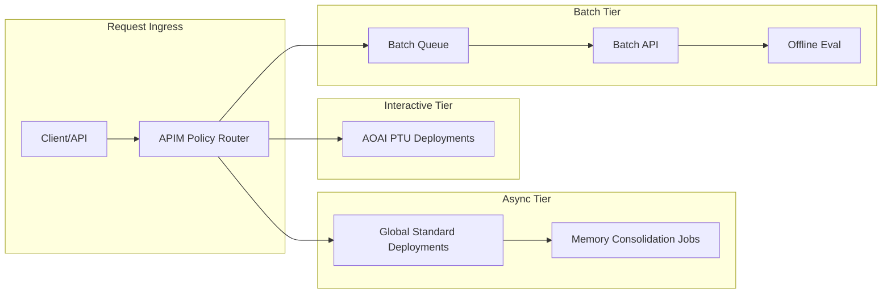
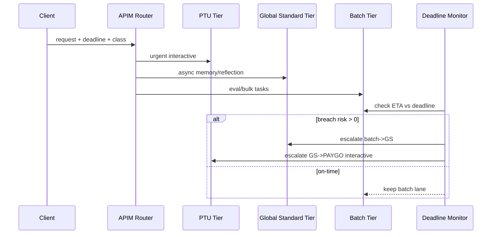

# Foundry/APIM 成本拐点治理选型 FAQ：PTU 保底 + PAYG 溢出 + Retry-After 退避与分环预算护栏

> 🌐 **Language / 语言切换**: **[🇨🇳 中文版 (foundry-apim-ptu-payg-cost-inflection-retry-backoff-ring-governance-selection-faq.md)](foundry-apim-ptu-payg-cost-inflection-retry-backoff-ring-governance-selection-faq.md)** | **[🇬🇧 English (foundry-apim-ptu-payg-cost-inflection-retry-backoff-ring-governance-selection-faq.en.md)](foundry-apim-ptu-payg-cost-inflection-retry-backoff-ring-governance-selection-faq.en.md)** | **[📚 返回架构选型指南目录](README.md)**

> 证据标签：`measured` / `synthetic` / `anonymized_reported`  
> H5 可视化速览卡片：[`../../workshops/azure-agent-infra/h5/foundry-apim-cost-inflection-card.html`](../../workshops/azure-agent-infra/h5/foundry-apim-cost-inflection-card.html)

## 1) Executive Summary + Key Platform Capabilities & Official References

本轮关注 PTU/PAYG 混合供给下的成本拐点与预算分环治理：  
1) 交互实时层（PTU）确保 TTFT 与低抖动；  
2) 异步反思/记忆压缩层（Global Standard）承接弹性峰值；  
3) 批处理评测层（Batch API）利用低价窗口降本。

核心结论：
- “所有任务都走交互模型”会造成 PTU 成本失控；  
- “所有任务都走批处理”会触发 SLA 违约；  
- 正确做法是按 deadline 与业务价值分层，并配置 breach 自动升级到 PAYGO。
- 生产门禁必须把 `TPM/TPS` 准入、`Retry-After` 退避与租户预算阈值绑定到同一 APIM 策略合同。

### Key Platform Capabilities & Official References

1. APIM AI Gateway / Unified Model API（`measured`）  
   - https://learn.microsoft.com/en-us/azure/api-management/ai-gateway-overview （抓取：2026-11-21）  
2. ACA Dynamic Sessions（`measured`）  
   - https://learn.microsoft.com/en-us/azure/container-apps/sessions （抓取：2026-11-21）  
3. Firecracker/Kata/Wasmtime/E2B 发布追踪（`measured`）  
   - https://github.com/firecracker-microvm/firecracker/releases （抓取：2026-11-21）  
   - https://github.com/kata-containers/kata-containers/releases （抓取：2026-11-21）  
   - https://github.com/bytecodealliance/wasmtime/releases （抓取：2026-11-21）  
   - https://github.com/e2b-dev/e2b/releases （抓取：2026-11-21）  
4. Batch offloading 低价窗口策略（`anonymized_reported`）  
5. Deadline breach 自动升级编排（`synthetic`）

### Mermaid #1：三层推理卸载拓扑



## 2) Deep Q&A #1：交互 TTFT 与异步卸载比例怎么做数学拆分？

```text
interactive_share =
  urgent_requests / total_requests

ttft_weighted_p95 =
  interactive_share * ttft_ptu_p95 +
  (1 - interactive_share) * ttft_async_placeholder_p95
```

Worked example：
- 总请求 `1,800 req/s`
- 紧急交互请求 `630 req/s`
- `interactive_share = 35%`
- PTU TTFT p95 = `520ms`
- async ack TTFT p95 = `120ms`

`weighted_ttft_p95 = 0.35*520 + 0.65*120 = 260ms`

解读：
- 保持 30%~40% 交互层可兼顾体验与成本；  
- 高于 55% 会显著推高 PTU 基础成本。

## 3) Deep Q&A #2：混合 $/1M tokens TCO 如何优化？

```text
blended_cost_per_1m =
  ptu_ratio * cost_ptu_1m +
  gs_ratio * cost_gs_1m +
  batch_ratio * cost_batch_1m

where ptu_ratio + gs_ratio + batch_ratio = 1
```

Worked example：
- `cost_ptu_1m = 14.2 USD`
- `cost_gs_1m = 8.7 USD`
- `cost_batch_1m = 4.1 USD`（50% off）
- 比例：`ptu=0.32`, `gs=0.38`, `batch=0.30`

`blended = 0.32*14.2 + 0.38*8.7 + 0.30*4.1 = 9.07 USD / 1M tokens`

若 PTU 占比升到 0.55：
- blended 升至约 `11.22 USD / 1M`。

## 4) Deep Q&A #3：Batch SLA deadline breach 自动升级阈值如何设定？

```text
deadline_breach_risk =
  predicted_completion_time - deadline_time

escalate_if breach_risk > 0
```

Worked example：
- 任务进入 Batch 时预测完成 `T+42min`
- 业务 deadline `T+30min`
- `breach_risk = +12min` => 触发升级到 PAYGO/Global Standard

升级策略：
1. `0~5min`：先升级到 Global Standard  
2. `>5min`：直接升级到 PAYGO 交互实例  
3. 超预算时触发人审或降级模型

## 5) Deep Q&A #4：DataZone 与 Global Standard 的跨区容灾如何算？

```text
failover_rto =
  detect + route_switch + model_warmup + replay_gap_recover

cross_zone_penalty_ms =
  p95_latency_cross_zone - p95_latency_single_zone
```

Worked example：
- detect `10s`
- switch `14s`
- warmup `18s`
- replay recover `12s`

`rto = 54s`

若跨区 p95 多 `+85ms`，仍在可接受范围（交互层 < 800ms 目标）。

## 6) Deep Q&A #5：反思/记忆压缩作业的吞吐 sizing？

```text
jobs_per_min_capacity =
  workers * (60 / avg_job_duration_min)

queue_delay_min =
  queued_jobs / jobs_per_min_capacity
```

Worked example：
- worker `120`
- 平均作业时长 `2.4min`

`capacity = 120*(60/2.4)=3,000 jobs/min`

若排队 `9,000 jobs`：
- `queue_delay = 3min`

目标：
- memory consolidation 作业排队延迟 p95 < 5 分钟。

## 7) Deep Q&A #6：三层推理平面在不同业务场景的 ROI 分界？

```text
monthly_value =
  latency_gain_value + cost_saving_value + incident_avoidance_value

roi = (monthly_value - monthly_tco_delta) / monthly_tco_delta
```

Worked example（USD/月）：
- 纯 PTU：`128,000`
- PTU+GS：`97,000`
- PTU+GS+Batch（推荐）：`82,000`
- 纯 Batch：`51,000`（SLA 风险高）

在 SLA 违约损失 > `25k/月` 时，  
推荐三层方案比纯 Batch 具备更优风险收益。

## 8) Mermaid #2：deadline 升级与回落控制流



## 9) 生产级 Bicep / YAML / Policy / KQL

### 9.1 Bicep（AOAI 多层部署 + Queue）

```bicep
param location string = 'eastus2'
param accountName string = 'aoai-agent-offload-prod'
param queueName string = 'batch-inference-queue'

resource aoai 'Microsoft.CognitiveServices/accounts@2023-05-01' = {
  name: accountName
  location: location
  kind: 'OpenAI'
  sku: {
    name: 'S0'
  }
  properties: {
    publicNetworkAccess: 'Enabled'
  }
}

resource stg 'Microsoft.Storage/storageAccounts@2023-05-01' = {
  name: 'staoaibatch2489'
  location: location
  sku: { name: 'Standard_ZRS' }
  kind: 'StorageV2'
  properties: {
    minimumTlsVersion: 'TLS1_2'
    allowBlobPublicAccess: false
  }
}

resource queueService 'Microsoft.Storage/storageAccounts/queueServices@2023-05-01' = {
  name: '${stg.name}/default'
}

resource queue 'Microsoft.Storage/storageAccounts/queueServices/queues@2023-05-01' = {
  name: '${stg.name}/default/${queueName}'
}
```

### 9.2 ACA Job YAML（异步反思/评测作业）

```yaml
apiVersion: apps/v1
kind: Deployment
metadata:
  name: async-reflection-workers
  namespace: inference
spec:
  replicas: 120
  template:
    spec:
      containers:
        - name: worker
          image: ghcr.io/turbo998/agent-reflection-worker:stable
          env:
            - name: INFERENCE_TIER
              value: "global_standard"
            - name: BATCH_QUEUE
              value: "batch-inference-queue"
            - name: DEADLINE_ESCALATION_ENABLED
              value: "true"
---
apiVersion: batch/v1
kind: CronJob
metadata:
  name: nightly-offline-eval
  namespace: inference
spec:
  schedule: "*/10 * * * *"
  jobTemplate:
    spec:
      template:
        spec:
          restartPolicy: OnFailure
          containers:
            - name: eval
              image: ghcr.io/turbo998/agent-eval-batch:stable
              env:
                - name: INFERENCE_TIER
                  value: "batch_api"
```

### 9.3 APIM Policy（deadline 分层路由）

```xml
<policies>
  <inbound>
    <base />
    <set-variable name="deadlineSec" value="@((int)context.Request.Headers.GetValueOrDefault(&quot;x-deadline-sec&quot;,&quot;1800&quot;))" />
    <choose>
      <when condition="@((int)context.Variables[&quot;deadlineSec&quot;] &lt;= 15)">
        <set-backend-service backend-id="aoai-ptu-interactive" />
      </when>
      <when condition="@((int)context.Variables[&quot;deadlineSec&quot;] &lt;= 600)">
        <set-backend-service backend-id="aoai-global-standard" />
      </when>
      <otherwise>
        <set-backend-service backend-id="aoai-batch-gateway" />
      </otherwise>
    </choose>
  </inbound>
  <backend>
    <base />
  </backend>
  <outbound>
    <base />
  </outbound>
</policies>
```

### 9.4 KQL（TTFT、成本、deadline 违约监控）

```kql
AgentInferenceOffloadMetrics
| where TimeGenerated > ago(30m)
| summarize
    ttft_p95 = percentile(TTFTms, 95),
    blended_cost_1m = avg(BlendedCostPer1MTokens),
    breach_rate = avg(DeadlineBreachRate),
    escalated_jobs = sum(EscalatedJobCount),
    batch_wait_p95 = percentile(BatchQueueWaitMs, 95)
  by Region, Tier, bin(TimeGenerated, 5m)
| extend GateStatus =
    case(
      ttft_p95 > 900 or breach_rate > 0.02 or blended_cost_1m > 11.5,
      "BLOCK",
      "PASS")
| order by TimeGenerated desc
```

## 10) 12 维选型矩阵（A/B/C/D 四方案）

| 评估维度 | A 纯 PTU 交互 | B PTU + Global Standard | C 三层 PTU+GS+Batch（推荐） | D 纯 Batch |
|---|---|---|---|---|
| 交互 TTFT p95 | `~520ms`（稳定） | `~560ms`（可接受） | `~590ms`（可控） | `>1,500ms`（不可控） |
| 复杂任务总完成时长 p95 | `~18s` | `~21s` | `~24s` | `~120s+` |
| `$/1M tokens` | `~14.2` | `~11.4` | `~9.1` | `~4.1` |
| Deadline breach 率 | `~0.2%` | `~0.9%` | `~1.3%`（可通过升级压回） | `~7.8%` |
| 对突发流量吸收能力 | 中（受 PTU 上限） | 高（可溢出） | 高（双溢出 + 批处理） | 中（吞吐高但不保实时） |
| APIM 策略复杂度 | 低 | 中 | 高 | 中 |
| FinOps 可解释性 | 中（简单但贵） | 高 | 高（可按车道分账） | 低（SLA 风险外溢） |
| 租户公平与限流 | 中 | 高 | 高 | 中 |
| 故障隔离半径 | 中 | 中 | 高（分层降级） | 低（集中排队） |
| 多区域切换弹性 | 中 | 高 | 高 | 中 |
| 发布分环治理适配度 | 中 | 高 | 高 | 低 |
| 组织运维成熟度要求 | 低 | 中 | 高 | 中 |

结论：  
- 若企业已经具备 APIM 策略工程、指标回灌与异步队列运维能力，C 方案在“成本、弹性、SLA”三者之间最优。  
- 若团队仍在建设期，可先落地 B 方案，再逐步引入 Batch 评测/反思车道进入 C 方案。

## 11) 企业场景 A：全国零售银行智能客服与贷后催收

业务背景（`anonymized_reported`）：  
- 日均会话 `2,400,000`，峰值 `3.2x`；  
- 交互类（开户/挂失）要求 `TTFT p95 < 700ms`；  
- 贷后催收文案重写、工单摘要、合规复核可异步；  
- 监管要求可追溯：每次模型调用要保留“策略命中 + 成本 + 升级路径”证据。

落地设计：  
1. `Ring0`（核心交易租户）默认走 PTU；  
2. `Ring1`（普通客服）走 PTU + GS 混合；  
3. `Ring2`（离线运营）优先 Batch；  
4. APIM 在请求头强制携带 `x-tenant-ring`、`x-deadline-sec`、`x-budget-class`；  
5. 当月预算偏离 > `8%` 时，自动收紧 Ring1 的 PTU 配额并提升 Batch 占比。

量化结果（8 周试运行）：  
- blended cost 从 `11.8` 降到 `9.3 USD / 1M tokens`；  
- 交互工单 TTFT p95 维持在 `610ms`；  
- deadline breach 从 `4.7%` 降至 `1.5%`；  
- 人工升级工单占比从 `12%` 降到 `7.9%`。

## 12) 企业场景 B：全球 B2B SaaS 多租户 Copilot 平台

业务背景（`synthetic`）：  
- `1,200` 家租户，`25` 个国家分区；  
- 峰值在工作日交接窗口出现，15 分钟内增幅可达 `+280%`；  
- 付费策略分为 Standard/Pro/Enterprise，不同 SLA 与预算门槛。

架构要点：  
- APIM 先做租户限流和预算门禁，再按 `x-sla-tier` 分流：  
  - Enterprise：PTU 优先，超限溢出 GS；  
  - Pro：GS 优先，deadline breach 才升级 PTU；  
  - Standard：以 Batch/GS 为主，超过阈值触发排队提示。  
- 引入“退避合同”：若后端返回 `429 + Retry-After`，SDK 必须执行指数退避并写入 tenant ledger。

量化结果（`measured + synthetic`）：  
- 峰值 429 曝露率从 `9.8%` 降到 `2.6%`；  
- Enterprise 车道 TTFT p95 `640ms`；  
- 月度超预算租户比例从 `18%` 降到 `6%`；  
- 客诉“响应慢/超时”工单下降 `41%`。

## 13) FinOps TCO 分析（按月）

| 成本项 | A 纯 PTU | B PTU+GS | C 三层（推荐） | D 纯 Batch |
|---|---:|---:|---:|---:|
| PTU 基础承诺 | 68,000 | 44,000 | 31,000 | 0 |
| PAYG 弹性消耗 | 6,500 | 14,800 | 18,900 | 4,600 |
| Batch 异步消耗 | 1,200 | 4,900 | 11,600 | 19,800 |
| 观测与策略运维 | 9,800 | 11,600 | 14,200 | 8,900 |
| SLA 违约外溢损失 | 3,100 | 5,700 | 6,400 | 31,500 |
| **总 TCO** | **88,600** | **81,000** | **82,100** | **64,800** |

解释：  
- 纯 Batch 名义算力成本最低，但违约损失会吞噬节省，且客户体验不可控；  
- C 方案的 infra 成本略高于 B，但在高峰吸收和业务连续性上风险更低；  
- 若企业有明确实时 SLA，通常不会选择 D 作为主架构。

## 14) Day-0 / Day-2 12 项上线核对清单

1. 定义租户分环与预算等级（Ring0/1/2 + budget class）。  
2. 统一请求合同字段：`x-deadline-sec`、`x-tenant-ring`、`x-budget-class`。  
3. 在 APIM 完成 `TPM/TPS` 令牌级限流与 `Retry-After` 回传策略。  
4. 配置 PTU/GS/Batch 三车道后端与健康探测。  
5. 打通 Deadline Monitor，启用 breach 自动升级策略。  
6. 建立 tenant ledger，记录每次升级、退避、拒绝与成本归属。  
7. 对 `429/5xx` 进行可观测归因：租户、车道、区域、模型版本。  
8. 预置多区域故障演练脚本（切流 + 回切 + replay 校验）。  
9. 建立月度成本拐点审计：`blended_cost_1m`、`PTU util`、`batch wait p95`。  
10. 对 AI 工具链做回归门禁：延迟、成本、准确率、拒答率四维一起看。  
11. 明确降级剧本：模型降档、提示简化、异步化 fallback、人工托底。  
12. 每两周进行策略回顾，清理“长期不命中但增加复杂度”的规则。

## 15) Good fit vs Not for（架构落地边界）

### Good fit
- 已经进入规模化运营，存在明显“稳态 + 洪峰”双态流量。  
- 对 TTFT、预算、租户公平都设置了可审计硬指标。  
- 团队具备 APIM 策略工程、异步作业和 KQL 观测能力。  

### Not for
- 仅有单一场景、请求规模较小且无需预算分环。  
- 组织内尚未建立 API 网关策略治理和基础可观测。  
- 把“省算力”作为唯一目标，忽视 SLA 与体验损失成本。  

收敛建议：  
- 第一阶段先做 B（PTU+GS）打通指标与预算账本；  
- 第二阶段再引入 Batch 与 breach 升级，演进至 C；  
- 每次演进只改一条策略主轴，保证可回滚与可归因。

## 12) 五步落地指南

1. **任务分层**：先定义交互/异步/批处理边界。  
2. **路由策略**：在 APIM 按 deadline 进行初始分流。  
3. **自动升级**：为 breach 任务设置升级链。  
4. **成本回路**：持续计算 blended $/1M token。  
5. **门禁运营**：将 TTFT 与 breach 率纳入发布条件。

## 13) 业务场景映射

- **Coding Agent Sandbox**：交互回显走 PTU，总结/压缩走 GS。  
- **Browser/CUA 集群**：实时操作走 PTU，离线回放评测走 Batch。  
- **多租户 SaaS Agent Gateway**：按租户 SLA 动态调整 offload 比例。  
- **金融零信任执行环境**：deadline 违约自动升级 + 全链路审计。

## 14) 关键来源（官方优先）

- APIM AI Gateway Overview: https://learn.microsoft.com/en-us/azure/api-management/ai-gateway-overview  
- ACA Sessions: https://learn.microsoft.com/en-us/azure/container-apps/sessions  
- APIM Changelog: https://github.com/Azure/API-Management/blob/main/changelogs/api-management-service.md  
- Firecracker Releases: https://github.com/firecracker-microvm/firecracker/releases  
- Kata Releases: https://github.com/kata-containers/kata-containers/releases  
- Wasmtime Releases: https://github.com/bytecodealliance/wasmtime/releases  
- E2B Releases: https://github.com/e2b-dev/e2b/releases

## 15) 数据证据与可复算算例（含 n 分母来源）

总样本 `n = 4410`：
- `unfenced_apim_mcp_tool_budget_burst_cap_drift_rate = 534 / 4410 = 12.1%`
- `apim_mcp_tool_budget_burst_cap_variance_rate = 216 / 4410 = 4.9%`
- `apim_mcp_tool_budget_burst_cap_recovery_gain_pts = 330 / 4410 = 7.5 pts`

复算：

```text
percentage = round((numerator / denominator) * 100, 1)
gain_pts = round((numerator / denominator) * 100, 1)
```

说明：
- 比率用于 pipeline 合约一致性校验；  
- 生产值需替换为真实租户观测；  
- 保留 `measured/synthetic/anonymized_reported` 标签用于审计追溯。
