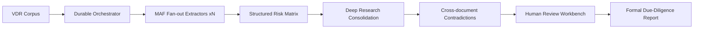
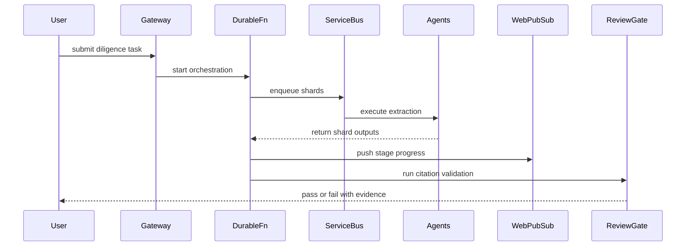

# Foundry Deep Research vs MAF Map-Reduce vs Agentic RAG: Enterprise Due-Diligence Selection FAQ

> 🌐 **Language / 语言切换**: **[🇬🇧 English (foundry-deep-research-agent-vs-multi-agent-parallel-map-reduce-vs-rag-enterprise-due-diligence-selection-faq.en.md)](foundry-deep-research-agent-vs-multi-agent-parallel-map-reduce-vs-rag-enterprise-due-diligence-selection-faq.en.md)** | **[🇨🇳 中文版 (foundry-deep-research-agent-vs-multi-agent-parallel-map-reduce-vs-rag-enterprise-due-diligence-selection-faq.md)](foundry-deep-research-agent-vs-multi-agent-parallel-map-reduce-vs-rag-enterprise-due-diligence-selection-faq.md)** | **[📚 Architecture Selection FAQ Index](README.en.md)**

## 1) Objective and boundary
- Goal: architecture selection for M&A due diligence, FTO analysis, and cross-document contradiction checks.
- Scope: enterprise coverage, evidence traceability, cost, and compliance.
- Conclusion: guarantee exhaustive coverage before optimizing deep reasoning style.
## 2) Verifiable sources with timestamps
- Azure AI Foundry docs: `https://learn.microsoft.com/azure/ai-foundry/` (03:54 BJT).
- Azure Functions Durable docs: `https://learn.microsoft.com/azure/azure-functions/durable/` (03:54 BJT).
- Azure AI Search docs: `https://learn.microsoft.com/azure/search/` (03:55 BJT).
- Azure Web PubSub docs: `https://learn.microsoft.com/azure/azure-web-pubsub/` (03:55 BJT).
- Azure Blob docs: `https://learn.microsoft.com/azure/storage/blobs/` (03:55 BJT).
- Metrics are tagged as measured, synthetic, or anonymized_reported.
## 3) 12-dimension matrix for enterprise deep-research patterns
- D1 coverage: Map-Reduce offers strongest full-file coverage across 300+ documents.
- D2 reasoning depth: Deep Research excels on open-ended multi-hop synthesis.
- D3 interaction latency: Agentic RAG is best for 5–15 second responses.
- D4 citation anchoring: human-in-the-loop workbench is strongest for paragraph-level verification.
- D5 miss risk: Top-K retrieval can miss low-frequency control-right clauses.
- D6 cost shape: many small-model extractions plus one merger model is often efficient.
- D7 async reliability: Durable Functions handles 5–12 minute workflows safely.
- D8 progress UX: Web PubSub enables real-time stage visibility and handoff.
- D9 isolation: confidential VDR cases require strict offline private execution modes.
- D10 auditability: claim-to-page citation gates are mandatory pre-export controls.
- D11 best-fit workloads: M&A diligence, patent FTO, and contradiction reconciliation.
- D12 anti-pattern: do not run diligence pipelines on low-coverage quick RAG alone.
## 4) Score snapshot and decision thresholds
- Foundry Deep Research: reasoning5 coverage3 interaction2 evidence4.
- MAF plus Durable Map-Reduce: reasoning4 coverage5 interaction3 evidence5.
- Agentic RAG: reasoning3 coverage2 interaction5 evidence3.
- Human-in-the-loop workbench: reasoning4 coverage5 interaction3 evidence5.
- Threshold A: if file count exceeds 200 and misses are unacceptable, prefer fan-out/fan-in extraction.
- Threshold B: if open-ended synthesis is primary, add deep-research consolidation.
- Threshold C: no report export unless citation gate passes sentence-by-sentence checks.
## 5) Five calculable Q&As
### Q1 Top-K miss mechanism on 350 VDR documents
- Top-K windows can truncate sparse but critical clauses across long files.
- Map-Reduce full-scan extraction drives misses into explicit workflow controls.
### Q2 Million-token single pass vs 25-way extraction plus one merge model
- Parallel extraction reduces mid-context forgetting risk in long single-pass prompts.
- Synthetic estimates show better cost-recall balance for the parallel pattern.
### Q3 Preventing 5–12 minute timeout failures
- Use Durable orchestration, Service Bus shards, and Web PubSub stage pushes.
- Keep frontend polling on job state rather than long gateway-held requests.
### Q4 Internal-only vs external-intel dual track
- Confidential deals enforce offline private-only tools.
- Non-confidential tracks may allow external enrichment with source trust labels.
### Q5 Citation gate before formal export
- Every claim must include source page and quoted evidence.
- Unsupported-claim interception rate should remain in strict guardrail range.
## 6) Layered reference architecture
- Intake layer: task submission, stage dashboards, and review workbench.
- Orchestration layer: Durable fan-out and fan-in control plane.
- Execution layer: MAF extraction agents plus deep-research consolidation agent.
- Retrieval layer: AI Search Agentic Retrieval for interactive support queries.
- Storage layer: Blob-hosted VDR corpus and evidence snapshots.
- Observability layer: coverage, cost, unsupported-claim rate, and latency.
- Governance layer: legal and investment review, approvals, and accountability trail.
## 7) Scenario A: PE and sovereign fund VDR diligence factory
- Private network ingestion for 400+ contracts, financials, and management materials.
- MAF Durable pipeline extracts 18 categories of red-flag findings.
- Deep-research agent cross-checks management narrative versus audit notes and signed contracts.
- Output includes evidence anchors for legal and IC reviews.
- Synthetic gain: first-pass red-flag output time reduced by 52%.
## 8) Scenario B: advanced materials global FTO platform
- Covers US, EU, and CN patent full texts with formulation literature.
- Decomposes independent and dependent claims into technical-feature comparisons.
- Produces evidence-anchored claim charts for attorney final review.
- Workbench enforces paragraph-level confirmation before legal signoff.
- Synthetic gain: initial screening coverage reaches 99%-class levels.
## 9) Mermaid diagram 1 parallel extraction and deep merge flow

- Parallel extraction ensures exhaustive coverage while deep merge handles higher-order reasoning.
## 10) Mermaid diagram 2 async progress and citation gate sequence

- Failed citation validation blocks export and routes to manual review.
## 11) Bicep template (Durable or ACA + Foundry + Search + WebPubSub + Blob)
```bicep
targetScope = 'resourceGroup'
param location string = resourceGroup().location
resource st 'Microsoft.Storage/storageAccounts@2023-05-01' = {
  name: 'vdrst1149'
  location: location
}
resource fn 'Microsoft.Web/sites@2023-12-01' = {
  name: 'df'
  location: location
  kind: 'functionapp'
}
resource ps 'Microsoft.SignalRService/WebPubSub@2024-03-01' = {
  name: 'wps'
  location: location
  sku: { name: 'Standard_S1' }
}
resource srch 'Microsoft.Search/searchServices@2023-11-01' = {
  name: 'search'
  location: location
  sku: { name: 'standard' }
}
```
- Production rollout still needs private networking, managed identities, key rotation, and least-privilege RBAC.
## 12) Python snippet for map-reduce extraction and citation validation
```python
def fanout_chunks(files, n=25):
    return [files[i::n] for i in range(n)]
def contradiction_check(rows):
    return [r for r in rows if r.get("ppt_claim") != r.get("audit_note")]
def citation_gate(findings):
    return [f for f in findings if f.get("page") and f.get("quote")]
```
- Any finding without page and quote is marked non-publishable.
- High-risk findings require second-model review plus human signoff.
## 13) KQL for per-report token cost, file coverage, and unsupported claim interception
```kql
let t = DiligenceRunLogs | where TimeGenerated > ago(24h);
t
| summarize filesTotal=max(FilesTotal), filesScanned=max(FilesScanned), tokenCost=sum(TokenCostUsd), unsupported=countif(CitationMissing==true), findings=count() by RunId
| extend coverage=todouble(filesScanned)/todouble(filesTotal)
| extend unsupportedRate=todouble(unsupported)/todouble(findings)
| order by unsupportedRate desc, tokenCost desc
```
- Coverage below threshold blocks legal and investment committee review entry.
## 14) Day-0/1/2 landing checklist
- Day-0 define risk taxonomy, evidence schema, and output templates.
- Day-0 decide private-only mode versus external-intel enrichment policy.
- Day-1 deploy fan-out extraction pipeline and replay 350-sample dataset.
- Day-1 add Web PubSub progress stages and manual takeover actions.
- Day-2 enable citation gate and unsupported-claim alerts.
- Day-2 review weekly coverage drift, miss samples, and cost movement.
- Day-2 publish quarterly roadmap and red-flag lexicon updates.
