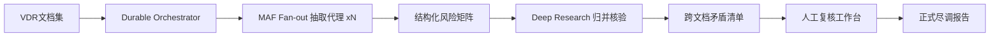
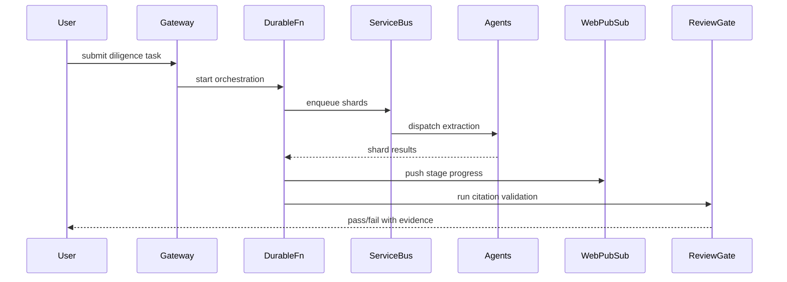

# Foundry Deep Research vs MAF Map-Reduce vs Agentic RAG：企业尽调深度研究选型 FAQ

> 🌐 **Language / 语言切换**: **[🇨🇳 中文版 (foundry-deep-research-agent-vs-multi-agent-parallel-map-reduce-vs-rag-enterprise-due-diligence-selection-faq.md)](foundry-deep-research-agent-vs-multi-agent-parallel-map-reduce-vs-rag-enterprise-due-diligence-selection-faq.md)** | **[🇬🇧 English (foundry-deep-research-agent-vs-multi-agent-parallel-map-reduce-vs-rag-enterprise-due-diligence-selection-faq.en.md)](foundry-deep-research-agent-vs-multi-agent-parallel-map-reduce-vs-rag-enterprise-due-diligence-selection-faq.en.md)** | **[📚 返回架构选型指南目录](README.md)**

## 1) 研究目标与边界
- 目标：服务并购尽调、FTO 排查与百份文档交叉核验场景。
- 范围：聚焦企业架构、覆盖率、证据链、成本与合规。
- 结论：先保证“全量覆盖”，再追求“深度推理表现”。
## 2) 可验证来源与时间戳
- Azure AI Foundry 文档：`https://learn.microsoft.com/azure/ai-foundry/`（抓取 03:54 BJT）。
- Azure Functions Durable 文档：`https://learn.microsoft.com/azure/azure-functions/durable/`（抓取 03:54 BJT）。
- Azure AI Search Agentic Retrieval：`https://learn.microsoft.com/azure/search/`（抓取 03:55 BJT）。
- Azure Web PubSub：`https://learn.microsoft.com/azure/azure-web-pubsub/`（抓取 03:55 BJT）。
- Blob 存储文档：`https://learn.microsoft.com/azure/storage/blobs/`（抓取 03:55 BJT）。
- 数据标签统一 measured/synthetic/anonymized_reported。
## 3) 四类企业深度研究架构 12 维矩阵
- 维度1覆盖率：Map-Reduce 对 300+ 文件全量覆盖最强。
- 维度2推理深度：Deep Research 对开放问题多跳推演更强。
- 维度3交互时延：Agentic RAG 在 5–15 秒问答最优。
- 维度4证据锚定：人机协同工作台对逐段引用核验最强。
- 维度5漏检风险：Top-K RAG 可能遗漏控制权条款。
- 维度6成本形态：并行小模型抽取+单路大模型归并常更经济。
- 维度7异步可靠性：Durable Functions 对 5–12 分钟任务更稳。
- 维度8进度可视化：Web PubSub 可实现阶段推送与人工介入。
- 维度9隔离需求：涉密VDR必须支持纯内网运行模式。
- 维度10审计要求：论断-页码逐句核验门是出报告前提。
- 维度11最佳场景：并购尽调、专利FTO、跨文档矛盾核验。
- 维度12反模式：禁止把低覆盖快问答当作尽调主引擎。
## 4) 评分与决策阈值
- Foundry Deep Research：推理5、覆盖3、交互2、证据4。
- MAF+Durable Map-Reduce：推理4、覆盖5、交互3、证据5。
- Agentic RAG：推理3、覆盖2、交互5、证据3。
- 人机协同工作台：推理4、覆盖5、交互3、证据5。
- 阈值A：文件数>200 且漏检不可接受时，优先并行分治。
- 阈值B：研判开放性高且需外部情报时，引入深度研究代理。
- 阈值C：正式报告前必须通过逐句锚点核验门禁。
## 5) 五组可复算 Q&A
### Q1 350份VDR文档下 Top-K 漏检机理
- Top-K RAG 受召回窗口限制，跨文档低频条款易被截断。
- Map-Reduce 全量逐份抽取可把漏检风险压到流程层可控。
### Q2 百万上下文 vs 25路并行抽取+1路归并
- 并行小模型抽取可降低单路长上下文遗忘风险。
- synthetic估算：并行方案在成本与召回平衡上更优。
### Q3 5–12分钟异步任务防超时
- Durable Functions 编排 + Service Bus 分片 + Web PubSub 阶段推送。
- 前端只追踪任务状态，不阻塞网关请求生命周期。
### Q4 内网隔离与外网情报双轨策略
- 涉密项目强制禁外网，仅允许VDR内网工具链。
- 非涉密可开放行业情报补证，但需分级标注来源可信度。
### Q5 导出前引用校验门
- 每条结论必须绑定原文页码和段落锚点。
- 无据论断拦截率应持续维持在高阈值区间。
## 6) 分层参考架构
- 接入层：任务提交、阶段看板、复核工作台。
- 编排层：Durable orchestrator + fan-out/fan-in。
- 执行层：MAF并行抽取代理与Deep Research归并代理。
- 检索层：AI Search Agentic Retrieval 作为交互补充。
- 存储层：Blob VDR 文档与证据快照仓。
- 观测层：覆盖率、成本、无据拦截率与时延。
- 治理层：法务/投研复核、发布审批与追责链。
## 7) 场景A：PE与主权基金VDR尽调工场
- 私网接入 400+ 份合同、财报、路演材料。
- MAF Durable 并行抽取 18 类红旗风险。
- 深度推理代理交叉比对管理层PPT与审计附注差异。
- 输出逐条证据锚点供法务和投决会复核。
- synthetic收益：首轮风险清单产出时间缩短 52%。
## 8) 场景B：精细化工新材料 FTO 侵权排查平台
- 覆盖美欧中专利全文与配方文献。
- 对独立/从属权利要求按技术特征逐条拆解比对。
- 自动生成带证据锚点的 Claim Chart。
- 专利律师在工作台逐段确认后出具法律意见。
- synthetic收益：初筛覆盖率提升到 99% 级。
## 9) Mermaid 图1：并行分治+深度归并流

- 分治保证全量覆盖，归并保证高阶推理。
## 10) Mermaid 图2：异步进度推送与引用校验时序

- 引用校验失败则阻断报告导出并进入人工复核。
## 11) Bicep 模板（Durable/ACA + Foundry + Search + WebPubSub + Blob）
```bicep
targetScope = 'resourceGroup'
param location string = resourceGroup().location
resource st 'Microsoft.Storage/storageAccounts@2023-05-01' = {
  name: 'vdrst1149'
  location: location
}
resource fn 'Microsoft.Web/sites@2023-12-01' = {
  name: 'df'
  location: location
  kind: 'functionapp'
}
resource ps 'Microsoft.SignalRService/WebPubSub@2024-03-01' = {
  name: 'wps'
  location: location
  sku: { name: 'Standard_S1' }
}
resource srch 'Microsoft.Search/searchServices@2023-11-01' = {
  name: 'search'
  location: location
  sku: { name: 'standard' }
}
```
- 生产需补齐私网、托管身份、密钥轮换与最小权限。
## 12) Python 片段：MAF并行抽取 + 矛盾核验 + 引用校验
```python
def fanout_chunks(files, n=25):
    return [files[i::n] for i in range(n)]
def contradiction_check(rows):
    return [r for r in rows if r.get("ppt_claim") != r.get("audit_note")]
def citation_gate(findings):
    return [f for f in findings if f.get("page") and f.get("quote")]
```
- 任一结论无页码或原文引句即判定为不可发布。
- 高风险结论需二次模型复核并进入人工确认队列。
## 13) KQL：单份报告成本/覆盖率/无据拦截率
```kql
let t = DiligenceRunLogs | where TimeGenerated > ago(24h);
t
| summarize filesTotal=max(FilesTotal), filesScanned=max(FilesScanned), tokenCost=sum(TokenCostUsd), unsupported=countif(CitationMissing==true), findings=count() by RunId
| extend coverage=todouble(filesScanned)/todouble(filesTotal)
| extend unsupportedRate=todouble(unsupported)/todouble(findings)
| order by unsupportedRate desc, tokenCost desc
```
- coverage 未达阈值时不得进入投决或法务终审环节。
## 14) Day-0/1/2 落地清单
- Day-0：定义风险分类、证据字段、报告模板。
- Day-0：确定内网隔离模式与外网补证策略。
- Day-1：上线并行抽取链并做 350 份样本回放。
- Day-1：接入Web PubSub阶段进度和人工接管按钮。
- Day-2：上线引用校验门与无据拦截告警。
- Day-2：周度复盘覆盖率、漏检样本与成本漂移。
- Day-2：形成季度优化路线图和红旗词典迭代机制。
