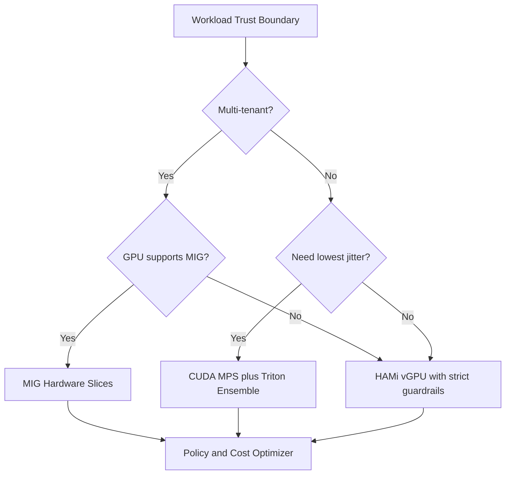
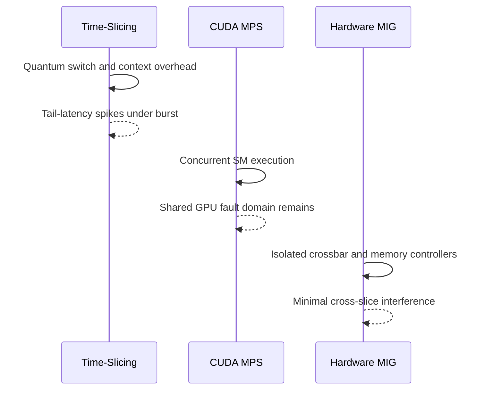

# Enterprise Fractional-GPU Auxiliary Model Serving Selection FAQ (MIG vs CUDA MPS vs HAMi vGPU vs Time-Slicing)
> Topic ID: #468
> Section: 3.2 Model Serving, Tiered Routing, Fine-Tuning, and GPU Orchestration
> Audience: GPU platform teams, inference engineering teams, Agent RAG/voice/CUA architects, FinOps and capacity-governance leaders
> Goal: maximize GPU utilization for auxiliary micro-model meshes while preserving strict tail-latency stability and bounded fault domains

## 1) Production problem: auxiliary models are small, numerous, and latency-sensitive
Production agent systems rarely run a single model.
End-to-end quality is often gated by multiple auxiliary hops.
Typical chains include embedding, reranking, guardrail classification, ASR, and OCR.
Each model often consumes only `1.5–8GB` VRAM but has strict `P99` budgets.
Assigning one full `A100` or `A10` per micro-model strands most of the GPU.
Using naive time-slicing can create severe tail-jitter and cross-pod OOM cascades.
The core platform question is how to partition a GPU into predictable, governable fractions.

## 2) Why naive time-slicing fails in online paths
Time-slicing is temporal multiplexing and does not provide hard VRAM isolation.
A single dynamic batch spike can pressure neighbors in the same card context.
Frequent context switching can amplify `P99` latency under burst.
For reranker and guardrail chains with tight millisecond SLOs, this jitter is directly user-visible.
Online paths usually require spatial isolation first and temporal sharing second.

## 3) Four architecture paths
Pattern A: `NVIDIA MIG` hardware spatial partitioning for regulated multi-tenant micro-model meshes.
Pattern B: `CUDA MPS` thread-percentage partitioning on non-MIG cards for single-tenant cost-optimized pipelines.
Pattern C: `CNCF HAMi vGPU` fine-grained memory/core scheduling for heterogeneous GPU pools.
Pattern D: anti-pattern (high-replica time-slicing on online paths or static one-model-per-whole-GPU overprovisioning).

## 4) Twelve-dimension comparison matrix
| Dimension | Pattern A (MIG) | Pattern B (CUDA MPS) | Pattern C (HAMi vGPU) | Pattern D (anti-pattern) |
|---|---|---|---|---|
| Hardware VRAM isolation | High | Medium | Medium-high | Low |
| SM/L2 interference isolation | High | Medium | Medium | Low |
| Fault blast radius | Low | Medium | Medium | High |
| Azure SKU compatibility | Medium (A100/H100 class) | High (A10/L40S class) | High (heterogeneous) | High |
| `P99` jitter control | High | Medium-high | Medium | Low |
| Partition granularity | Medium (fixed geometry) | Medium (percentage) | High (fine-grained) | Low |
| Dynamic reconfiguration agility | Medium | High | Medium-high | High but unstable |
| Operational complexity | Medium-high | Medium | High | Low |
| Observability depth | High | Medium-high | Medium-high | Low |
| Multi-tenant compliance fit | High | Medium | Medium-high | Low |
| Cost optimization potential | High | High | High | Low |
| Enterprise recommendation | Primary for regulated multi-tenant | Primary for non-MIG single-tenant | Optional for heterogeneous scheduling | Disallow |

## 5) Pattern A: MIG hardware slices (primary for strong multi-tenant isolation)
MIG partitions SMs, memory controllers, and cache resources in hardware.
That makes interference boundaries explicit and auditable.
For finance, public sector, and cross-BU shared clusters, MIG improves both utilization and governance clarity.
The trade-off is fixed geometry profiles that require careful packing strategy.
It also requires MIG-capable GPU classes and cannot cover every budget-oriented SKU.

## 6) Pattern B: CUDA MPS (primary for non-MIG cost optimization)
On `A10/L40S` class cards, MPS is a practical spatial-sharing mechanism.
`CUDA_MPS_ACTIVE_THREAD_PERCENTAGE` and memory-limit settings allow multiple micro-models to run concurrently.
Compared with plain time-slicing, MPS can reduce context-switch-driven tail inflation.
However, MPS keeps a shared GPU failure domain and should not mix mutually untrusted tenants.
Best fit is single-tenant or tightly governed pipeline sharing with explicit budgets.

## 7) Pattern C: HAMi vGPU (primary for heterogeneous pool governance)
HAMi offers fine-grained memory and core scheduling abstractions across mixed GPU fleets.
Model teams can keep standard Kubernetes deployment workflows.
Compared with fixed MIG geometry, HAMi can reduce fragmentation in mixed-demand pools.
The trade-off is stronger dependency on driver/hook compatibility and upgrade validation discipline.
HAMi is powerful as a scheduling control plane, not a universal substitute for hard-isolation requirements.

## 8) Pattern D: anti-pattern checklist
Using high-replica time-slicing for online critical paths without memory hard caps.
Running `<6GB` models as one full high-end GPU per model for long periods.
Ignoring Xid-driven fault propagation and lacking automatic drain/remediation.
Optimizing for mean latency while ignoring `P99` and `P99.9`.
These designs typically fail both cost and stability targets as scale grows.

## 9) Mermaid: capability and partitioning decision topology


## 10) Mermaid: execution timeline and fault-boundary contrast


## 11) Quantitative Q1-Q6 formulas and thresholds
Q1: slice VRAM budget.
`VRAM_slice >= W_model + Act_peak + CUDA_ctx_overhead`.
Q2: MIG geometry waste.
`Waste_MIG = 1 - sum(Used_i) / Total_HBM`.
Q3: MPS compute partition.
`SM_i = floor(SM_total * Pct_i / 100)` with `sum(Pct_i) <= 100`.
Q4: capacity safety factor.
Production target: `sum(VRAM_i) <= 0.88 * HBM_total`.
Q5: tail-latency gate.
Auxiliary path target: `P99 <= 25ms`; beyond this threshold triggers reallocation or load shedding.
Q6: fault gate.
If `Xid_rate` exceeds threshold or `FB_USED` jitter is abnormal, drain that GPU and rebalance.

## 12) Production code block 1: GPU Operator MIG strategy (YAML)
```yaml
apiVersion: nvidia.com/v1
kind: ClusterPolicy
metadata:
  name: gpu-cluster-policy
spec:
  mig:
    strategy: mixed
  migManager:
    enabled: true
---
apiVersion: v1
kind: ConfigMap
metadata:
  name: custom-mig-config
  namespace: gpu-operator
data:
  config.yaml: |
    version: v1
    mig-configs:
      all-balanced:
      - devices: all
        mig-enabled: true
        mig-devices:
          "1g.10gb": 4
          "2g.20gb": 2
```

## 13) Production code block 2: MPS deployment on A10 class (Kubernetes)
```yaml
apiVersion: apps/v1
kind: Deployment
metadata:
  name: aux-model-mps
spec:
  replicas: 1
  template:
    spec:
      containers:
        - name: mps-daemon
          image: nvcr.io/nvidia/cuda:12.4.1-runtime-ubuntu22.04
          command: ["bash","-lc","nvidia-cuda-mps-control -d && sleep infinity"]
          env:
            - name: CUDA_MPS_ACTIVE_THREAD_PERCENTAGE
              value: "35"
            - name: CUDA_MPS_PINNED_DEVICE_MEM_LIMIT
              value: "0=6G"
        - name: reranker
          image: ghcr.io/contoso/reranker:latest
          env:
            - name: CUDA_MPS_ACTIVE_THREAD_PERCENTAGE
              value: "30"
```

## 14) Production code block 3: binpacking and P99 validator (Python)
```python
from dataclasses import dataclass

@dataclass
class ModelSlice:
    name: str
    vram_gb: float
    sm_pct: int
    p99_ms: float

def validate_budget(slices, total_vram_gb: float) -> bool:
    vram_ok = sum(s.vram_gb for s in slices) <= 0.88 * total_vram_gb
    sm_ok = sum(s.sm_pct for s in slices) <= 100
    slo_ok = all(s.p99_ms <= 25.0 for s in slices)
    return vram_ok and sm_ok and slo_ok

def placement_decision(slices, gpu_type: str) -> str:
    if gpu_type in {"A100", "H100"}:
        return "prefer_mig" if validate_budget(slices, 80.0) else "scale_out"
    return "prefer_mps" if validate_budget(slices, 24.0) else "scale_out"
```

## 15) Enterprise scenarios and three-tier three-year TCO
### 15.1 Scenario A: regulated multi-BU financial agent hub
Six business units deployed `28` auxiliary models in one shared platform.
The platform adopted mixed MIG profiles on `A100` clusters for strict slice-level boundaries.
Tail latency remained stable while GPU count was reduced dramatically versus whole-card allocations.
Audit teams also gained clearer isolation evidence per business unit.
The program achieved lower cost with improved policy explainability.
### 15.2 Scenario B: e-commerce multimodal search and voice service
The workload ran on non-MIG classes where legacy time-slicing caused severe high-peak jitter.
The team migrated to MPS-based partitioning for embedding, reranking, ASR, and guardrail models.
Auxiliary path latency dropped from triple-digit milliseconds to stable two-digit ranges.
GPU spend also declined materially due to better fractional packing.
The architecture kept operational complexity manageable without forcing full migration to high-end MIG-only fleets.
### 15.3 Three-tier TCO
| Tier | Auxiliary model scale | Recommended combination | Three-year blended TCO |
|---|---:|---|---:|
| Tier-1 | 12 models | B primary + C scheduling buffer | `$2.9M` |
| Tier-2 | 36 models | A + B hybrid | `$8.4M` |
| Tier-3 | 90 models | A isolation core + B cost pool + C orchestration | `$20.7M` |
### 15.4 Fine-grained architecture implementation points
Start by defining trust boundaries before selecting scheduler mechanics.
If regulation requires tenant-level blast-radius control, prioritize hard spatial partitions over convenience defaults.
On non-MIG fleets, treat MPS as a controlled single-tenant optimization mechanism.
Before introducing HAMi, establish a strict driver compatibility and rollback matrix.
Keep a standard resource profile per model that includes VRAM, SM, and tail-latency envelopes.
Capacity plans should optimize both utilization and tail behavior, not utilization alone.
Guardrail models usually need stricter latency budgets than retrieval enrichers.
Adopt progressive traffic rollout so partitioning regressions are detected under bounded exposure.
Observe `FB_USED`, SM usage, Xid events, queue depth, and `P99/P99.9` together.
When memory fragmentation rises, trigger proactive rebalancing before OOM conditions form.
Every MIG or MPS policy change needs an automated rollback companion.
Present cost, latency, and isolation grade in one decision panel for balanced governance.
Quarterly reviews should include not only GPU savings but also latency stability evidence.
Reserve slice redundancy for critical safety and compliance micro-models.
Separate online and offline workloads so batch bursts do not steal online latency budgets.
Require model teams to submit updated resource profiles with each release.
Cross-region DR should preserve compatible partition policies to avoid failover performance cliffs.
Treat auxiliary-model pools as first-class cost centers with dedicated chargeback signals.
Document exactly where time-slicing is forbidden to avoid accidental policy drift.
As organizations scale, formalize arbitration for cross-team GPU quota conflicts.
Retrospectives should track blast radius, recovery time, and false-positive remediation cost.
Revisit A/B/C mix continuously as GPU generations and service economics evolve.
### 15.5 Day-0 / Day-1 / Day-2 engineering runbook (18 actions)
Day-0: define auxiliary model categories and trust labels.
Day-0: complete GPU capability inventory (MIG/non-MIG/heterogeneous).
Day-0: publish MIG, MPS, and HAMi admission policies.
Day-0: establish baseline VRAM and `P99` profiles per model.
Day-0: set packing safety factors and alert thresholds.
Day-0: define Xid-driven drain and recovery policy.
Day-1: deploy MIG pool and validate slice placement and jitter targets.
Day-1: deploy MPS pool and validate thread/memory ceilings.
Day-1: deploy HAMi pool and validate compatibility and rollback.
Day-1: publish unified observability and cost dashboards.
Day-1: execute OOM and fault-injection drills to verify blast-radius limits.
Day-1: complete online/offline separation policy integration.
Day-2: review weekly packing efficiency and tail-jitter trends.
Day-2: review weekly Xid events and auto-recovery success rates.
Day-2: review monthly model-profile drift and placement policy fit.
Day-2: review monthly cost per million auxiliary inferences.
Day-2: run quarterly DR consistency drills across regions.
Day-2: rebalance quarterly A/B/C strategy and budget allocation.

Sources (fetched 2026-11-27):
- NVIDIA MIG user guide: https://docs.nvidia.com/datacenter/tesla/mig-user-guide/
- NVIDIA CUDA MPS docs: https://docs.nvidia.com/deploy/mps/
- NVIDIA k8s-device-plugin time slicing: https://github.com/NVIDIA/k8s-device-plugin
- HAMi project: https://github.com/Project-HAMi/HAMi
- Kubernetes GPU scheduling: https://kubernetes.io/docs/tasks/manage-gpus/scheduling-gpus/
- Azure AKS GPU node pools: https://learn.microsoft.com/azure/aks/gpu-cluster
