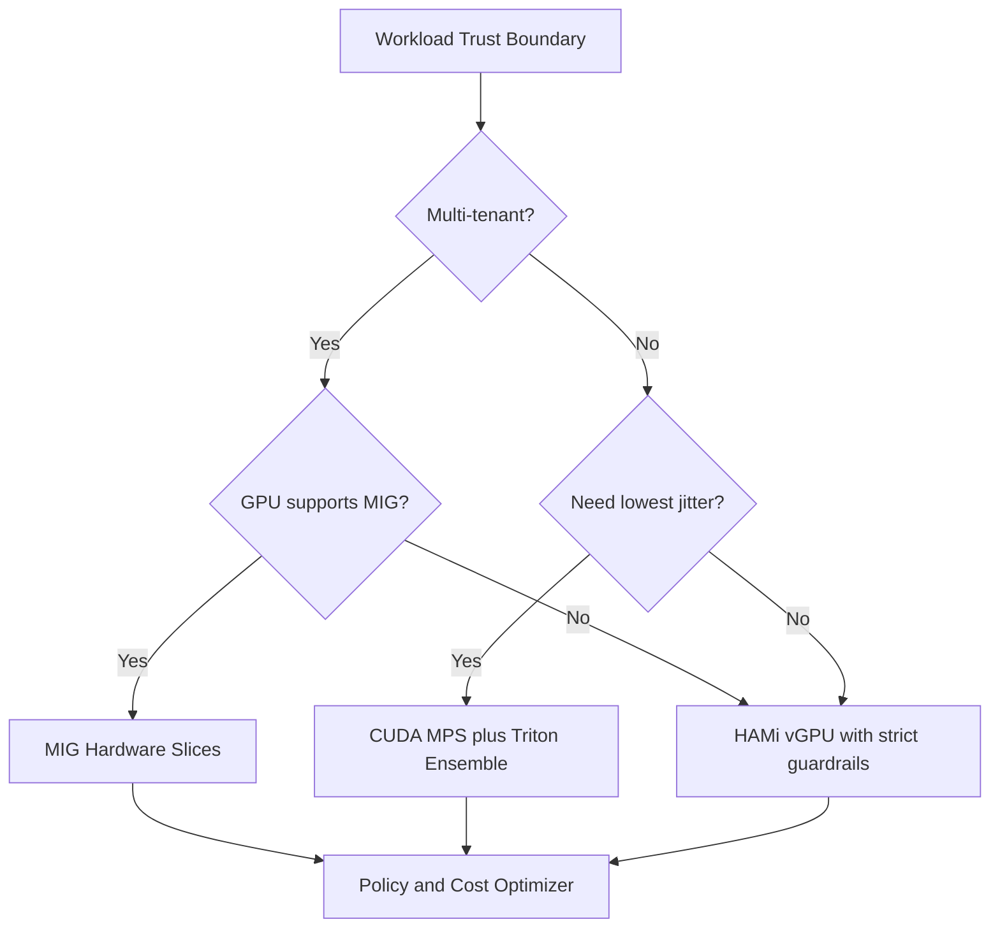
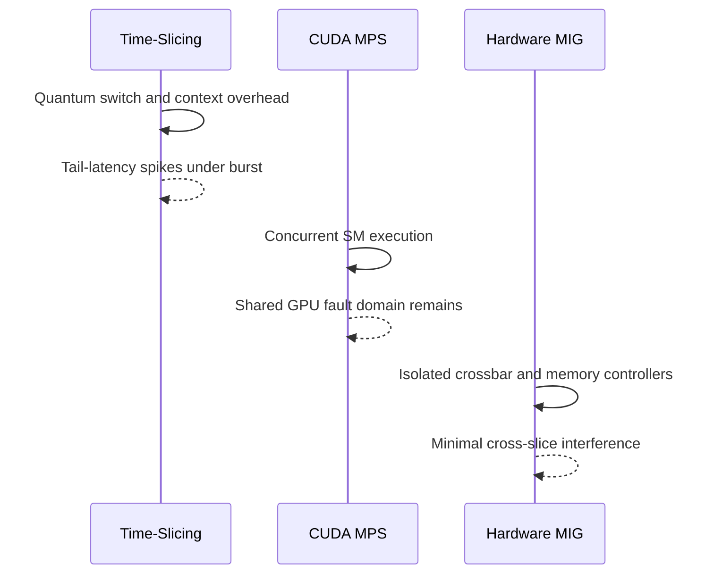

# 企业辅助模型分数 GPU 供给选型 FAQ（MIG vs CUDA MPS vs HAMi vGPU vs Time-Slicing）
> Topic ID: #468
> Section: 3.2 模型托管、大小模型分级路由、微调与 GPU 编排（Model Serving, Tiered Routing & GPU Orchestration）
> Audience: GPU 平台团队、推理工程团队、Agent RAG/语音/CUA 架构师、FinOps 与容量治理负责人
> Goal: 在保证辅助模型尾延迟稳定的同时显著提升 GPU 利用率并收敛跨租户故障传播

## 1）生产问题：辅助模型天然“小而多”，整卡独占会造成极大浪费
生产 Agent 系统很少只运行一个主模型。
真正决定端到端体验的，通常是多个辅助模型链路的叠加时延。
典型链路包含 embedding、reranker、guardrail、ASR 或 OCR 等微模型。
这些模型单体常见显存占用仅 `1.5–8GB`，却要求严格的 `P99` 时延预算。
如果每个模型都独占一张 `A100` 或 `A10`，GPU 资源会长期空置大半。
如果直接启用粗粒度 Time-Slicing，又可能在高峰时段产生严重尾延迟抖动与跨 Pod OOM。
因此“怎么把一张卡切成可治理、可隔离、可预测的小份额”是企业推理平台的核心议题。

## 2）为何时间片共享在在线路径上经常失控
Time-Slicing 本质是时分复用，不提供硬件级显存隔离。
当某个副本瞬时扩批或发生异常分配，邻居副本可能被连带挤压。
上下文切换还会在高并发下放大尾延迟，导致 `P99` 明显恶化。
对于需要毫秒级稳定性的 reranker/guardrail 链路，这种抖动会直接转化为用户可感知退化。
因此在线主链路通常需要“空间隔离优先，时间复用谨慎”的策略。

## 3）四类架构路径总览
Pattern A：`NVIDIA MIG` 硬件空间切分，适合高监管多租户微模型网格。
Pattern B：`CUDA MPS` 在非 MIG 显卡上做并行 SM 配额，适合单租户高性价比流水线。
Pattern C：`CNCF HAMi vGPU` 细粒度显存/算力调度，适合异构 GPU 统一调度。
Pattern D：反模式（生产在线路径用无硬隔离 Time-Slicing 或者小模型整卡独占）。

## 4）十二维对比矩阵
| 维度 | Pattern A（MIG） | Pattern B（CUDA MPS） | Pattern C（HAMi vGPU） | Pattern D（反模式） |
|---|---|---|---|---|
| 硬件显存隔离 | 高 | 中 | 中高 | 低 |
| SM/L2 干扰隔离 | 高 | 中 | 中 | 低 |
| GPU 故障爆炸半径 | 低 | 中 | 中 | 高 |
| Azure SKU 适配面 | 中（A100/H100） | 高（A10/L40S） | 高（多 SKU） | 高 |
| `P99` 抖动控制 | 高 | 中高 | 中 | 低 |
| 切分粒度 | 中（固定几何） | 中（百分比） | 高（细粒度） | 低 |
| 动态重配敏捷性 | 中 | 高 | 中高 | 高（但不稳） |
| 平台运维复杂度 | 中高 | 中 | 高 | 低 |
| 调度可观测性 | 高 | 中高 | 中高 | 低 |
| 多租户合规友好度 | 高 | 中 | 中高 | 低 |
| 单位推理成本优化潜力 | 高 | 高 | 高 | 低 |
| 推荐结论 | 监管多租户首选 | 单租户非 MIG 首选 | 异构统一调度可选 | 禁用 |

## 5）Pattern A：MIG 硬件切片（多租户强隔离主路径）
MIG 在硬件层切分 SM、显存控制器与缓存资源，天生适合隔离边界明确的多租户场景。
切片后每个实例拥有相对独立的资源面，跨实例尾延迟干扰更可控。
对金融、政企、跨 BU 共池场景而言，MIG 的价值不只是利用率，更是“可解释的故障边界”。
其限制是切片几何固定，容量规划要围绕 `1g/2g/3g` 等轮廓做装箱。
此外，必须选择支持 MIG 的 GPU 代际与 SKU，无法覆盖所有成本敏感机型。

## 6）Pattern B：CUDA MPS（非 MIG 成本优化主路径）
在 `A10/L40S` 等不支持 MIG 的机型上，MPS 提供了务实可行的空间并行手段。
通过 `CUDA_MPS_ACTIVE_THREAD_PERCENTAGE` 与内存上限参数，可把一张卡拆给多个微模型并发执行。
与纯 Time-Slicing 相比，MPS 能显著降低上下文切换带来的尾延迟放大。
不过 MPS 共享同一 GPU 故障域，不应混跑互不信任租户。
最佳实践是单租户流水线内共享，结合 Triton ensemble 或服务编排做统一资源预算。

## 7）Pattern C：HAMi vGPU（异构池统一编排路径）
HAMi 提供了较细粒度的显存与算力调度抽象，适合多型号 GPU 的统一资源池。
平台团队可以用标准 K8s 工作负载语义推动模型团队自助部署。
相比固定 MIG 几何，HAMi 在资源碎片回收上更灵活。
代价是对驱动、hook 与版本兼容要求更高，需要建立严格升级验证链。
在大规模多团队场景，HAMi 适合作为“统一调度面”，而非替代所有强隔离诉求。

## 8）Pattern D：反模式清单
在线关键链路直接采用高副本 Time-Slicing 且无显存硬上限。
把 `<6GB` 模型按“每模型一整卡”长期静态部署。
忽略 Xid 故障联动，不做自动摘除与重调度。
只看平均时延不看 `P99/P99.9`，上线后才发现尾部抖动不可接受。
这些做法短期看似简单，长期会在成本与稳定性上双重失血。

## 9）Mermaid：GPU 能力与切分决策拓扑


## 10）Mermaid：执行时间线与故障边界对比


## 11）Q1-Q6 量化公式与阈值
Q1：切片显存预算。
`VRAM_slice >= W_model + Act_peak + CUDA_ctx_overhead`。
Q2：MIG 几何浪费。
`Waste_MIG = 1 - sum(Used_i) / Total_HBM`。
Q3：MPS 算力分配。
`SM_i = floor(SM_total * Pct_i / 100)`，并要求 `sum(Pct_i) <= 100`。
Q4：容量安全系数。
生产建议 `sum(VRAM_i) <= 0.88 * HBM_total`，预留突发与碎片。
Q5：尾延迟门槛。
辅助链路建议 `P99 <= 25ms`，超过即触发重分配或降载。
Q6：故障联动门槛。
若 `Xid_rate > threshold` 或 `FB_USED` 异常抖动，自动 drain 该 GPU 并迁移工作负载。

## 12）生产代码块 1：GPU Operator MIG 策略（YAML）
```yaml
apiVersion: nvidia.com/v1
kind: ClusterPolicy
metadata:
  name: gpu-cluster-policy
spec:
  mig:
    strategy: mixed
  migManager:
    enabled: true
---
apiVersion: v1
kind: ConfigMap
metadata:
  name: custom-mig-config
  namespace: gpu-operator
data:
  config.yaml: |
    version: v1
    mig-configs:
      all-balanced:
      - devices: all
        mig-enabled: true
        mig-devices:
          "1g.10gb": 4
          "2g.20gb": 2
```

## 13）生产代码块 2：A10 上 MPS 部署示例（Kubernetes）
```yaml
apiVersion: apps/v1
kind: Deployment
metadata:
  name: aux-model-mps
spec:
  replicas: 1
  template:
    spec:
      containers:
        - name: mps-daemon
          image: nvcr.io/nvidia/cuda:12.4.1-runtime-ubuntu22.04
          command: ["bash","-lc","nvidia-cuda-mps-control -d && sleep infinity"]
          env:
            - name: CUDA_MPS_ACTIVE_THREAD_PERCENTAGE
              value: "35"
            - name: CUDA_MPS_PINNED_DEVICE_MEM_LIMIT
              value: "0=6G"
        - name: reranker
          image: ghcr.io/contoso/reranker:latest
          env:
            - name: CUDA_MPS_ACTIVE_THREAD_PERCENTAGE
              value: "30"
```

## 14）生产代码块 3：容量装箱与 P99 校验器（Python）
```python
from dataclasses import dataclass

@dataclass
class ModelSlice:
    name: str
    vram_gb: float
    sm_pct: int
    p99_ms: float

def validate_budget(slices, total_vram_gb: float) -> bool:
    vram_ok = sum(s.vram_gb for s in slices) <= 0.88 * total_vram_gb
    sm_ok = sum(s.sm_pct for s in slices) <= 100
    slo_ok = all(s.p99_ms <= 25.0 for s in slices)
    return vram_ok and sm_ok and slo_ok

def placement_decision(slices, gpu_type: str) -> str:
    if gpu_type in {"A100", "H100"}:
        return "prefer_mig" if validate_budget(slices, 80.0) else "scale_out"
    return "prefer_mps" if validate_budget(slices, 24.0) else "scale_out"
```

## 15）企业场景与三档三年 TCO
### 15.1 场景 A：监管多 BU 金融 Agent 中枢
六个业务单元在同一平台部署 `28` 个辅助模型，既要低延迟也要明确隔离边界。
平台采用 Pattern A 混合 MIG 切片，在 `A100` 集群上按模型特征做固定轮廓装箱。
模型数量增长后仍保持稳定 `P99`，并显著减少跨团队资源争抢冲突。
相较“每模型整卡”，GPU 数量由 `28` 张降到 `6` 张，审计侧也更容易解释边界。
### 15.2 场景 B：电商多模态检索与语音客服
业务运行在非 MIG 机型，历史 Time-Slicing 导致高峰时段辅助链路延迟抖动严重。
切换到 Pattern B 后，用 MPS 对 embedding、reranker、ASR 与 guardrail 做并行配额。
在不牺牲吞吐的情况下，辅助链路 `P99` 从百毫秒级降到几十毫秒级。
成本侧通过分数化共享显著下降，且无需全部迁移到高端 MIG 机型。
### 15.3 三档三年 TCO
| 档位 | 辅助模型规模 | 推荐组合 | 三年综合 TCO |
|---|---:|---|---:|
| Tier-1 | 12 模型 | B 主路径 + C 调度补充 | `$2.9M` |
| Tier-2 | 36 模型 | A + B 混合 | `$8.4M` |
| Tier-3 | 90 模型 | A 主隔离 + B 成本池 + C 统一编排 | `$20.7M` |
### 15.4 架构落地细粒度工程要点
首先明确租户信任边界，再决定是否允许共享故障域；不要先谈调度细节后补安全边界。
若业务对跨租户隔离有强监管要求，优先把模型放入硬件切片路径，避免在共享上下文中混跑。
当平台使用非 MIG 机型时，应把 MPS 当作“单租户流水线优化器”而不是“跨租户安全隔离器”。
推进 HAMi 前，建议建立驱动版本锁定策略与回归矩阵，减少 hook 兼容问题在生产暴露。
每个模型都应维护标准化显存画像与 `P99` 画像，装箱决策不能只凭静态参数估算。
容量规划需要同时考虑平均利用率与峰值冲击，避免“均值看起来很高，尾延迟却不可用”。
对于 guardrail 类模型，建议设置更严格的时延阈值与独立优先级，保障安全链路不被挤压。
上线策略应采用小流量灰度，先验证切片稳定性，再逐步放大并发，以降低共振风险。
监控面必须同时覆盖 `FB_USED`、SM 利用率、Xid 事件、队列长度和 `P99/P99.9`，单一指标无法反映真实健康度。
发现显存碎片持续升高时，应触发主动整理或重调度，而不是等待 OOM 之后再被动恢复。
策略变更应配套回滚脚本，特别是 MIG profile 和 MPS 线程百分比，避免高峰期误配扩大影响。
推荐把“单位成本、尾延迟、隔离等级”统一呈现在同一决策面板，便于业务与平台共同权衡。
容量审查会上应展示“本季度节省了多少 GPU”之外，还要展示“是否保持了稳定 `P99`”。
对关键辅助模型可预留冗余切片，防止单切片故障导致安全链路或检索链路失效。
夜间批任务与在线任务要分层运行，避免离线吞吐抢占在线低延迟资源。
模型团队提交新版本时应附带资源画像变化说明，平台据此自动校验是否仍满足切片预算。
需要跨区域容灾时，分数 GPU 策略要在主备区保持一致，避免故障切换后性能曲线突变。
计费治理上，建议把辅助模型池独立核算，形成可持续的“成本-性能-隔离”优化闭环。
平台文档要明确哪些场景允许 Time-Slicing，哪些场景必须禁用，避免团队误用默认值上线。
当业务规模扩大到多团队共池时，建议引入配额仲裁委员会，统一处理资源冲突与优先级争议。
定期复盘失败案例，把“爆炸半径、恢复时长、误告警率”沉淀成可执行改进项，而非停留在经验层面。
长期演进中应跟踪新 GPU 代际能力，及时调整 A/B/C 组合比例，让架构保持成本竞争力与稳定性。
架构评审时可以先画出辅助模型调用拓扑，再把每个节点映射到具体 GPU 份额与延迟预算，这样能更早发现不合理的资源耦合。
容量压测不应只在白天低压窗口执行，建议覆盖促销峰值、批量任务并发与模型热更新重叠时段，验证真实抖动上界。
对于跨团队共享平台，统一的命名规范和标签体系非常关键，否则后续成本核算与故障定位会出现大量“资源归属不清”问题。
如果某类模型长期出现显存波动大于基线阈值，应优先排查输入分布与批处理策略，而不是先盲目扩容整卡资源。
实践中常见一个误区是把 guardrail 模型当成“可被牺牲”的低优先级链路，这会在安全事件时放大风险，应反向优先保障。
在服务网关层可加入辅助模型级别熔断策略，当某个切片进入异常状态时优雅降级到备份模型，避免全链路阻塞。
运维值班手册建议把 Xid 常见编号与对应处置动作做成速查表，减少夜间故障时查文档和误判的时间成本。
对于采用 HAMi 的团队，灰度发布阶段应增加“驱动升级回滚演练”，确保 hook 兼容故障能够在分钟级恢复。
当平台准备升级 CUDA 或推理框架版本时，先在镜像预发布池复跑辅助模型基准，确认切片装箱结论不会被版本变化破坏。
在预算沟通环节，直接展示“单位成本下降 + P99 稳定性保持”的双指标结果，通常比单纯展示 GPU 节省更容易获得业务支持。
微模型链路常被忽视的另一个问题是冷启动缓存抖动，可通过预热计划与请求分层降低第一波流量尖峰风险。
若企业存在跨境或跨区域合规要求，分数 GPU 策略也要映射到数据驻留边界，避免资源优化与合规策略发生冲突。
团队协作上推荐把“模型画像更新”纳入发布流程必填项，防止上线后才发现资源需求已偏离原始装箱假设。
指标看板中可加入“切片利用率方差”指标，帮助识别哪些切片长期过载或长期闲置，支持更精细的再平衡决策。
长期运营中应建立季度路线图，明确哪些模型将迁移到更强隔离路径、哪些模型可下沉成本池，形成持续演进闭环。
### 15.5 Day-0 / Day-1 / Day-2 工程运行清单（18 项）
Day-0：定义辅助模型分类与信任边界标签。
Day-0：完成 GPU SKU 能力盘点（MIG/非 MIG/异构池）。
Day-0：制定 MIG/MPS/HAMi 三路径准入标准。
Day-0：建立模型显存与 `P99` 基线画像。
Day-0：定义装箱预算安全系数与告警阈值。
Day-0：定义 Xid 自动摘除与恢复策略。
Day-1：上线 MIG 池并验证切片装箱与延迟稳定性。
Day-1：上线 MPS 池并验证线程比例与显存上限。
Day-1：上线 HAMi 池并验证调度兼容与回滚。
Day-1：发布统一观测看板与成本看板。
Day-1：执行 OOM 与故障注入演练并校验爆炸半径。
Day-1：完成在线/离线任务分层调度联调。
Day-2：每周复核切片利用率与尾延迟抖动。
Day-2：每周复核 Xid 事件与自动恢复成功率。
Day-2：每月复核模型画像漂移与装箱策略。
Day-2：每月复核单位推理成本与预算达成率。
Day-2：季度复盘跨区域容灾一致性与演练结果。
Day-2：季度调整 A/B/C 路径占比与资源配额策略。

来源（抓取日期 2026-11-27）：
- NVIDIA MIG user guide: https://docs.nvidia.com/datacenter/tesla/mig-user-guide/
- NVIDIA CUDA MPS docs: https://docs.nvidia.com/deploy/mps/
- NVIDIA k8s-device-plugin time slicing: https://github.com/NVIDIA/k8s-device-plugin
- HAMi project: https://github.com/Project-HAMi/HAMi
- Kubernetes GPU scheduling: https://kubernetes.io/docs/tasks/manage-gpus/scheduling-gpus/
- Azure AKS GPU node pools: https://learn.microsoft.com/azure/aks/gpu-cluster
