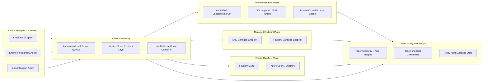
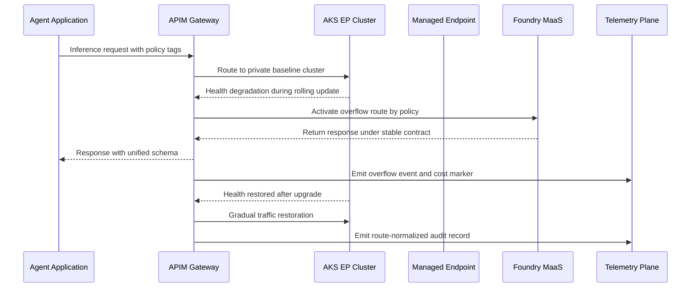

# Enterprise Frontier Open-Weight MoE Hosting Selection FAQ: Foundry MaaS vs AKS NDv5 Expert Parallel vs AML/Foundry Managed Online Endpoints vs APIM Hybrid Overflow
> 🌐 **Language Switch**: [中文](frontier-open-weight-moe-serving-foundry-maas-vs-aks-ndv5-ep-vs-aml-managed-endpoints-selection-faq.md) | **English (current)**
> Audience: Enterprise Cloud & AI Solution Architects, platform governance leads, LLMOps/SRE teams, security and compliance owners, and FinOps leaders.  
> Decision scope: Hosting and governing `DeepSeek-R1/V3 671B`, `Qwen3-235B-A22B`, `Llama-4 Maverick/Scout`, and similar frontier open-weight MoE reasoning and agent models on Azure.  
> Boundary condition: This guide is intentionally architectural and operational; it excludes low-level kernel, driver, and hardware-physics deep dives.

## 1. Executive summary: split by control plane first, then optimize by cost and throughput
Most enterprises fail in MoE production programs for governance reasons rather than model quality reasons. The dominant failure mode is not inferencing capability but operating model mismatch.
If teams optimize only for peak throughput, they usually under-design release safety and rollback control. If teams optimize only for list price, they usually under-design burst absorption and service continuity.
If teams optimize only for speed to market, they usually under-design tenancy boundaries and audit evidence depth. Therefore a durable approach is to separate platform responsibilities into four coordinated planes.
**Plane A (Foundry MaaS)** provides rapid launch and pay-per-token elasticity with minimal infrastructure commitment.  
**Plane B (AKS NDv5 Expert Parallel)** provides private, sovereign, high-throughput multi-node baseline capacity.  
**Plane C (AML/Foundry Managed Endpoints)** provides a PaaS middle lane for medium-scale production without full cluster operations.  
**Plane D (APIM AI Gateway)** provides contract abstraction, health-aware routing, and deterministic overflow/rollback policy.  
The correct enterprise question is not “Which one is universally best.” The correct question is “Which composition minimizes risk-adjusted TCO at our current traffic stage.”
For workloads below `~25B` monthly tokens, MaaS often maximizes organizational agility. For sustained workloads above `~35B` monthly tokens, private base capacity often starts winning on unit economics.
For regulated workloads, APIM policy governance plus private routing is usually mandatory rather than optional. For multi-business-unit platforms, an API facade is the only practical way to avoid client-side version drift.
This architecture transforms model hosting from a project-level decision into a platform-level operating capability.

## 2. Problem framing, assumptions, and non-goals
This guide assumes enterprise identity, baseline network segmentation, and centralized observability already exist. This guide assumes production deployment requires private networking and traceable policy decisions.
This guide assumes a mixed traffic profile containing interactive agent requests and offline evaluation workloads. This guide assumes at least two environment classes, such as regulated workloads and standard workloads.
This guide assumes architectural governance is shared by product, platform, security, and finance stakeholders. This guide does not recommend immediate full migration to self-managed multi-node serving for all scenarios.
This guide also does not recommend long-term lock-in to pure serverless inference for all scenarios. A robust program classifies workloads into four decision quadrants before choosing hosting paths.
Quadrant 1 is high sensitivity and high stability, where private baseline capacity is preferred. Quadrant 2 is medium sensitivity and medium stability, where managed endpoints often fit best.
Quadrant 3 is low sensitivity and high volatility, where MaaS elasticity has clear advantages. Quadrant 4 is upgrade and incident windows, where APIM overflow and rollback policy is critical.
Without a unified gateway, model upgrades usually cascade into client-side contract rework. Without a unified evaluation baseline, migration decisions devolve into subjective disputes.
Without a unified cost taxonomy, per-session and per-tenant economics cannot be trusted. Every MoE rollout should therefore lock four contracts before scaling.
Contract set 1 defines request and response schema plus tool-call semantics. Contract set 2 defines latency, success, and availability SLO boundaries.
Contract set 3 defines authorization, tenancy, and audit trace requirements. Contract set 4 defines budget guardrails, quota policies, and overflow rules.
Contract-first architecture materially reduces rework during migration windows.

## 3. Four-way architecture options and role boundaries
| Option | Primary value | Typical monthly scale | Governance focus | Main risk | Recommended role |
|---|---|---|---|---|---|
| A Foundry MaaS | Zero GPU reservation and fast launch | `<25B` tokens | identity + cost controls | burst-driven bill volatility | elastic entry |
| B AKS NDv5 EP | sovereign high-throughput private serving | `30B–120B` tokens | cluster release discipline | ops complexity | private baseline |
| C Managed Endpoints | PaaS production without full K8s burden | `8B–45B` tokens | endpoint lifecycle and traffic split | large-model ceiling | medium steady lane |
| D APIM Hybrid | contract abstraction and overflow orchestration | all scales | policy, routing, rollback | policy drift | global control plane |
Option A is optimal for exploratory or rapidly changing product portfolios. Option B is optimal for organizations requiring private residency and predictable high-volume economics.
Option C is optimal for teams that need production governance but do not want to operate clusters directly. Option D is not merely an enhancement feature.
In multi-version and multi-backend estates, Option D is the reliability backbone. Enterprises should treat D as a shared control plane above A, B, and C.
That design turns migration from application rework into gateway policy updates.

## 4. Twelve-dimension selection matrix for architecture review boards
| Dimension | A MaaS | B AKS NDv5 EP | C Managed Endpoints | D APIM Hybrid |
|---|---|---|---|---|
| Cold-start predictability | medium | high after warm baseline | medium-high | N/A |
| Steady-state unit economics | medium | high | medium-high | N/A |
| Burst absorption | high | medium-high | medium | high |
| Weight and KV sovereignty | medium | high | medium-high | N/A |
| Private networking control | medium-high | high | high | high |
| Upgrade control fidelity | medium | high | high | high |
| Operational complexity | low | high | medium-low | medium |
| Rollback speed | medium | medium-high | high | high |
| Tenant isolation explainability | medium | high | high | medium-high |
| Audit evidence quality | high | high | high | high |
| Team onboarding speed | high | medium | medium-high | medium |
| Long-term platform extensibility | medium | high | medium-high | high |
This matrix should be used as a weighted decision instrument. Business, platform, security, and finance owners should score independently first.
Architecture governance can then consolidate the weighted result with explicit trade-offs. Single-metric optimization should be avoided except for hard compliance constraints.
For example, if strict sovereignty is mandatory, shared external telemetry can be disallowed by policy. After non-negotiable constraints are applied, throughput and economics can be optimized safely.

## 5. Option A deep dive: Foundry Serverless API / MaaS endpoints
The key value of MaaS is organizational speed and low infrastructure commitment. For new business streams, it enables week-level transition from experiment to controlled production.
The biggest benefit is not necessarily the lowest absolute unit price. The biggest benefit is lower decision friction when demand is uncertain.
MaaS helps teams avoid over-committing to GPU reservation before demand stabilizes. Governance still needs to be explicit and non-negotiable.
Entra RBAC, private networking paths, and budget alerting should be mandatory defaults. Relying on API keys alone weakens enterprise audit traceability.
A common anti-pattern is keeping MaaS as the permanent sole baseline after demand matures. That often creates unpredictable spend under high burst multipliers.
A healthier pattern is to define MaaS as elastic ingress and overflow capacity. APIM should provide shared contract and policy control over that lane.
Three telemetry families should be visible to both platform and product owners. Family one is per-tenant token and request-rate envelope utilization.
Family two is model-version exposure and blast radius during migration. Family three is policy interception rate versus false positive burden.
Without these views, teams cannot explain quality or cost deltas credibly. In regulated sectors, data classification should precede MaaS enablement.
Requests can then be routed by sensitivity class, not only by latency class. That policy boundary becomes the foundation for later AKS or AML capacity planning.
Without this boundary, migrations usually happen under avoidable production pressure.

## 6. Option B deep dive: AKS ND H200/H100 v5 multi-node EP serving
When demand becomes sustained and sovereignty requirements tighten, private AKS serving becomes strategic. Multi-node Expert Parallel serving supports very large total-parameter models with private residency guarantees.
MoE sparse activation can deliver better cost-per-million-token economics at scale. However, “model boots successfully” is not a production architecture milestone.
Production maturity depends on release safety, failure isolation, and deterministic rollback. `LeaderWorkerSet` is central in this operating model.
It allows scheduling and restart as a coherent group instead of independent pod drift. That reduces split-brain behavior during rolling upgrades and partial failure events.
For SRE teams, it shrinks the practical multi-node blast radius. For platform teams, it improves change-window predictability and incident containment.
Four operational capabilities should be built in parallel with the serving stack. Capability one is weight-distribution and image-caching governance.
Capability two is KV-cache lifecycle and tenant boundary controls. Capability three is deployment orchestration, canary policy, and rollback automation.
Capability four is tenant-level cost attribution and chargeback reporting. Missing any one of these capabilities can negate infrastructure-level gains.
Latency objectives should be segmented by workload class. Interactive agents care about TTFT and ITL envelopes.
Offline pipelines care more about aggregate throughput and completion windows. A single global metric will create misleading optimization behavior.
Network and security controls should be first-class platform features. That includes private egress policy, image-signing enforcement, and node patch cadences.
When governance is mature, AKS usually becomes the long-term private baseline. It remains a high-control option, not a low-ops option.

## 7. Option C deep dive: AML / Foundry managed online endpoints
Managed endpoints are the practical middle lane for many enterprise portfolios. They combine production release governance with lower operational burden than full cluster ownership.
For medium-size models and quantized MoE variants, they often provide a strong balance point. Blue/green traffic splitting and endpoint lifecycle controls are mature and enterprise-friendly.
Operational responsibilities are more clearly partitioned between provider and platform team. This improves delivery predictability for product groups with limited SRE bandwidth.
Managed VNet controls also simplify policy evidence for internal compliance audits. The primary limitation is reduced flexibility for extreme multi-node custom topologies.
For that reason, Option C is best treated as a steady middle tier. It handles medium-scale sustained traffic and region-specific workloads effectively.
Five implementation practices should be standardized early. Practice one is endpoint segmentation by tenant class and scenario class.
Practice two is explicit model-version lifetime and deprecation policy. Practice three is contract regression suites bound to release gates.
Practice four is minimum warm-capacity policy to reduce cold-impact spikes. Practice five is APIM integration for consistent auth and observability semantics.
If endpoint policies and gateway policies diverge, release windows become brittle. This misalignment tends to surface first in multi-region rollouts.
Policy cohesion testing should therefore be a mandatory release gate.

## 8. Option D deep dive: APIM AI Gateway hybrid overflow and rollback plane
APIM provides architectural leverage by centralizing model contract and policy complexity. Application clients integrate once with a stable contract surface.
Backends can shift among AKS, managed endpoints, MaaS, and AOAI without client rewrites. This significantly lowers migration risk across model and platform generations.
At minimum, APIM policy should implement four policy classes. Class one is health probes, circuit breaking, and fail-open/fail-close logic by sensitivity.
Class two is quota, throttling, and tenant-priority controls. Class three is model version pinning and progressive traffic shift controls.
Class four is retry and overflow orchestration with bounded retries. During AKS rolling upgrades, APIM can divert affected traffic to MaaS or managed endpoints.
During cost spikes, APIM can re-balance traffic back to private baseline lanes. For high-sensitivity categories, APIM can deny overflow to shared pools by policy tags.
Each decision should produce auditable metadata for governance and forensics. A gateway without transparent policy evidence is an operational liability.
APIM should also host compatibility adapters for provider contract differences. Examples include token parameter normalization and tool-call field mapping.
That protects downstream applications from frequent backend contract churn. Policy testing must be part of CI and pre-release simulation.
Failure-injection exercises should be scheduled, not occasional. Only tested policies deserve production trust in high-impact windows.

## 9. Reference architecture diagram A: hybrid MoE hosting and governance topology

This topology separates hosting concerns from governance concerns. That separation makes both migration and incident response more deterministic.
It also improves accountability across product, platform, security, and finance teams.

## 10. Reference architecture diagram B: upgrade-window overflow and restoration sequence

The sequence highlights contract stability, policy-driven switching, and auditable operations. It removes emergency routing decisions from ad-hoc human intervention paths.
That is critical for predictable upgrades in high-volume enterprise estates.

## 11. Production snippet A: AKS LeaderWorkerSet multi-node MoE deployment
```yaml
apiVersion: apps.x-k8s.io/v1alpha1
kind: LeaderWorkerSet
metadata:
  name: frontier-moe-r1
  namespace: llm-prod
spec:
  replicas: 3
  leaderWorkerTemplate:
    size: 8
    restartPolicy: RecreateGroupOnLeaderChange
    leaderTemplate:
      metadata:
        labels:
          app: frontier-moe-r1
          role: leader
      spec:
        nodeSelector:
          sku: nd-h200-v5
        containers:
          - name: router
            image: contoso.azurecr.io/moe/router:2026.11.21
            env:
              - name: MODEL_ID
                value: deepseek-r1-671b
              - name: EXPERT_PARALLEL_GROUP
                value: "8"
              - name: KV_CACHE_SCOPE
                value: tenant-private
    workerTemplate:
      metadata:
        labels:
          app: frontier-moe-r1
          role: worker
      spec:
        nodeSelector:
          sku: nd-h200-v5
        containers:
          - name: expert
            image: contoso.azurecr.io/moe/expert:2026.11.21
            resources:
              limits:
                nvidia.com/gpu: "1"
            env:
              - name: EXPERT_RUNTIME
                value: sglang
              - name: OTEL_EXPORTER_OTLP_ENDPOINT
                value: http://otel-collector.monitoring:4318
```
This manifest emphasizes group-level scheduling and group-level restart semantics. That pattern is materially safer for multi-node consistency than independent pod replacement.
It also enables cleaner failure-domain definitions for incident operations.

## 12. Production snippet B: managed endpoint Bicep and APIM overflow policy
```bicep
param location string = resourceGroup().location
param workspaceName string = 'aml-frontier-prod'
param endpointName string = 'qwen3-30b-a3b-prod'

resource endpoint 'Microsoft.MachineLearningServices/workspaces/onlineEndpoints@2024-04-01' = {
  name: '${workspaceName}/${endpointName}'
  location: location
  properties: {
    authMode: 'AADToken'
    traffic: {
      blue: 85
      green: 15
    }
    mirrorTraffic: {
      shadow: 5
    }
    publicNetworkAccess: 'Disabled'
  }
}
```
```xml
<policies>
  <inbound>
    <base />
    <set-variable name="workloadClass" value="@(context.Request.Headers.GetValueOrDefault("x-workload-class","standard"))" />
    <set-variable name="aksHealthy" value="@(context.Variables.GetValueOrDefault<bool>("aksHealth", false))" />
    <choose>
      <when condition="@((bool)context.Variables["aksHealthy"])">
        <set-backend-service backend-id="aks-moe-primary" />
      </when>
      <otherwise>
        <set-backend-service backend-id="foundry-maas-overflow" />
      </otherwise>
    </choose>
    <rate-limit-by-key calls="1200" renewal-period="60" counter-key="@(context.Subscription.Id + "-" + context.Variables["workloadClass"])" />
  </inbound>
  <backend>
    <forward-request timeout="120" />
  </backend>
  <outbound>
    <base />
    <set-header name="x-serving-plane" exists-action="override">
      <value>@(context.Backend.Id)</value>
    </set-header>
  </outbound>
</policies>
```
Bicep provides predictable endpoint provisioning and controlled traffic partitioning semantics. APIM policy provides route control, quota controls, and per-request serving-plane traceability.
Together they form a practical and auditable production governance loop.

## 13. Enterprise scenarios: sovereign finance and global engineering
### 13.1 Scenario A: sovereign regulated bank with private 671B reasoning MoE
A tier-1 bank needs private residency for credit and quant-research reasoning workloads. Regulatory requirements prohibit sensitive prompts and proprietary model artifacts from leaving sovereign boundaries.
The architecture uses AKS NDv5 EP as the private baseline serving plane. APIM provides a single ingress contract and policy-governed routing controls.
Foundry MaaS is limited to lower-sensitivity overflow classes by policy tag. Initial rollout starts at 15% traffic with strict audit observation.
After two controlled release cycles, high-value workflows shift to private baseline capacity. During cluster maintenance windows, APIM automatically diverts impacted flows to managed overflow lanes.
This prevents business interruption during change windows. Three governance outcomes were observed.
Outcome one: end-to-end audit trace completeness reached a consistent evidence threshold. Outcome two: high-priority workflow SLO remained stable during quarterly upgrades.
Outcome three: cross-team release arbitration conflicts dropped substantially. Economically, break-even against pure MaaS appeared once monthly token volume stabilized above `~42B`.
That threshold informed the following fiscal-year reservation and staffing plan. This scenario shows sovereignty and cost control can coexist with proper control-plane design.
### 13.2 Scenario B: global engineering enterprise at 80B monthly coding-review tokens
This enterprise runs coding review, pull-request risk analysis, and engineering knowledge agents globally. Traffic is highly correlated with release calendars and internal migration programs.
Peak days reach around `4.3x` normal weekday average volume. Pure private baseline would underutilize capacity during low periods.
Pure MaaS would create unstable spend during release spikes. The chosen design is AKS private baseline plus MaaS overflow under APIM governance.
AKS hosts stable high-value and policy-sensitive traffic. MaaS absorbs release-week spikes and temporary campaign surges.
Managed endpoints host medium-scale business-unit-specific model variants. The platform team reviews three metric families weekly.
Family one covers route mix, retry ratio, and failover success. Family two covers tenant budget variance and cost-per-million-token drift.
Family three covers rollback duration and incident recovery lead time. After four months, effective unit cost dropped by 23%.
Release cadence also improved because route switching no longer required client changes. This scenario demonstrates why hybrid composition is often superior to single-lane hosting.

## 14. FinOps model and quantitative Q&A for architecture boards
### 14.1 Monthly and three-year TCO view (illustrative USD)
| Cost category | A MaaS | B AKS NDv5 EP | C Managed Endpoints | D APIM Control Plane |
|---|---:|---:|---:|---:|
| Monthly baseline platform | 0 | 280,000 | 96,000 | 18,000 |
| Monthly inference + network | 410,000 | 210,000 | 175,000 | 22,000 |
| Monthly operations + governance labor | 42,000 | 88,000 | 51,000 | 26,000 |
| Monthly total | 452,000 | 578,000 | 322,000 | 66,000 |
| Three-year cumulative (growth adjusted) | 20,200,000 | 17,800,000 | 12,900,000 | 3,100,000 |
This table should be treated as a decision framework rather than a universal truth claim. Each enterprise must adjust for discount structures, utilization behavior, and staffing model.
The value is in a shared financial language for architecture governance decisions.  
### 14.2 Break-even estimation logic (illustrative)
Assume ND H200 v5 private baseline monthly all-in cost is `580,000`. Assume equivalent MaaS monthly cost under similar volume is `860,000`.
Gross monthly savings from private baseline is therefore about `280,000`. Assume additional monthly governance and operations overhead of `90,000`.
Net monthly savings is approximately `190,000`. With one-time platform setup investment of `760,000`, static payback appears near `4` months.
Risk buffers must still be modeled for migration windows and overflow volatility. Ignoring those buffers systematically overstates financial certainty.
### 14.3 Quantitative Q&A (8 architecture questions)
**Q1: At what monthly token range does AKS NDv5 often overtake pure MaaS economics?**  
A common observed enterprise transition range is `35B–50B` monthly tokens. The exact threshold depends on utilization discipline, procurement terms, and workload profile.
**Q2: How does LeaderWorkerSet reduce multi-node blast radius during upgrades?**  
It enforces coherent group scheduling and coherent group restart behavior. This avoids partial-group drift and narrows failure exposure during rolling changes.
**Q3: How should teams think about total versus active parameters for capacity sizing?**  
Total parameters influence storage and weight-distribution architecture. Active parameters influence per-request runtime utilization and latency behavior.
Capacity planning should model both curves separately rather than blending them.  
**Q4: How should APIM overflow thresholds be configured?**  
Use a three-threshold policy combining health, latency, and cost envelope triggers. Single-trigger routing often produces either premature overflow or delayed protection.
**Q5: Why can’t throughput alone be the dominant KPI?**  
Interactive agent experience is strongly shaped by TTFT and ITL, not only aggregate TPS. Throughput-only optimization can hide severe user-facing latency regressions.
**Q6: When are managed endpoints the strongest fit?**  
They are strongest for medium-size stable workloads where teams want PaaS governance with moderate control depth. They are weaker for extreme multi-node customization and very large private baseline needs.
**Q7: When should MaaS move from primary to overflow role?**  
A practical signal is sustained budget exceedance over three billing cycles with predictable demand structure. At that point, private baseline migration should start while preserving MaaS burst capability.
**Q8: How can enterprises prevent backend model upgrades from forcing client rewrites?**  
Stabilize the application contract at APIM and keep provider-specific adaptation in gateway policy. Contract regression tests should run before each route-shift or model-version promotion.
### 14.4 Governance dashboard recommendation
A production dashboard should expose quality, economics, and compliance together. Quality metrics include TTFT, ITL, success rate, and rollback duration.
Economic metrics include route mix, cost per million tokens, and budget variance by tenant. Compliance metrics include policy-hit accuracy, isolation exceptions, and audit record completeness.
Without a shared dashboard, cross-functional decisions become anecdotal instead of evidence-based. The dashboard should feed weekly operational reviews and monthly portfolio steering.
Quarterly architecture rebalance should use this dataset as input.

## 15. Day-0/Day-2 checklist and fit guidance
### 15.1 Twelve-item implementation checklist
- [ ] Publish a written architecture decision defining A/B/C/D lane ownership.  
- [ ] Freeze request/response/tool contracts and enforce regression testing.  
- [ ] Implement tenant-level quota, rate, and budget guardrails.  
- [ ] Configure LeaderWorkerSet release and rollback policy for multi-node AKS lanes.  
- [ ] Configure blue/green and shadow traffic controls for managed endpoints.  
- [ ] Implement APIM health probes, circuit breaking, and overflow policies.  
- [ ] Enforce private networking, RBAC, and baseline audit logging controls.  
- [ ] Align TTFT/ITL/throughput metric definitions to SLO policy.  
- [ ] Enable chargeback-ready token and cost attribution by tenant and scenario.  
- [ ] Schedule failure-injection and upgrade-window routing drills.  
- [ ] Define model lifecycle policy with deprecation and migration timelines.  
- [ ] Assign Day-2 ownership with explicit runbook and escalation paths.  
### 15.2 Good fit
This pattern fits organizations with layered traffic profiles and explicit governance requirements. It fits enterprises that treat model hosting as a long-lived platform capability.
It fits teams needing simultaneous control of reliability, cost, and audit transparency.  
### 15.3 Not for
This pattern is not ideal for very small trial-only teams with no platform operations plan. It is not ideal for organizations that reject gateway policy governance and contract discipline.
It is not ideal for environments that treat auditability as optional post-release work.  
### 15.4 Closing perspective
The hardest part of frontier open-weight MoE adoption is not model size itself. The hardest part is operating growth under policy and cost discipline at enterprise scale.
When A, B, C, and D lanes are intentionally composed, performance and governance reinforce each other. That is the practical difference between a successful pilot and a durable enterprise platform.
