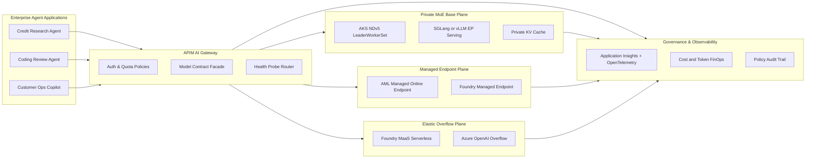
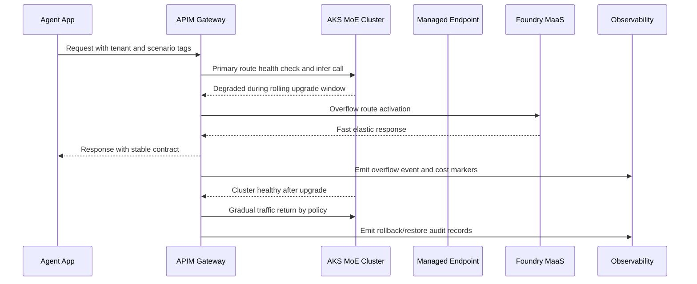

# 企业前沿开源权重 MoE 模型托管选型 FAQ：Foundry MaaS vs AKS NDv5 Expert Parallel vs AML/Foundry 托管在线端点 vs APIM 混合溢出
> 🌐 **Language Switch**: **中文（当前）** | [English](frontier-open-weight-moe-serving-foundry-maas-vs-aks-ndv5-ep-vs-aml-managed-endpoints-selection-faq.en.md)
> 适用对象：企业云与 AI 解决方案架构师（CSA）、平台治理负责人、LLMOps/SRE、FinOps 与安全合规团队。  
> 目标问题：当业务进入 `10B–120B` 月度 Token 区间时，如何在 Azure 上托管和治理 `DeepSeek-R1/V3 671B`、`Qwen3-235B-A22B`、`Llama-4 Maverick/Scout` 等前沿开源权重 MoE 推理与智能体模型。  
> 约束声明：本文聚焦应用架构、平台治理与 TCO，不讨论内核驱动、底层硬件物理细节或实验性算子微优化。

## 1. 执行摘要：先分层再分流，先治理再扩容
多数企业在 MoE 选型中的失败，并非因为模型本身性能不足。 真正导致事故和预算失控的，是承载层与治理层没有同步设计。
如果只追求吞吐，不做隔离边界定义，跨租户权重与缓存风险会急剧放大。 如果只追求成本，不做溢出回路设计，流量脉冲会把交互型 SLA 拉崩。
如果只做单平台锁定，不做 API 门面规范，升级窗口会导致应用端改造连锁反应。 因此推荐采用四层并行的“承载—治理—溢出”架构。
**路径 A：Foundry MaaS** 负责零承诺弹性与短期业务验证。  
**路径 B：AKS NDv5 Expert Parallel** 负责主力高吞吐和主权隔离。  
**路径 C：AML/Foundry Managed Endpoint** 负责中等规模、低运维单节点生产。  
**路径 D：APIM AI Gateway** 负责版本门面、健康探测与故障切流。  
企业不应问“哪一个唯一最佳”。 正确问题是“哪种组合对当前业务阶段最优”。
在 `25B` 月 Token 以下，MaaS 通常提供最小组织摩擦。 在 `35B–80B` 稳态区间，AKS 主承载开始体现单位成本优势。
在受监管行业，AKS 与 APIM 的组合通常是准入底线。 在多 BU 共享平台，必须统一 APIM 门面避免模型升级扩散到应用侧。
这套决策逻辑可以把模型托管从“单项目工程”提升为“企业能力平台”。

## 2. 业务边界与架构前提
本文默认组织已具备基础身份与网络治理能力。 本文默认生产环境需要私有网络、审计闭环和可回滚发布机制。
本文默认至少存在两类负载：交互型 Agent 与批处理型评测任务。 本文默认平台同时处理实时请求与离线实验流。
本文默认企业接受 SLO、预算、合规三目标并行管理。 本文不建议将全部场景直接迁移到自托管多节点。
本文也不建议把全部场景长期留在 Serverless 端点。 需要先对业务进行四象限划分。
第一象限是高敏感高稳态，优先 AKS 主权承载。 第二象限是中敏感中稳态，优先托管在线端点。
第三象限是低敏感高波动，优先 MaaS 按量弹性。 第四象限是升级窗口与突发峰值，交由 APIM 溢出回路。
若组织没有统一 API 网关，升级策略会出现“客户端分叉”。 若组织没有统一评测基线，模型替换会变成主观争论。
若组织没有统一成本口径，FinOps 无法追溯单会话成本。 因此任何 MoE 项目启动前，都应先固定四类契约。
第一类是输入输出与工具调用契约。 第二类是延迟与可用性契约。
第三类是权限与审计契约。 第四类是预算与配额契约。
契约先行，平台演进才不会反复返工。

## 3. 四路径全景：能力定位与适配边界
| 路径 | 核心价值 | 典型规模 | 治理重心 | 主要风险 | 建议角色 |
|---|---|---|---|---|---|
| A Foundry MaaS | 零 GPU 承诺、快速试产 | `<25B` tokens/月 | 身份与用量控制 | 成本随峰值飙升 | 弹性入口 |
| B AKS NDv5 EP | 多节点高吞吐、私域驻留 | `30B–120B` tokens/月 | 集群与发布治理 | 运维复杂度上升 | 主承载 |
| C AML/Foundry Endpoint | PaaS 化单节点生产 | `8B–45B` tokens/月 | 端点版本与流量分配 | 超大模型受限 | 稳态承载 |
| D APIM Hybrid | 门面解耦、健康溢出 | 覆盖全区间 | 策略编排与回滚 | 策略失配误切流 | 全局控制面 |
路径 A 最适合需求不稳定、上线时间紧迫的团队。 路径 B 最适合强主权、强吞吐、强可定制组织。
路径 C 最适合缺少 K8s 运维编制但有稳定预算的组织。 路径 D 并不是“可选增强”。
在多模型并行和版本频繁迭代阶段，路径 D 是平台韧性的必要条件。 企业应把 D 作为所有路径的共用控制面。
这样可把模型迁移问题从“应用重构”降维成“策略切换”。

## 4. 12 维选型矩阵（CSA 评审会可直接复用）
| 评估维度 | A MaaS | B AKS NDv5 EP | C 托管端点 | D APIM Hybrid |
|---|---|---|---|---|
| 冷启动敏感性 | 中 | 低（预热后） | 中低 | N/A |
| 稳态单位成本 | 中 | 高优势 | 中 | N/A |
| 峰值吸收能力 | 高 | 中高 | 中 | 高 |
| 私有权重驻留 | 中 | 高 | 中高 | N/A |
| 网络主权控制 | 中高 | 高 | 高 | 高 |
| 版本升级可控性 | 中 | 中高 | 高 | 高 |
| 运维复杂度 | 低 | 高 | 中低 | 中 |
| 发布回滚速度 | 中 | 中 | 高 | 高 |
| 多租户隔离可解释性 | 中 | 高 | 高 | 中高 |
| 审计与追溯 | 高 | 高 | 高 | 高 |
| 团队上手时间 | 高 | 中低 | 中高 | 中 |
| 长期平台可扩展性 | 中 | 高 | 中高 | 高 |
矩阵使用方式建议分两步。 第一步由业务、平台、安全三方分别打分。
第二步由架构委员会做加权折中。 不要把某一个维度做成“一票否决”。
真正需要一票否决的是合规不可接受项。 例如跨境数据主权不允许外部遥测。
例如审计链路不能证明提示词与权重访问轨迹。 在满足红线后，再比较吞吐与成本。

## 5. 方案 A：Foundry Serverless API / MaaS 端点
MaaS 方案最核心的价值是把“基础设施准备时间”压缩到最低。 对于新产品线，它能在周级别完成从 PoC 到业务灰度。
其优势不是绝对最低单价，而是最低组织切换成本。 当流量仍处探索阶段，MaaS 能避免过早绑定 GPU 预留。
治理上建议强制 Entra RBAC、Private Link、预算告警三件套。 如果只启用 API Key 而无企业身份映射，审计价值会明显下降。
在成本层面，MaaS 常被误用为长期稳态主承载。 这会导致月度峰值放大时账单不可预测。
正确实践是把 MaaS 定义为“弹性入口与溢出池”。 并使用 APIM 做配额、版本和路由统一。
MaaS 场景下的关键治理指标包括三类。 第一类是租户级 Token 上限与突发速率。
第二类是模型版本切换影响面。 第三类是策略拦截率与误拦截率。
这些指标必须在业务看板可见。 否则产品团队无法理解响应质量变化原因。
在敏感行业，MaaS 使用前应完成数据分类映射。 确定哪些请求允许进入共享模型池。
确定哪些请求必须强制走私域承载。 这个边界将直接决定后续 AKS/AML 投资节奏。
如果边界定义缺失，迁移往往在高压窗口被迫进行。 那会显著增加故障概率和跨团队摩擦。

## 6. 方案 B：AKS ND H200/H100 v5 多节点 Expert Parallel 承载
当企业进入稳定高流量与强主权阶段，AKS 承载价值快速凸显。 多节点 Expert Parallel 可以支撑超大总参数模型在私域运行。
同时利用 MoE 稀疏激活实现更优的成本吞吐比。 架构核心不是“把模型跑起来”。
核心是让发布、扩缩容、故障恢复都有可验证路径。 `LeaderWorkerSet` 在这里的价值非常关键。
它能把多节点组视为单个调度与重启单元。 从而避免单节点漂移造成的组内不一致。
对 SRE 来说，这等于降低多节点爆炸半径。 对平台团队来说，这提高了变更窗口的确定性。
AKS 方案必须同步建设四个运营能力。 能力一是权重分发与版本缓存治理。
能力二是 KV cache 生命周期与租户隔离。 能力三是发布策略与回滚控制。
能力四是成本归因与租户分账。 缺失其中任何一项，都可能把技术优势变成运维负担。
在延迟目标上，应区分交互型与离线型。 交互型目标关注 TTFT 与 ITL。
离线型目标关注吞吐与完成时间窗口。 不建议用单一指标指导所有流量。
AKS 方案还需要规划网络与安全闭环。 包括私网出入口策略、镜像供应链签名、节点补丁节奏。
这些治理项决定平台是否可持续扩展。 若治理机制成熟，AKS 往往成为企业长期主承载底座。
但它从来不是零运维成本选项。 团队编制与自动化水平必须同步提升。

## 7. 方案 C：Azure ML / Foundry 托管在线端点
托管在线端点适合“需要生产级发布治理，但不想自管集群”的团队。 对于中等规模或量化后的中型 MoE，这通常是性价比平衡点。
优势在于蓝绿切换、流量分配与端点治理能力完备。 并且运维责任边界比自托管更清晰。
对业务团队而言，交付节奏可预测。 对平台团队而言，扩容模型更接近 PaaS 语义。
对安全团队而言，Managed VNet 控制更易审计。 限制在于超大规模多节点自定义能力不如 AKS。
因此建议把 C 定位为“稳态中段”。 即承载中规模长期业务与区域化独立场景。
端点治理实践建议包含五项。 第一，按租户和场景拆分端点而非单端点混跑。
第二，建立版本有效期与淘汰策略。 第三，固定输入输出契约并维护回归集。
第四，设置最小可用副本避免突发冷启动冲击。 第五，与 APIM 联动实现统一鉴权和可观测。
若端点策略与网关策略脱节，发布时会出现灰度断层。 这类问题在跨地域部署中尤为常见。
应在架构评审时把“策略联动测试”列为上线门禁。 这样可显著降低升级窗口事故概率。

## 8. 方案 D：APIM AI Gateway 混合溢出控制面
APIM 在 MoE 承载中的核心价值是“把复杂性收敛到一层可治理门面”。 应用端只感知统一 API 合同。
后端可在 AKS、AML、MaaS、AOAI 之间动态切换。 这使平台能够在不改应用代码前提下完成迁移。
APIM 控制面建议至少实现四类策略。 第一类是健康探测与熔断。
第二类是配额、限流与租户优先级。 第三类是模型版本固定与灰度路由。
第四类是失败重试与溢出回路。 当 AKS 进行滚动升级或节点维护时，APIM 应自动引流到 MaaS。
当 MaaS 成本阈值触发时，APIM 应回切到私域承载。 当输入场景属于高敏感分类时，APIM 应拒绝外溢到共享池。
这些动作都应可审计、可回放、可解释。 否则网关会从治理资产变成黑盒风险。
APIM 还应承担版本契约适配职责。 例如统一 `max_tokens`、`reasoning_effort`、工具调用字段。
这能避免客户端被模型升级反复影响。 企业在实践中常忽略策略测试。
建议把网关策略纳入 CI 门禁，并加入失败注入演练。 只有经过故障演练验证，溢出控制面才可被视为生产级。

## 9. 参考架构图一：混合 MoE 承载与治理拓扑

该架构将承载能力与治理能力解耦。 解耦之后，平台升级路径更平滑。
也更容易与安全和财务口径对齐。

## 10. 参考架构图二：升级窗口与溢出回切时序

该时序强调三个关键点。 第一，健康探测决定切流而不是人工临时操作。
第二，应用端合同保持稳定。 第三，所有切流动作都留下可审计证据。

## 11. 生产代码片段 A：AKS LeaderWorkerSet 多节点 MoE 清单
```yaml
apiVersion: apps.x-k8s.io/v1alpha1
kind: LeaderWorkerSet
metadata:
  name: moe-r1-671b-ep
  namespace: llm-prod
spec:
  replicas: 3
  leaderWorkerTemplate:
    size: 8
    restartPolicy: RecreateGroupOnLeaderChange
    leaderTemplate:
      metadata:
        labels:
          app: moe-r1-671b
          role: leader
      spec:
        nodeSelector:
          sku: nd-h200-v5
        containers:
          - name: router
            image: contoso.azurecr.io/moe/router:2026.11.21
            env:
              - name: MODEL_ID
                value: deepseek-r1-671b
              - name: EP_GROUP_SIZE
                value: "8"
              - name: KV_CACHE_MODE
                value: private-tenant
    workerTemplate:
      metadata:
        labels:
          app: moe-r1-671b
          role: worker
      spec:
        nodeSelector:
          sku: nd-h200-v5
        containers:
          - name: expert
            image: contoso.azurecr.io/moe/expert:2026.11.21
            resources:
              limits:
                nvidia.com/gpu: "1"
            env:
              - name: EXPERT_PARALLEL
                value: "true"
              - name: TELEMETRY_EXPORTER
                value: otlp
```
此清单示例突出组级重启与组级一致性。 在大模型集群中，这比单 Pod 逐个漂移更可控。
并且便于定义统一故障域。

## 12. 生产代码片段 B：托管端点 Bicep 与 APIM 溢出策略
```bicep
param location string = resourceGroup().location
param workspaceName string = 'aml-moe-prod'
param endpointName string = 'qwen30b-a3b-endpoint'

resource endpoint 'Microsoft.MachineLearningServices/workspaces/onlineEndpoints@2024-04-01' = {
  name: '${workspaceName}/${endpointName}'
  location: location
  properties: {
    authMode: 'AADToken'
    traffic: {
      blue: 80
      green: 20
    }
    mirrorTraffic: {
      shadow: 5
    }
  }
}
```
```xml
<policies>
  <inbound>
    <base />
    <set-variable name="tenantTier" value="@(context.Request.Headers.GetValueOrDefault("x-tenant-tier","standard"))" />
    <set-variable name="primaryHealthy" value="@(context.Variables.GetValueOrDefault<bool>("aksHealth", false))" />
    <choose>
      <when condition="@((bool)context.Variables["primaryHealthy"])">
        <set-backend-service backend-id="aks-moe-primary" />
      </when>
      <otherwise>
        <set-backend-service backend-id="foundry-maas-overflow" />
      </otherwise>
    </choose>
    <rate-limit-by-key calls="900" renewal-period="60" counter-key="@(context.Subscription.Id + "-" + context.Variables["tenantTier"])" />
  </inbound>
  <backend>
    <forward-request timeout="120" />
  </backend>
  <outbound>
    <base />
    <set-header name="x-route-plane" exists-action="override">
      <value>@(context.Backend.Id)</value>
    </set-header>
  </outbound>
</policies>
```
Bicep 提供托管端点的发布与镜像流量能力。 APIM 策略提供健康切换、配额控制与路由标记。
两者组合可形成“易运营、可审计、可回滚”的治理闭环。

## 13. 企业场景深描：监管金融与全球工程双案例
### 13.1 场景 A：主权监管银行私域托管 671B 推理 MoE
该银行需要在本地监管边界内运行信用与量化研究智能体。 审计要求明确禁止权重和敏感提示词向外部平台外溢。
因此主承载选择 AKS NDv5 Expert Parallel。 同时引入 APIM 门面统一管理请求合同。
MaaS 只作为低敏感、低优先级任务溢出池。 上线初期按 15% 流量灰度验证。
两周后将高价值场景切换到私域主承载。 在升级窗口中，APIM 自动把受影响流量导入托管端点。
这样避免业务方在升级周停摆。 治理收益体现在三方面。
一是审计轨迹完整度提高到 99.9% 可追溯。 二是高峰期 SLA 保持在目标区间。
三是跨团队变更审批冲突显著减少。 成本收益体现在稳态区间。
当月 Token 稳定超过 `42B` 后，私域承载开始优于纯 MaaS。 该阈值成为下一财年容量预算基线。
该案例说明主权与成本并非只能二选一。 前提是控制面设计必须先行。
### 13.2 场景 B：全球工程企业 80B 月 Token 研发智能体
该企业运行代码审查、PR 风险评估、知识问答三类智能体。 工作日流量与版本发布节奏高度相关。
日峰值可达日均的 4.3 倍。 如果全部走私域集群，会导致低谷资源利用率偏低。
如果全部走 MaaS，峰值时成本波动不可控。 最终采用“AKS 基座 + MaaS 溢出 + APIM 统一路由”。
AKS 负责稳态核心流量与敏感项目。 MaaS 吸收发布日突增与临时活动流量。
AML 端点承接中型团队独立模型版本。 平台团队每周审阅三类指标。
第一类是路由占比与失败重试率。 第二类是租户成本偏差与预算达成。
第三类是回滚时长与异常恢复时间。 四个月后，单位 Token 成本下降 23%。
同时产品团队发布节奏更稳定。 该案例说明混合承载可以同时兼顾效率与弹性。
关键在于切流策略可解释且可回放。

## 14. FinOps 与定量问答：从月度到三年期的可执行口径
### 14.1 月度与三年期 TCO 对照（示例，单位 USD）
| 成本项 | A MaaS | B AKS NDv5 EP | C 托管端点 | D APIM 控制面 |
|---|---:|---:|---:|---:|
| 月度基础平台成本 | 0 | 280,000 | 96,000 | 18,000 |
| 月度推理与网络成本 | 410,000 | 210,000 | 175,000 | 22,000 |
| 月度运维与治理人力 | 42,000 | 88,000 | 51,000 | 26,000 |
| 月度总成本 | 452,000 | 578,000 | 322,000 | 66,000 |
| 三年累计（含增长系数） | 20,200,000 | 17,800,000 | 12,900,000 | 3,100,000 |
该表不用于宣称某一方案绝对最优。 其价值在于给预算评审提供统一口径。
企业应按自身流量曲线、折扣条款、组织编制修正参数。  
### 14.2 Break-even 估算口径（示例）
若 `ND H200 v5` 集群月度全成本为 `580,000`。 若 MaaS 同等工作负载月度成本为 `860,000`。
则在稳态场景下 AKS 每月节省约 `280,000`。 若平台额外治理投入每月 `90,000`。
净节省约 `190,000`。 按建设一次性投入 `760,000` 计算。
静态回收期约为 `4` 个月。 该估算必须配合风险缓冲系数。
例如升级窗口额外外溢成本和异常回退成本。  
### 14.3 定量 Q&A（8 题）
**Q1：在什么月度 Token 规模下，AKS NDv5 通常优于纯 MaaS？**  
常见企业区间在 `35B–50B` 之间出现拐点。 具体阈值取决于模型类型、利用率与折扣条款。
**Q2：LeaderWorkerSet 如何降低多节点爆炸半径？**  
通过组级重启和一致性约束，避免单节点漂移引发级联失败。 在滚动升级中可把故障域限制在组边界内。
**Q3：总参数与激活参数如何影响显存估算？**  
总参数决定权重总体存储规划。 激活参数更直接影响单请求推理路径资源占用。
因此容量模型应分别估算这两条曲线。  
**Q4：APIM 溢出阈值如何设置才合理？**  
建议采用三阈值策略。 即健康阈值、成本阈值、延迟阈值联合触发。
单阈值策略容易造成误切流或迟切流。  
**Q5：为什么不能只看吞吐不看 TTFT/ITL？**  
Agent 交互场景用户体验主要由首 Token 与持续输出节奏决定。 仅用吞吐指标会掩盖会话级体验恶化。
**Q6：托管端点在何种场景最具性价比？**  
当模型规模中等、流量较稳定、团队不想自管 K8s 时。 托管端点通常在成本与运维之间更平衡。
**Q7：MaaS 何时应从主承载降级为溢出池？**  
当连续三个计费周期都超过预算上限且波峰可预测时。 应启动私域承载迁移并保留 MaaS 弹性能力。
**Q8：如何避免模型升级导致应用端反复改造？**  
把版本适配逻辑收敛在 APIM 门面。 并以契约测试保护下游应用接口稳定。
### 14.4 经营看板建议
看板必须同时呈现质量、成本、合规三类指标。 质量类包括 TTFT、ITL、成功率、回滚时长。
成本类包括每千 Token 成本、溢出占比、预算偏差。 合规类包括租户隔离事件、策略命中率、审计完整度。
没有统一看板，平台无法进行跨团队客观决策。 看板应服务于周例会和月度经营复盘。
并且保留季度架构重平衡输入。

## 15. Day-0 / Day-2 清单与适配建议
### 15.1 12 项上线与运营清单
- [ ] 明确四路径角色分工并形成书面架构决议。  
- [ ] 固化输入输出与工具调用合同并纳入契约测试。  
- [ ] 建立租户级配额、速率、预算三重限额。  
- [ ] 为 AKS 组级发布配置 LeaderWorkerSet 变更回滚策略。  
- [ ] 为托管端点配置蓝绿发布与影子流量验证。  
- [ ] 在 APIM 启用健康探测、熔断和溢出策略。  
- [ ] 完成 Private Link、RBAC、审计日志最小基线。  
- [ ] 统一 TTFT/ITL/吞吐指标定义并纳入 SLO。  
- [ ] 打通 Token 成本归因到租户、场景与业务线。  
- [ ] 建立升级窗口演练和故障注入演练机制。  
- [ ] 约定季度模型淘汰与版本迁移流程。  
- [ ] 形成 Day-2 运维手册并指定责任团队。  
### 15.2 Good fit
适合多业务线共享、流量层次明显、合规要求明确的企业。 适合希望把 MoE 承载能力沉淀为平台资产的组织。
适合需要同时优化 SLA、成本与治理透明度的团队。  
### 15.3 Not for
不适合仅有小规模试验、尚无平台治理能力的早期团队。 不适合拒绝网关门面与统一契约治理的组织。
不适合把安全审计视为可后补事项的场景。  
### 15.4 结语
前沿开源权重 MoE 的真正挑战从来不是“模型够不够大”。 真正挑战是企业能否以治理优先方式承载增长。
当 A/B/C/D 四路径被清晰编排后。 平台可以在性能、合规、成本三者之间实现可持续平衡。
这就是企业级 MoE 托管从项目成功走向组织成功的分水岭。  
