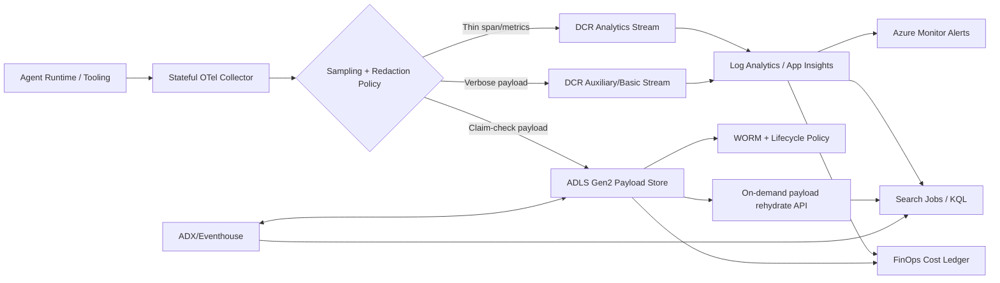
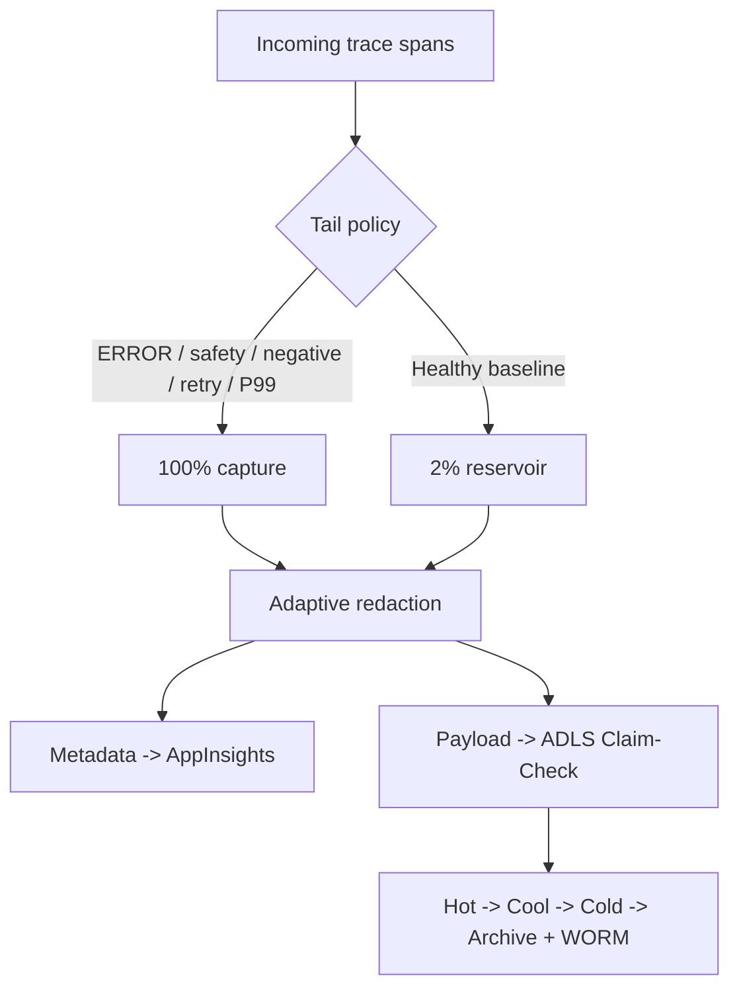

# Enterprise GenAI Trace and Prompt/Tool Payload Telemetry Tiering FAQ: Log Analytics Auxiliary vs ADX/Eventhouse vs OTel Claim-Check Blob Offload

> 🌐 **Language Switch**: [中文](./genai-trace-payload-telemetry-storage-finops-log-analytics-auxiliary-vs-adx-eventhouse-vs-otel-blob-offload-selection-faq.md) | **English (current)**
> **Audience**: Enterprise Cloud & AI Solution Architects, observability platform leads, LLMOps/FinOps owners, compliance audit leaders, and SRE engineering managers.
> **Scope**: Storage tiering and observability FinOps for `5–50 TB/month` multi-agent GenAI telemetry, balancing real-time triage, long-term regulated retention, and ingestion/query economics.

## 1. Problem framing and boundary: why GenAI observability creates bill shock in production
Conventional observability designs assume that richer logs are always beneficial, but GenAI systems fundamentally change payload scale because single telemetry records may include `50KB–2MB` prompt bodies, RAG chunks, tool I/O payloads, code diffs, and multimodal extraction artifacts.  
When these payloads are ingested wholesale into premium analytics tiers, cost behavior quickly shifts from query-driven to ingestion-driven, producing monthly bill spikes that are difficult to predict and hard to justify to business owners.  

At the same time, enterprises cannot simply reduce capture volume without architectural safeguards.  
Regulated domains often require replayable evidence chains for critical interactions, while SRE and AI engineering teams still need sub-second drill-down on tenant/model/tool correlation keys during active incidents.  

The design challenge is therefore not “which storage is cheapest,” but “how to separate real-time operational metadata from heavy audit payloads while preserving deterministic linkage and governance.”  
In other words, this is a telemetry data-product architecture problem, not just a logging-configuration problem.  

## 2. Four pattern families: explicitly separate ingestion, query, retention, and compliance concerns
Pattern A keeps the Azure Monitor-native experience and uses DCR split routing so thin spans and operational fields remain in analytics-tier tables while verbose payloads are redirected into Auxiliary/Basic logs with summary-rule rollups.  
Pattern B implements OTel claim-check so AppInsights stores searchable metadata plus `blob_uri` pointers while heavy payload objects are compressed and retained in ADLS Gen2 lifecycle tiers.  

Pattern C introduces ADX/Eventhouse as a high-throughput analytical plane for teams that perform frequent ad-hoc KQL and JSON/regex exploration on `10–100 TB` trajectory datasets.  
Pattern D applies stateful OTel tail-based policies and adaptive redaction to retain `100%` anomalous traces while sampling healthy traces, reducing volume at the source before storage decisions.  

These patterns are composable rather than mutually exclusive.  
A common enterprise end-state is A+B+D as baseline, with C activated for high-query-intensity teams; success depends on clear policy definitions for what must be real-time, immutable, sampled, or recoverable.  

## 3. End-to-end reference architecture: thin real-time index plus low-cost payload retention plus compliant replay


This architecture creates three explicit control surfaces: real-time operations, immutable evidence retention, and analytical acceleration.  
When all three concerns are forced into one storage tier, systems typically become either too expensive or too slow for incident response.  

A practical non-negotiable is shared key design across all layers: `trace_id/span_id/request_id/tenant_id/model/tool/status`.  
Without shared keys, claim-check recovery and cross-tier forensics become manual and error-prone.  

## 4. Pattern A deep dive: Azure Monitor DCR split into Analytics and Auxiliary/Basic tiers
Pattern A is operationally attractive because it preserves native Azure Monitor workflows, alerting integrations, dependency maps, and existing on-call runbooks while reducing premium-tier ingestion volume through routing policy.  
Teams can keep high-signal fields in analytics tables and route payload-heavy bodies to lower-cost tiers without breaking existing dashboards.  

A common implementation keeps `duration_ms`, `status_code`, `tenant_id`, `model_name`, and `tool_name` in analytics while shifting prompt bodies, raw tool payloads, and large retrieval snippets to Auxiliary/Basic.  
At around `15 TB/month`, this frequently delivers `80–95%` ingestion savings versus naive all-analytics ingestion.  

Its boundary appears in deep ad-hoc analytics workloads.  
When teams perform frequent long-range regex and nested JSON inspection across large historical windows, auxiliary query economics and experience can degrade, pushing organizations toward ADX/Eventhouse acceleration.  

Pattern A also does not automatically satisfy multi-year immutable legal retention.  
Long-horizon compliance still requires explicit object storage or immutable archive strategy.  

## 5. Pattern B deep dive: OTel claim-check plus ADLS lifecycle tiers (Hot->Cool->Cold->Archive)
Pattern B decouples telemetry pointers from payload bodies: AppInsights stores searchable metadata and object references, while full payload content is compressed and persisted in ADLS.  
This shifts economics from premium ingestion pricing to lower-cost object retention with optional retrieval.  

For regulated workloads, claim-check enables strong combinations of per-tenant CMK, WORM retention locks, legal hold tagging, and long retention windows compatible with strict evidentiary requirements such as `SEC 17a-4`-style controls.  
It also supports data-sovereignty strategies through account/container partitioning and key-scope segregation.  

The trade-off is retrieval indirection: payload body inspection requires rehydrate flow.  
The design implication is clear: real-time detection fields must remain in thin telemetry envelopes, while full payload is fetched only when triage or audit genuinely needs body-level detail.  

Without robust indexing metadata, claim-check can become “cheap to store but hard to find.”  
A production-ready design must guarantee deterministic pointer reconstruction from operational query keys.  

## 6. Pattern C deep dive: ADX/Eventhouse unified telemetry and evaluation lake
Pattern C is suited for organizations with high analytical query intensity, where AI engineering and SRE teams run frequent exploratory KQL across very large trajectory datasets.  
Columnar storage, compression, and hot-cache execution typically improve large-window query behavior compared to ad-hoc retrieval over operational log stores.  

At `10–100 TB` with sustained analyst activity, ADX/Eventhouse often becomes cost-effective because it reduces repeated scan penalties and provides consistent interactive performance for complex filters and payload-structure exploration.  
With OneLake shortcuts, teams can align online telemetry with offline evaluation data for closed-loop model governance.  

The trade-off is additional platform surface area, including capacity planning, cache policy, ingestion governance, and role-based query controls.  
If query volume is sparse, this added complexity may not justify itself and can create avoidable operations overhead.  

Pattern C should therefore be demand-driven by measured query behavior, not adopted preemptively because it appears architecturally elegant.  
Use query telemetry as the gating input for adoption timing.  

## 7. Pattern D deep dive: stateful tail sampling and adaptive payload redaction
Pattern D optimizes at the collector edge by reducing volume before downstream ingestion costs are incurred.  
The recommended policy shape is “keep all anomalous trajectories, sample healthy trajectories, redact sensitive fields adaptively.”  

Typical full-capture triggers include `ERROR` status, safety blocks, user negative feedback, retry loops, and high-latency outliers.  
This approach can reduce raw payload volume by `90–96%` while preserving almost all incident-relevant data paths.  

A critical compliance caveat: pure tail sampling cannot satisfy legal requirements for full interaction retention where mandated.  
In such contexts, tail sampling may optimize engineering replicas, but legal-hold retention must remain on a full-capture immutable path.  

Pattern D should therefore be presented as observability optimization, not compliance substitution.  
Documenting this distinction is essential to avoid policy misuse under audit pressure.  

## 8. 12-dimension comparison matrix: real-time operations, analytical depth, retention compliance, and cost behavior
| Dimension | Pattern A DCR Split | Pattern B Claim-Check Blob | Pattern C ADX/Eventhouse | Pattern D Tail Sampling |
|---|---|---|---|---|
| 1. Real-time alert fitness | High | Medium-high (thin index dependent) | Medium | High (anomaly-first) |
| 2. Sub-second KQL triage | High (small-medium windows) | Medium (rehydrate overhead) | High (large windows) | High for retained anomaly path |
| 3. Heavy payload cost elasticity | Medium-high | Highest | High | High |
| 4. Seven-year retention viability | Medium (needs add-ons) | Highest | High (with policy) | Low alone |
| 5. Per-tenant CMK isolation | Medium | High | High | Medium |
| 6. Platform complexity | Low-medium | Medium | High | Medium |
| 7. Query ergonomics | Low learning overhead | Medium | Medium | Medium |
| 8. Payload rehydrate complexity | Low | Medium-high | Medium | Medium |
| 9. Audit proof strength | Medium-high | Highest | High | Medium |
| 10. Cost predictability | Medium | High | Medium-high | High |
| 11. Migration friction | Low | Medium | Medium-high | Medium |
| 12. Best-fit maturity stage | Early-medium scale | Medium-large regulated scale | High-query large scale | Cross-cutting optimization |

No single pattern dominates every dimension.  
Most production programs converge to layered combinations where each pattern addresses a different control objective.  

A robust governance process should weight dimensions quarterly based on business maturity, regulatory pressure, and query demand evolution rather than freezing one design permanently.  
This prevents architecture lock-in while retaining accountability.  

## 9. Monthly TCO model at `1 TB`, `15 TB`, and `60 TB` raw telemetry volume
Assumptions are normalized across all options: raw trace payload includes prompt/tool bodies and retrieval snippets before compression, then compared across four storage/processing strategies.  
The baseline is naive all-analytics ingestion, with alternatives measured against equivalent operational requirements.  

| Raw monthly volume | Naive all-analytics baseline | DCR split (Pattern A) | ADX/Eventhouse (Pattern C) | Claim-check blob (Pattern B) |
|---:|---:|---:|---:|---:|
| 1 TB/month | $3,900 | $1,180 | $1,650 | $920 |
| 15 TB/month | $58,500 | $13,600 | $16,900 | $8,700 |
| 60 TB/month | $234,000 | $49,800 | $57,200 | $29,600 |

At `1 TB/month`, multiple strategies are viable and team skill/ops simplicity may drive choice.  
At `15 TB/month`, naive baseline economics become difficult to justify, and split or claim-check patterns usually become necessary.  

At `60 TB/month`, architecture should almost always be layered.  
`B + C` is often optimal for high-query organizations, while `A + B` can be stronger when analytical demand is moderate but compliance retention remains strict.  

## 10. Query latency and scan-economics trade-off: storage price alone is not enough
Low storage cost does not guarantee low incident response cost.  
During incidents, the key question is whether responders can isolate affected tenant/model/tool paths within seconds, not merely whether archived bytes are cheap.  

| Query use case | Pattern A (Log Analytics) | Pattern B (Claim-check) | Pattern C (ADX/Eventhouse) | Pattern D (Tail sampling) |
|---|---|---|---|---|
| Last 15-minute failure chain triage | Fast (sub-second to seconds) | Fast metadata, slower body rehydrate | Fast with hot cache | Fast for retained anomalies |
| 30-day cross-tenant regex/JSON deep scan | Medium (cost rises quickly) | Slow-medium (rehydrate-heavy) | Fast | Medium (sample-sensitive) |
| 12-month evaluation replay sampling | Medium | Medium-high | High | Medium |
| Full legal audit export | Medium (additional controls needed) | High | High with governance | Low alone |

FinOps decisions should include query-latency SLAs and incident recovery impact, not ingestion cost alone.  
Many programs reduce ingestion spend but later pay more in outage duration due to weak forensic performance.  

## 11. Enterprise scenario A: global retail bank requiring 100% immutable seven-year prompt audit
This scenario demands complete replayability and legal hold readiness while preserving fast operational triage for fraud, compliance, and customer-dispute investigations.  
Recommended baseline is Pattern B for immutable payload retention plus Pattern A for operational indexing and alerting.  

The bank stores `prompt_hash`, `payload_blob_uri`, `legal_hold_tag`, `case_id`, and tenant controls in the thin tier so investigators can identify relevant traces quickly before rehydrating full payload.  
This preserves operational speed while keeping evidentiary payload in immutable storage.  

In pilot operation, the program reduced projected monthly observability spend from about `$71K` to roughly `$19K` while maintaining full replay coverage for sampled legal audits.  
Cross-team evidence retrieval time also improved from hours to minutes because pointer design was standardized.  

## 12. Enterprise scenario B: high-growth B2B coding-agent SaaS emitting `25 TB/month` repo/tool traces
This scenario has sustained analytical demand: daily ad-hoc debugging, release regression comparisons, tenant anomaly clustering, and cost accountability by workload class.  
Recommended architecture is Pattern C + Pattern D + Pattern B, with Pattern A retained for native real-time operational dashboards.  

Pattern C supports heavy KQL exploration, Pattern D reduces healthy-run telemetry volume at source, and Pattern B provides long-term low-cost retention with deterministic payload retrieval when needed.  
Together they avoid forcing one storage plane to satisfy contradictory requirements.  

In practice, this layered approach reduced telemetry cost per 1,000 resolved tasks by approximately `44%` and reduced median failure-trace diagnosis time by around `37%`.  
The critical success factor was strict key design consistency across all telemetry tiers.  

## 13. Config block A: Azure Monitor DCR transformation and analytics/auxiliary split
```kql
source
| extend payload_size = strlen(tostring(customDimensions.payload))
| extend status = tostring(customDimensions.status)
| extend tenant_id = tostring(customDimensions.tenant_id)
| extend model_name = tostring(customDimensions.model_name)
| extend tool_name = tostring(customDimensions.tool_name)
| extend trace_id = tostring(operation_Id)
| project TimeGenerated,
          trace_id,
          tenant_id,
          model_name,
          tool_name,
          status,
          durationMs = todouble(duration),
          payload_size,
          payload_hash = hash_sha256(tostring(customDimensions.payload)),
          payload_preview = substring(tostring(customDimensions.payload), 0, 512),
          payload = tostring(customDimensions.payload)
| extend route_to_aux = iif(payload_size > 4096, true, false)
| where isnotempty(trace_id)
```

```json
{
  "dataFlows": [
    {
      "streams": ["Custom-GenAIThin"],
      "destinations": ["la-analytics"],
      "transformKql": "source | where route_to_aux == false | project-away payload"
    },
    {
      "streams": ["Custom-GenAIVerbose"],
      "destinations": ["la-auxiliary"],
      "transformKql": "source | where route_to_aux == true"
    }
  ],
  "destinations": {
    "logAnalytics": [
      { "name": "la-analytics", "workspaceResourceId": "/subscriptions/.../workspaces/prod-la" },
      { "name": "la-auxiliary", "workspaceResourceId": "/subscriptions/.../workspaces/prod-la" }
    ]
  }
}
```

This split-stream pattern keeps high-frequency triage data in premium operational paths while diverting heavy payload bodies to lower-cost tiers.  
The architecture remains searchable because key correlation fields are preserved in both routes.  

## 14. Config block B: OTel collector claim-check routing + tail sampling + adaptive redaction
```yaml
receivers:
  otlp:
    protocols:
      grpc:
      http:

processors:
  memory_limiter:
    check_interval: 5s
    limit_mib: 4096
  attributes/redact:
    actions:
      - key: user_email
        action: hash
      - key: user_phone
        action: delete
      - key: prompt_body
        action: extract
        pattern: "(?s)^(.{0,1200}).*$"
  tailsampling:
    decision_wait: 15s
    num_traces: 500000
    expected_new_traces_per_sec: 5000
    policies:
      - name: keep-errors
        type: status_code
        status_code: {status_codes: [ERROR]}
      - name: keep-safety-blocked
        type: string_attribute
        string_attribute: {key: safety_blocked, values: ["true"]}
      - name: keep-user-negative
        type: string_attribute
        string_attribute: {key: user_feedback, values: ["negative"]}
      - name: keep-retries
        type: numeric_attribute
        numeric_attribute: {key: step_retry_count, min_value: 1}
      - name: keep-p99-latency
        type: latency
        latency: {threshold_ms: 4000}
      - name: baseline-random
        type: probabilistic
        probabilistic: {sampling_percentage: 2.0}

exporters:
  azuremonitor:
    connection_string: "${APPINSIGHTS_CONNECTION_STRING}"
  azureblob/claimcheck:
    storage_account: "${BLOB_ACCOUNT}"
    container: "genai-payload"
    compression: "zstd"
    object_path_template: "tenant=${tenant_id}/date=%Y-%m-%d/trace=${trace_id}.zst"
    immutability_policy_days: 2555

service:
  pipelines:
    traces:
      receivers: [otlp]
      processors: [memory_limiter, attributes/redact, tailsampling]
      exporters: [azuremonitor, azureblob/claimcheck]
```



This control stack provides deterministic anomaly retention while aggressively reducing healthy-run payload volume, enabling strong FinOps outcomes without sacrificing incident forensics.  
It should be paired with legal-hold policy exceptions whenever full retention is mandatory by regulation.  

## 15. Quantitative FAQ plus Day-0/Day-2 operating checklists (Good fit vs Not for)
1. **Why is naive all-analytics ingestion usually unsustainable at `15 TB/month`?**  
Because baseline cost near `$58.5K/month` is typically multiple times higher than split or claim-check alternatives with comparable operational observability quality.  

2. **When does ADX/Eventhouse become justified?**  
When query intensity and complexity are both high, especially for frequent broad-window KQL and deep payload analytics where operational log tiers incur repeated scan penalties.  

3. **Can tail sampling alone satisfy strict legal retention mandates?**  
No.  
Tail sampling optimizes engineering telemetry, but legal-hold and regulated retention requirements still need full immutable capture paths.  

4. **Does claim-check degrade incident response speed?**  
Not when thin-index metadata is designed correctly; responders can isolate candidate traces quickly and hydrate full payload only when body-level evidence is required.  

5. **What baseline architecture is recommended at `60 TB/month` with mixed operations and compliance?**  
Typically `B + C + D` with Pattern A preserved for native alerting and service health integration.  

6. **How should business stakeholders evaluate architectural complexity trade-offs?**  
Use three KPIs together: cost per 1,000 resolved tasks, median trace-to-root-cause time, and legal audit replay success rate.  

### Day-0 go-live checklist
| Item | Target | Notes |
|---|---|---|
| DCR split policy active | 100% | analytics vs auxiliary routing validated |
| Claim-check pointer closure | 100% | trace IDs resolve deterministic blob objects |
| Full-capture anomaly policy | 100% | error/safety/retry/negative/P99 conditions enforced |
| Lifecycle + immutability policy | 100% | Hot/Cool/Cold/Archive plus WORM lock configured |
| Cost attribution tags | >= 98% | tenant and product dimensions mandatory |

### Day-2 operations checklist
| Metric | Threshold | Response when breached |
|---|---:|---|
| Analytics-tier ingestion share | < 20% | tune DCR field routing policy |
| Payload rehydrate failure rate | < 0.5% | repair index-object consistency and lifecycle gaps |
| P95 critical query latency | < 2s | optimize cache and route heavy workloads to ADX |
| Cost variance per 1,000 tasks | < 10% | rebalance sampling and tiering policy |
| Audit replay success rate | 100% | escalate incident and remediate retention chain |

**Good fit**: regulated multi-tenant GenAI platforms that require both operational speed and long-horizon auditable retention under strict cost controls.  
**Not for**: low-volume early-stage pilots with minimal compliance obligations, where full multi-tier architecture may introduce unnecessary complexity too early.  
