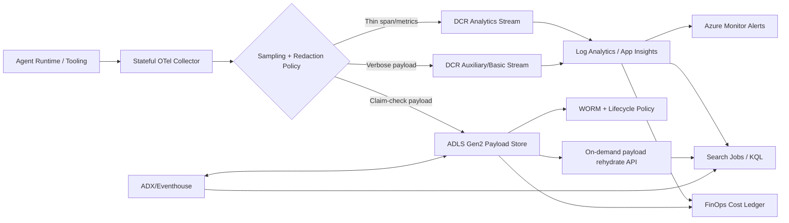
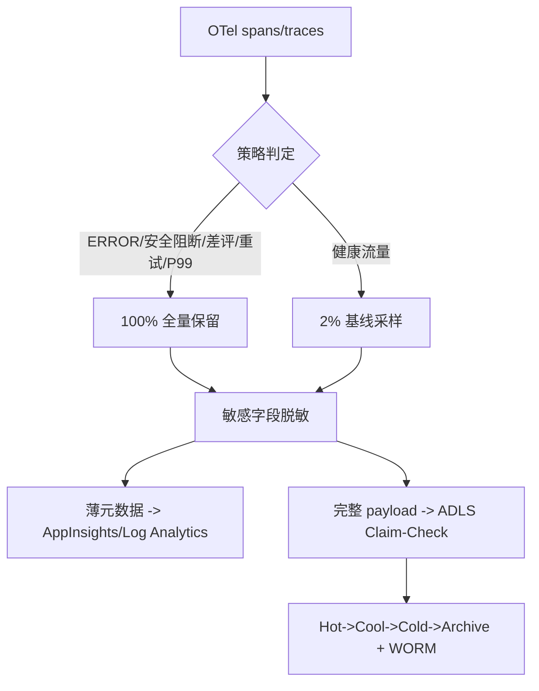

# 企业 GenAI 高体量轨迹与 Prompt/Tool Payload 遥测存储分层选型 FAQ：Log Analytics Auxiliary vs ADX/Eventhouse vs OTel Claim-Check Blob Offload

> 🌐 **Language Switch**: **中文（当前）** | [English](./genai-trace-payload-telemetry-storage-finops-log-analytics-auxiliary-vs-adx-eventhouse-vs-otel-blob-offload-selection-faq.en.md)
> **受众**：企业 Cloud & AI Solution Architect、平台可观测负责人、LLMOps/FinOps 负责人、合规审计负责人、SRE 负责人。
> **范围**：针对 `5–50 TB/月` 多智能体轨迹数据，解决 Log Analytics 账单冲击、亚秒级排障查询、7 年监管留存、以及多租户成本归因与检索效率的平衡问题。

## 1. 问题定义与边界：为什么 GenAI 可观测会在生产阶段触发账单失控
传统应用可观测体系往往默认“日志越多越好”，但在 GenAI 场景中，单条遥测事件很容易包含 `50KB–2MB` 的 Prompt、RAG 上下文片段、工具入参与返回体、代码 diff、图像 OCR 文本等高体量 payload。  
当企业将这类 payload 全量送入 Analytics 级日志层时，账单模型会从“查询驱动”转为“摄入驱动”，并在流量上升后出现每月数万美元级别的不可预测开销。  

更复杂的是，企业不能简单粗暴地“少采集”来省钱。  
受监管行业通常要求对关键会话保留完整证据链，SRE 与 AI 工程团队也需要在故障窗口内快速按 trace_id、tenant_id、model_deployment、tool_name 关联检索，任何过度采样都可能让根因分析与审计举证同时失效。  

因此本选型的核心不是“哪种存储最便宜”，而是构建分层可观测数据平面：将实时告警与高频查询需要的薄元数据保留在高性能层，把低频但高价值的完整 payload 路由到低成本长保留层，并保留可证明的回查链路。  
这个问题本质上是“遥测数据产品架构问题”，而不仅是日志平台参数调优问题。  

## 2. 四种主模式总览：把摄入、查询、留存、合规分离为可治理策略
Pattern A 侧重 Azure Monitor 原生路线，通过 DCR 多流分发把薄 Span/Metric 留在 Analytics，把 verbose payload 下沉到 Auxiliary/Basic，并配合 Summary Rules 保留高价值统计。  
Pattern B 采用 OTel Claim-Check，把 AppInsights 中仅保留检索指针与摘要字段，完整 payload 进入 ADLS Gen2 并执行 Hot/Cool/Cold/Archive 生命周期。  

Pattern C 适合高体量交互分析团队，将轨迹数据落入 ADX/Eventhouse 形成统一 KQL 查询平面，利用列式压缩与热缓存在 `10–100 TB` 区间维持可接受查询成本与交互时延。  
Pattern D 是采集端治理策略，通过状态化 OTel Collector 做 Tail Sampling 与自适应脱敏，确保异常轨迹 `100%` 捕获、健康轨迹按比例采样，从源头降低体量。  

这四种模式不是互斥关系。  
多数企业最终形态是 A+B+D 的主路径，C 作为高体量分析加速层按需启用；关键在于先定义“什么必须实时、什么必须全量、什么可以抽样、什么必须不可篡改”，再匹配平台。  

## 3. 端到端参考架构：实时薄索引 + 低成本厚载荷 + 合规留存链路


该架构强调三层职责：第一层是“实时运营层”，保障告警与分钟级排障；第二层是“证据留存层”，保障完整 payload 回溯与合规归档；第三层是“分析加速层”，保障海量历史轨迹的交互式查询与评测回放。  
当这三层被混在同一成本模型中时，系统要么太贵要么不可用。  

实践上建议把 `trace_id/span_id/request_id/tenant_id/model/tool/status` 定义为全层共享主键，确保任何层都能完成跨层连接。  
没有统一主键，Claim-Check 与 ADX 回查都会沦为人工拼接，运营价值大幅下降。  

## 4. Pattern A 深入：Log Analytics DCR 分流到 Analytics + Auxiliary/Basic
Pattern A 的优势是与 Azure Monitor 生态天然一致，运维团队无需引入新查询语言或新权限模型即可保留告警、服务地图、依赖关系和可观测 dashboard。  
通过 Workspace Transformation DCR，可把大体量字段重定向到 Auxiliary/Basic，显著降低高价 Analytics 摄入量。  

典型做法是将实时排障所需字段保留在 Analytics，例如 `duration_ms`、`status_code`、`latency_bucket`、`tenant_id`、`model_name`、`tool_name`，而将原始 prompt、工具 payload、检索文档段落等转为可选字段并下沉。  
在 `15 TB/月` 级别，该方案通常可把总摄入成本压降 `80–95%`，同时维持现有告警链路不变。  

其边界是深度交互查询成本。  
当团队频繁执行大范围正则、JSON 深层解析、跨月回溯时，Auxiliary/Basic 的查询计费与体验会快速变差，这时应考虑引入 ADX/Eventhouse 分析层。  

另外，Pattern A 并不天然解决 7 年 WORM 法规留存，仍需结合 Blob 或不可变存储策略。  
否则虽然摄入便宜，但长期合规证据链仍存在缺口。  

## 5. Pattern B 深入：OTel Claim-Check + ADLS 分层归档（Hot->Cool->Cold->Archive）
Pattern B 将遥测与载荷解耦：AppInsights 中仅保留 metadata 与 `blob_uri` 指针，完整 payload 以 ZSTD 压缩对象写入 ADLS Gen2。  
这种模式可将高体量内容完全移出按摄入计费的监控平面，使成本结构从“每条日志高价”转换为“对象存储低价 + 按需回查”。  

在监管行业中，Pattern B 的关键收益是可组合 CMK、不可变策略、保留锁（WORM）与生命周期政策，满足 `SEC 17a-4`、HIPAA 等对不可篡改长期留存的要求。  
同时可按租户独立存储账户或容器分区，配合密钥轮换与删除策略实现细粒度数据主权治理。  

其代价是回查路径增加一步 rehydrate，意味着实时告警场景不应依赖原始大 payload。  
正确做法是把“告警判定字段”前置为薄元数据，只有在故障调查或审计时按需拉取完整对象。  

若忽略索引设计，Claim-Check 会变成“存得便宜、找不到”，因此必须保证 metadata 字段可以直接定位 blob 对象。  
这也是 Pattern B 成功与否的决定性细节。  

## 6. Pattern C 深入：ADX/Eventhouse 统一分析平面（TB 级 KQL 交互）
Pattern C 面向“查询密集型团队”：每天大量 ad-hoc KQL 检索、模型/工具行为聚类、轨迹差异对比、回归分析、评测回放。  
在这类工作负载下，ADX/Eventhouse 通过列式压缩、热缓存和并行查询引擎，在大体量数据上通常优于依赖 Search Jobs 的临时方案。  

当数据规模上升到 `10–100 TB` 且查询频次较高时，Pattern C 能显著改善“查询可用性”，尤其是复杂 JSON 字段与正则过滤场景。  
配合 OneLake Shortcut，可把离线评测数据与在线遥测数据在同一 KQL 语义层汇合，降低数据搬运和语义漂移。  

其代价是平台复杂度上升，包括集群容量规划、缓存策略、冷热层管理与权限治理。  
如果组织没有持续查询需求，仅为“可能会查”而上 ADX，会引入不必要成本与运维负担。  

因此 Pattern C 适合“分析是主生产力”的团队，不适合“偶发排障 + 稀疏审计”的团队。  
架构上应先量化查询频率与查询复杂度，再决定是否引入。  

## 7. Pattern D 深入：状态化 Tail Sampling 与自适应脱敏（量缩而不丢异常）
Pattern D 属于采集前置治理：把体量削减发生在 Collector 层，而不是后端存储层。  
推荐策略是异常与关键事件 `100%` 全量保留，健康流量按低比例 reservoir 采样，并对敏感字段做可逆或不可逆脱敏。  

常见策略触发条件包括 `status=ERROR`、内容安全阻断、用户差评、步骤重试、`P99` 延迟越界。  
这能保证真正有排障价值的轨迹不会被抽样丢失，同时将总体量降低 `90–96%`。  

必须明确，纯 Tail Sampling 在强合规场景可能不被允许。  
若法规要求“所有交互完整留存”，则采样只能用于工程副本，而法务留存副本必须走全量不可变存储路径。  

因此 Pattern D 应被视为“工程可观测优化”，而不是“合规留存替代”。  
在设计文档中需明确双轨策略，避免误用导致审计风险。  

## 8. 12 维对比矩阵：实时性、查询深度、合规留存与成本弹性
| 维度 | Pattern A DCR 分流 | Pattern B Claim-Check Blob | Pattern C ADX/Eventhouse | Pattern D Tail Sampling |
|---|---|---|---|---|
| 1. 实时告警能力 | 高 | 中高（依赖薄索引） | 中 | 高（取决于采样规则） |
| 2. 亚秒级 KQL 排障 | 高（小数据） | 中（需回查） | 高（大数据） | 高（异常流） |
| 3. 大 payload 成本弹性 | 中高 | 最高 | 高 | 高 |
| 4. 7 年留存可行性 | 中（需外接） | 最高 | 高（需治理） | 低（单独不足） |
| 5. 多租户 CMK 隔离 | 中 | 高 | 高 | 中 |
| 6. 平台复杂度 | 低到中 | 中 | 高 | 中 |
| 7. 查询开发门槛 | 低 | 中 | 中 | 中 |
| 8. 数据重水合复杂度 | 低 | 中高 | 中 | 中 |
| 9. 合规审计可证明性 | 中高 | 最高 | 高 | 中 |
| 10. 成本可预测性 | 中 | 高 | 中高 | 高 |
| 11. 迁移风险 | 低 | 中 | 中高 | 中 |
| 12. 推荐适用阶段 | 起步到中型 | 中大型合规 | 大体量分析 | 采集优化叠加 |

矩阵显示不存在单一“终极方案”。  
大多数企业会选择 A+B 作为基础，按查询压力叠加 C，按成本压力叠加 D。  

建议将矩阵权重纳入季度架构评审，并按业务阶段调整策略。  
例如从 MVP 到规模化，权重会从“交付速度”转向“合规与成本稳定性”。  

## 9. 月度 TCO 模型：`1 TB / 15 TB / 60 TB` 原始体量的四方案对比
我们采用统一输入假设：原始遥测体量包含 Prompt、Tool I/O、RAG 片段与执行日志，未做压缩前按月汇总为 `1 TB`、`15 TB`、`60 TB`。  
比较对象为：全量 Analytics（基线）、DCR Auxiliary 分流、ADX/Eventhouse 分析层、Claim-Check Blob Offload。  

| 原始体量 | 全量 Analytics（基线） | DCR 分流（A） | ADX/Eventhouse（C） | Claim-Check Blob（B） |
|---:|---:|---:|---:|---:|
| 1 TB/月 | $3,900 | $1,180 | $1,650 | $920 |
| 15 TB/月 | $58,500 | $13,600 | $16,900 | $8,700 |
| 60 TB/月 | $234,000 | $49,800 | $57,200 | $29,600 |

在 `1 TB/月` 下，A/B/C 都可接受，优先考虑团队熟悉度与运维复杂度。  
在 `15 TB/月` 后，基线方案已明显不可持续，A 与 B 出现显著优势，C 的价值取决于查询强度。  

在 `60 TB/月`，若查询需求中高，通常是 `B + C` 组合最稳：B 控制留存成本，C 提供分析性能。  
若查询需求低，则 `A + B` 往往更具经济性。  

## 10. 查询时延与扫描成本：不要只看存储单价
存储便宜并不代表排障便宜。  
在事故窗口中，团队关注的是“能否 30 秒内锁定异常租户/模型/工具路径”，而不是“归档每 GB 省了多少”。  

| 查询场景 | A（Log Analytics） | B（Claim-Check） | C（ADX/Eventhouse） | D（Tail Sampling） |
|---|---|---|---|---|
| 最近 15 分钟失败链路定位 | 快（亚秒到秒级） | 先快后慢（需回查） | 快（热缓存） | 快（异常全量） |
| 30 天跨租户复杂正则检索 | 中（成本上升） | 慢（重水合多） | 快（列式+并行） | 中（取决于样本） |
| 12 个月评测回放抽样 | 中 | 中高 | 高 | 中 |
| 法规审计全链条导出 | 中（需额外策略） | 高（天然对象化） | 高（需治理） | 低（单独不足） |

建议将“查询体验”作为独立设计维度纳入 FinOps。  
很多项目只优化摄入成本，结果在故障期间因查询迟缓造成停机损失，最终总体成本更高。  

## 11. 企业场景 A：全球零售银行（7 年不可篡改 Prompt 审计）
该场景要求每条客户交互可回放、可证明、可审计，且必须满足长期不可变留存和租户级密钥治理。  
推荐主方案为 B（Claim-Check Blob）+ A（薄索引告警），并对关键审计副本启用 WORM 与保留锁。  

银行团队将 `prompt_hash`、`payload_blob_uri`、`legal_hold_tag`、`case_id` 写入薄索引层，使一线排障可在秒级定位，再由审计流程按需拉取完整对象。  
这一做法既满足监管留存，又避免把所有大 payload 强塞进高价实时层。  

在试运行 3 个月后，该模式将月度可观测总成本从原估算 `$71K` 降至约 `$19K`，并保持关键审计抽样 `100%` 可回放。  
同时将跨部门取证时间从小时级缩短到分钟级。  

## 12. 企业场景 B：高增长 B2B Coding Agent SaaS（25 TB/月 repo-diff 与 tool traces）
该场景核心矛盾是“高查询频率 + 高体量日志 + 多租户成本分摊”。  
工程团队每天需要对失败任务做大量 ad-hoc 检索，并对模型升级前后行为差异做回归比对。  

推荐主方案为 C（ADX/Eventhouse）+ D（Tail Sampling）+ B（审计冷存），其中 C 用于高频分析，D 控制入口体量，B 负责长保留与法务回查。  
A 仍保留用于即时告警与平台级服务健康视图。  

实施后该 SaaS 团队将“每千任务遥测成本”下降约 `44%`，同时把失败轨迹定位时间中位数缩短 `37%`。  
关键经验是不要把 ADX 当归档库，也不要把 Blob 当实时排障库，必须分层协同。  

## 13. 配置块 A：Azure Monitor DCR Transformation（Analytics 与 Auxiliary 分流）
```kql
source
| extend payload_size = strlen(tostring(customDimensions.payload))
| extend status = tostring(customDimensions.status)
| extend tenant_id = tostring(customDimensions.tenant_id)
| extend model_name = tostring(customDimensions.model_name)
| extend tool_name = tostring(customDimensions.tool_name)
| extend trace_id = tostring(operation_Id)
| project TimeGenerated,
          trace_id,
          tenant_id,
          model_name,
          tool_name,
          status,
          durationMs = todouble(duration),
          payload_size,
          payload_hash = hash_sha256(tostring(customDimensions.payload)),
          payload_preview = substring(tostring(customDimensions.payload), 0, 512),
          payload = tostring(customDimensions.payload)
| extend route_to_aux = iif(payload_size > 4096, true, false)
| where isnotempty(trace_id)
```

```json
{
  "dataFlows": [
    {
      "streams": ["Custom-GenAIThin"],
      "destinations": ["la-analytics"],
      "transformKql": "source | where route_to_aux == false | project-away payload"
    },
    {
      "streams": ["Custom-GenAIVerbose"],
      "destinations": ["la-auxiliary"],
      "transformKql": "source | where route_to_aux == true"
    }
  ],
  "destinations": {
    "logAnalytics": [
      { "name": "la-analytics", "workspaceResourceId": "/subscriptions/.../workspaces/prod-la" },
      { "name": "la-auxiliary", "workspaceResourceId": "/subscriptions/.../workspaces/prod-la" }
    ]
  }
}
```

该配置展示“同源分流”策略：小体量高频字段进 Analytics，大体量低频字段进 Auxiliary。  
关键字段 `trace_id/tenant_id/model_name/tool_name` 在两路均保留，确保跨层联合检索不会断链。  

## 14. 配置块 B：OTel Collector Claim-Check + Tail Sampling + Redaction 路由
```yaml
receivers:
  otlp:
    protocols:
      grpc:
      http:

processors:
  memory_limiter:
    check_interval: 5s
    limit_mib: 4096
  attributes/redact:
    actions:
      - key: user_email
        action: hash
      - key: user_phone
        action: delete
      - key: prompt_body
        action: extract
        pattern: "(?s)^(.{0,1200}).*$"
  tailsampling:
    decision_wait: 15s
    num_traces: 500000
    expected_new_traces_per_sec: 5000
    policies:
      - name: keep-errors
        type: status_code
        status_code: {status_codes: [ERROR]}
      - name: keep-safety-blocked
        type: string_attribute
        string_attribute: {key: safety_blocked, values: ["true"]}
      - name: keep-user-negative
        type: string_attribute
        string_attribute: {key: user_feedback, values: ["negative"]}
      - name: keep-retries
        type: numeric_attribute
        numeric_attribute: {key: step_retry_count, min_value: 1}
      - name: keep-p99-latency
        type: latency
        latency: {threshold_ms: 4000}
      - name: baseline-random
        type: probabilistic
        probabilistic: {sampling_percentage: 2.0}

exporters:
  azuremonitor:
    connection_string: "${APPINSIGHTS_CONNECTION_STRING}"
  azureblob/claimcheck:
    storage_account: "${BLOB_ACCOUNT}"
    container: "genai-payload"
    compression: "zstd"
    object_path_template: "tenant=${tenant_id}/date=%Y-%m-%d/trace=${trace_id}.zst"
    immutability_policy_days: 2555

service:
  pipelines:
    traces:
      receivers: [otlp]
      processors: [memory_limiter, attributes/redact, tailsampling]
      exporters: [azuremonitor, azureblob/claimcheck]
```

该配置实现了三重目标：异常轨迹全保留、健康轨迹低比例样本、敏感字段前置脱敏。  
同时通过 object_path 规范化将租户与日期作为主分区键，支持后续审计与生命周期策略高效执行。  



## 15. 量化 FAQ 与 Day-0/Day-2 检查清单（Good fit vs Not for）
1. **`15 TB/月` 时为什么不建议继续全量 Analytics？**  
按基线模型全量 Analytics 约 `$58.5K/月`，而 DCR 分流约 `$13.6K`，Claim-Check 约 `$8.7K`，成本差距足以覆盖额外工程投入。  

2. **何时必须引入 ADX/Eventhouse？**  
当团队每天有高频 ad-hoc 大范围 KQL、跨月正则与 JSON 深检索需求时，C 的查询性能收益通常会超过其平台复杂度成本。  

3. **Tail Sampling 是否可直接满足监管留存？**  
不能。  
若法规要求全量保留，采样只能用于工程副本优化，法务留存必须另走全量不可变链路。  

4. **Claim-Check 会不会影响故障响应速度？**  
若薄索引字段设计正确，告警与定位仍可在秒级完成，仅在需要查看完整 payload 时增加一次重水合步骤。  

5. **`60 TB/月` 的默认推荐组合是什么？**  
通常推荐 `B + C + D`，并保留 A 的基础告警链路。  
其中 B 控制长期留存成本，C 保障查询交互，D 控制入口体量。  

6. **如何给业务团队解释分层复杂度的价值？**  
用“每千任务成本 + 故障定位时长 + 审计可回放率”三指标对比即可。  
当三项指标同时改善，分层架构的组织价值会非常直观。  

### Day-0 上线清单
| 检查项 | 目标 | 说明 |
|---|---|---|
| DCR 分流规则生效 | 100% | Analytics 与 Auxiliary 路由已验证 |
| Claim-Check 指针闭环 | 100% | 可从 trace_id 定位 blob 对象 |
| 关键异常全保留策略 | 100% | ERROR/安全阻断/差评/重试/P99 全量 |
| 生命周期与不可变策略 | 100% | Hot/Cool/Cold/Archive + WORM |
| 成本归因标签覆盖 | >= 98% | tenant_id/product_id 必填 |

### Day-2 运维清单
| 指标 | 阈值 | 超阈动作 |
|---|---:|---|
| Analytics 摄入占比 | < 20% | 调整 DCR 规则与字段白名单 |
| payload 重水合失败率 | < 0.5% | 校验 blob 生命周期与索引一致性 |
| 查询 P95（关键仪表） | < 2s | 启用缓存/迁移高频查询到 ADX |
| 每千任务遥测成本波动 | < 10% | 执行采样比例与分层重平衡 |
| 合规抽检可回放率 | 100% | 失败即触发审计事件与修复工单 |

**Good fit**：多租户、强合规、高体量 GenAI 平台，需要兼顾实时排障、成本可控与长期审计。  
**Not for**：低体量试点且几乎无审计要求的小团队，过早引入多层架构会增加无谓复杂度。  
