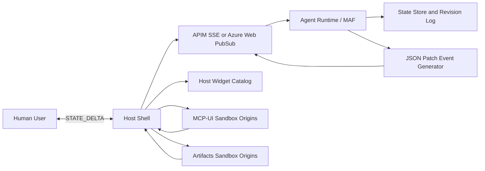
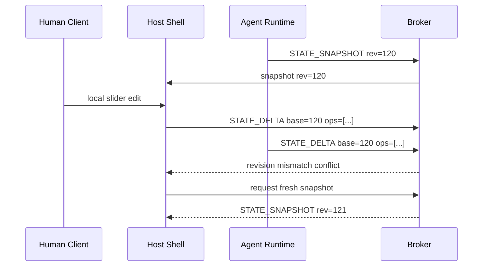

# Enterprise Generative UI Protocol Selection FAQ: AG-UI JSON-Patch State Sync, MCP-UI Sandboxed Frontends, and Host Declarative Catalogs
> 🌐 **Language Switch**: [中文](generative-ui-ag-ui-json-patch-state-sync-vs-mcp-ui-sandbox-vs-adaptive-cards-selection-faq.md) | **English (current)**  
> Audience: Cloud & AI Principal Architects, frontend platform governance teams, agent runtime engineers, and enterprise security leads.  
> Scope: Agent-to-user protocol-layer architecture with AG-UI/MCP-UI alignment, distinct from #26 transport plumbing and #51 channel positioning.  
> Objective: Build collaborative, auditable, low-latency, zero-trust generative UI systems on Azure.  

## 1. Executive finding: generative UI success depends on shared-state governance, not raw rendering flexibility
Most teams start with chat bubbles.
That approach scales poorly for real operations.
Enterprise workflows require shared structured state.
They require bidirectional edits by humans and agents.
They require replayable decision evidence.
They require strict security boundaries.
Text-only interactions produce hidden state drift.
Full-snapshot updates produce bandwidth inflation.
Unrestricted generated HTML produces governance failures.
A protocolized UI layer is therefore mandatory.
It should coexist with MCP and A2A contracts.
This guide evaluates four architecture paths.
Path A introduces AG-UI event-sourced state with RFC 6902 deltas.
Path B enforces host-owned declarative component catalogs.
Path C enables MCP-UI sandboxed cross-origin micro-frontends.
Path D supports isolated ad-hoc LLM artifact rendering.
The goal is balanced latency, safety, and cost.

## 2. Problem definition: four structural tensions in enterprise generative UI systems
Tension one is collaboration versus consistency.
Human and agent edits can collide in milliseconds.
Tension two is flexibility versus governance.
Business wants rapid UI innovation.
Platform teams need deterministic safety controls.
Tension three is observability versus confidentiality.
Teams need fine-grained diagnostics.
Compliance teams need strict data minimization.
Tension four is extensibility versus isolation.
Organizations want partner UI innovation.
They cannot expose host tokens or session cookies.
Without protocol-layer separation, these tensions collapse into one fragile frontend tier.
That creates brittle release cycles and weak auditability.
Architecture must separate state sync, rendering authority, and isolation controls explicitly.

## 3. Four-path operating model: AG-UI delta backbone, host catalog default, sandbox extension, isolated artifacts
Path A optimizes state synchronization efficiency.
It uses snapshot-plus-delta event streams.
Path B optimizes governance determinism.
It limits model output to typed props only.
Path C optimizes extensibility safely.
It supports independently shipped domain micro-frontends.
Path D optimizes ad-hoc exploratory visualization.
It enables fast bespoke artifacts under strict sandbox policies.
These paths are complementary.
Most enterprises run Path B as baseline.
Path A provides the collaboration state backbone.
Path C serves controlled federation scenarios.
Path D remains constrained by policy and TTL.
A central policy engine should route across paths.
Operational evidence should be unified across all four modes.

## 4. Twelve-dimension comparison matrix across AG-UI, host catalogs, MCP-UI, and artifact rendering
| Dimension | Path A AG-UI delta sync | Path B host declarative catalog | Path C MCP-UI sandbox frontends | Path D isolated ad-hoc artifacts |
|---|---|---|---|---|
| Latency potential | High | Medium-high | Medium | Medium |
| Bandwidth efficiency | Highest | High | Medium | Low-medium |
| Concurrency conflict handling | High | Medium | Medium | Low |
| XSS exposure surface | Low | Lowest | Low-medium | Medium |
| Data exfiltration risk | Low | Lowest | Low | Medium |
| Auditability | High | Highest | High | Medium |
| Component reuse leverage | Medium | High | Highest | Low |
| Governance complexity | Medium-high | Medium | High | Medium |
| Delivery flexibility | High | Medium | High | Highest |
| Multi-team scalability | High | High | Highest | Medium |
| Runtime operations complexity | Medium | Low-medium | High | Medium |
| Compliance proof strength | High | Highest | High | Medium-low |
This matrix is intended for architecture review boards.
It should be calibrated with workload-specific evidence.
Default path selection should be explicit and policy-backed.

## 5. Path A deep dive: AG-UI event-sourced state with RFC 6902 deltas and revision fencing
Path A treats UI state as first-class protocol data.
It does not rely on free-form textual interpretation.
Core events include `STATE_SNAPSHOT` and `STATE_DELTA`.
`STATE_DELTA` payloads use RFC 6902 operations.
Each delta carries base and next revision identifiers.
Clients apply deltas only when revision fences match.
Mismatch immediately triggers conflict handling.
Conflict handling can use deterministic merge policies.
Conflict handling can also request snapshot resynchronization.
This pattern minimizes payload volume in high-frequency collaboration.
It also improves deterministic replay.
APIM SSE and Azure Web PubSub both support this model.
Selection depends on fan-out, bidirectionality, and reconnect profile.
State event logs should be retained for incident forensics and tuning.

## 6. Path B deep dive: host-owned declarative component catalogs with typed schema contracts
Path B centralizes rendering authority in host governance.
Model output is constrained to validated JSON props.
Component code lives in approved host repositories.
No model-generated arbitrary script execution is allowed.
Adaptive Cards can serve as a normalized declarative envelope.
Typed design-system registries provide stricter long-term control.
WCAG 2.2 AA requirements can be enforced systematically.
Telemetry and action payload schemas become deterministic.
Audit and compliance evidence quality improves significantly.
The trade-off is reduced ad-hoc UI freedom.
For regulated industries, this trade-off is usually desirable.
Path B often becomes the enterprise default route.

## 7. Path C deep dive: MCP-UI cross-origin sandbox micro-frontends with typed postMessage bridges
Path C addresses specialized visual and domain tooling needs.
Examples include topology explorers and quantitative payoff viewers.
Teams can ship independent frontend runtimes without host redeploy.
Isolation is non-negotiable.
Sandboxed iframe boundaries should enforce least privilege.
Recommended baseline includes `sandbox=\"allow-scripts\"`.
Host and component origins should always differ.
Communication should use typed `postMessage` channels only.
Messages should include schema version and correlation IDs.
Host secrets, cookies, and Entra tokens must not enter component origins.
This model supports federation while preserving host trust boundaries.
It requires strong contract governance and compatibility testing.

## 8. Path D deep dive: LLM-synthesized ephemeral artifacts on isolated origins with strict CSP
Path D enables rapid one-off visual artifacts.
It is valuable for exploratory analytics and temporary explainers.
It also carries elevated injection and exfiltration risk.
Prompt-injected markdown can hide beacon links.
Generated CSS and image references can leak metadata.
Isolated artifact origins are mandatory.
A strict CSP baseline should start with `default-src 'none'`.
`connect-src 'none'` should disable outbound fetch channels.
`img-src data: blob:` should block external beacon images.
`frame-ancestors 'none'` should prevent clickjacking embedding.
Artifact lifetime should be policy-limited with TTL cleanup.
This path should never bypass enterprise trust controls.

## 9. Quantitative Q&A: eight mandatory protocol-review questions
**Q1: How large is snapshot bandwidth amplification versus RFC 6902 deltas.**  
A1: With `100KB` snapshots and `0.8KB` median deltas, `10,000` sessions updating every second can shift from roughly `~953MB/s` to `~7.6MB/s` on wire payload volume.  
**Q2: How should concurrent edit collision risk be estimated.**  
A2: If human and agent each write within a `200ms` window and field overlap is `15%`, approximate collision probability is `1-(1-0.15)^2≈27.8%`, requiring revision fences.  
**Q3: When should a reconnect force full snapshot instead of replaying patch chains.**  
A3: A practical policy is snapshot resync when patch chain exceeds `256` ops or cumulative patch bytes exceed `60%` of snapshot size.  
**Q4: How should APIM SSE and Web PubSub reconnect parameters be tuned.**  
A4: A baseline uses `15s` heartbeat and `60s` resumable reconnect window; beyond that threshold, return a fresh `STATE_SNAPSHOT` for deterministic recovery.  
**Q5: Why does double-iframe isolation strengthen MCP-UI boundaries.**  
A5: Splitting shell and component contexts across distinct origins further reduces token, storage, and DOM bridge exposure under indirect prompt injection attempts.  
**Q6: Why must postMessage payloads be versioned.**  
A6: Independent team release cadences create schema drift; explicit versioning enables compatibility branching and controlled rollback.  
**Q7: What exfiltration reduction is expected from strict artifact CSP.**  
A7: Blocking outbound connect and external image sources suppresses common beacon channels; residual risk shifts mainly to user-initiated export vectors.  
**Q8: Where is the practical cost boundary between SSE and Web PubSub.**  
A8: SSE is often cheaper for low-fanout unidirectional streams, while Web PubSub is operationally stronger for high-fanout bidirectional collaboration and mobile reconnect churn.  
These questions should be embedded in architecture gates.
Each answer should map to measured load-test evidence.

## 10. Reference architecture diagram: protocol control plane and rendering lanes

The diagram separates state protocol from rendering policy.
It also keeps extension lanes isolated from host trust roots.

## 11. Sequence diagram: concurrent edits, revision mismatch, and snapshot resync

Revision fencing is the decisive consistency control.
Without it, silent overwrite defects are likely.

## 12. Production code sample: AG-UI patch emitter and revision-fenced applier
```python
import copy
import jsonpatch
from dataclasses import dataclass


@dataclass
class Envelope:
    revision: int
    state: dict


def emit_delta(prev: Envelope, next_state: dict, actor: str) -> dict:
    patch = jsonpatch.make_patch(prev.state, next_state)
    return {
        "type": "STATE_DELTA",
        "base_revision": prev.revision,
        "next_revision": prev.revision + 1,
        "actor": actor,
        "ops": patch.patch,
    }


def apply_delta(env: Envelope, delta: dict) -> Envelope:
    if delta["base_revision"] != env.revision:
        raise ValueError("revision mismatch, snapshot required")
    merged = jsonpatch.JsonPatch(delta["ops"]).apply(copy.deepcopy(env.state), in_place=False)
    return Envelope(revision=delta["next_revision"], state=merged)
```
The key controls are deterministic revisions and fast conflict rejection.
Both are mandatory for enterprise co-agent editing integrity.

## 13. Production configuration sample: MCP-UI CSP isolation and typed bridge contracts
```nginx
add_header Content-Security-Policy "default-src 'none'; script-src 'self'; style-src 'self'; img-src data: blob:; connect-src 'none'; frame-ancestors 'none'; base-uri 'none'; form-action 'none'" always;
add_header X-Frame-Options "DENY" always;
add_header Referrer-Policy "no-referrer" always;
add_header Cross-Origin-Opener-Policy "same-origin" always;
add_header Cross-Origin-Resource-Policy "same-origin" always;
```
```ts
type BridgeMessage =
  | { kind: "ui:init"; version: "1.0"; componentId: string; correlationId: string }
  | { kind: "ui:event"; version: "1.0"; event: string; payload: unknown; correlationId: string };

export function postTyped(target: Window, origin: string, msg: BridgeMessage) {
  target.postMessage(msg, origin);
}
```
Default-deny CSP should be treated as baseline policy.
Typed bridge contracts should be versioned and compatibility-tested.

## 14. Enterprise scenarios and FinOps bandwidth economics
### Scenario A: global wealth and institutional derivatives co-agent workbench (`6,500` advisors)
The business requires shared interactive risk structuring.
Advisors adjust exposure sliders while agents recalculate outcomes.
Path A plus Path B forms the baseline.
Path C is enabled for specialized quantitative visual modules.
Peak patch throughput is high.
Wire bytes remain far below full snapshot transport.
Mobile latency remains inside target envelopes.
Audit replay supports post-trade governance review.
### Scenario B: enterprise cloud IDP and observability portal with `40` MCP-UI modules
The portal aggregates internal and partner diagnostic frontends.
Host token exposure is prohibited by design.
Path C runs as default extension lane.
Each module is isolated on dedicated origins.
Path D is restricted to temporary reporting artifacts.
Outbound network from artifact origins is blocked.
Contract tests gate module rollout.
Module-level circuit breaking protects shell availability.
### FinOps and egress comparison table
| Metric | Full snapshot transport | AG-UI delta transport | Delta + catalog + sandbox blend |
|---|---:|---:|---:|
| Average upstream bytes per step | 100 KB | 0.8 to 2.5 KB | 1.1 to 3.0 KB |
| Peak bandwidth at 10k sessions | High | Low | Low-medium |
| Client deserialization cost | High | Low | Low-medium |
| Reconnect recovery time | Medium | Low | Low |
| Operations complexity | Medium | Medium-high | High |
| Security proof strength | Medium | High | Highest |
| Component reuse payoff | Medium | Medium | High |
| TCO stability | Medium | High | High |
This table supports architecture plus finance planning reviews.
Values should be validated with measured traffic profiles.

## 15. Day-0 and Day-2 checklist: production discipline for generative UI protocol systems
- Define canonical schemas for STATE_SNAPSHOT and STATE_DELTA events.
- Require base and next revision identifiers on every delta event.
- Ensure conflict handling is observable and replayable.
- Set explicit snapshot-resync thresholds for reconnect paths.
- Version-control host widget catalog contracts.
- Enforce strict typed-prop schema validation before rendering.
- Isolate MCP-UI modules on dedicated origins.
- Require typed and versioned postMessage contracts.
- Enforce artifact CSP baseline with `default-src 'none'`.
- Deny outbound `connect-src` in artifact rendering origins.
- Run weekly weak-network reconnect load drills.
- Review monthly bandwidth, latency, and collision metrics.
Each checklist item should map to a named owner.
Each checklist item should map to release-gate evidence.
Additional governance recommendations strengthen scale operations.
Track patch-apply failure rate as an SLO.
Track reconnect first-frame latency as an SLI.
Integrate component contract tests into CI gates.
Log cross-origin message audits in centralized telemetry.
Apply least-privilege permissions for all extension modules.
Require approval workflows for high-risk module onboarding.
Set TTL lifecycle limits for temporary artifacts.
Auto-clean expired artifacts with auditable jobs.
Mark sensitive shared-state fields with policy labels.
Block default export of sensitive fields in UI shells.
Throttle abnormal patch burst patterns per session.
Use backoff reconnect for cross-region jitter windows.
Alert on host-component contract drift.
Use dual-stack rollout for breaking schema evolution.
Publish four mandatory protocol health indicators weekly.
Run quarterly prompt-injection exfiltration simulations.
Maintain cross-device consistency benchmark suites.
Include iOS and Android divergence checks in regressions.
Set browser-fragmentation compatibility thresholds per release.
Bucket long-connection failures by network layer reason.
Correlate heartbeat-loss rates with regional network quality.
Trip circuit breakers on abnormal patch-chain growth.
Provide scripted recovery playbooks after circuit-break events.
Persist manual remediation actions as auditable events.
Decouple UI component release cadence from protocol versions.
Define deprecation windows for legacy protocol clients.
Provide dual-protocol compatibility bridges before cutoff.
Emit structured alerts for bridge translation failures.
Auto-feed failure samples back into protocol test corpora.
Govern shared-state field definitions in enterprise data dictionaries.
Make field ownership and approval routes explicit.
Enforce dual approval for high-value field modifications.
Track cross-team component dependencies with SBOM manifests.
Validate component supply-chain signatures on a fixed cadence.
Run third-party components in least-privilege runtime envelopes.
Redact sensitive content from runtime exception stacks.
Scan telemetry fields with automated compliance policies.
Apply regionalized log residency for cross-border user traffic.
Schedule full end-to-end protocol game days before major launches.
Track schema migration lag as a program KPI.
Require migration completion targets for dependent teams.
Link policy exceptions to signed risk-acceptance records.
Expire exceptions automatically unless renewed by governance.
Measure typed-message validation rejection rates continuously.
Alert on sudden rejection-rate drift by component family.
Backtest conflict-resolution heuristics on archived session traces.
Publish quarterly resilience scorecards to architecture boards.
Run annual red-team drills against cross-origin bridge boundaries.
Maintain industry-specific replay datasets for banking, healthcare, and public-sector workflows.
Apply stricter signed-message policies for cross-organization collaboration channels.
Trigger immediate containment actions when signature validation fails repeatedly.
Correlate protocol anomalies with business failure outcomes in one observability view.
Track high-value field mutation frequencies as risk signals.
Bucket hot versus cold state fields for transport optimization.
Feed quarterly capacity-planning outcomes into protocol roadmap governance.
Require architecture-board approval for high-impact protocol default changes.
