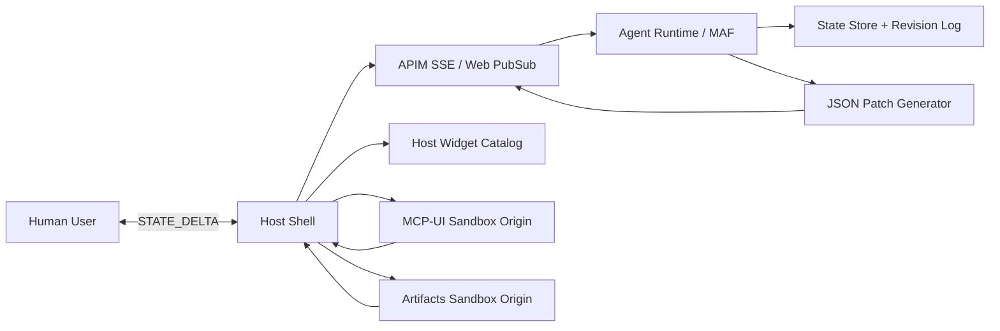
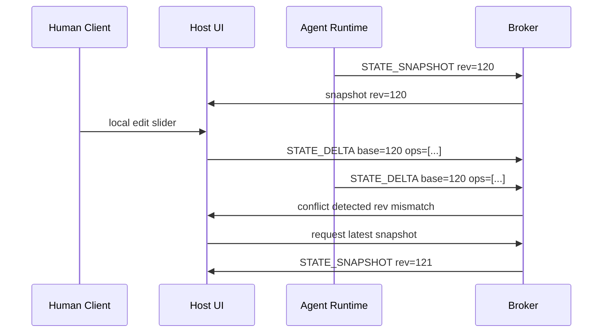

# 企业生成式界面协议选型 FAQ：AG-UI 状态增量、MCP-UI 沙箱与 Host 声明式组件治理
> 🌐 **Language Switch**: **中文（当前）** | [English](generative-ui-ag-ui-json-patch-state-sync-vs-mcp-ui-sandbox-vs-adaptive-cards-selection-faq.en.md)  
> 适用对象：Cloud & AI 首席架构师、前端平台治理团队、Agent Runtime 与安全团队。  
> 主题边界：聚焦 Agent-to-User 界面协议层，不替代 #26 实时传输管道，不覆盖 #51 渠道入口定位。  
> 核心目标：在 Azure 上实现可协作、可回放、可审计、可隔离的企业级生成式 UI。  

## 1. 执行摘要：生成式 UI 的核心不是“能渲染”，而是“能共编、可控、可追责”
很多团队先做聊天气泡。  
然后发现业务效率受限。  
真实业务需要共享状态。  
需要表格、滑杆、图表。  
需要人与 Agent 同步编辑。  
还需要可回放证据。  
如果只传自然语言。  
状态会不断漂移。  
如果每次全量快照。  
带宽会线性爆炸。  
如果允许任意 HTML。  
安全边界会迅速失守。  
因此需要协议化 UI 层。  
并且要与 MCP、A2A 协同。  
本指南给出四路径。  
路径 A：AG-UI 事件源 + RFC 6902 增量。  
路径 B：Host 声明式组件目录。  
路径 C：MCP-UI 跨源沙箱微前端。  
路径 D：LLM 临时产物隔离渲染。  
目标是体验、成本、安全三者平衡。  

## 2. 问题定义：企业生成式 UI 的四个系统矛盾
第一矛盾是实时协作与一致性。  
人和 Agent 会并发编辑。  
第二矛盾是灵活性与治理。  
业务想快速出新界面。  
平台要严格控风险。  
第三矛盾是可观测与隐私。  
需要细粒度调试信息。  
又不能泄露敏感数据。  
第四矛盾是复用与隔离。  
希望复用伙伴能力。  
又必须防跨租户越权。  
如果不做协议层分工。  
这些矛盾会堆到前端。  
最终变成不可维护系统。  

## 3. 四路径总览：AG-UI、Host Catalog、MCP-UI、Artifacts Sandbox
路径 A 解决状态同步效率。  
用 snapshot + delta 传输。  
并用 revision 栅栏控并发。  
路径 B 解决渲染面治理。  
模型只出 typed props。  
组件完全由 Host 控制。  
路径 C 解决能力扩展。  
允许独立团队交付可视部件。  
但运行在跨源沙箱中。  
路径 D 解决临时可视化探索。  
允许 ad-hoc 产物快速渲染。  
同时用强 CSP 隔离出网。  
四路径并非互斥。  
常见做法是 B 为默认。  
A 为协作底座。  
C 为受控扩展。  
D 为受限实验。  

## 4. 十二维对比矩阵：协议效率、治理强度与零信任隔离边界
| 维度 | 路径 A AG-UI Delta | 路径 B Host 声明式目录 | 路径 C MCP-UI 沙箱微前端 | 路径 D LLM 临时产物沙箱 |
|---|---|---|---|---|
| 交互延迟潜力 | 高 | 中高 | 中 | 中 |
| 带宽效率 | 最高 | 高 | 中 | 低中 |
| 并发冲突处理 | 高 | 中 | 中 | 低 |
| XSS 暴露面 | 低 | 最低 | 低中 | 中 |
| 外联数据渗漏风险 | 低 | 最低 | 低 | 中 |
| 可审计性 | 高 | 最高 | 高 | 中 |
| 组件复用效率 | 中 | 高 | 最高 | 低 |
| 上线治理复杂度 | 中高 | 中 | 高 | 中 |
| 开发灵活性 | 高 | 中 | 高 | 最高 |
| 多团队协作可扩展性 | 高 | 高 | 最高 | 中 |
| 运维复杂度 | 中 | 低中 | 高 | 中 |
| 合规可证明性 | 高 | 最高 | 高 | 中低 |
矩阵显示没有唯一银弹。  
需按场景分层组合。  
并定义默认与例外路径。  

## 5. 路径 A：AG-UI 事件源协议与 RFC 6902 增量同步
AG-UI 强调共享状态。  
不是只推文本片段。  
核心事件包括 snapshot。  
也包括 state_delta。  
delta 使用 JSON Patch。  
每条 patch 绑定 revision。  
客户端先比对 base_revision。  
匹配才可应用。  
不匹配进入冲突流程。  
冲突流程可做自动合并。  
也可回退到最新快照。  
在高并发协作界面。  
delta 显著减少出网字节。  
并降低端侧反序列化压力。  
在 APIM SSE 或 Web PubSub 中。  
都可实现顺序事件流。  

## 6. 路径 B：Host 声明式组件目录与 Typed Props 治理
Host Catalog 是治理锚点。  
模型无权输出脚本。  
模型只输出结构化属性。  
属性需经过 schema 校验。  
组件由企业前端仓维护。  
可统一可访问性规范。  
可统一埋点规范。  
可统一审计 payload。  
Adaptive Cards 可作为入口。  
也可映射到 Fluent 组件。  
当 LLM 输出越界字段。  
Host 可直接拒绝渲染。  
这种模式安全上限很高。  
尤其适合金融与政企。  
代价是灵活性受约束。  
但运维和审计成本更可控。  

## 7. 路径 C：MCP-UI 跨源沙箱微前端与 typed postMessage
MCP-UI 适合域专家组件。  
比如复杂风险图谱。  
比如分子三维可视化。  
比如衍生品损益曲面。  
这些组件常由外部团队维护。  
Host 不希望频繁重发版。  
因此采用跨源 iframe。  
并设置严格 sandbox。  
推荐仅开 `allow-scripts`。  
禁止 same-origin 升权。  
通信仅走 typed postMessage。  
消息需声明 schema version。  
消息需声明 correlation id。  
Host 不透传 cookie 与 token。  
并在网关层限制资源域名。  

## 8. 路径 D：LLM 临时 UI 产物隔离渲染与 CSP 最小权限
临时产物模式迭代快。  
适合一次性分析看板。  
也适合 PoC 可视化。  
但风险同样突出。  
提示注入可植入外链。  
Markdown 图片可偷信标。  
内联 CSS 可诱导点击。  
应将产物托管到隔离域。  
如 `*.artifacts-sandbox`。  
并启用 `default-src 'none'`。  
`connect-src 'none'` 强制断网。  
`img-src data: blob:` 限制外图。  
`frame-ancestors 'none'` 防套娃。  
必要时可启用静态净化器。  
如 DOMPurify 白名单策略。  
该路径应受配额与时限约束。  

## 9. 定量问答：协议评审必须回答的八个硬问题
**Q1：全量 snapshot 与 JSON Patch 的带宽差异有多大。**  
A1：若单状态 `100KB`，每步变更仅 `0.8KB`，`10,000` 会话每秒 1 次更新时，全量约 `~953MB/s`，增量约 `~7.6MB/s`，量级差异可超过百倍。  
**Q2：并发编辑冲突如何量化。**  
A2：设人和 Agent 在 `200ms` 窗口内各提交一次，且共享字段重叠率 `15%`，冲突概率近似 `1-(1-0.15)^2≈27.8%`，需 revision 栅栏与重放策略。  
**Q3：何时应触发 snapshot 重同步。**  
A3：常见阈值是“累计 patch 条数 > 256 或累计 patch 字节 > 快照 60%”即触发重发 snapshot，避免长链回放放大延迟。  
**Q4：APIM SSE 刷新与重连窗口怎么定。**  
A4：建议 `heartbeat 15s`，连接空闲 `60s` 内可续流，超过阈值返回 `STATE_SNAPSHOT` 重建，兼顾边缘网络抖动与服务端资源。  
**Q5：MCP-UI 双 iframe 隔离价值是什么。**  
A5：外层 Host 容器与内层组件分别不同 origin，可把 token、storage 与 DOM 能力进一步分区，降低跨上下文注入成功率。  
**Q6：typed postMessage 为什么必须 version 化。**  
A6：多团队独立发布下，若无 schema version，字段歧义会导致 silent failure；显式版本可做兼容分支与灰度回滚。  
**Q7：Artifact 沙箱对外联泄露压制效果如何。**  
A7：在 `connect-src 'none'` 与外图禁用下，常见 beacon 通道可被直接阻断，残余风险主要来自用户主动复制外发。  
**Q8：Web PubSub 与 SSE 的成本分界。**  
A8：低扇出单向流常用 SSE 成本更优；高扇出双向协作与移动弱网重连场景 Web PubSub 运维弹性更强。  
问答应写入架构评审模板。  
并配套压测证据。  

## 10. 参考架构图：AG-UI 协议控制平面与渲染平面

该图体现三类渲染路径并存。  
也体现状态流与渲染流解耦。  

## 11. 时序图：并发编辑、revision fencing 与重同步

关键是 base_revision 必须严格校验。  
否则会产生静默覆盖。  

## 12. 生产代码：AG-UI JSON Patch 事件生成与 revision 栅栏
```python
import copy
import jsonpatch
from dataclasses import dataclass


@dataclass
class StateEnvelope:
    revision: int
    state: dict


def build_state_delta(prev_env: StateEnvelope, next_state: dict, actor: str) -> dict:
    patch = jsonpatch.make_patch(prev_env.state, next_state)
    return {
        "type": "STATE_DELTA",
        "base_revision": prev_env.revision,
        "next_revision": prev_env.revision + 1,
        "actor": actor,
        "ops": patch.patch,
    }


def apply_delta_with_fence(env: StateEnvelope, delta: dict) -> StateEnvelope:
    if delta["base_revision"] != env.revision:
        raise ValueError("revision mismatch, require snapshot resync")
    patched = jsonpatch.JsonPatch(delta["ops"]).apply(copy.deepcopy(env.state), in_place=False)
    return StateEnvelope(revision=delta["next_revision"], state=patched)
```
代码要点是显式 base_revision。  
与冲突失败快速返回。  

## 13. 生产配置：MCP-UI 隔离 CSP 与 typed postMessage 桥
```nginx
add_header Content-Security-Policy "default-src 'none'; script-src 'self'; style-src 'self'; img-src data: blob:; connect-src 'none'; frame-ancestors 'none'; base-uri 'none'; form-action 'none'" always;
add_header X-Frame-Options "DENY" always;
add_header Referrer-Policy "no-referrer" always;
add_header Cross-Origin-Opener-Policy "same-origin" always;
add_header Cross-Origin-Resource-Policy "same-origin" always;
```
```ts
type UiBridgeMessage =
  | { kind: "ui:init"; version: "1.0"; componentId: string; correlationId: string }
  | { kind: "ui:event"; version: "1.0"; event: string; payload: unknown; correlationId: string };

export function sendTyped(target: Window, origin: string, msg: UiBridgeMessage) {
  target.postMessage(msg, origin);
}
```
配置重点是默认拒绝一切。  
桥接重点是消息强类型与版本化。  

## 14. 企业场景与带宽 FinOps：财富衍生品工作台与企业 IDP 观测门户
### 场景 A：全球财富与机构衍生品协作台（`6,500` 顾问）
业务要求人机同屏协作。  
顾问拖动风险参数。  
Agent 实时回推定价区间。  
采用路径 A + B。  
复杂图面使用受控 C 扩展。  
高峰时每秒 patch 峰值可观。  
但总带宽仍低于全量快照。  
可把移动端延迟控制在目标线。  
并保留交易建议审计链。  
### 场景 B：企业云 IDP 与可观测门户（`40` 内外部 MCP-UI）
门户需汇聚多供应商诊断组件。  
同时禁止 host token 泄露。  
采用路径 C 为主。  
并对每个组件分配独立 origin。  
路径 D 仅用于一次性临时报表。  
所有外联默认禁用。  
组件升级走 schema 契约测试。  
故障时可单组件熔断。  
不影响主壳可用性。  
### FinOps 与出网成本对比表
| 指标 | 全量 Snapshot 模式 | AG-UI Delta 模式 | Delta + Catalog + Sandbox 组合 |
|---|---:|---:|---:|
| 单会话平均上行字节/步 | 100 KB | 0.8~2.5 KB | 1.1~3.0 KB |
| 10k 会话峰值带宽 | 高 | 低 | 低中 |
| 端侧反序列化开销 | 高 | 低 | 低中 |
| 断线重连恢复时间 | 中 | 低 | 低 |
| 运维复杂度 | 中 | 中高 | 高 |
| 安全治理可证明性 | 中 | 高 | 最高 |
| 组件复用收益 | 中 | 中 | 高 |
| 总体 TCO 稳定性 | 中 | 高 | 高 |
该表用于架构与财务联评。  
需结合真实流量校准。  

## 15. Day-0 / Day-2 十二项清单：生成式 UI 协议生产化纪律
- 定义 STATE_SNAPSHOT 与 STATE_DELTA 的统一契约。  
- 所有 delta 必须包含 base_revision 与 next_revision。  
- 冲突处理必须可观测并可重放。  
- 设定 snapshot 重同步触发阈值。  
- Host 组件目录必须版本化管理。  
- Typed props 必须经 schema 校验。  
- MCP-UI iframe 必须运行在独立 origin。  
- postMessage 必须强类型与版本标识。  
- Artifact 渲染必须启用 `default-src 'none'`。  
- 禁止 artifact 外联 `connect-src`。  
- 每周回放一次弱网重连压测。  
- 每月复盘带宽、延迟与冲突率。  
清单每项需绑定 owner。  
并纳入发布门禁。  
建议补充以下治理动作。  
建议将 patch 失败率纳入 SLO。  
建议将重连后首帧时延纳入 SLI。  
建议将组件契约测试接入 CI。  
建议将跨源消息审计写入集中日志。  
建议将组件权限最小化并分级授权。  
建议将高风险组件启用人工上架审批。  
建议对临时产物设置生命周期 TTL。  
建议对 TTL 到期产物自动清理。  
建议对共享状态做字段级敏感标注。  
建议对敏感字段默认禁止前端导出。  
建议对异常高频 patch 设置限流保护。  
建议对跨区网络抖动配置退避重试。  
建议对 Host 与组件版本漂移设置告警。  
建议对 schema 破坏性变更做双栈灰度。  
建议在审计周报中输出四项核心指标。  
建议在季度演练中覆盖 prompt 注入 UI 泄露场景。  
建议建立跨端一致性基准测试集。  
建议将 iOS 与 Android 差异纳入回归。  
建议对浏览器版本碎片化设置兼容阈值。  
建议将长连接失败原因按网络层分桶。  
建议将心跳丢失率与地区网络质量关联。  
建议对 patch 链长度暴涨设置熔断。  
建议对熔断后恢复流程提供自动剧本。  
建议将人工修复动作纳入审计事件。  
建议将 UI 组件发布节奏与协议版本解耦。  
建议对旧协议客户端设置淘汰时间窗。  
建议在淘汰前提供双协议兼容桥。  
建议对桥接转换失败输出结构化告警。  
建议将失败样本自动回灌测试仓。  
建议将状态字段定义纳入数据字典治理。  
建议将字段所有者与审批路径显式化。  
建议对高价值字段启用双人变更复核。  
建议对跨团队组件依赖做 SBOM 清单。  
建议对组件供应链签名做周期校验。  
建议对第三方组件启用最小权限容器。  
建议对运行时异常堆栈做敏感信息脱敏。  
建议对埋点字段设置自动合规扫描。  
建议对跨境用户流量启用区域化日志落盘。  
建议在重大版本前执行全链路演练日。  
建议将会话回放样本按行业模板分层管理。  
建议对金融、医疗、政务分别维护风险基线。  
建议对跨组织协作场景启用额外消息签名。  
建议对签名验失败事件触发即时隔离策略。  
建议将协议异常与业务失败建立因果关联看板。  
建议将关键字段变更频度纳入风控监测阈值。  
建议将状态热字段与冷字段分桶优化传输。  
建议将季度容量规划纳入协议演进路线图。  
建议在年度治理评审中联合法务验证跨境数据边界与可视化策略一致性。  
建议将重大协议缺陷复盘结论沉淀为组织级设计守则并纳入新人培训。  
