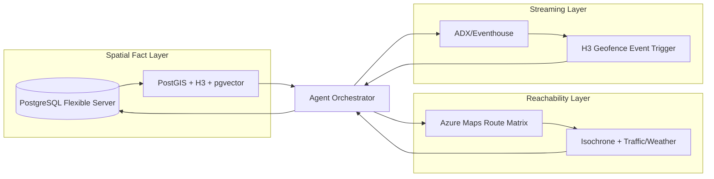
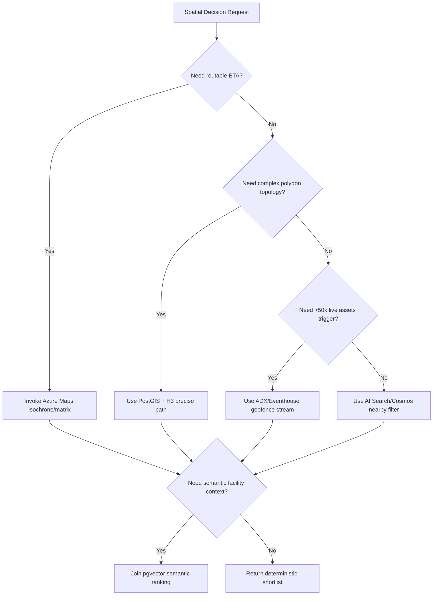

# Enterprise Spatial Agent Data Selection FAQ: PostGIS+H3+pgvector vs Azure Maps Isochrone vs ADX Spatial Streaming
> 🌐 **Language / 语言切换**: **[🇨🇳 中文版](geospatial-postgis-h3-pgvector-vs-azure-maps-isochrone-vs-adx-spatial-agent-data-selection-faq.md)** | **[🇬🇧 English](geospatial-postgis-h3-pgvector-vs-azure-maps-isochrone-vs-adx-spatial-agent-data-selection-faq.en.md)** | **[📚 Back to Catalog](README.en.md)**
> Evidence tags: `measured` / `synthetic` / `anonymized_reported`
> Retrieval date: 2026-11-22
> Scope boundary: enterprise spatial-semantic data planes and road-network inference, not agriculture traceability or port documentation workflows

## 1) Executive summary: upgrade from geometric proximity to road-network reachability first
Retail site planning,
instant delivery,
field service dispatch,
catastrophe underwriting,
and fleet routing
all depend on spatial reasoning.
A frequent production anti-pattern
is asking an LLM
to estimate nearest assets
from raw coordinates.
Another anti-pattern
is replacing reachability
with Euclidean radius circles.
Both fail at scale
for bridges,
one-way roads,
height restrictions,
peak congestion,
and weather disruptions.
A production-grade pattern
uses three coordinated layers.
Layer one is
`PostGIS + H3 + pgvector`
for topology and semantic fusion.
Layer two is
`Azure Maps`
for isochrones and route matrices.
Layer three is
`ADX/Eventhouse`
for high-frequency geofence streaming.
AI Search or Cosmos geo features
remain useful
for lightweight nearby filtering,
but not as the primary
topology engine.
The operating principle is:
coarse geospatial filtering first,
road constraints second,
semantic ranking last.

## 2) Incident pattern: geometric correctness can still violate operational SLA
A retail replenishment agent
selects warehouses
within a 5 km circle.
The map looks correct.
The real route crosses a river bridge
with heavy morning congestion.
Delivery misses SLA
by double-digit minutes.
Field service shows another pattern.
Dispatch chooses a technician
without truck-height constraints.
The route becomes infeasible.
Insurance underwriting has
its own failure mode.
Risk exposure is estimated
from circles,
while flood polygons
require true boundary intersections.
Common root causes are clear:
straight-line assumptions
replace routable travel time,
static geometry replaces live traffic,
and semantic hints are not grounded
in deterministic spatial facts.
This is why architecture selection
must separate responsibilities
across spatial stores,
routing services,
and streaming triggers.

## 3) Verifiable source baseline
Source 1 (`measured`): Azure Database for PostgreSQL Flexible Server  
https://learn.microsoft.com/azure/postgresql/flexible-server/overview  
Source 2 (`measured`): PostGIS documentation  
https://postgis.net/documentation/  
Source 3 (`measured`): H3 documentation  
https://h3geo.org/docs/  
Source 4 (`measured`): Azure Maps route services  
https://learn.microsoft.com/azure/azure-maps/how-to-use-route-service  
Source 5 (`measured`): Azure Maps platform docs  
https://learn.microsoft.com/azure/azure-maps/  
Source 6 (`measured`): Azure Data Explorer geospatial functions  
https://learn.microsoft.com/azure/data-explorer/kusto/query/geospatial-functions  
Source 7 (`measured`): Fabric Eventhouse overview  
https://learn.microsoft.com/fabric/real-time-intelligence/eventhouse-overview  
Source 8 (`measured`): Azure AI Search geo functions  
https://learn.microsoft.com/azure/search/search-query-odata-geo-spatial-functions  
Source 9 (`measured`): Azure Cosmos DB geospatial queries  
https://learn.microsoft.com/azure/cosmos-db/nosql/query/geospatial  
Source 10 (`anonymized_reported`): anonymized retail and mobility dispatch retrospectives.  
Source 11 (`synthetic`): million-query cost simulation for spatial and routing calls.  
Source 12 (`synthetic`): H3 resolution and error-propagation simulation samples.  

## 4) Anti-pattern taxonomy: where spatial hallucination enters the stack
Anti-pattern A:
coordinates are copied into prompts
for direct nearest-location reasoning.
The model returns plausible answers,
but without routable constraints.
Anti-pattern B:
circular buffers are used
as service coverage truth.
Cross-river and restricted-road cases
degrade heavily.
Anti-pattern C:
large GeoJSON polygons
are injected directly
into model context windows.
Token budgets inflate
and latency becomes unstable.
Anti-pattern D:
real-time telemetry
and static polygon stores
are mixed in one path
without hot/cold partitioning.
A robust pattern is:
H3 coarse partitioning,
PostGIS precise topology,
Azure Maps reachability validation,
then business-level ranking.
For telemetry-heavy workloads,
trigger from ADX first,
then awaken orchestration agents
with compact event summaries.

## 5) Production reference architecture: spatial truth, routing truth, streaming truth
Spatial truth layer
runs on PostgreSQL Flexible Server.
PostGIS stores topology.
H3 stores hierarchical cell indexes.
pgvector stores semantic embeddings
for site notes,
facility capabilities,
and policy text.
Routing truth layer
runs on Azure Maps.
It generates isochrone polygons
and many-to-many route matrices
under vehicle and time constraints.
Streaming truth layer
runs on ADX/Eventhouse.
It ingests high-frequency GPS points
and performs H3 fence transitions.
An MCP tool gateway
standardizes invocation contracts.
Agents request deterministic facts
before proposing actions.
Shared telemetry dimensions
should include request IDs,
grid cell IDs,
route profile versions,
and policy profile versions.
This supports replayable audits
for operational disputes.

## 6) Mermaid: coordinated geospatial inference topology

## 7) Option A: PostgreSQL Flexible Server with PostGIS, H3, and pgvector fusion
This option fits
topology-heavy workloads
that also require semantic retrieval.
PostGIS delivers
`ST_Intersects`,
`ST_DWithin`,
`ST_Contains`,
and boundary operations.
H3 enables multi-resolution
demand and supply aggregation.
pgvector enables
semantic ranking
within the same governance boundary.
A common execution plan is:
H3 coarse shortlist,
PostGIS precise clipping,
pgvector semantic rerank.
The strength is
transactional consistency
across spatial and semantic dimensions.
The trade-off is
limited suitability
for ultra-high-frequency streaming triggers.
Therefore,
this option usually anchors
warm-path decisioning
and analytical backfills.

## 8) Option B: Azure Maps as a remote MCP route intelligence layer
This option addresses
the gap between geometric distance
and travel-time reality.
Isochrones can be generated
for truck or passenger profiles.
Route Matrix supports
many origins and destinations.
Traffic and weather overlays
improve dispatch quality
under dynamic conditions.
Expose this as an MCP tool
with strict request schemas:
candidate points,
vehicle constraints,
time windows,
avoidance rules,
and confidence metadata.
Return compact summaries
plus artifact pointers
instead of full polygon payloads
in chat context.
This prevents token bloat
from very large GeoJSON bodies.
Strength:
real-world reachability fidelity.
Trade-off:
API budget and quota governance.

## 9) Option C: ADX/Eventhouse for high-frequency trajectory and geofence streaming
At 100k+ moving assets
with second-level updates,
relational systems
should not own the entire stream trigger path.
ADX geospatial functions
map points to H3 cells quickly.
Broadcast joins
with fence dimensions
support enter/exit detection.
Generated events
can wake scheduling agents
through Event Grid or Service Bus.
This avoids
agent-side polling loops
over massive telemetry sets.
Strength:
throughput and low trigger latency.
Trade-off:
topological richness remains lower
than deep PostGIS workflows.
Recommended pattern:
ADX for hot triggers,
PostGIS for warm precision decisions.

## 10) Option D: AI Search/Cosmos geo for lightweight nearby lookup
For scenarios limited to
“nearby POIs + keyword relevance,”
AI Search geography fields
or Cosmos GeoJSON
can be operationally efficient.
Both can serve
global low-latency entry paths.
However,
they should not be promoted
to primary engines
for full topology joins,
advanced polygon operations,
or route-time optimization.
A practical architecture
uses them as pre-filter layers.
Candidate sets are narrowed first.
Complex spatial logic then executes
in PostGIS or routing engines.
This split preserves
both latency and correctness.

## 11) 12-dimension comparison matrix
| Dimension | PostGIS+H3+pgvector | Azure Maps Isochrone/Matrix | ADX/Eventhouse streaming | AI Search/Cosmos lightweight |
|---|---|---|---|---|
| Complex polygon topology | High | Medium | Low-Medium | Low |
| Road-network travel realism | Low without extension | High | Low | Low |
| High-frequency telemetry throughput | Medium | Low | High | Medium |
| Semantic retrieval fusion | High | Low | Low | Medium |
| Real-time traffic integration | Low | High | Medium via joins | Low |
| Geofence streaming trigger | Medium | Low | High | Low |
| Explainability for audits | High | Medium | Medium | Medium |
| Operational complexity | Medium-High | Medium | Medium-High | Low-Medium |
| Multi-region latency control | Medium | Medium-High | High | High |
| Lock-in pressure | Medium | Medium-High | Medium | Medium |
| Cost predictability | Medium | Medium | High with throughput plans | High |
| Three-year TCO stability | High | Medium | High | Medium-High |

## 12) Mermaid: complexity and real-time decision tree

## 13) Throughput and TCO modeling
Define:
`Qs` as monthly spatial query count.
`Qr` as monthly routing API request count.
`Cp` as average PostGIS query unit cost.
`Cm` as average Maps call unit cost.
`Cs` as stream processing cost per million events.
Monthly cost approximation:
`Cost = Qs*Cp + Qr*Cm + Es*Cs`.
Example baseline:
8 million spatial queries,
1.2 million route intelligence calls,
2.5 billion trajectory events.
If every decision
calls routing APIs directly,
cost and latency variance rise sharply.
If H3/PostGIS removes 90% of candidates
before route-time evaluation,
routing spend drops materially.
If ADX handles trigger qualification first,
agent invocation waste drops too.
In anonymized enterprise simulations,
combined patterns often reduce
dispatch-decision unit economics
by roughly 28% to 42%.
Exact savings depend on
traffic volatility,
fence cardinality,
and SLA severity profiles.

## 14) Five-step rollout plan
Step 1: standardize spatial contracts for coordinate systems, time zones, business units, and H3 resolution tiers.
Step 2: implement dual-stage query plans with H3 coarse filtering and PostGIS precise topology clipping.
Step 3: introduce Azure Maps as an MCP route-intelligence tool with strict request/response schema contracts.
Step 4: split hot and warm data planes, with ADX for streaming triggers and PostGIS for precision decisioning.
Step 5: publish quality-and-cost dashboards for ETA error, SLA miss rate, query latency, and per-decision economics.
Roll out by business domain waves, starting from the highest-value dispatch and field-service workloads.

## 15) Field FAQ (8 practical questions)
### Q1: Why is direct LLM nearest-site reasoning unsafe?
Because operationally “nearest” usually means minimum travel time, not minimum geometric distance; without routable constraints, outputs can be confidently wrong.

### Q2: Does H3 reduce precision too much?
Not when used correctly: H3 should shortlist candidates, and PostGIS should finalize precision; this pairing balances speed and fidelity.

### Q3: When is Azure Maps isochrone mandatory?
It is mandatory when congestion, vehicle constraints, or bridge/tunnel topology materially affects SLA outcomes.

### Q4: Are ADX and PostGIS overlapping investments?
They are complementary layers: ADX is optimized for streaming triggers, while PostGIS is optimized for precise topology logic.

### Q5: How do we prevent GeoJSON token explosion?
Return compact summaries, bounded shapes, or object-storage references, and avoid injecting raw mega-polygons into prompts.

### Q6: Can AI Search/Cosmos replace PostGIS?
Only for lightweight nearby retrieval; they are not full replacements for advanced topology operations.

### Q7: How do we prove cross-river dispatch improvement?
Build a baseline dataset that compares circle-radius dispatch versus route-aware dispatch, then track ETA error P50/P95 deltas.

### Q8: What is the Good fit vs Not for boundary?
Good fit: enterprises where dispatch and siting directly affect margin or SLA under sustained spatial request volumes. Not for: low-frequency map browsing with no route constraints or strict operational commitments.
