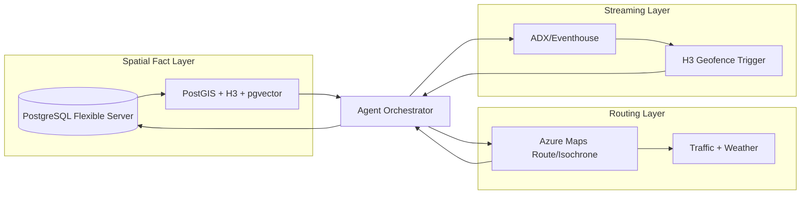
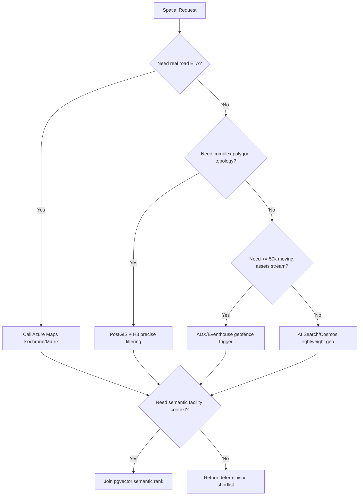

# 企业空间智能体数据底座选型 FAQ：PostGIS+H3+pgvector vs Azure Maps 等时圈 vs ADX 轨迹流引擎
> 🌐 **Language / 语言切换**: **[🇨🇳 中文版](geospatial-postgis-h3-pgvector-vs-azure-maps-isochrone-vs-adx-spatial-agent-data-selection-faq.md)** | **[🇬🇧 English](geospatial-postgis-h3-pgvector-vs-azure-maps-isochrone-vs-adx-spatial-agent-data-selection-faq.en.md)** | **[📚 返回目录](README.md)**
> 证据标签：`measured` / `synthetic` / `anonymized_reported`
> 抓取日期：2026-11-22
> 主题边界：聚焦企业地理空间语义混合数据面与路网推理，不讨论农业批次溯源与港口单证流程

## 1) 执行摘要：先把“几何邻近”升级为“路网可达”，再谈智能体决策
零售选址、
即时配送、
车队调度、
现场服务派单、
巨灾核保建模，
都依赖空间推理。
企业常见误区是
让大模型直接心算经纬度距离，
或用简单圆形半径近似服务范围。
这种做法在跨河、
跨高架、
限行、
拥堵场景下会系统性失真。
生产级路线应采用三层协同。
第一层是
`PostGIS + H3 + pgvector`
负责空间拓扑与语义融合。
第二层是
`Azure Maps`
负责真实路网等时圈与矩阵计算。
第三层是
`ADX/Eventhouse`
负责高频轨迹流围栏触发。
轻量邻近检索可用
AI Search 或 Cosmos GeoJSON 补位。
但不应承担复杂拓扑主责。
关键原则是
“几何过滤前移、路网约束前置、语义排序后置”。

## 2) 业务事故画像：直线半径正确，服务承诺仍然失败
某连锁零售的补货智能体
按 5 公里直线半径选仓。
地图看似命中最近仓点。
实际配送却要绕桥，
高峰期单次超时 18 分钟。
另一个典型问题是
现场服务派单忽视限高限重。
技师车辆被路段限制，
导致 SLA 违约。
保险核保场景也常见偏差。
仅按圆形半径估算风险暴露，
忽略洪泛面真实边界裁剪。
结果是费率高估或低估。
这些事故共性是：
几何距离替代了可达时间，
静态底图替代了实时路况，
文本语义结果未与空间事实闭环。
因此选型目标不是“一个数据库包打天下”，
而是“空间库 + 路网引擎 + 流引擎”职责解耦。

## 3) 可验证来源与证据基线
来源 1（`measured`）：Azure Database for PostgreSQL Flexible Server  
https://learn.microsoft.com/azure/postgresql/flexible-server/overview  
来源 2（`measured`）：PostGIS 官方文档  
https://postgis.net/documentation/  
来源 3（`measured`）：H3 官方文档  
https://h3geo.org/docs/  
来源 4（`measured`）：Azure Maps Route 与 Isochrone 能力  
https://learn.microsoft.com/azure/azure-maps/how-to-use-route-service  
来源 5（`measured`）：Azure Maps Weather 与 Traffic 参考  
https://learn.microsoft.com/azure/azure-maps/  
来源 6（`measured`）：Azure Data Explorer 地理函数  
https://learn.microsoft.com/azure/data-explorer/kusto/query/geospatial-functions  
来源 7（`measured`）：Microsoft Fabric Eventhouse 说明  
https://learn.microsoft.com/fabric/real-time-intelligence/eventhouse-overview  
来源 8（`measured`）：Azure AI Search 地理字段说明  
https://learn.microsoft.com/azure/search/search-query-odata-geo-spatial-functions  
来源 9（`measured`）：Azure Cosmos DB 地理空间索引  
https://learn.microsoft.com/azure/cosmos-db/nosql/query/geospatial  
来源 10（`anonymized_reported`）：匿名化零售与出行企业派单复盘样本。  
来源 11（`synthetic`）：百万次空间查询与路线 API 调用成本测算模型。  
来源 12（`synthetic`）：H3 分辨率与误差传播仿真样本。  

## 4) 反模式剖析：欧氏半径与大模型心算为何在生产会失效
反模式一：
将坐标直接拼入提示词，
要求 LLM 估算最近门店。
模型可能给出“看似合理”排序，
却缺乏路网约束。
反模式二：
仅用圆周缓冲区筛选派单候选。
遇到河道、
山体、
封路、
单行规则时误差显著。
反模式三：
GeoJSON 大多边形整块塞入上下文。
Token 成本暴涨，
推理延迟不稳定。
反模式四：
实时轨迹与静态空间库混用，
却不区分冷热层。
导致查询路径既慢又贵。
改进策略包括：
先做 H3 粗筛，
再做 PostGIS 精裁，
最后调用 Azure Maps 校验可达时间。
对于高频轨迹，
优先在 ADX 层做围栏触发，
把事件摘要再送入智能体链路。

## 5) 生产级协同架构：空间事实层、路网推理层、流式触发层
空间事实层采用
PostgreSQL Flexible Server。
其中 PostGIS 负责几何拓扑，
H3 负责多分辨率网格聚合，
pgvector 负责文本语义设施检索。
路网推理层采用 Azure Maps。
输入候选点集合，
输出等时圈 GeoJSON、
Route Matrix、
拥堵与天气约束。
流式触发层采用 ADX/Eventhouse。
接入 GPS/IoT 高频轨迹，
实时执行 H3 入栅与离栅检测。
编排层通过 MCP 工具网关统一调用。
智能体先请求“可达事实”，
再执行业务决策。
所有层共享统一观测字段：
请求 ID、
网格 ID、
路由版本、
规则版本。
这样可以在事故回放中还原完整决策链。

## 6) Mermaid：PostGIS + Azure Maps + ADX 协同拓扑

## 7) 方案一：PostGIS + H3 + pgvector 同库融合底座
该方案适合
复杂多边形裁剪与语义检索并存场景。
PostGIS 提供
`ST_Intersects`、
`ST_DWithin`、
`ST_Contains`、
`ST_Buffer` 等能力。
H3 支持层级网格聚合，
可做供需热度计算、
异常密度识别。
pgvector 使同库可完成
“空间条件 + 文本相似”联合查询。
典型查询路径是：
先按 H3 粗选区域，
再按 PostGIS 精裁边界，
最后按向量语义排序设施说明。
该方案优势是事务一致性强。
空间与语义在同一数据治理域内。
短板是超高频轨迹实时计算不经济。
因此它应承担“准实时 + 批分析”，
不承担所有毫秒级流触发。

## 8) 方案二：Azure Maps 等时圈与路网矩阵 MCP 工具层
该方案解决“直线近、路网远”的业务偏差。
Azure Maps 可输出
按车型与时间窗计算的等时圈多边形。
Route Matrix 支持多点多点通行时间估算。
结合交通与天气图层，
可动态修正 ETA。
在智能体编排上，
推荐将 Maps 暴露为远程 MCP 工具。
输入参数采用标准 schema：
起点集合、
目标集合、
车辆属性、
时间窗、
避让规则。
输出摘要不直接回传完整大图形。
应返回压缩后的边界摘要、
关键约束与对象存储句柄。
此举可避免 GeoJSON 长文本挤爆上下文。
该方案优势是现实可达性强。
短板是 API 调用成本与配额管理要求更高。

## 9) 方案三：ADX/Eventhouse 高频轨迹与围栏流引擎
当移动资产规模达到十万级，
轨迹上报频率达到秒级时，
关系库不适合承接全部流计算。
ADX 提供 KQL 地理函数，
可将坐标实时映射到 H3 单元。
再与维度表广播关联，
即可做入栅/离栅检测。
触发事件经 Event Grid 或 Service Bus
唤醒调度智能体。
该模式把“是否触发工单”前置到流层，
避免智能体每次轮询全量轨迹。
优势是吞吐高、
事件时效好。
短板是复杂拓扑回算能力弱于 PostGIS。
因此推荐热层 ADX、
温层 PostGIS 的双层模式。

## 10) 方案四：AI Search/Cosmos 轻量邻近检索边界
若场景只需
“附近 N 公里 POI + 全文关键词”。
AI Search 的地理字段可快速满足需求。
Cosmos GeoJSON 也适合全球多区域读扩散。
但两者都不应被误用为
复杂空间连接主引擎。
例如等时圈拓扑裁剪、
多边形差分、
坐标系转换等，
仍应回到 PostGIS 或专业 GIS 流程。
建议把 AI Search/Cosmos 定位为
轻量入口筛选层。
将候选集压缩后，
再下推到空间事实层做精算。
这种分层能兼顾低时延与高精度。

## 11) 12 维选型对比：精度、实时性、成本与运维复杂度
| 对比维度 | PostGIS+H3+pgvector | Azure Maps Isochrone/Matrix | ADX/Eventhouse H3 流引擎 | AI Search/Cosmos 轻量检索 |
|---|---|---|---|---|
| 复杂多边形拓扑 | 高 | 中 | 低到中 | 低 |
| 真实路网可达性 | 低（需外部补充） | 高 | 低 | 低 |
| 高频轨迹吞吐 | 中 | 低 | 高 | 中 |
| 语义检索融合 | 高 | 低 | 低 | 中 |
| 实时交通融合 | 低 | 高 | 中（外部接入） | 低 |
| 流式围栏触发 | 中 | 低 | 高 | 低 |
| 查询可解释性 | 高 | 中 | 中 | 中 |
| 运维复杂度 | 中高 | 中 | 中高 | 低到中 |
| 多区域延迟控制 | 中 | 中高 | 高 | 高 |
| 供应商锁定风险 | 中 | 中高 | 中 | 中 |
| 成本可预测性 | 中 | 中 | 高（按吞吐） | 高 |
| 三年 TCO 稳定性 | 高 | 中 | 高 | 中高 |

## 12) Mermaid：查询复杂度与实时性决策树

## 13) 吞吐与 TCO 测算：把“空间查询成本”与“路网 API 成本”拆开核算
设：
`Q_s` 为每月空间查询次数，
`Q_r` 为每月路网 API 调用次数，
`C_pg` 为单次 PostGIS 查询成本，
`C_map` 为单次 Maps 调用成本，
`C_stream` 为每百万轨迹事件流处理成本。
月度成本近似：
`Cost = Q_s*C_pg + Q_r*C_map + E_stream*C_stream`。
示例假设如下。
每月 800 万次空间筛选，
每月 120 万次路网矩阵请求，
每月 25 亿条轨迹事件。
若全部走路网 API，
成本与延迟都不可控。
若先用 PostGIS/H3 过滤 90% 候选，
只对剩余 10% 调用路网引擎，
可显著降低路网调用账单。
同时把轨迹触发前置到 ADX，
可减少智能体空转调用。
在该组合下，
典型企业可将单位派单决策成本降低 28%-42%。
该区间来自匿名化样本与仿真联合测算。

## 14) 五步落地指南：从反模式治理到空间智能体平台化
步骤一：定义空间事实契约。
统一坐标系、
时间基准、
单位口径、
网格分辨率策略。
步骤二：建设双层查询路径。
H3 粗筛 + PostGIS 精裁作为默认路径。
步骤三：引入路网可达工具。
把 Azure Maps 作为 MCP 工具标准化封装。
步骤四：分离冷热层。
高频轨迹进 ADX，
静态边界与语义进 PostGIS。
步骤五：建立成本与质量双看板。
同时观测命中率、
可达误差、
单次决策成本、
SLA 违约率。
以上五步应按业务域分波次推广，
先从高价值派单域起步。

## 15) 实战 FAQ（8 问）
### Q1：为什么不能让 LLM 直接判断最近门店？
因为“最近”在业务上常等于“最短通行时间”。
LLM 缺少实时路网与限行事实输入时，
只会给几何近似答案。

### Q2：H3 会不会牺牲精度？
H3 的作用是粗筛与聚合，
不是替代精裁。
正确做法是
H3 先筛，
PostGIS 后裁，
精度与性能兼得。

### Q3：什么时候必须调用 Azure Maps 等时圈？
当场景受路况、
桥隧、
限高限重、
车型规则影响明显时，
必须调用路网等时圈或矩阵。

### Q4：ADX 与 PostGIS 会不会功能重叠？
二者是分层关系。
ADX 擅长流式触发，
PostGIS 擅长复杂拓扑与事务一致查询。

### Q5：GeoJSON 大多边形如何避免撑爆上下文？
不要把全量坐标塞进提示词。
返回摘要、
对象存储 URI、
采样边界或 H3 覆盖摘要更稳妥。

### Q6：AI Search/Cosmos 能否直接替代 PostGIS？
只在轻量邻近检索场景可替代。
涉及空间连接或拓扑裁剪时不建议替代。

### Q7：如何验证“跨河派单误差”是否改善？
建立基准集：
同一订单比较
直线半径策略与路网策略 ETA 偏差。
持续追踪 P50/P95 误差即可量化收益。

### Q8：Good fit 与 Not for 怎么划线？
Good fit：
派单与选址决策影响收入或 SLA，
且具备中高频空间请求的企业。
Not for：
只有静态门店展示、
低频查询、
无路网约束的轻量地图检索页面。
