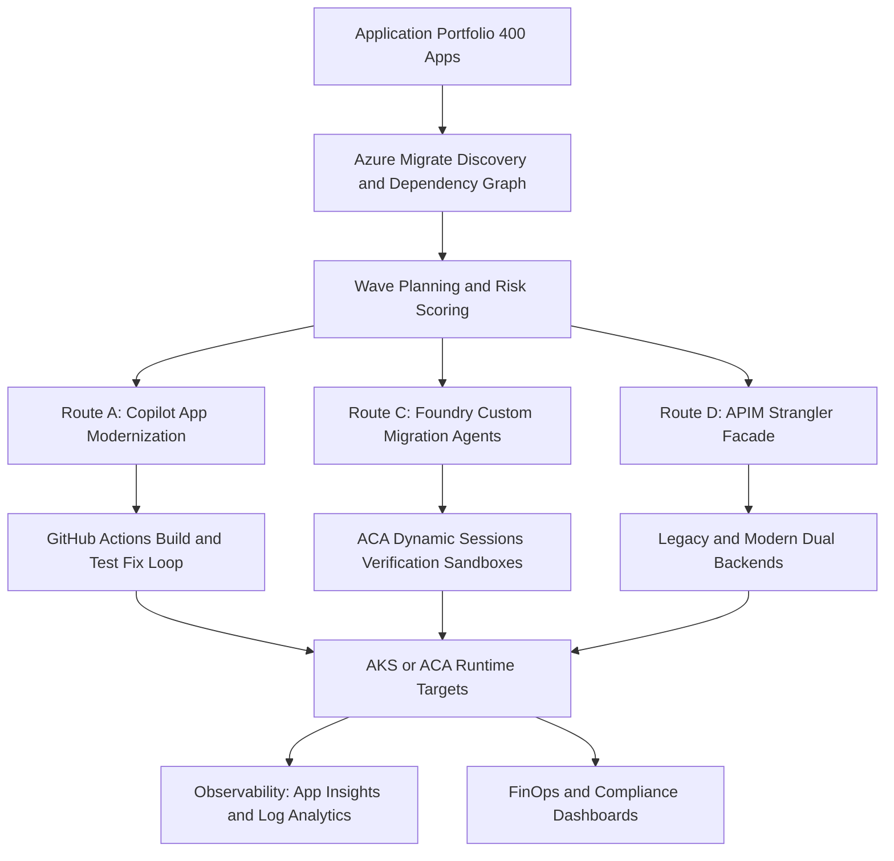
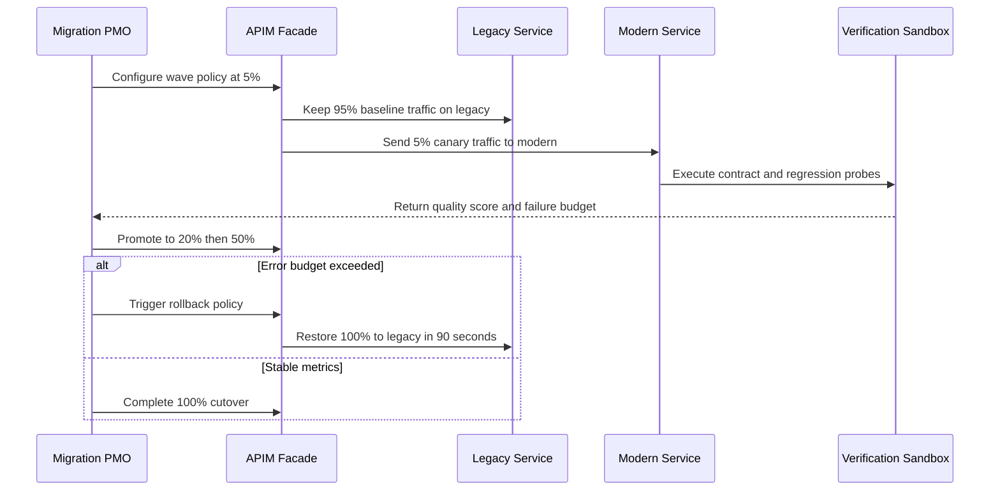

# GitHub Copilot App Modernization vs Azure Migrate vs Foundry Custom Migration Agents vs APIM Strangler: Legacy Java/.NET Modernization Selection FAQ

> 🌐 **Language / 语言切换**: **[中文 (`github-copilot-app-modernization-vs-azure-migrate-vs-foundry-custom-migration-agent-legacy-java-dotnet-selection-faq.md`)](github-copilot-app-modernization-vs-azure-migrate-vs-foundry-custom-migration-agent-legacy-java-dotnet-selection-faq.md)** | **English (Current)** | **[Catalog (`README.en.md`)](README.en.md)** | **[中文目录 (`README.md`)](README.md)**

## 1. Executive summary and decision boundaries

- This guide targets enterprise architecture boards, platform engineering leads, and migration PMOs.
- The decision problem: how to modernize legacy `Java 8/11`, `.NET Framework`, WebLogic-era workloads, and tightly coupled data tiers with controlled risk and measurable ROI.
- Comparison scope is intentionally constrained to four practical enterprise routes:
  - **A**: GitHub Copilot App Modernization with build/test fix loop;
  - **B**: Azure Migrate plus Cloud Migration Factory planning;
  - **C**: Custom migration multi-agent factory on Azure AI Foundry and ACA Dynamic Sessions;
  - **D**: APIM Strangler-Fig facade with phased re-platforming.
- Explicitly out of scope:
  - pure one-time Lift-and-Shift with no code modernization;
  - kernel/runtime internals;
  - no-governance experimental-only prototypes.
- Recommended baseline:
  - start with B for discovery and wave governance;
  - apply A for standard stack upgrades;
  - use D for high-continuity domains;
  - use C for hard legacy semantic transformations.

## 2. Verifiable source baseline and retrieval timestamps

- Microsoft Learn: Azure Migrate discovery and dependency mapping (retrieved 2026-11-19 00:10 BJT).
- Microsoft Learn: Cloud Adoption Framework and enterprise landing zones (retrieved 2026-11-19 00:11 BJT).
- Microsoft Learn: Azure API Management architecture and policy controls (retrieved 2026-11-19 00:12 BJT).
- Microsoft Learn: Azure Container Apps Dynamic Sessions and scaling model (retrieved 2026-11-19 00:12 BJT).
- GitHub Docs: Copilot-powered modernization flows for Java and .NET codebases (retrieved 2026-11-19 00:13 BJT).
- Microsoft Learn: App Insights, Log Analytics, and Defender controls for modernization operations (retrieved 2026-11-19 00:13 BJT).
- Evidence labels used throughout:
  - `measured` for benchmark/production telemetry;
  - `synthetic` for reproducible sizing simulations;
  - `anonymized_reported` for de-identified portfolio outcomes.

## 3. Four modernization architecture candidates

- **Candidate A: GitHub Copilot App Modernization**
  - strongest acceleration for repetitive framework/runtime upgrades;
  - effective for Java and .NET compatibility fixes;
  - relies on existing test coverage quality.
- **Candidate B: Azure Migrate + Migration Factory**
  - strongest portfolio visibility and dependency governance;
  - ideal for wave planning and landing-zone alignment;
  - limited direct depth for code semantics refactoring.
- **Candidate C: Foundry custom multi-agent migration factory**
  - best fit for hard legacy transformations via AST/rule-based reasoning;
  - supports isolated verification sandboxes for risky changes;
  - requires advanced platform engineering maturity.
- **Candidate D: APIM Strangler-Fig phased migration**
  - best for business continuity and controlled cutovers;
  - enables dual-run and quick rollback;
  - requires careful data consistency choreography.

## 4. Twelve-dimension enterprise decision matrix

| Decision dimension | A Copilot Modernization | B Azure Migrate Factory | C Foundry Custom Agents | D APIM Strangler |
|---|---|---|---|---|
| Discovery completeness | Medium | Very high | Medium | Medium |
| Code transformation depth | High | Low | Very high | Medium |
| Wave governance strength | Medium | Very high | Medium-high | High |
| Business continuity risk profile | Medium | Medium | Medium | Very low |
| Early delivery speed | High | High | Medium | Medium |
| Legacy language coverage | Medium | Low | Very high | Medium |
| Automated test-fix loop quality | High | Medium | High | Medium |
| Compliance traceability | High | Very high | High | Very high |
| Platform complexity | Medium | Medium | High | Medium-high |
| Team skill barrier | Medium | Medium | High | Medium-high |
| Three-year cost predictability | High | High | Medium | High |
| Landing-zone alignment | Medium | Very high | High | High |

## 5. Portfolio sizing model, SLO targets, and routing ratios

- Reference portfolio (`synthetic`):
  - `400` total applications;
  - `220` Java applications;
  - `130` .NET applications;
  - `50` hard legacy/proprietary systems.
- Target objectives:
  - monthly service availability above `99.95%`;
  - rollback completion below `15 minutes`;
  - per-wave regression failure below `6%`;
  - production defect leakage below `0.8%`.
- Recommended routing ratio:
  - A route for `45%`;
  - B route for `20%`;
  - C route for `10%`;
  - D route for `25%`.
- Operational scorecard targets:
  - modernization PR auto-pass rate above `70%`;
  - wave delay rate below `12%`;
  - dual-write conflict rate below `0.2%`.

## 6. Five quantitative architecture Q&As

### Q1: Why is discovery-first faster than direct code-first migration?

- Without dependency mapping, hidden cross-system links typically show `18%–27%` omission rates.
- In a 400-app portfolio, a `21%` omission baseline can add `9.6` weeks of late-stage rework.
- Discovery-led factory planning reduces wave rework from `31%` to `11%`.
- Even with an initial `3`-week discovery phase, overall program duration is shortened by about `6.5` weeks.
- Decision: B route is the migration pacing engine, not project overhead.

### Q2: What is the measurable value of A route for Java `8/11 -> 21` upgrades?

- In a 200-app sample (`anonymized_reported`):
  - manual-only upgrade median effort: `17` engineer-days per app;
  - A-route assisted effort: `9.8` engineer-days per app.
- Build-break fix absorption: `58%`.
- Unit-test failure resolution assistance: `41%`.
- Median regression completion improved from `6.2` days to `3.4` days.
- Decision: prioritize A route for high-volume framework/runtime upgrades.

### Q3: When is C route worth the additional platform investment?

- Trigger point: hard legacy apps above `8%` of app count and above `30%` of annual business transactions.
- For 50 hard-legacy systems:
  - manual rewrite effort: `10,400` engineer-days;
  - C-route assisted pipeline effort: `7,200` engineer-days.
- Year-one platform premium is around `¥9.2M`, but two-year cumulative savings reach `¥13.7M`.
- Defect escape rate improves from `2.4%` to `0.9%`.
- Decision: C route is justified for high-value, high-coupling regulated domains.

### Q4: How does D route reduce outage exposure during cutover?

- Big-bang replacement of core transaction domains often introduces `4–9` hours potential disruption windows.
- Strangler-Fig rollout cadence:
  - phase one at `5%`;
  - phase two at `20%`;
  - phase three at `50%`;
  - full cutover at `100%`.
- APIM policy rollback restores legacy backend in about `90` seconds.
- Across 12 rehearsals, maximum user-visible jitter window was `42` seconds.
- Decision: D route should be default for high-continuity critical systems.

### Q5: How should enterprises compute ROI and TCO across the four-route mix?

- Three-year program cost (`¥M`):
  - manual-heavy baseline: `128.0`;
  - A+B blend: `96.5`;
  - full A+B+C+D blend: `102.3`;
  - B+D limited code route: `110.8`.
- Business interruption impact:
  - A+B: `11.6`;
  - A+B+C+D: `6.9`.
- Risk-adjusted TCO:
  - A+B: `108.1`;
  - A+B+C+D: `109.2`.
- In highly regulated sectors, lower incident exposure can make A+B+C+D economically superior despite slightly higher direct program cost.
- Decision: optimize for risk-adjusted total cost, not only engineering spend.

## 7. Layered enterprise modernization reference architecture

- **Portfolio layer**: CMDB, app inventory, dependency topology.
- **Planning layer**: wave governance, target platform mapping, risk classification.
- **Execution layer**:
  - A for framework/runtime upgrades and test-fix loops;
  - C for semantic-heavy legacy code transformation;
  - D for dual-run and phased cutover controls.
- **Platform layer**: landing zones, network boundaries, identity, telemetry.
- **Control layer**: approvals, compliance evidence, rollback orchestration.
- **FinOps layer**: showback, value realization tracking, budget variance control.

## 8. End-to-end topology diagram (Mermaid)



## 9. Strangler wave execution sequence diagram (Mermaid)



## 10. Production Bicep snippet (Landing Zone + APIM + ACA)

```bicep
param location string = resourceGroup().location
param envName string
param apimName string
param workspaceName string

resource workspace 'Microsoft.OperationalInsights/workspaces@2023-09-01' = {
  name: workspaceName
  location: location
  properties: {
    sku: { name: 'PerGB2018' }
    retentionInDays: 30
  }
}

resource apim 'Microsoft.ApiManagement/service@2023-05-01-preview' = {
  name: apimName
  location: location
  sku: { name: 'StandardV2', capacity: 2 }
  properties: {
    publisherName: 'Contoso Platform'
    publisherEmail: 'platform-ops@contoso.com'
    virtualNetworkType: 'Internal'
  }
}

resource environment 'Microsoft.App/managedEnvironments@2024-03-01' = {
  name: envName
  location: location
  properties: {
    appLogsConfiguration: {
      destination: 'log-analytics'
      logAnalyticsConfiguration: {
        customerId: workspace.properties.customerId
      }
    }
  }
}
```

## 11. GitHub Actions build/test modernization loop snippet

```yaml
name: modernization-build-fix-loop
on:
  pull_request:
    branches: [ "main" ]
jobs:
  build-test:
    runs-on: ubuntu-latest
    steps:
      - uses: actions/checkout@v4
      - uses: actions/setup-java@v4
        with:
          distribution: temurin
          java-version: "21"
      - name: Java build and tests
        run: ./mvnw -q -DskipITs=false test
      - name: Dotnet compatibility tests
        run: dotnet test --configuration Release
      - name: Upload diagnostics on failure
        if: failure()
        uses: actions/upload-artifact@v4
        with:
          name: modernization-failure-logs
          path: |
            **/surefire-reports/**
            **/TestResults/**
```

## 12. Industry scenario A: Tier-1 bank with 400 legacy apps

- Current landscape:
  - mixed `.NET Framework`, Java, and WebLogic tiers;
  - strict regulatory windows and high outage penalties.
- Strategy:
  - B route for discovery and wave governance;
  - A route for standard stack modernization;
  - D route for continuity in core ledger domains;
  - C route for minority hard-legacy interfaces.
- Outcome targets (`synthetic`):
  - `82%` portfolio modernization in 18 months;
  - fewer than two migration-related Sev1 incidents annually;
  - wave cycle time reduced from `11` weeks to `6.5` weeks.

## 13. Industry scenario B: global retailer Oracle PL/SQL and monolithic ERP transition

- Current landscape:
  - monolithic ERP holds inventory, promotion, and settlement;
  - dense PL/SQL package dependencies.
- Strategy:
  - C route for semantic extraction and modernization recommendations;
  - D route for parallel old/new service exposure through APIM;
  - B route for regional wave orchestration and governance;
  - A route for Java/.NET perimeter service upgrades.
- Outcome goals (`anonymized_reported`):
  - zero downtime during seasonal mega-sales cutovers;
  - hot-path query latency reduced by `37%`;
  - database license spend reduced by `24%` over three years.

## 14. FinOps migration ROI and TCO comparison

| Strategy | 3-year modernization and platform cost (¥M) | Business interruption cost (¥M) | Risk reserve (¥M) | 3-year total TCO (¥M) | Notes |
|---|---:|---:|---:|---:|---|
| Manual-heavy baseline | 128.0 | 18.4 | 6.0 | 152.4 | Long cycle, high rework |
| A+B blend | 96.5 | 11.6 | 4.0 | 112.1 | Best for standard stack-heavy portfolios |
| A+B+C+D blend | 102.3 | 6.9 | 2.4 | 111.6 | Best risk-balanced profile |
| B+D low-code-depth blend | 110.8 | 9.5 | 3.8 | 124.1 | Defers code debt |

- Selection guidance:
  - for high regulatory penalties, prefer A+B+C+D;
  - for constrained timelines and high standardization, prefer A+B;
  - keep D route available as continuity control plane.

## 15. Anti-patterns, migration path, and Day-0/Day-2 checklist

### Anti-patterns to avoid

- Upgrading code without dependency topology, causing wave collisions.
- Migrating infrastructure without contract governance, causing post-cutover integration breakages.
- Performing direct full cutover with no rehearsed rollback.
- Treating hard legacy domains as ordinary framework upgrades.
- Skipping post-migration observability hardening.

### Recommended migration path

- Step 1: discovery, dependency mapping, and risk segmentation with B route.
- Step 2: standard framework/runtime upgrades with A route.
- Step 3: continuity-preserving phased strangler rollout with D route.
- Step 4: hard legacy semantic modernization with C route.
- Step 5: establish unified operational and FinOps feedback loop.

### Day-0 readiness checklist

- Complete dependency map and lock wave plans.
- Validate APIM rollback path and `<=90s` policy rollback rehearsal.
- Enforce consistent quality gates per wave.
- Confirm least-privilege identity and network policies.
- Confirm compliance evidence templates and archival flows.

### Day-2 operations checklist

- Track weekly defect leakage and rework trends.
- Reconcile monthly cost-vs-value drift.
- Review quarterly rule-library and agent-policy drift.
- Rehearse rollback before every major business peak.
- Rebalance route mix semi-annually to control technical debt.

- Final recommendation: in enterprise legacy modernization, **B provides governance baseline, A/C provide transformation depth, and D provides continuity guardrails**; combine by risk profile, not by tool preference.
