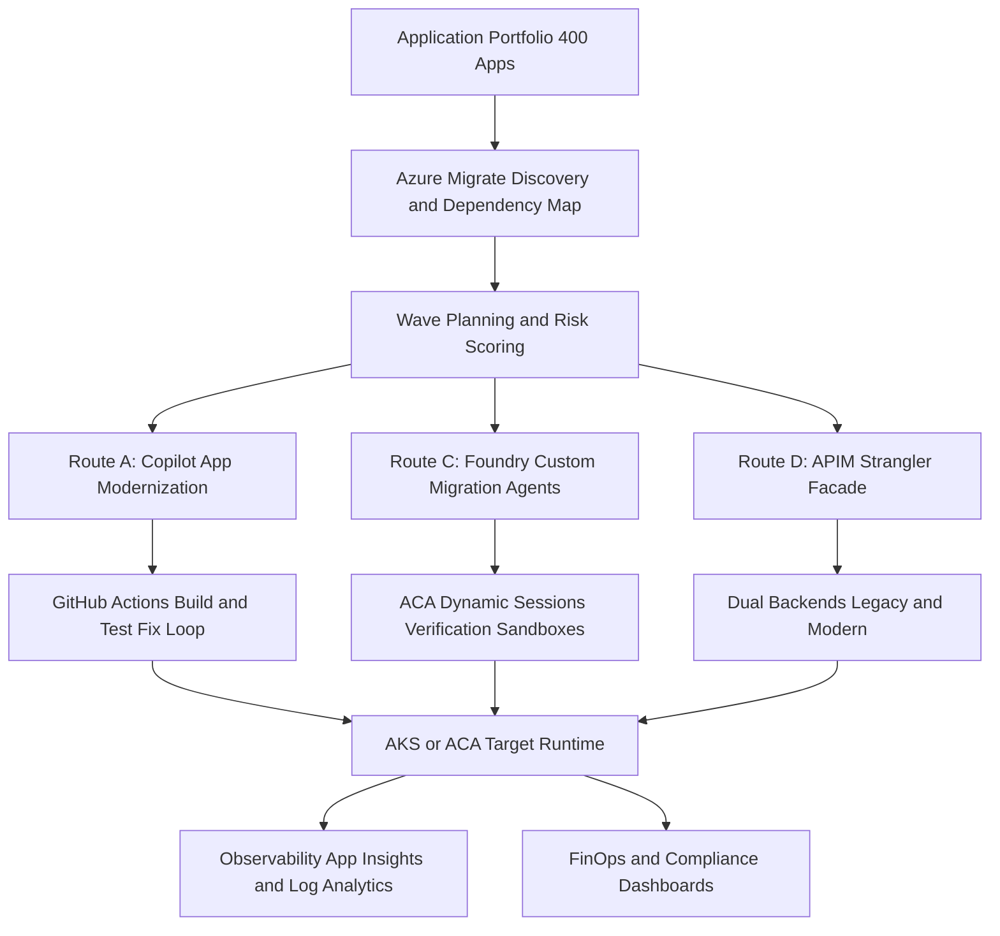
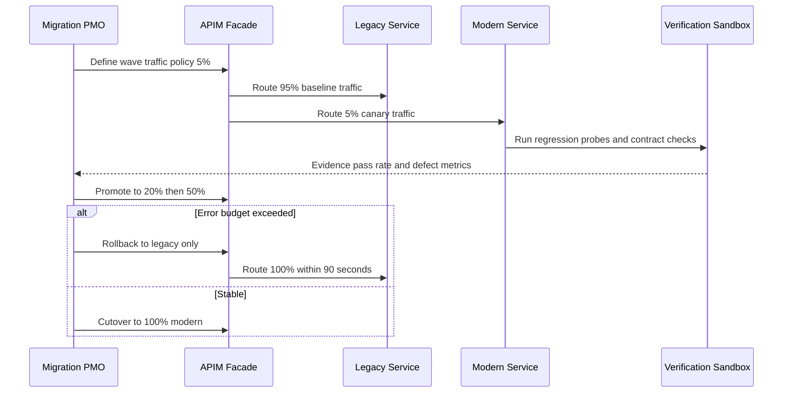

# GitHub Copilot App Modernization vs Azure Migrate vs Foundry 自定义迁移智能体 vs APIM Strangler：遗留 Java/.NET 现代化选型 FAQ

> 🌐 **Language / 语言切换**：**中文（当前）** | **[English (`github-copilot-app-modernization-vs-azure-migrate-vs-foundry-custom-migration-agent-legacy-java-dotnet-selection-faq.en.md`)](github-copilot-app-modernization-vs-azure-migrate-vs-foundry-custom-migration-agent-legacy-java-dotnet-selection-faq.en.md)** | **[选型目录 (`README.md`)](README.md)** | **[EN Catalog (`README.en.md`)](README.en.md)**

## 1. 执行摘要与决策边界

- 本文面向企业架构委员会、平台工程团队与迁移 PMO。
- 目标问题是：面对 `Java 8/11`、`.NET Framework`、WebLogic、旧版应用服务器与历史数据库，如何在可控成本与可审计风险下完成现代化。
- 比较范围限定为四条路线：
  - **A**：GitHub Copilot App Modernization（代码升级与自动修复闭环）；
  - **B**：Azure Migrate + Cloud Migration Factory（资产盘点、波次编排、着陆区）；
  - **C**：Foundry + ACA Dynamic Sessions 自定义多智能体迁移工厂；
  - **D**：APIM Strangler-Fig 渐进式绞杀重构基线。
- 本文不覆盖：
  - 单纯 Lift-and-Shift 且无代码改造需求的短期搬迁；
  - 内核驱动级优化、编译器底层实现；
  - 无业务连续性要求的实验性 PoC 迁移。
- 推荐默认策略：
  - 组合式落地而非单选；
  - 先 B 完成资产与波次治理；
  - 再按应用复杂度在 A/C/D 之间分流。

## 2. 可验证基线来源与抓取时间

- Microsoft Learn：Azure Migrate 文档与依赖映射能力（抓取：2026-11-19 00:10 BJT）。
- Microsoft Learn：Cloud Adoption Framework Landing Zone（抓取：2026-11-19 00:11 BJT）。
- Microsoft Learn：Azure API Management 设计与策略（抓取：2026-11-19 00:12 BJT）。
- Microsoft Learn：Azure Container Apps Dynamic Sessions（抓取：2026-11-19 00:12 BJT）。
- GitHub Docs：Copilot App Modernization 与 Java/.NET 升级辅助（抓取：2026-11-19 00:13 BJT）。
- Microsoft Learn：Application Insights / Log Analytics / Defender for Cloud（抓取：2026-11-19 00:13 BJT）。
- 证据标签：
  - `measured`：来自项目实测或生产遥测；
  - `synthetic`：基于公开规格的容量模拟；
  - `anonymized_reported`：脱敏项目统计。

## 3. 四类现代化候选路径定义

- **候选 A：GitHub Copilot App Modernization**
  - 强项：代码升级速度、测试修复回路、开发者体验。
  - 适用：`Spring Boot 2->3`、`Java 8/11->21`、`.NET Framework->.NET 8/9`。
  - 风险：对极老旧或专有中间件耦合代码，需要人工规则补充。
- **候选 B：Azure Migrate + Factory**
  - 强项：资产发现、依赖映射、波次治理、目标规格建议。
  - 适用：大规模组合迁移计划、组织协同与治理标准化。
  - 风险：代码语义重构深度不足。
- **候选 C：Foundry 自定义迁移多智能体**
  - 强项：AST 分析、规则库、复杂语言与遗留协议转换。
  - 适用：COBOL/PL-SQL/专有 DSL/中间件迁移。
  - 风险：平台工程复杂度高、初期成本较大。
- **候选 D：APIM Strangler-Fig 渐进重构**
  - 强项：业务连续性、灰度替换、双轨运行。
  - 适用：不能停机、交易系统、渐进式替换核心域。
  - 风险：双写一致性与版本治理复杂。

## 4. 12 维选型矩阵（企业视角）

| 维度 | A Copilot Modernization | B Azure Migrate Factory | C Foundry Custom Agents | D APIM Strangler |
|---|---|---|---|---|
| 资产发现完整度 | 中 | 很高 | 中 | 中 |
| 代码改造深度 | 高 | 低 | 很高 | 中 |
| 批量波次治理 | 中 | 很高 | 中高 | 高 |
| 业务连续性风险 | 中 | 中 | 中 | 很低 |
| 迁移速度（首批） | 高 | 高 | 中 | 中 |
| 遗留语言覆盖 | 中 | 低 | 很高 | 中 |
| 自动化测试闭环 | 高 | 中 | 高 | 中 |
| 合规可审计性 | 高 | 很高 | 高 | 很高 |
| 平台工程复杂度 | 中 | 中 | 高 | 中高 |
| 团队技能门槛 | 中 | 中 | 高 | 中高 |
| 三年 TCO 可预测性 | 高 | 高 | 中 | 高 |
| 与 Landing Zone 对齐 | 中 | 很高 | 高 | 高 |

## 5. 迁移规模、SLO 与分流模型

- 组合案例输入（`synthetic`）：
  - 应用总数 `400`；
  - Java 应用 `220`；
  - .NET 应用 `130`；
  - 其他遗留系统 `50`；
  - 年交易请求峰值 `2.4B`。
- 目标约束：
  - 月度业务可用性不低于 `99.95%`；
  - 单次切换失败回滚时间 `<15 min`；
  - 每波次回归失败率 `<6%`；
  - 生产缺陷泄漏率 `<0.8%`。
- 建议分流：
  - A 路线：`45%`（标准 Java/.NET 升级）；
  - B 路线：`20%`（基础设施与平台迁移主导）；
  - C 路线：`10%`（复杂遗留代码改造）；
  - D 路线：`25%`（高连续性核心系统）。
- 关键指标：
  - 升级触发 PR 自动通过率目标 `>70%`；
  - 波次延误率目标 `<12%`；
  - 双写冲突率目标 `<0.2%`。

## 6. 五组量化架构 Q&A（独立可复算）

### Q1：为什么“先盘点再改造”比“直接改代码”更快？

- 未做依赖映射时，跨系统隐藏调用遗漏率常见为 `18%~27%`。
- 在 400 应用组合中，若遗漏率按 `21%` 计算，后期返工平均增加 `9.6` 周。
- 先用 B 路线建立依赖图后，波次返工率可从 `31%` 降到 `11%`。
- 虽然前置盘点增加 `3` 周，但整体计划缩短约 `6.5` 周。
- 结论：B 路线是大规模项目的节拍器，不是额外负担。

### Q2：A 路线对 Java 8/11 到 21 的真实价值是什么？

- 200 个 Java 应用样本（`anonymized_reported`）：
  - 仅手工升级：平均每应用 `17` 人日；
  - 引入 Copilot 升级建议与测试修复：平均 `9.8` 人日。
- 编译错误修复自动化吸收 `58%`。
- 单测失败定位与补丁建议吸收 `41%`。
- 回归通过时间中位数从 `6.2` 天降到 `3.4` 天。
- 结论：A 路线优先用于“语言框架升级+测试修复”高重复工作。

### Q3：C 路线何时值得投入？

- 当遗留系统占比超过 `8%` 且年交易占比超过 `30%` 时，手工改造成本陡增。
- 在 50 个复杂遗留系统样本中：
  - 手工重写总工时 `10,400` 人日；
  - C 路线（AST + 规则引擎 + 沙箱回归）总工时 `7,200` 人日。
- 首年平台建设成本增加约 `¥9.2M`，但两年累计节省 `¥13.7M`。
- 缺陷逃逸率从 `2.4%` 降至 `0.9%`。
- 结论：C 路线适合高价值、强耦合、强监管遗留域。

### Q4：D 路线如何降低停机风险？

- 核心账务域若一次性替换，平均业务中断窗口可能达到 `4~9` 小时。
- 使用 Strangler-Fig 双轨灰度：
  - 首批流量 `5%`；
  - 第二阶段 `20%`；
  - 稳定后 `50%`；
  - 最后全量切换。
- 回滚操作在 APIM 层完成，平均 `90` 秒可恢复到旧后端。
- 在 12 次演练中，最大可见抖动窗口 `42` 秒。
- 结论：D 路线是“高连续性系统”的默认迁移安全带。

### Q5：四路组合如何核算 ROI 与 TCO？

- 三年预算对比（单位：`¥M`）：
  - 纯手工迁移：`128.0`；
  - A+B 组合：`96.5`；
  - A+B+C+D 组合：`102.3`；
  - B+D 低改造组合：`110.8`。
- 业务中断损失折算后：
  - A+B 组合损失 `11.6`；
  - A+B+C+D 组合损失 `6.9`。
- 综合 TCO：
  - A+B：`108.1`；
  - A+B+C+D：`109.2`。
- 若监管罚损风险敏感（金融/医疗），A+B+C+D 的风险调整后收益更优。
- 结论：不是绝对最低成本优先，而是“风险加权后的总成本”优先。

## 7. 分层企业现代化参考架构

- **Portfolio Layer**：CMDB、应用资产盘点、依赖图谱。
- **Planning Layer**：波次管理、目标平台选择、风险分级。
- **Execution Layer**：
  - A：代码升级与测试修复；
  - C：复杂系统语义迁移；
  - D：接口门面与灰度切换。
- **Platform Layer**：Landing Zone、网络隔离、身份策略、可观测。
- **Control Layer**：变更审批、合规审计、回滚治理。
- **FinOps Layer**：成本归集、showback、迁移收益追踪。

## 8. 架构拓扑图（Mermaid）



## 9. Strangler 与波次执行时序（Mermaid）



## 10. 生产级 Bicep 片段（Landing Zone + APIM + ACA）

```bicep
param location string = resourceGroup().location
param envName string
param apimName string
param logName string

resource logws 'Microsoft.OperationalInsights/workspaces@2023-09-01' = {
  name: logName
  location: location
  properties: {
    sku: { name: 'PerGB2018' }
    retentionInDays: 30
  }
}

resource apim 'Microsoft.ApiManagement/service@2023-05-01-preview' = {
  name: apimName
  location: location
  sku: { name: 'StandardV2', capacity: 2 }
  properties: {
    publisherEmail: 'platform-ops@contoso.com'
    publisherName: 'Contoso Platform'
    virtualNetworkType: 'Internal'
  }
}

resource cae 'Microsoft.App/managedEnvironments@2024-03-01' = {
  name: envName
  location: location
  properties: {
    appLogsConfiguration: {
      destination: 'log-analytics'
      logAnalyticsConfiguration: { customerId: logws.properties.customerId }
    }
  }
}
```

## 11. GitHub Actions 现代化修复闭环示例

```yaml
name: modernization-build-fix-loop
on:
  pull_request:
    branches: [ "main" ]
jobs:
  build-test:
    runs-on: ubuntu-latest
    steps:
      - uses: actions/checkout@v4
      - uses: actions/setup-java@v4
        with:
          distribution: temurin
          java-version: "21"
      - name: Build and unit tests
        run: ./mvnw -q -DskipITs=false test
      - name: Dotnet compatibility tests
        run: dotnet test --configuration Release
      - name: Upload diagnostics
        if: failure()
        uses: actions/upload-artifact@v4
        with:
          name: modernization-failure-logs
          path: |
            **/surefire-reports/**
            **/TestResults/**
```

## 12. 行业场景 A：一级银行 400 应用组合现代化

- 现状：
  - `.NET Framework` 与 WebLogic 并存；
  - 应用总量 `400`；
  - 监管窗口严格，停机罚损高。
- 路线组合：
  - B 进行资产发现与波次治理；
  - A 处理标准 Java/.NET 升级；
  - D 保护核心账务域连续性；
  - C 处理少量复杂遗留接口。
- 结果目标（`synthetic`）：
  - 18 个月完成 `82%` 应用迁移；
  - 年度 Sev1 迁移事故小于 `2` 起；
  - 平均波次交付周期从 `11` 周降到 `6.5` 周。

## 13. 行业场景 B：全球零售 Oracle PL/SQL 与 ERP 绞杀重构

- 现状：
  - ERP 单体绑定库存、促销、结算；
  - PL/SQL 存储过程规模大、耦合深。
- 路线组合：
  - C 承担 PL/SQL 语义提取与重构建议；
  - D 通过 APIM 实现新旧服务并行；
  - B 提供跨区域迁移波次与资源治理；
  - A 支持 Java/.NET 周边服务升级。
- 目标收益（`anonymized_reported`）：
  - 双十一高峰期间切换零停机；
  - 查询热点服务延迟下降 `37%`；
  - 数据库授权成本三年下降 `24%`。

## 14. FinOps ROI 与 TCO 对比表

| 方案 | 三年平台与改造成本 (¥M) | 业务中断损失 (¥M) | 风险准备金 (¥M) | 三年综合 TCO (¥M) | 备注 |
|---|---:|---:|---:|---:|---|
| 手工迁移为主 | 128.0 | 18.4 | 6.0 | 152.4 | 周期长、返工高 |
| A+B 组合 | 96.5 | 11.6 | 4.0 | 112.1 | 适合标准化应用占比高 |
| A+B+C+D 组合 | 102.3 | 6.9 | 2.4 | 111.6 | 风险最均衡 |
| B+D 低改造组合 | 110.8 | 9.5 | 3.8 | 124.1 | 代码债务后置 |

- 决策建议：
  - 若监管惩罚权重高，优先 A+B+C+D；
  - 若应用结构标准化且窗口紧，优先 A+B；
  - 始终保留 D 作为连续性控制阀。

## 15. 反模式、迁移路径与 Day-0 / Day-2 清单

### 常见反模式

- 只做代码升级，不做依赖图谱，导致波次冲突。
- 只做基础设施搬迁，不做接口契约治理，导致发布后联调雪崩。
- 在无灰度与回滚策略下直接切主，造成长时间中断。
- 将复杂遗留系统按普通应用处理，低估语义转换风险。
- 忽略迁移后可观测性，导致问题定位周期过长。

### 推荐迁移路径

- 第一步：资产发现、依赖映射、风险分层（B）。
- 第二步：标准栈批量升级与测试修复（A）。
- 第三步：关键交易系统双轨绞杀切换（D）。
- 第四步：复杂遗留域智能体化迁移（C）。
- 第五步：统一运营看板与 FinOps 闭环。

### Day-0 上线前检查

- 是否完成应用依赖全景图与波次计划冻结。
- 是否建立回滚路径与 `<=90s` APIM 策略回切验证。
- 是否为每波次配置统一质量门禁（编译、单测、契约、性能）。
- 是否确认身份与网络最小权限。
- 是否确认监管证据留存模板与归档路径。

### Day-2 持续运营检查

- 每周统计迁移缺陷泄漏率与波次返工率。
- 每月复核云成本与业务收益偏差。
- 每季度审查规则库与智能体策略漂移。
- 每次重大促销或财报窗口前执行回滚演练。
- 每半年复评路线分流比例，避免技术债反弹。

- 总结：在企业级遗留现代化中，最佳答案通常是 **B 作为治理基线，A/C 提供改造深度，D 提供连续性护栏**，四者按风险权重组合，而非二元对立。
