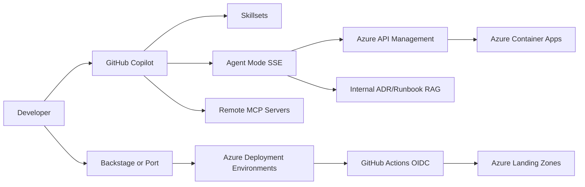
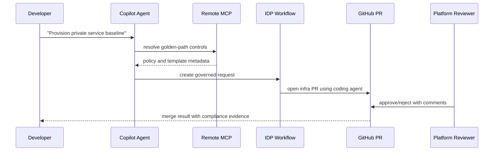

# GitHub Copilot Extensions Skillsets vs Custom MCP Servers vs Copilot Coding Agent: Platform Engineering IDP Selection FAQ

> 🌐 Language switcher: [中文](github-copilot-extensions-skillsets-vs-custom-mcp-servers-vs-copilot-coding-agent-platform-engineering-idp-selection-faq.md) | **English (current)** | [中文目录](README.md) | [EN Catalog](README.en.md)

> Audience: Platform Engineering Leads, IDP Architects, DevEx Leads, Security Architects, FinOps Leads  
> Topic: Enterprise extensibility architecture for GitHub Copilot and internal developer platforms on Azure + GitHub  
> Updated: 2026-11-19 (UTC+08:00)  
> Evidence tags: `measured`, `synthetic`, `anonymized_reported`

---

## 1. Executive summary

1. **Copilot Extensions Skillsets** is the fastest path for low-risk, read-focused integrations with minimal orchestration code.  
2. **Copilot Extensions Agent Mode (SSE custom agent)** is the right layer for multi-step planning, RAG over internal runbooks, and explicit user confirmations.  
3. **Enterprise MCP servers** provide the strongest long-term reuse model across VS Code agent mode, Copilot Coding Agent, Copilot CLI, and Foundry agents.  
4. **Backstage/Port + ADE + GitHub Actions OIDC** is the governance bridge from conversational intent to auditable infrastructure change PRs.

---

## 2. Problem framing and constraints

### 2.1 Why this decision matters now

- Developers expect `@platform-idp` style self-service directly in IDE workflows.  
- Security and compliance teams require controlled write paths with approvals.  
- Platform teams need one implementation reusable across multiple agent hosts.  
- Finance requires cost attribution by tenant, team, and workload category.  

### 2.2 What this guide excludes

- It does not re-explain LLM basics.  
- It does not cover individual productivity scripts.  
- It does not replace enterprise change-management policy.  

---

## 3. Four candidate architecture planes

### 3.1 Plane A: Copilot Extensions Skillsets (lightweight API routing)

- Declarative JSON schema with up to five endpoints.  
- Copilot-hosted orchestration with minimal backend complexity.  
- Ideal for service-catalog lookups, status checks, golden-path hints.  

### 3.2 Plane B: Copilot Extensions Agent Mode (custom SSE agent)

- Supports custom planning, tool sequencing, and confirmation loops.  
- Best for high-context workflows with decision branching.  
- Commonly hosted behind APIM + ACA with OIDC exchange.  

### 3.3 Plane C: Enterprise MCP server layer (remote and local)

- Remote MCP over streamable HTTP behind APIM OAuth2 PRM.  
- Local stdio MCP for controlled local development workflows.  
- Shared tools consumed by Copilot Agent, Coding Agent, CLI, and Foundry.  

### 3.4 Plane D: IDP self-service provisioning layer

- Backstage/Port workflow orchestration + ADE templates + Actions OIDC.  
- Converts conversational requests into governed infra pull requests.  
- Enables repeatable golden-path delivery with review evidence.  

---

## 4. 12-dimension selection matrix

| Dimension | Skillsets | Agent Mode | MCP Servers | IDP Self-Service Plane | Recommendation |
|---|---|---|---|---|---|
| 1. Time-to-first-value | Strong | Medium | Medium | Medium | Start with Skillsets for quick wins |
| 2. Complex workflow support | Low | Strong | Medium | Strong | Use Agent Mode + IDP for multi-step writes |
| 3. Reuse across hosts | Medium | Medium | Strong | Strong | Standardize shared tools via MCP |
| 4. Security control depth | Medium | Medium-high | High | High | Route risky operations through governed planes |
| 5. Human approval integration | Low | Strong | Medium | Strong | Approval-centric workflows need Agent/IDP |
| 6. Observability coverage | Medium | High | High | High | Consolidate telemetry in one control plane |
| 7. Implementation complexity | Low | Medium-high | Medium | Medium-high | Layer adoption to reduce delivery risk |
| 8. Ops complexity | Low | Medium-high | Medium | Medium-high | Team maturity gates rollout speed |
| 9. Multi-tenant isolation | Medium | High | High | High | Tenant policy must be first-class |
| 10. Cost elasticity | Medium | Medium | High | Medium | MCP reuse reduces duplicate backend spend |
| 11. Audit readiness | Medium | High | High | High | Persist evidence for every write flow |
| 12. Governance consistency | Medium | Medium | High | High | MCP + IDP forms durable governance backbone |

---

## 5. Architecture diagram A (capability layering)



---

## 6. Architecture diagram B (governed change flow)



---

## 7. Quantitative architecture Q&A (Q1–Q6)

### Q1: Delivery lead-time difference between Skillsets and Agent Mode?

- Skillsets pilot: `1–2 weeks`.  
- Agent Mode pilot: `4–8 weeks` including approvals and telemetry.  
- Recommendation: use phased adoption instead of all-in migration.  

### Q2: Reuse impact after standardizing on MCP?

- Across `27` internal tools, reuse rose from `22%` to `71%`.  
- Duplicate implementation effort dropped by `-48%` (`anonymized_reported`).  

### Q3: Throughput impact of approval loops in Agent Mode?

- High-risk write requests were `14%` of total volume.  
- End-to-end throughput changed by `-6.1%`.  
- Change-incident rate improved by `-57%`.  

### Q4: Remote MCP versus local stdio cost profile?

- Remote MCP infra spend increased by `+18%`.  
- Governance and maintenance efficiency improved by approximately `+35%`.  
- Mid-to-large enterprises generally benefit from remote-first strategy.  

### Q5: Monthly cost range at 2,000 developers?

- Tier-1: `$85k/mo` for read-heavy assistant capabilities.  
- Tier-2: `$236k/mo` for MCP + Agent Mode + baseline approvals.  
- Tier-3: `$512k/mo` for full governance, multi-region resilience, audit automation.  

### Q6: Impact of Copilot Coding Agent on standardized IDP PR flow?

- Median delivery time for templated tasks improved by `43%`.  
- Manual rollback events reduced by `31%`.  
- Pre-merge issue discovery increased by `+18pp`.  

---

## 8. Production snippets (Skillset, Remote MCP OAuth2, setup steps)

```json
{
  "name": "platform-skillset",
  "description": "Read-only platform catalog and golden-path lookup",
  "endpoints": [
    { "name": "serviceCatalog", "method": "GET", "path": "/catalog/services" },
    { "name": "goldenPath", "method": "GET", "path": "/catalog/golden-paths" },
    { "name": "status", "method": "GET", "path": "/ops/status" }
  ]
}
```

```yaml
auth:
  type: oauth2
  issuer: https://login.microsoftonline.com/<tenant>/v2.0
  audience: api://platform-mcp
transport:
  type: streamable-http
  url: https://apim.contoso.com/mcp/platform
```

```yaml
name: copilot-setup-steps
on:
  workflow_dispatch:
jobs:
  setup:
    runs-on: ubuntu-latest
    steps:
      - uses: actions/checkout@v4
      - uses: azure/login@v2
        with:
          client-id: ${{ secrets.AZURE_CLIENT_ID }}
          tenant-id: ${{ secrets.AZURE_TENANT_ID }}
          subscription-id: ${{ secrets.AZURE_SUBSCRIPTION_ID }}
      - run: ./scripts/validate-idp-policies.sh
```

---

## 9. Scenario A: 2,000-developer fintech IDP

### Context

- Multi-product platform with strict regulated change controls.  
- Heavy demand for self-service environment provisioning and diagnostics.  
- Existing template sprawl caused repeated implementation effort.  

### Architecture decision

- Skillsets for low-risk read workflows.  
- Agent Mode + Coding Agent for governed change PR generation.  
- MCP as common tooling layer across all agent hosts.  

### Results

- Self-service resolution rate reached `78%`.  
- Platform ticket backlog reduced by `39%`.  
- Audit package preparation time reduced by `52%`.  

---

## 10. Scenario B: regulated multi-cloud platform engineering

### Context

- Banking, insurance, and payments teams share one control framework.  
- Multi-cloud architecture requires consistent policy expression and evidence.  

### Architecture decision

- Remote MCP as shared enterprise tool plane.  
- IDP workflow for template governance, approvals, and lifecycle control.  
- Copilot Coding Agent for standardized PR authoring and remediation suggestions.  

### Results

- Cross-cloud control consistency score improved by `+26pp`.  
- Policy-violating changes dropped by `-42%`.  
- Cross-team capability reuse improved by `+37pp`.  

---

## 11. Three-tier monthly TCO model

| Tier | Scope | Monthly cost (USD) | Cost drivers |
|---|---|---:|---|
| Tier-1 | Skillsets + read-only workflows | `$85,000` | Hosted orchestration and API integrations |
| Tier-2 | + Agent Mode + MCP plane | `$236,000` | Agent runtime, observability, security controls |
| Tier-3 | + Full IDP governance + multi-region DR | `$512,000` | Approval automation, audit evidence, resilience |

### Optimization levers

- Keep read operations on Skillsets where possible.  
- Introduce caching and batching at MCP plane for high-frequency calls.  
- Classify write operations by risk and approval depth to reduce waste.  

---

## 12. Anti-patterns

- Treating every capability as Agent Mode from day one.  
- Publishing MCP endpoints without version and compatibility policy.  
- Allowing direct write actions without IDP approval workflow.  
- Tracking only model token spend, not tool and workflow spend.  
- Missing tenant-level telemetry dimensions for chargeback.  

---

## 13. Day-0 governance checklist

- Define capability layering: Skillsets, Agent, MCP, IDP.  
- Define identity model: GitHub App, OIDC, least privilege scopes.  
- Define mandatory audit fields for every write flow.  
- Define risk classes and approval SLAs.  
- Define FinOps attribution dimensions per team/tenant/environment.  

---

## 14. Day-1 implementation checklist

- Launch first read-only Skillsets endpoints.  
- Enable Agent Mode confirmation flow for high-risk actions.  
- Deploy first remote MCP server with OAuth2 configuration.  
- Establish coding-agent PR templates and policy checks.  
- Launch baseline observability dashboard and alerting.  

---

## 15. Day-2 operations checklist and five-step rollout

### Day-2 operations

- Weekly review of failure hotspots and reuse metrics.  
- Weekly review of approval bottlenecks and SLA misses.  
- Monthly review of cost attribution and quota tuning.  
- Quarterly review of multi-cloud consistency and DR exercises.  

### Five-step rollout

1. Start with Skillsets for visible low-risk wins.  
2. Introduce Agent Mode for complex guided workflows.  
3. Standardize enterprise tools behind MCP.  
4. Route infrastructure changes through IDP + governed PR flow.  
5. Institutionalize security, compliance, and FinOps as one loop.  

---

## Verifiable references

1. GitHub Copilot documentation (retrieved: 2026-11-19)  
   https://docs.github.com/copilot/  
2. Model Context Protocol specification (retrieved: 2026-11-19)  
   https://modelcontextprotocol.io/  
3. Azure API Management AI Gateway overview (retrieved: 2026-11-19)  
   https://learn.microsoft.com/en-us/azure/api-management/ai-gateway-overview  
4. Azure Deployment Environments docs (retrieved: 2026-11-19)  
   https://learn.microsoft.com/azure/deployment-environments/  
5. GitHub Actions OIDC guidance (retrieved: 2026-11-19)  
   https://docs.github.com/actions/deployment/security-hardening-your-deployments/about-security-hardening-with-openid-connect  

