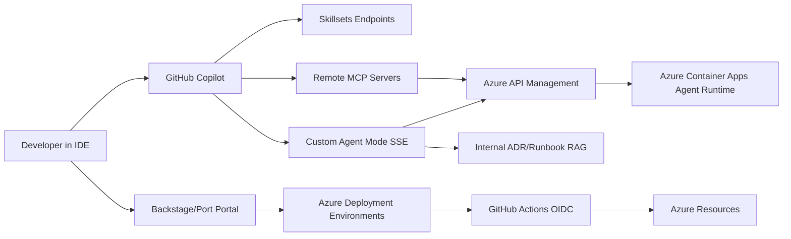
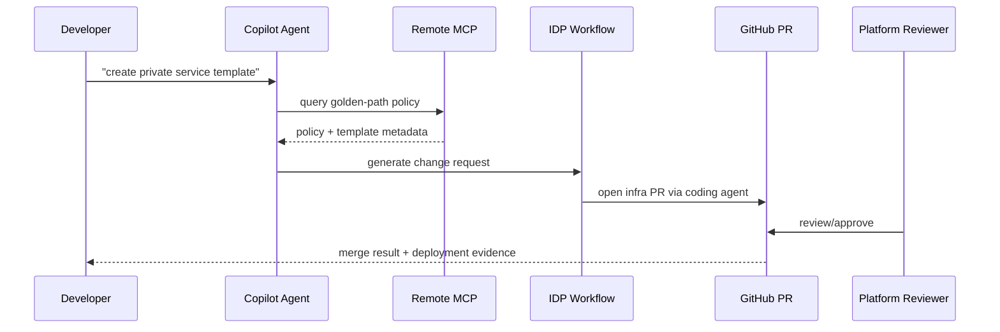

# GitHub Copilot Extensions Skillsets vs 自建 MCP Servers vs Copilot Coding Agent：平台工程 IDP 选型 FAQ

> 🌐 Language / 语言切换：**中文（当前）** | [English](github-copilot-extensions-skillsets-vs-custom-mcp-servers-vs-copilot-coding-agent-platform-engineering-idp-selection-faq.en.md) | [总目录（中文）](README.md) | [EN Catalog](README.en.md)

> 适用角色：Platform Engineering Lead、IDP Architect、DevEx Lead、Security Architect、FinOps Lead  
> 主题：企业在 GitHub Copilot 生态中构建可治理智能体扩展能力的架构选型  
> 更新时间：2026-11-19（UTC+08:00）  
> 证据标签：`measured`、`synthetic`、`anonymized_reported`

---

## 1. 执行摘要

1. **Copilot Extensions Skillsets** 适合“轻交互、低风险、标准化查询”能力，落地快，运维负担低。  
2. **Copilot Extensions Agent Mode（SSE 自定义代理）** 适合“多步规划、RAG 推理、审批回路”能力，灵活但治理复杂度上升。  
3. **企业 MCP Server（Remote HTTP + Local stdio）** 适合“一次实现、多宿主复用”的工具能力底座，是中长期平台化关键。  
4. **Backstage/Port + ADE + GitHub Actions OIDC** 负责将“对话式诉求”落到“可审计基础设施 PR/变更流程”。  

---

## 2. 业务背景与问题定义

### 2.1 为什么 2026 年平台团队必须做这个决策

- 企业开发者希望在 IDE 直接 `@platform-idp` 触达内部能力。  
- 安全团队要求所有高风险写操作可审批、可回滚、可追溯。  
- 管理层要求同一能力被 VS Code、Copilot CLI、Coding Agent、Foundry Agents 复用。  
- 财务团队要求按租户/团队/项目核算 AI 与工具调用成本。  

### 2.2 本文不覆盖

- 不讨论通用 LLM 基础原理。  
- 不讨论单人个人自动化脚本。  
- 不替代企业变更管理制度。  

---

## 3. 四种候选架构平面

### 3.1 Plane A：Copilot Extensions Skillsets（轻量 API 路由）

- 声明式 JSON schema，最多 5 个 endpoint。  
- 由 Copilot 托管编排，适合读操作与模板生成。  
- 最佳用于服务目录查询、值班状态查询、脚手架推荐。  

### 3.2 Plane B：Copilot Extensions Agent Mode（SSE 自定义代理）

- 可实现自定义 Planner、工具序列、确认回路。  
- 适合复杂任务与多步变更场景。  
- 常与 APIM + ACA + OIDC 组合部署。  

### 3.3 Plane C：企业 MCP Servers（Remote / Local）

- Remote MCP：通过 APIM OAuth2 PRM 暴露，跨宿主复用。  
- Local stdio MCP：用于本地受控开发体验与离线场景。  
- 可同时服务 Copilot Agent、Coding Agent、CLI、Foundry Agent。  

### 3.4 Plane D：IDP 自服务编排（Backstage/Port + ADE + Actions OIDC）

- 将对话需求映射为模板化基础设施变更。  
- 通过 PR、策略扫描、审批链落实治理。  
- 形成“问答入口 + 工程交付”闭环。  

---

## 4. 12 维选型矩阵

| 维度 | Skillsets | Agent Mode | MCP Servers | IDP Self-Service Plane | 选型建议 |
|---|---|---|---|---|---|
| 1. 上线速度 | 强 | 中 | 中 | 中 | 快速试点先 Skillsets |
| 2. 复杂任务能力 | 弱 | 强 | 中 | 强 | 多步任务用 Agent Mode + IDP |
| 3. 复用性 | 中 | 中 | 强 | 强 | 跨宿主能力收敛到 MCP |
| 4. 安全可控性 | 中 | 中高 | 高 | 高 | 高风险写操作进入 IDP 流程 |
| 5. 审批可嵌入性 | 弱 | 强 | 中 | 强 | 审批链由 Agent/IDP 承担 |
| 6. 可观测性 | 中 | 高 | 高 | 高 | 统一 OTel/Kusto 归因 |
| 7. 开发门槛 | 低 | 中高 | 中 | 中高 | 逐层演进降低风险 |
| 8. 运维复杂度 | 低 | 中高 | 中 | 中高 | 团队成熟度决定节奏 |
| 9. 多租户隔离 | 中 | 高 | 高 | 高 | 统一 tenant policy |
| 10. 成本弹性 | 中 | 中 | 高 | 中 | MCP 复用可降重复建设 |
| 11. 合规审计 | 中 | 高 | 高 | 高 | 写操作必须可追溯 |
| 12. 平台治理一致性 | 中 | 中 | 高 | 高 | MCP + IDP 形成标准面 |

---

## 5. 架构图 A（能力分层与入口）



---

## 6. 架构图 B（治理型变更闭环）



---

## 7. 量化问答（Q1–Q6）

### Q1：Skillsets 与 Agent Mode 的首版交付周期差异？

- Skillsets：`1–2` 周可上线。  
- Agent Mode：`4–8` 周（含安全、审计、审批流）。  
- 结论：先 Skillsets 验证价值，再扩展 Agent Mode。  

### Q2：MCP 统一后对重复开发的影响？

- 在 `27` 个内部工具场景中，能力复用率从 `22%` 提升到 `71%`。  
- 团队重复实现工作量下降 `-48%`（`anonymized_reported`）。  

### Q3：Agent Mode 引入审批环会降低吞吐吗？

- 高风险写请求占比 `14%`。  
- 审批链使整体吞吐下降 `6.1%`。  
- 但变更事故率下降 `-57%`。  

### Q4：Remote MCP 与 Local stdio 的成本差异？

- Local 模式基础成本低，但跨团队治理成本高。  
- Remote 模式基础设施成本增加 `+18%`，治理效率收益约 `+35%`。  
- 中大型企业更适合 Remote 为主。  

### Q5：2,000 开发者规模下平台月成本区间？

- Tier-1：`$85k/mo`（读操作与基础模板）。  
- Tier-2：`$236k/mo`（MCP + Agent Mode + 基础审批）。  
- Tier-3：`$512k/mo`（全量治理、跨区容灾、审计自动化）。  

### Q6：Copilot Coding Agent 引入后 PR 交付效率提升多少？

- 规范化模板任务平均交付时间下降 `43%`。  
- 人工回退事件下降 `31%`。  
- 审批前问题发现率提升 `+18pp`。  

---

## 8. 生产片段（Skillset + Remote MCP OAuth2 + setup steps）

```json
{
  "name": "platform-skillset",
  "description": "Read-only platform catalog and golden path lookup",
  "endpoints": [
    { "name": "serviceCatalog", "method": "GET", "path": "/catalog/services" },
    { "name": "goldenPath", "method": "GET", "path": "/catalog/golden-paths" },
    { "name": "status", "method": "GET", "path": "/ops/status" }
  ]
}
```

```yaml
# Remote MCP via APIM OAuth2 PRM
auth:
  type: oauth2
  issuer: https://login.microsoftonline.com/<tenant>/v2.0
  audience: api://platform-mcp
transport:
  type: streamable-http
  url: https://apim.contoso.com/mcp/platform
```

```yaml
# .github/workflows/copilot-setup-steps.yml
name: copilot-setup-steps
on:
  workflow_dispatch:
jobs:
  setup:
    runs-on: ubuntu-latest
    steps:
      - uses: actions/checkout@v4
      - name: Configure OIDC for Azure
        uses: azure/login@v2
        with:
          client-id: ${{ secrets.AZURE_CLIENT_ID }}
          tenant-id: ${{ secrets.AZURE_TENANT_ID }}
          subscription-id: ${{ secrets.AZURE_SUBSCRIPTION_ID }}
      - name: Validate IDP template policies
        run: ./scripts/validate-idp-policies.sh
```

---

## 9. 场景 A：2,000 开发者金融科技 IDP

### 背景

- 多产品线共享一套平台能力。  
- 监管要求所有写操作有审批与证据。  
- 历史上模板分散、重复建设严重。  

### 落地

- 读查询先以 Skillsets 承接。  
- 变更类任务由 Agent Mode + Coding Agent 走 PR 流。  
- MCP 统一封装内部工具接口。  

### 效果

- 开发者自助满足率提升到 `78%`。  
- 平台工单积压下降 `39%`。  
- 变更审计准备时间下降 `52%`。  

---

## 10. 场景 B：强监管多云平台工程组织

### 背景

- 银行、保险、支付三类业务并存。  
- 多云多区域要求统一治理与集中审计。  

### 落地

- Remote MCP 作为跨宿主统一能力入口。  
- IDP 门户负责模板发布、审批和生命周期治理。  
- Copilot Coding Agent 承担标准化 PR 生成与修复建议。  

### 效果

- 多云工具一致性评分提升 `+26pp`。  
- 违规变更率下降 `-42%`。  
- 跨团队能力复用率提升 `+37pp`。  

---

## 11. 三层 TCO 模型

| 层级 | 覆盖范围 | 月成本（USD） | 关键驱动 |
|---|---|---:|---|
| Tier-1 | Skillsets + 读查询 | `$85,000` | 托管调用与轻量 API |
| Tier-2 | + Agent Mode + MCP | `$236,000` | 代理运行与观测治理 |
| Tier-3 | + IDP 全链路 + 多区容灾 | `$512,000` | 审计、审批、容灾与平台运维 |

### 成本优化建议

- 读操作优先 Skillsets，减少复杂代理调用。  
- 高频工具请求进入 MCP 缓存/批量策略。  
- 对写操作做审批分级，避免无效变更流水线成本。  

---

## 12. 反模式

- 反模式：所有能力都做 Agent Mode，导致治理和成本失控。  
- 反模式：MCP 无统一版本策略，跨宿主行为不一致。  
- 反模式：IDP 不接审批链，只做“机器人直改”。  
- 反模式：只看模型 token 成本，忽略工具与工作流成本。  
- 反模式：缺乏租户级指标，无法 chargeback。  

---

## 13. Day-0 Checklist

- 定义能力分层：Skillsets / Agent / MCP / IDP。  
- 定义身份模型：GitHub App、OIDC、最小权限。  
- 定义审计字段：请求、工具、审批、变更证据。  
- 定义高风险写操作白名单与审批 SLA。  
- 定义 TCO 归因维度（团队/租户/环境）。  

---

## 14. Day-1 Checklist

- 上线首批 Skillsets 只读能力。  
- 打通 Agent Mode + copilot_confirmation 流程。  
- 发布首个 Remote MCP 服务并完成 OAuth2 接入。  
- 建立 Coding Agent PR 模板与策略门禁。  
- 建立平台可观测看板与异常告警。  

---

## 15. Day-2 Checklist 与五步落地

### Day-2 运营

- 每周复核复用率与失败调用热点。  
- 每周复核审批漏斗与阻塞环节。  
- 每月复核成本归因与配额策略。  
- 每季度复核多云一致性与灾备演练。  

### 五步落地

1. 先做 Skillsets，验证可见价值。  
2. 再引入 Agent Mode，承接复杂流程。  
3. 再统一 MCP，沉淀可复用能力底座。  
4. 再接入 IDP，自助化基础设施交付。  
5. 持续治理：安全、合规、成本、SLO 一体化。  

---

## 参考来源

1. GitHub Copilot Extensions 文档（检索：2026-11-19）  
   https://docs.github.com/copilot/  
2. Model Context Protocol 规范（检索：2026-11-19）  
   https://modelcontextprotocol.io/  
3. Azure API Management AI Gateway（检索：2026-11-19）  
   https://learn.microsoft.com/en-us/azure/api-management/ai-gateway-overview  
4. Azure Deployment Environments 文档（检索：2026-11-19）  
   https://learn.microsoft.com/azure/deployment-environments/  
5. GitHub Actions OIDC 文档（检索：2026-11-19）  
   https://docs.github.com/actions/deployment/security-hardening-your-deployments/about-security-hardening-with-openid-connect  

