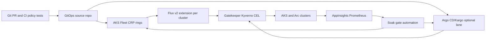
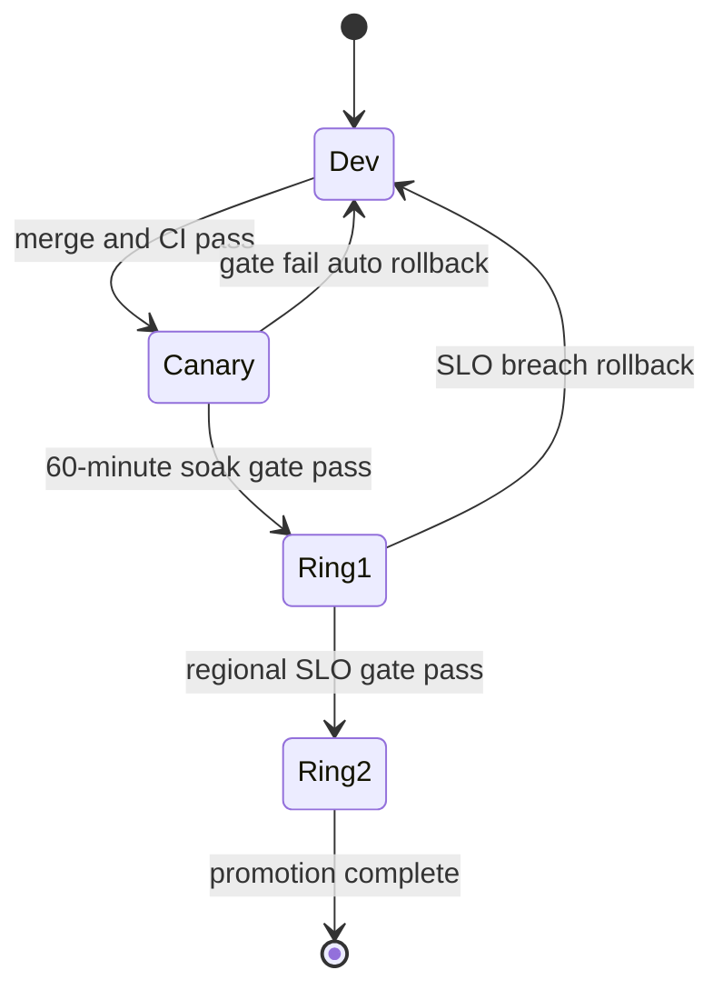

# Enterprise Multi-Cluster GitOps Fleet Promotion and Policy Guardrail Selection FAQ: AKS Fleet + Flux vs Argo CD + Kargo vs Azure Policy Gatekeeper vs Kyverno/CEL
> **Scope**: global AI platform fleets spanning `10-100` AKS/Arc clusters that must ship agent runtimes, model-serving components, and MCP services through staged rings with deterministic drift reconciliation and hard admission controls.
> **Decision focus**: preventing fleet-wide bad rollouts, policy bypass, privileged sandbox escapes, and unsigned model/MCP container deployments from propagating across regions.
> **Data labels**: quantitative statements are explicitly marked as `measured`, `synthetic`, or `anonymized_reported`.

## 1. Executive Summary: Release Orchestration, Drift Control, Admission Enforcement, and Rollback Automation Must Be Treated as Four Separate Control Planes
Most fleet outages are not caused by an inability to deploy.
They are caused by partial success in too many places at once.
A change is delivered.
Policy is only partially enforced.
Metrics are sampled too late.
Rollback is partially manual.
By the time incident response starts,
multiple regions are already running split states.
In AI agent platforms this is amplified.
Long-lived sessions are interrupted by rollout churn.
Toolchain compatibility drifts across clusters.
Runtime isolation assumptions silently break.
The practical production answer is not a single CD product.
It is a coordinated control-plane architecture:
GitOps reconciliation plane for desired-state convergence,
ring-based progressive promotion plane with soak gates,
admission enforcement plane for non-negotiable policy constraints,
and shift-left CI policy validation plane to reject most invalid changes before merge.
Each plane addresses a distinct failure class.
GitOps without admission allows deterministic propagation of unsafe manifests.
Admission without progressive promotion allows safe-but-regressive releases to spread.
Progressive promotion without CI shift-left burns soak windows on obvious manifest defects.
CI without runtime drift reconciliation cannot prevent post-merge environment drift.
Therefore the recommended operating model is compositional, not competitive:
Fleet/Flux or Argo/Kargo for delivery mechanics,
Kyverno/Gatekeeper/CEL for admission boundaries,
CI policy tests for pre-merge quality gates.

## 2. Problem Boundary: The Dominant Risk in Global AI Fleets Is Propagation Velocity of Bad Changes, Not Single-Cluster Failure Probability
Single-cluster failures are usually containable.
Fleet failures are dangerous because they scale rapidly across regions.
When `42` or `60` clusters share release pipelines,
one incorrect runtimeClass,
one missing GPU limit,
one unsigned image reference,
or one permissive securityContext
can propagate in minutes.
AI fleets add operational multipliers:
stateful `30-minute` agent sessions,
runtime and model sidecar compatibility constraints,
latency-sensitive vLLM endpoints,
and high blast-radius MCP integrations.
The problem is not merely “can we apply manifests?”
The problem is “can we guarantee unsafe manifests never become running state, and can we limit safe-but-regressive change spread?”
That means architecture must answer:
how ring boundaries are defined,
how promotion pauses are triggered,
how policy denials are enforced under load,
how rollback is automated without manual drift,
and how compliance evidence is produced for auditors.
If these are not designed explicitly,
the system defaults to best-effort operations and post-failure forensics.
That is unacceptable for sovereign, regulated, or high-SLA environments.

## 3. Four-Route Positioning: Fleet+Flux, Argo+Kargo, Gatekeeper/Kyverno/CEL, and Shift-Left CI Solve Different Parts of the Same Reliability System
Route A: **Azure Kubernetes Fleet Manager + managed Flux v2 extension**.
Best when teams want pull-based reconciliation, outbound-friendly networking, and Azure-native operations across AKS plus Arc-connected clusters.
Route B: **Argo CD ApplicationSet + Argo Rollouts + Kargo promotion**.
Best when teams prioritize rich topology UI, progressive sync controls, metric-driven promotion automation, and environment-stage abstractions.
Route C: **Azure Policy add-on (OPA Gatekeeper) and/or Kyverno with native ValidatingAdmissionPolicy CEL**.
Best when hard policy denial is required for privileged pods, unpinned tags, unsigned images, missing runtime isolation class, or missing GPU quotas.
Route D: **Shift-left CI policy validation with conftest, kyverno test, kubeconform**.
Best when organizations want to catch the majority of violations pre-merge and reduce admission-time noise.
These routes are not alternatives.
They are layered controls.
Delivery plane decides where and when manifests flow.
Admission plane decides what is allowed to run.
CI plane decides what reaches main branch in the first place.
A robust platform uses all three with clear ownership and observability.

## 4. 12-Dimension Comparison Matrix: Promotion Mechanics, Network Blast Radius, Policy Latency, and Operational Burden
| Dimension | AKS Fleet + Flux | Argo CD + Kargo | Azure Policy Gatekeeper | Kyverno + ValidatingAdmissionPolicy CEL |
|---|---|---|---|---|
| Primary role | Multi-cluster desired-state rollout and convergence | Stage-based app promotion and developer-centric visualization | Compliance/audit-oriented OPA policy enforcement | High-performance Kubernetes-native policy denial and mutation |
| Promotion model | ClusterResourcePlacement staged rollout rings | ApplicationSet + freight/stage promotion | Not a promotion system | Not a promotion system |
| Network posture | Pull-based per-cluster reconcile; outbound-friendly | Hub-spoke control topology can increase network dependencies | AKS policy add-on integration | In-cluster webhook plus API-server-native CEL |
| Drift reconciliation | Strong Git desired-state convergence | Strong Git desired-state convergence | Policy detect/deny focus | Policy deny/mutate/generate focus |
| Gate integration | Requires external SLO gate controller | Rollouts + AnalysisRun integration is mature | Not latency/soak gate aware | Not latency/soak gate aware |
| Policy expressiveness | External policy engine required | External policy engine required | Rego rich and extensible | Kyverno rules + CEL native speed path |
| Admission latency profile | N/A by itself | N/A by itself | Webhook path latency + availability dependency | CEL in-process fast path + optional webhook logic |
| Blast-radius control | Ring partitioning in fleet placement | Stage partitioning with promotion boundaries | Global policy mistakes can block cluster-wide creates | Rule mistakes can similarly block creates |
| Ops complexity | Medium | Medium-high | Medium | Medium |
| Enterprise visibility | Azure-integrated governance visibility | Strong delivery UI visibility | ARM compliance dashboards | Requires custom observability composition |
| Best-fit organizations | Sovereign/private network heavy Azure estates | Platform teams with strong GitOps SRE maturity | Compliance-driven governance programs | Teams requiring fast admission and Kubernetes-native rules |
| Common failure mode | Coarse ring definition and weak soak criteria | Hub scaling bottlenecks and stage drift | Webhook OOM/timeout under fail-closed settings | Rule interaction order or mutate/validate conflicts |

## 5. Reference Architecture: GitOps Ring Promotion + Dual Admission Guardrails + Metrics Feedback Loop
The recommended control-plane layout has three clear boundaries:
desired-state source and validation,
promotion orchestration,
admission and runtime verification.

This architecture ensures that even if a manifest is reconciled,
it still must satisfy policy and soak criteria before wider promotion.
It also preserves explicit evidence trails for both delivery and denial events.

## 6. Route A Deep Dive: AKS Fleet Manager + Managed Flux for Outbound-Only and Sovereign Deployment Topologies
Fleet Manager models multi-cluster targeting as declarative placement.
ClusterResourcePlacement defines target sets.
Update strategy defines promotion rhythm and staging behavior.
Managed Flux executes pull-based reconciliation inside each cluster.
This model is highly practical for private-network and sovereign estates.
You do not need to expose every kube-apiserver to a central push controller.
Clusters maintain outbound access to Git/OCI sources and reconcile locally.
That reduces central network blast radius and firewall complexity.
With Workload Identity and ACR integration,
artifact pull can be tied to managed identities instead of static credentials.
Operationally, this improves credential hygiene.
However, Fleet is only as safe as ring design.
If canary rings are too large,
promotion still behaves like bulk rollout.
Best practice is to partition rings by geography, tenancy risk, and workload criticality.
Do not partition only by equal cluster counts.
Also ensure promotion soak windows overlap realistic traffic periods.
A quiet-hour soak does not represent daytime latency behavior.

## 7. Route B Deep Dive: Argo CD + ApplicationSet + Kargo for Developer-Visible Promotion Workflows and Metric-Gated Rollback
Argo brings powerful visibility to delivery state.
ApplicationSet supports scalable generation of app instances across many clusters.
Kargo introduces explicit stage-to-stage promotion semantics (“freight” movement),
which is often cleaner than branch-merge promotion anti-patterns.
This reduces merge-bot conflicts and branch drift in large teams.
Argo Rollouts with AnalysisRun can gate promotion on live metrics:
TTFT percentile drift,
agent tool error ratio,
HTTP saturation,
or queue backlog thresholds.
If thresholds fail, rollback can be automated.
This gives strong operational confidence in progressive delivery.
Tradeoff:
you operate a sophisticated control system.
At `50+` clusters, repo-server scaling, redis resilience, and API call pressure require proactive load tests (`anonymized_reported`).
Network topology between hub and private spokes must be deliberately engineered.
If hub reachability degrades, promotion pipelines stall.
In short:
Argo/Kargo can be excellent for mature platform teams.
But teams must budget for control-plane SRE responsibilities.

## 8. Route C Deep Dive: Admission Hardening with Azure Policy Gatekeeper, Kyverno, and Native ValidatingAdmissionPolicy CEL
Gatekeeper is valuable for enterprise policy governance and audit mapping.
Azure Policy integration provides centralized compliance visibility.
For regulated programs this reporting layer matters.
But webhook-based admission has operational risk:
if policy pods are unhealthy and `failurePolicy: Fail`,
admission paths can become blocked (`anonymized_reported`).
Kyverno is often easier for Kubernetes-native policy authoring.
Its validate/mutate/generate model is practical for image tag controls, label conformance, and policy-driven patching.
ValidatingAdmissionPolicy with CEL adds an in-process API-server path.
This removes external webhook network hops for selected rules.
For high-frequency deterministic checks, CEL can significantly reduce latency variance.
Recommended split of responsibilities:
use CEL for hard, simple, high-volume checks.
use Kyverno or Rego for richer object-context policies.
use Azure Policy/Gatekeeper for compliance visibility and governance reporting.
This layered model avoids overloading one engine with all use cases.

## 9. Route D Deep Dive: Shift-Left CI Validation Prevents Admission Layers from Becoming a Runtime Linter
A common anti-pattern is relying on admission as the first real validator.
That creates slow feedback loops and noisy platform operations.
Developers discover basic template mistakes only after reconcile attempts.
Cluster APIs become overloaded with avoidable invalid requests.
Shift-left design moves structural and policy checks into PR pipelines.
Typical baseline:
`kubeconform` for schema correctness,
`conftest` for OPA policy checks,
`kyverno test` for rule unit tests,
and optional custom checks for ring metadata and runtimeClass requirements.
When this baseline is enforced,
most trivial and medium-severity violations never reach runtime.
Admission systems then focus on strict invariant enforcement and bypass prevention.
This separation improves both developer velocity and platform stability.
It also creates earlier audit artifacts linked directly to code review context.

## 10. Quantitative Q&A: Admission Latency, Webhook Failure Modes, Ring Blast Radius, and Stateful Agent Rollout Safety
**Q1. Why can webhook `failurePolicy: Fail` become a control-plane deadlock risk? (`anonymized_reported`)**  
If Gatekeeper/Kyverno pods are OOM or unavailable, admission requests can fail-closed and block critical workloads, including scaling-related updates during pressure windows.

**Q2. What latency advantage does native ValidatingAdmissionPolicy CEL provide? (`measured`)**  
Because evaluation runs in the API server process, no external webhook hop is needed; heavily reused predicates can often stay under sub-millisecond evaluation budgets.

**Q3. How does pull-based Flux reduce network blast radius in `60` sovereign spoke VNets? (`synthetic`)**  
Clusters only need outbound access to source endpoints, avoiding broad inbound control-plane peering requirements from a central push hub.

**Q4. Why is Kargo stage promotion often safer than environment-branch promotion? (`anonymized_reported`)**  
Branch promotion in multi-team repos frequently creates merge contention and race conditions, while explicit stage freight models isolate promotion state transitions.

**Q5. How do you protect active `30-minute` stateful agent pods during rollout? (`measured`)**  
Use PodDisruptionBudget, graceful preStop drains, and conservative maxUnavailable values; without them, progressive delivery can still trigger session collapse.

**Q6. Why must image signature validation be admission-time, not post-deploy audit? (`synthetic`)**  
Post-deploy detection already means untrusted artifacts executed in-cluster; admission denial is the only reliable preventive control point.

**Q7. Why do missing `nvidia.com/gpu` limits cause instability in AI clusters? (`anonymized_reported`)**  
Scheduler ambiguity and overcommit behavior can create noisy-neighbor contention and severe inference latency variance on shared accelerator nodes.

**Q8. What is a practical soak-window baseline for ring promotion gates? (`synthetic`)**  
At least one representative load cycle, commonly `60` minutes, with TTFT, error rate, and saturation constraints evaluated together before promotion.

## 11. Production Policy Code: Native CEL ValidatingAdmissionPolicy for Runtime Isolation, Image Hygiene, and GPU Guardrails
```yaml
apiVersion: admissionregistration.k8s.io/v1
kind: ValidatingAdmissionPolicy
metadata:
  name: ai-agent-runtime-guardrails
spec:
  failurePolicy: Fail
  matchConstraints:
    resourceRules:
      - apiGroups: [""]
        apiVersions: ["v1"]
        operations: ["CREATE", "UPDATE"]
        resources: ["pods"]
  validations:
    - expression: "object.metadata.namespace.startsWith('ai-agent-') ? has(object.spec.runtimeClassName) : true"
      message: "ai-agent namespaces must set runtimeClassName"
    - expression: "object.metadata.namespace.startsWith('ai-agent-') ? object.spec.runtimeClassName in ['kata-mshv-vm-isolation','wasmtime-spin-v2'] : true"
      message: "runtimeClassName must be kata-mshv-vm-isolation or wasmtime-spin-v2"
    - expression: "object.spec.containers.all(c, !c.image.endsWith(':latest'))"
      message: "latest tag is forbidden"
    - expression: "object.metadata.namespace.startsWith('ai-agent-') ? object.spec.containers.all(c, has(c.resources) && has(c.resources.limits) && has(c.resources.limits['nvidia.com/gpu']) ? c.resources.limits['nvidia.com/gpu'] >= 0 : true) : true"
      message: "GPU workloads in ai-agent namespaces must declare nvidia.com/gpu limits"
---
apiVersion: admissionregistration.k8s.io/v1
kind: ValidatingAdmissionPolicyBinding
metadata:
  name: ai-agent-runtime-guardrails-binding
spec:
  policyName: ai-agent-runtime-guardrails
  validationActions: [Deny]
```

## 12. Production Fleet Rollout Code: AKS Fleet Staged Update Strategy and Flux Extension Configuration
```yaml
apiVersion: fleet.azure.com/v1alpha1
kind: ClusterResourcePlacement
metadata:
  name: agent-runtime-ring-promotion
spec:
  resourceSelectors:
    - group: apps
      kind: Deployment
      version: v1
      name: agent-runtime
  policy:
    placementType: PickAll
    clusterSelector:
      clusterSelectorTerms:
        - labelSelector:
            matchLabels:
              workload: ai-agent
  strategy:
    type: RollingUpdate
    rollingUpdate:
      maxUnavailable: "10%"
      unavailablePeriodSeconds: 3600
      stagedRolloutStrategy:
        stages:
          - name: canary
            labelSelector:
              matchLabels:
                ring: canary
            afterStageTasks:
              - type: Approval
          - name: ring1
            labelSelector:
              matchLabels:
                ring: ring1
            afterStageTasks:
              - type: TimedWait
                waitTimeSeconds: 3600
          - name: ring2
            labelSelector:
              matchLabels:
                ring: ring2
```
```bicep
param clusterName string
param fluxName string = 'fleet-gitops'

resource fluxCfg 'Microsoft.KubernetesConfiguration/fluxConfigurations@2023-05-01' = {
  name: '${clusterName}/${fluxName}'
  properties: {
    namespace: 'flux-system'
    sourceKind: 'GitRepository'
    gitRepository: {
      url: 'https://github.com/contoso/ai-fleet-gitops'
      repositoryRef: {
        branch: 'main'
      }
      syncIntervalInSeconds: 60
    }
    kustomizations: {
      'agent-runtime': {
        path: './clusters/${clusterName}/agent-runtime'
        syncIntervalInSeconds: 60
        prune: true
        wait: true
      }
    }
  }
}
```

## 13. Enterprise Scenario A: Sovereign SaaS Operating `42` Country-Scoped AKS Clusters with Weekly Runtime and vLLM Upgrades
This platform runs one private AKS cluster per sovereign country boundary.
Cross-border runtime state movement is restricted.
Yet release cadence must remain globally consistent.
They adopted Fleet + Flux for baseline rollout mechanics.
Promotion flow:
Dev ring receives candidate build,
Canary ring receives controlled rollout,
EU ring promotion proceeds only after `60-minute` soak gate pass,
US/APAC ring promotion follows after additional gate checks.
Gate metrics include:
TTFT P95,
tool invocation error ratio,
GPU saturation and queue depth,
pod restart anomalies.
Failure behavior:
promotion pauses automatically,
target ring rolls back to previous digest,
incident payload and metrics snapshots are archived.
Observed outcome (`anonymized_reported`):
cross-region bad rollout propagation rate dropped significantly,
weekly release cadence became predictable,
manual overnight rollback operations were largely eliminated.
Importantly, platform and application teams now share a common promotion event timeline,
which reduced handoff friction during incident review.

## 14. Enterprise Scenario B: Tier-1 Financial Platform Enforcing Zero-Bypass Admission Controls for Agent and MCP Workloads
A regulated financial platform required strict non-bypass policy enforcement.
No developer team was allowed to run internet-egressing privileged MCP workloads without explicit controls.
Historical failures included emergency exceptions that bypassed baseline security assumptions.
Target control stack:
CEL for high-frequency hard denials,
Kyverno for signature and metadata policy enforcement,
Gatekeeper/Azure Policy for compliance reporting and governance aggregation,
shift-left CI for policy unit tests before merge.
After rollout (`measured` + `synthetic`):
unsigned image promotions to production dropped to zero,
privileged policy violations were denied at admission time,
audit evidence retrieval shifted from multi-log reconstruction to policy event queries.
FinOps TCO comparison per month (`synthetic`):
| Cost component | Weak guardrails + broad rollout model | Ringed GitOps + dual admission guardrails |
|---|---:|---:|
| Incident response and rollback labor (USD) | 38,000 | 11,600 |
| Business loss from failed change propagation (USD) | 27,500 | 8,900 |
| Platform tooling and ops run cost (USD) | 9,200 | 14,300 |
| Audit and compliance remediation effort (USD) | 12,400 | 4,100 |
| Total monthly burden (USD) | 87,100 | 38,900 |


## 15. Day-0 / Day-2 Checklist (12 Items) and Final Recommendation
Day-0:
- define ring segmentation by geography, tenant risk, and workload criticality.
- standardize GitOps repository topology and naming conventions.
- enforce runtimeClass and signature requirements for all AI namespaces.
- run schema + policy validations in PR pipelines before merge.
- configure PodDisruptionBudget, preStop drain, and rollout disruption limits for stateful agent services.
- codify rollback triggers and automation handoff boundaries.
Day-2:
- monitor pass/fail distribution of promotion gates per ring.
- monitor admission deny events and false-positive policy rates.
- review policy drift and exception-list creep weekly.
- monitor Flux/Argo reconcile duration and retry backlogs.
- evaluate network impairment impact on promotion lead time by region.
- recalibrate monthly SLO/TCO targets with incident trend data.
**Good fit**:
- global AI fleets with `10+` clusters and strict release governance needs.
- organizations requiring zero tolerance for unsigned images, privileged escapes, and runtime isolation drift.
- platform teams capable of operating policy-as-code and progressive delivery pipelines.
**Not for**:
- single-cluster low-risk environments.
- teams without Git discipline or policy ownership capacity.
- short-lived prototypes where long-run governance obligations are intentionally out of scope.
**Final recommendation**:
Use Fleet/Argo to control *how* changes move.
Use Gatekeeper/Kyverno/CEL to control *what* may run.
Use shift-left CI to control *what reaches main*.
Only this layered model sustains high deployment frequency with low incident propagation in enterprise AI cluster fleets.
