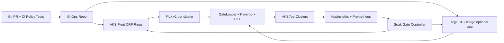
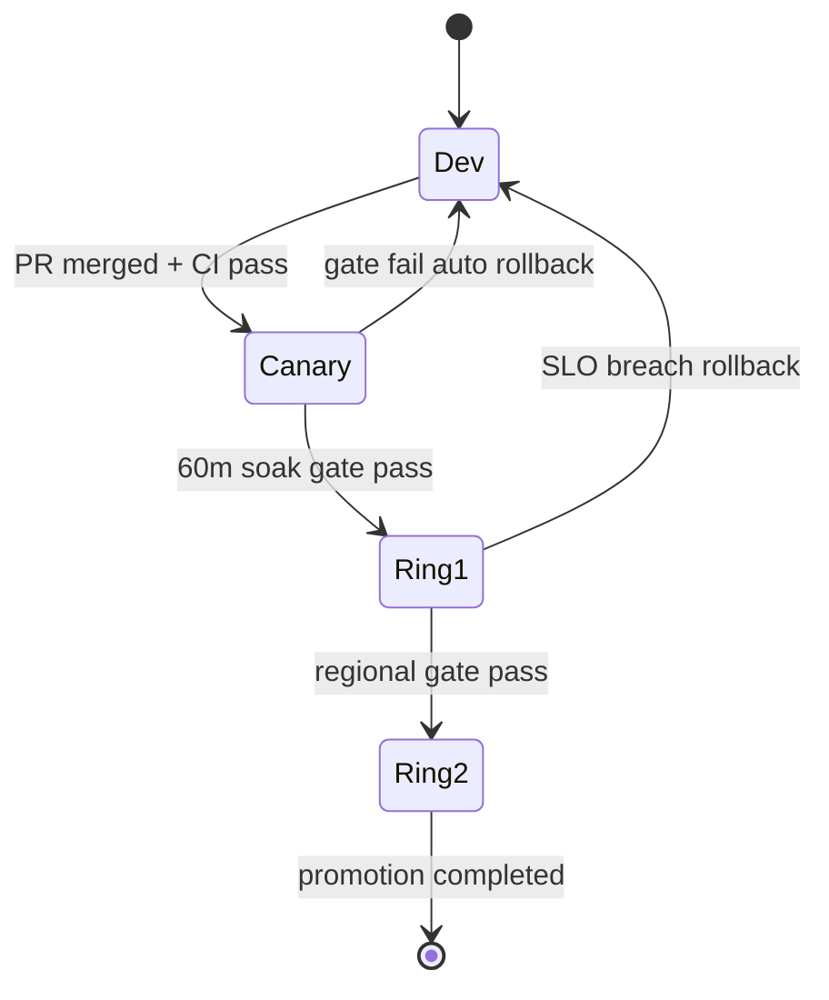

# 企业多集群 GitOps 晋级与策略护栏选型 FAQ：AKS Fleet+Flux vs Argo CD+Kargo vs Azure Policy Gatekeeper vs Kyverno/CEL
> **适用范围**：`10–100` 区域级 AKS/Arc 集群统一发布智能体运行时、模型推理组件与 MCP 服务，要求分环晋级、漂移收敛与准入阻断。
> **决策焦点**：如何避免一次错误发布放大为全舰队事故，并阻断特权沙箱逃逸、未签名镜像与越权网络策略进入生产。
> **数据标签**：文中定量口径均标注 `measured`、`synthetic`、`anonymized_reported`。

## 1. 执行摘要：发布、策略、漂移与回滚必须四轨解耦，不能靠单一 CD 平台兜底
多集群 AI 平台的事故常常不是“不会发版”。
而是“发版半成功 + 策略半生效 + 回滚半自动”。
结果是区域间版本分裂。
一部分集群带着高风险配置运行数小时。
等告警出现时，
SRE 才发现配置来源已经不可追溯。
在全球 AI 生产舰队里，
最稳妥的做法不是押注某个单品。
而是把控制面拆成四条并行链路。
第一条是 GitOps 拉取式收敛链路。
第二条是分环晋级与 soak 门禁链路。
第三条是 Admission 策略阻断链路。
第四条是 CI 左移验证链路。
四条链路缺一不可。
只有 GitOps 没有策略阻断，
错误会稳定地被同步到所有集群。
只有策略阻断没有分环晋级，
合法但有性能回归的版本仍会大面积扩散。
只有分环晋级没有左移，
每次晋级都在生产发现模板缺陷。
只有左移没有漂移收敛，
线上手工改动会长期偏离基线。
因此本指南的核心结论是：
AKS Fleet+Flux、Argo/Kargo、Gatekeeper/Kyverno/CEL、CI policy test
应被设计成协同系统，
而不是竞品单选题。
## 2. 问题边界：AI 集群舰队最大的风险是“坏变更传播速度”而非“单集群失败率”
单集群事故通常可局部处置。
舰队事故的难点在于传播速度。
当 `42` 或 `60` 个区域集群共用同一发布节奏时，
一个错误 RuntimeClass、
一个漏掉的 GPU 限额、
一个未签名镜像，
都会在分钟级扩散到多个国家区域。
AI 场景还有额外放大器。
智能体工作负载常有长连接和有状态会话。
发布抖动会直接打断推理会话。
模型服务与工具服务耦合紧密。
一个 MCP 版本漂移可能触发链式失败。
如果组织没有明确“分环 + soak + 自动回滚”机制，
就会被迫在生产窗口做人肉回滚。
同时，
平台安全团队最担心的不是普通配置错误。
而是越权部署。
例如：
沙箱命名空间被部署成 privileged。
MCP 服务镜像来自未签名来源。
`runtimeClassName` 丢失导致 Kata/Wasm 隔离失效。
这类问题必须在 Admission 层硬阻断，
不能寄希望于事后巡检。
## 3. 四路线定位：Fleet+Flux、Argo+Kargo、Gatekeeper/Kyverno/CEL、CI 左移各自解决什么
路线 A：**AKS Fleet Manager + Managed Flux v2**。
适合强调微软托管能力、
拉取式收敛、
出站网络友好、
跨 Arc 私有环境一致分发的组织。
路线 B：**Argo CD ApplicationSet + Kargo + Rollouts**。
适合强调开发者可视化、
多阶段推广编排、
指标门禁自动回滚、
自定义扩展能力的组织。
路线 C：**Azure Policy Gatekeeper vs Kyverno + ValidatingAdmissionPolicy CEL**。
适合在准入层做零旁路硬阻断，
把“不能发生”的配置在 API Server 前置拦截。
路线 D：**CI 左移验证（conftest/kyverno test/kubeconform）**。
适合把大部分模板缺陷在 PR 阶段清除，
减少 GitOps 同步后才报错的往返成本。
四者组合关系是：
Fleet/Argo 负责“把变更送达并收敛”。
Kargo/Ring 策略负责“按风险顺序推广”。
Admission 负责“即便推广也不能越过红线”。
CI 负责“尽可能别把坏清单放进 Git”。
## 4. 12 维对比矩阵：传播控制、网络边界、策略执行路径与运营开销
| 维度 | AKS Fleet + Flux | Argo CD + Kargo | Azure Policy Gatekeeper | Kyverno + CEL VAP |
|---|---|---|---|---|
| 主能力 | 多集群拉取式分发与收敛 | 可视化应用编排与阶段晋级 | 企业合规可见性与 OPA 约束 | Kubernetes 原生/近原生准入策略 |
| 发布模式 | CRP 分环 + Flux Reconcile | AppSet + Stage Promotion | 非发布系统 | 非发布系统 |
| 网络模型 | 出站拉取友好 | Hub-spoke 管控面要求更高 | 依赖 AKS add-on | 依赖集群内控制器 + API Server |
| 漂移收敛 | 强（Git 目标态） | 强（Git 目标态） | 侧重审计与阻断 | 侧重阻断与变更修复 |
| 准入阻断 | 需搭配策略引擎 | 需搭配策略引擎 | OPA webhook 路径 | CEL 内置 + webhook 路径 |
| 性能门禁 | 需外接监控门禁 | Rollouts AnalysisRun 成熟 | 非性能门禁系统 | 非性能门禁系统 |
| 策略表达力 | 依赖外部策略工具 | 依赖外部策略工具 | Rego 强 | Kyverno 规则 + CEL 高效 |
| 故障爆炸半径 | 分环可控 | 阶段可控 | 策略配置错误可全局影响 | 策略错误同样可全局影响 |
| 运维复杂度 | 中 | 中高 | 中 | 中 |
| 可观测性 | Azure 生态一体较好 | UI 与事件链丰富 | ARM 合规面板可见 | 需组合 Prom/Logs |
| 最佳适用 | 主权区域与私网舰队 | DevOps 成熟平台团队 | 强监管合规审计场景 | 高性能准入硬阻断场景 |
| 常见失败点 | Ring gate 定义过粗 | Hub 规模扩展与 repo-server 压力 | webhook OOM 导致 admission 卡死 | 规则冲突与 mutate 顺序误配 |
## 5. 参考架构：GitOps 分环晋级 + Admission 双闸 + 观测回馈闭环
推荐把舰队控制平面拆成三层。
第一层 Git 源事实。
第二层发布编排与分环推进。
第三层准入阻断与运行时观测。

这样可以保证：
坏变更即使被同步，
也要通过准入与指标双门禁才会进入更大环。
## 6. 路线 A 深入：AKS Fleet + Managed Flux 在出站私网与主权区域场景的稳定性优势
Fleet 的核心价值是把“多集群分发”抽象成受控资源。
`ClusterResourcePlacement` 可声明目标集群集合。
`ClusterResourcePlacementUpdateStrategy` 可声明分阶段推进。
Flux 扩展负责每个集群的拉取式收敛。
这对出站优先网络非常关键。
你不需要从中心控制面主动打入所有 kube-apiserver。
在主权区域、
专线隔离、
Arc 混合环境里，
这一点显著降低网络改造难度。
另一价值是身份链路可统一到 Workload Identity。
例如拉取 ACR OCI 工件时，
可减少长期凭据分发。
但要注意：
若 ring 定义过大，
仍可能把错误扩散到过多集群。
建议 ring 设计遵循“地域 + 客户风险 + 工作负载类型”三维切片，
不要只按数量均分。
## 7. 路线 B 深入：Argo CD + ApplicationSet + Kargo 在开发者可观测与多阶段编排上的优势
Argo 的优势是可视化与生态成熟。
应用拓扑、同步状态、回滚历史直观可见。
ApplicationSet 能批量生成多集群应用实例。
Kargo 把“从 stage 到 stage 的晋级”建模为显式流程。
相比“分支推进 + 机器人合并”，
Kargo 可减少 Git 历史污染与冲突。
当你需要把 canary 指标门禁接入 AppInsights 或 Prometheus 时，
Argo Rollouts 的 AnalysisRun 模式很实用。
可以在 TTFT、错误率、饱和度超过阈值时自动回退。
这条路线的代价是平台自运维负担更高。
当集群数 `50+`，
repo-server、redis 与 controller 规模设计需要提前压测（`anonymized_reported`）。
另外，
Hub 到 spoke 的私网连通策略要纳入网络基线，
否则控制面可达性会成为发布瓶颈。
## 8. 路线 C 深入：Gatekeeper 与 Kyverno/CEL 的边界与组合策略
Gatekeeper 的价值在于 OPA/Rego 表达力与合规可视化整合。
Azure Policy add-on 能把合规状态回传管理平面。
这对审计友好。
但 webhook 体系有共性风险。
若策略引擎 Pod OOM 或超时，
且 `failurePolicy: Fail`，
可能导致 API Server admission 堵塞（`anonymized_reported`）。
Kyverno 的优势是 Kubernetes 语义贴近，
支持 validate/mutate/generate。
在镜像签名、标签规范、资源限制注入上很高效。
Kubernetes `ValidatingAdmissionPolicy`（CEL）进一步降低链路跳数。
它在 API Server 内执行，
减少外部 webhook 依赖，
在高压准入场景更稳定。
最佳实践不是二选一。
而是：
高频硬规则优先 CEL。
复杂跨对象策略用 Kyverno 或 Rego。
审计报表接 Azure Policy。
三者分工可同时拿到性能与可管性。
## 9. 路线 D 深入：CI 左移验证把 95% 清单缺陷挡在 PR 前
很多团队把策略验证完全放到 Admission。
结果是开发反馈慢，
平台队列拥塞，
策略回归难定位。
左移做法是：
PR 阶段执行 `kubeconform`、`conftest`、`kyverno test`。
先校验 schema。
再校验策略。
再校验环境覆盖。
当这三步稳定后，
绝大多数明显违规会在合并前被拦截。
Admission 层只处理“最后一道红线”。
而不是“所有语法和逻辑错误垃圾桶”。
这能把平台变更吞吐提升到可持续水平。
也让平台团队把精力集中在高风险策略演进，
而不是重复修正低级模板错误。
## 10. 定量 Q&A：准入延迟、网络爆炸半径、晋级冲突与有状态滚动保护
**Q1. 为什么 webhook 失稳会放大为全局事故？（`anonymized_reported`）**  
当 `failurePolicy: Fail` 且策略 Pod OOM，准入请求会排队阻塞。  
集群扩容期间连 CoreDNS 或关键控制器更新都可能受影响。  

**Q2. CEL 为什么能降低准入时延风险？（`measured`）**  
CEL 在 API Server 内执行，无外部网络跳转。  
在高并发准入下，常见评估延迟可低于 `0.5ms` 级别。  

**Q3. Flux 拉取式与 Argo Hub 推送式对 `60` 私网 VNet 有何差异？（`synthetic`）**  
拉取式主要要求集群到 Git/OCI 出站连通。  
Hub 推送式需额外保障中心控制面到所有 spoke 的稳定控制链路。  

**Q4. 为什么 Kargo 比“分支晋级”更稳？（`anonymized_reported`）**  
分支晋级在多团队并行时容易产生 merge-bot 冲突。  
Kargo 用显式 stage freight 模型减少并发冲突面。  

**Q5. 如何避免发布时打断 `30` 分钟有状态 Agent 会话？（`measured`）**  
Deployment 需配合 `PodDisruptionBudget`、`preStop drain` 与 maxUnavailable 控制。  
否则 GitOps 同步会触发会话雪崩。  

**Q6. 未签名镜像为何必须在 Admission 拦截？（`synthetic`）**  
镜像进入集群后再审计已太晚。  
应在准入前验证 digest 与签名信任链。  

**Q7. 为什么 GPU limit 缺失会成为生产事故？（`anonymized_reported`）**  
未声明 `nvidia.com/gpu` limit 的 Pod 可能被错误调度或争抢资源。  
会引发推理延迟暴涨与节点抖动。  

**Q8. Ring soak 时间如何设定更可靠？（`synthetic`）**  
建议至少覆盖一个业务峰值周期。  
例如 `60` 分钟门禁观测 TTFT、错误率与资源饱和三类指标。  
## 11. 生产策略代码：ValidatingAdmissionPolicy CEL 硬阻断高风险 AI 工作负载
```yaml
apiVersion: admissionregistration.k8s.io/v1
kind: ValidatingAdmissionPolicy
metadata:
  name: ai-agent-runtime-guardrails
spec:
  failurePolicy: Fail
  matchConstraints:
    resourceRules:
      - apiGroups: [""]
        apiVersions: ["v1"]
        operations: ["CREATE", "UPDATE"]
        resources: ["pods"]
  validations:
    - expression: "object.metadata.namespace.startsWith('ai-agent-') ? has(object.spec.runtimeClassName) : true"
      message: "ai-agent namespaces must set runtimeClassName"
    - expression: "object.metadata.namespace.startsWith('ai-agent-') ? object.spec.runtimeClassName in ['kata-mshv-vm-isolation','wasmtime-spin-v2'] : true"
      message: "runtimeClassName must be kata-mshv-vm-isolation or wasmtime-spin-v2"
    - expression: "object.spec.containers.all(c, !c.image.endsWith(':latest'))"
      message: "latest tag is forbidden"
    - expression: "object.metadata.namespace.startsWith('ai-agent-') ? object.spec.containers.all(c, has(c.resources) && has(c.resources.limits) && has(c.resources.limits['nvidia.com/gpu']) ? c.resources.limits['nvidia.com/gpu'] >= 0 : true) : true"
      message: "GPU workloads in ai-agent namespaces must declare nvidia.com/gpu limits"
---
apiVersion: admissionregistration.k8s.io/v1
kind: ValidatingAdmissionPolicyBinding
metadata:
  name: ai-agent-runtime-guardrails-binding
spec:
  policyName: ai-agent-runtime-guardrails
  validationActions: [Deny]
```

## 12. 生产发布代码：AKS Fleet 分环更新策略 + Flux 扩展配置
```yaml
apiVersion: fleet.azure.com/v1alpha1
kind: ClusterResourcePlacement
metadata:
  name: agent-runtime-ring-promotion
spec:
  resourceSelectors:
    - group: apps
      kind: Deployment
      version: v1
      name: agent-runtime
  policy:
    placementType: PickAll
    clusterSelector:
      clusterSelectorTerms:
        - labelSelector:
            matchLabels:
              workload: ai-agent
  strategy:
    type: RollingUpdate
    rollingUpdate:
      maxUnavailable: "10%"
      unavailablePeriodSeconds: 3600
      stagedRolloutStrategy:
        stages:
          - name: canary
            labelSelector:
              matchLabels:
                ring: canary
            afterStageTasks:
              - type: Approval
          - name: ring1
            labelSelector:
              matchLabels:
                ring: ring1
            afterStageTasks:
              - type: TimedWait
                waitTimeSeconds: 3600
          - name: ring2
            labelSelector:
              matchLabels:
                ring: ring2
```
```bicep
param clusterName string
param fluxName string = 'fleet-gitops'

resource fluxCfg 'Microsoft.KubernetesConfiguration/fluxConfigurations@2023-05-01' = {
  name: '${clusterName}/${fluxName}'
  properties: {
    namespace: 'flux-system'
    sourceKind: 'GitRepository'
    gitRepository: {
      url: 'https://github.com/contoso/ai-fleet-gitops'
      repositoryRef: {
        branch: 'main'
      }
      syncIntervalInSeconds: 60
    }
    kustomizations: {
      'agent-runtime': {
        path: './clusters/${clusterName}/agent-runtime'
        syncIntervalInSeconds: 60
        prune: true
        wait: true
      }
    }
  }
}
```

## 13. 企业场景 A：`42` 主权国家 AKS 集群周更晋级（Dev -> Canary -> EU -> US/APAC）
该 SaaS 平台在每个国家部署单独集群。
跨境数据不可流动。
但运行时版本必须保持节奏一致。
他们采用 Fleet + Flux 作为基础分发。
每周从开发环境构建候选版本。
先推 Canary 两个集群。
通过 `60` 分钟 AppInsights 门禁后，
再推 EU ring。
最后推 US/APAC ring。
门禁指标包含：
TTFT P95。
工具调用错误率。
GPU 饱和度。
若任一指标越阈值，
晋级自动暂停并回滚到上一 digest。
结果（`anonymized_reported`）：
跨区域坏发布扩散率显著下降。
周更节奏保持稳定。
各区域平台团队不再依赖人工夜间批量操作。

## 14. 企业场景 B：一级金融平台“零旁路准入”与未签名 MCP 镜像阻断
该平台要求任何团队都不能绕过准入策略。
历史上曾出现开发团队临时放开 privileged 测试 Pod。
被巡检晚发现。
整改方案是三层：
CEL 负责高频硬规则。
Kyverno 负责镜像签名与标签补全。
Gatekeeper 负责复杂跨对象合规约束与审计面板。
同时，
GitHub Actions 在 PR 阶段执行策略测试。
把大部分问题提前阻断。
上线后（`measured` + `synthetic`）：
未签名镜像进入生产次数归零。
高风险 privileged 变更在 Admission 即被拒绝。
审计取证从“日志拼接”变成“策略事件直取”。
FinOps TCO 对比（每月，`synthetic`）：
| 成本项 | 无分环+弱策略护栏 | 分环 GitOps + Admission 双闸 |
|---|---:|---:|
| 事故处置与回滚工时（USD） | 38,000 | 11,600 |
| 变更失败导致业务损失（USD） | 27,500 | 8,900 |
| 平台工具与运维成本（USD） | 9,200 | 14,300 |
| 审计取证与合规整改（USD） | 12,400 | 4,100 |
| 合计（USD） | 87,100 | 38,900 |


## 15. Day-0 / Day-2 检查清单（12 项）与结论
Day-0：
- 定义 ring 切分原则（地域、风险、租户类型）。
- 建立统一 GitOps 仓库目录与命名规范。
- 为 AI 命名空间定义 runtimeClass 与签名强制策略。
- 在 PR 流水线启用 schema 与 policy 双重校验。
- 为有状态 Agent 设定 PDB、preStop、maxUnavailable。
- 明确回滚触发阈值与自动/人工接管边界。
Day-2：
- 监控每轮晋级的 gate pass/fail 原因分布。
- 监控 Admission 拒绝事件与误拦截比例。
- 周期复核策略版本漂移与例外白名单。
- 监控 Flux/Argo 收敛时长与失败重试队列。
- 复盘跨区域网络异常对晋级节奏的影响。
- 每月回算 TCO 与事故下降是否达成目标。
**Good fit**：
- `10+` 集群且需要统一发布节奏的全球 AI 平台。
- 对未签名镜像、特权 Pod、越权网络有零容忍要求。
- 具备基本平台工程与策略运营能力的组织。
**Not for**：
- 单集群或低风险测试环境。
- 没有 Git 流程纪律、无法维护策略基线的团队。
- 只追求“快上”而不承担长期运维与合规责任的短期项目。
**结论**：
Fleet/Argo 解决“怎么发”。
Gatekeeper/Kyverno/CEL 解决“什么不能发”。
CI 左移解决“尽量别把坏清单放进主干”。
三层协同，
才能在多集群 AI 舰队中持续实现高频发布与低事故率并存。
