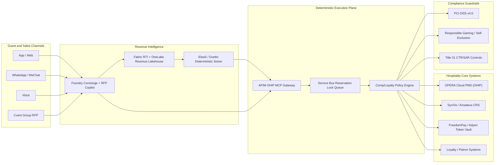
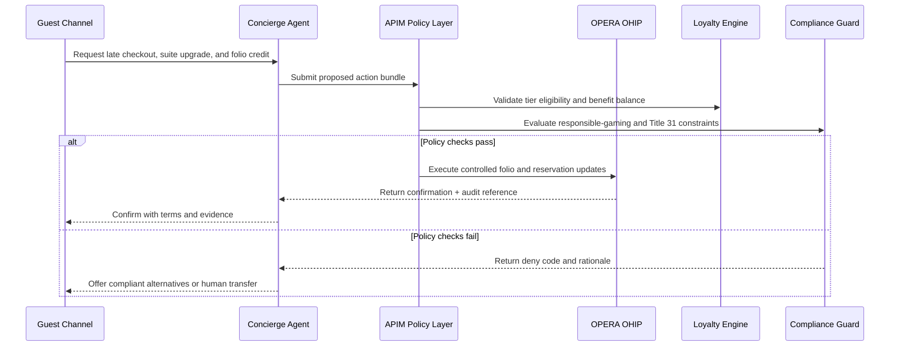

# Global Hotel and Integrated Resort Agent Selection FAQ: RevPAR/TRevPAR Yield, OPERA Folio Control, and VIP Concierge Compliance

> Audience: Cloud & AI Solution Architects, hospitality platform leaders, revenue-management teams, compliance and internal-control organizations.  
> Scope: global hotel groups and regulated integrated resorts with 500–8,000 properties, mixed franchise/managed portfolios, and premium loyalty programs.  
> Core challenge: improve occupancy and total revenue while enforcing deterministic comp ceilings, PCI controls, regional privacy residency, and Title 31 guardrails.  
> Outcome: an implementation-ready selection framework across Fabric, Foundry, and APIM+OHIP MCP execution patterns.  

## 1. Why this domain is harder than airline IROPS automation

Airline disruption automation primarily optimizes flight segments, seat inventory, and reaccommodation policies.  
Hospitality and integrated resort operations add multiple high-value planes that must be optimized together:

- room inventory and upgrade locks,  
- F&B, banquet, and meeting-space revenue,  
- gaming-theoretical value (`Theo`) and host compensation limits,  
- payment tokenization and folio dispute controls,  
- multilingual concierge engagement around the clock.  

A single convention-block decision can move multi-million-dollar outcomes across several ledgers.  
Optimizing room revenue alone can reduce total property profit if displacement, comp, and compliance are not co-managed.

## 2. Scope boundary: this is not a generic chatbot use case

This guide addresses operationally sensitive, financially material, and compliance-heavy workflows.

Distinct characteristics:

- high-value decisions (group RFP, VIP comp, large folio adjustments),  
- strict deterministic policy requirements,  
- cross-system transaction orchestration across PMS/CRS/loyalty/payment stacks,  
- immediate regulatory consequences for policy breaches.  

Therefore architecture must separate:
flexible reasoning for recommendations,  
and deterministic execution for policy-bound actions.

## 3. Enterprise system reality: PMS, CRS, RMS, loyalty, and payment coupling

Typical stack composition:

- `Oracle OPERA Cloud PMS (OHIP)` for reservations, stay lifecycle, and folio operations,  
- `SynXis` / `Amadeus CRS` for channel distribution and inventory propagation,  
- `IDeaS G3` / `Duetto` for yield and displacement calculations,  
- `FreedomPay` / `Adyen` tokenized payment rails,  
- `Aristocrat Oasis` / `IGT` loyalty and patron-management platforms in regulated resorts.  

Common architecture frictions:

- inconsistent event timing and schema semantics across platforms,  
- concurrent update collisions on upgrade inventory and room assignment,  
- loyalty/comp policy variability by geography and brand,  
- fragmented compliance telemetry and delayed investigative reconstruction.  

A unified policy and orchestration gateway is mandatory at scale.

## 4. Option A: Fabric real-time revenue plane + deterministic displacement solver + Foundry RFP copilot

Option A targets pre-execution decision quality and portfolio-level revenue optimization.

Core approach:

- stream reservation and operational events into Fabric Eventstreams,  
- normalize metrics in a hospitality revenue lakehouse on OneLake,  
- ingest deterministic displacement outputs from IDeaS/Duetto,  
- use Foundry copilots to structure and explain complex group RFP tradeoffs.  

Strengths:

- strongest impact on RevPAR/TRevPAR uplift,  
- portfolio-wide yield transparency,  
- evidence-linked recommendation paths for audit and review.  

Limitations:

- without strict execution gates, recommendation quality does not guarantee policy-safe actions,  
- requires robust integration with downstream execution controls.

## 5. Option B: Foundry omnichannel VIP concierge + Cosmos memory + APIM entitlement control

Option B focuses on guest-facing service velocity and host productivity.

Core design:

- omnichannel concierge agent for app, messaging, and voice channels,  
- Cosmos-based preference and context memory,  
- APIM policy checks for loyalty tier, comp entitlements, and approval requirements.  

Strengths:

- rapid service responsiveness for high-value guests,  
- consistent cross-channel experience,  
- improved host productivity and reduced manual triage.  

Risks if poorly controlled:

- over-compensation or unauthorized credits,  
- inconsistent policy interpretation across channels,  
- inventory lock conflicts under concurrent high-demand interactions.

## 6. Option C: APIM + OHIP MCP execution gateway + payment airlock + reservation lock orchestration

Option C prioritizes deterministic execution safety and compliance-grade traceability.

Core controls:

- APIM-mediated OHIP API access with controlled app-key injection and policy headers,  
- payment token-only processing with strict PAN redaction boundaries,  
- reservation/folio-sensitive operations serialized through queue-based locking,  
- mandatory pre/post execution policy validation with idempotency guards.  

Strengths:

- strongest execution-control posture,  
- high audit readiness for regulated IR operations,  
- reduced write-conflict and replay risk.

Trade-offs:

- higher integration complexity,  
- stronger change-governance discipline required for release cycles.

## 7. Twelve-dimension selection matrix (A vs B vs C)

| Dimension | Option A: Revenue Intelligence Plane | Option B: VIP Service Plane | Option C: Execution & Compliance Plane |
|---|---|---|---|
| RevPAR/TRevPAR uplift potential | Very High | Medium to High | Medium |
| Concierge responsiveness | Medium | Very High | Medium |
| Folio/comp execution safety | Medium | High | Very High |
| PCI exposure control | Medium | High | Very High |
| Title 31 / responsible gaming fit | Medium | High | Very High |
| Delivery speed | Medium | Fast to Medium | Medium to Slow |
| Integration complexity | High | Medium | High |
| Audit traceability | High | High | Very High |
| Operational adoption curve | Medium | Low to Medium | Medium |
| Multi-region reproducibility | High | High | Medium to High |
| 3-year TCO profile | Medium | Medium | Medium to High |
| Strategic role | Decision engine | Guest experience engine | Deterministic guardrail engine |

Practical recommendation:
use A, B, and C as layered planes rather than mutually exclusive choices.

## 8. Reference architecture: decision, service, and compliance planes



## 9. Controlled execution sequence: VIP requests and folio credit adjustments



## 10. Production APIM snippet: OHIP app-key injection, PAN redaction, deterministic comp caps

```xml
<policies>
  <inbound>
    <base />
    <set-header name="x-app-key" exists-action="override">
      <value>{{ohip-app-key}}</value>
    </set-header>
    <set-variable name="tier" value="@((string)context.Principal?.Claims.GetValueOrDefault("loyaltyTier","standard"))" />
    <set-variable name="theo" value="@((decimal)context.Principal?.Claims.GetValueOrDefault("theo","0"))" />
    <choose>
      <when condition="@((string)context.Variables["tier"] == "vip")">
        <set-variable name="compCapPct" value="0.18" />
      </when>
      <otherwise>
        <set-variable name="compCapPct" value="0.08" />
      </otherwise>
    </choose>
  </inbound>
  <backend>
    <base />
  </backend>
  <outbound>
    <base />
    <set-body template="none">@{
      var body = context.Response.Body.As<string>(preserveContent: true);
      body = System.Text.RegularExpressions.Regex.Replace(body, "\"pan\"\\s*:\\s*\"[0-9]{12,19}\"", "\"pan\":\"[REDACTED]\"");
      return body;
    }</set-body>
  </outbound>
  <on-error>
    <base />
    <log-to-eventhub logger-id="hospitality-audit">@("folio_policy_block:" + context.LastError?.Message)</log-to-eventhub>
  </on-error>
</policies>
```

This policy should be paired with an entitlement calculator and immutable audit IDs for every compensatory action.

## 11. Deployment composition snippet: Fabric + Foundry + APIM + Service Bus

```bicep
resource apim 'Microsoft.ApiManagement/service@2023-05-01-preview' = {
  name: 'apim-hospitality-prod'
  location: location
  sku: {
    name: 'PremiumV2'
    capacity: 2
  }
}

resource bus 'Microsoft.ServiceBus/namespaces@2023-01-01-preview' = {
  name: 'sb-hospitality-prod'
  location: location
  sku: {
    name: 'Premium'
    tier: 'Premium'
    capacity: 2
  }
}

resource cosmos 'Microsoft.DocumentDB/databaseAccounts@2024-05-15' = {
  name: 'cosmos-hospitality-prod'
  location: location
  kind: 'GlobalDocumentDB'
  properties: {
    databaseAccountOfferType: 'Standard'
    locations: [
      { locationName: location, failoverPriority: 0 }
      { locationName: secondaryLocation, failoverPriority: 1 }
    ]
  }
}
```

Execution priorities:

- serialize reservation-sensitive write paths,  
- keep cardholder data tokenized end-to-end,  
- enforce read-only fallback for non-critical actions during regional impairment.

## 12. Capacity and 3-year TCO: balancing revenue uplift and compliance cost

Scale assumptions:

- 4,200 properties,  
- 960k daily service interactions,  
- 38k monthly group RFP submissions,  
- 6.5% of requests involve comp-sensitive paths.  

### 12.1 Option A monthly cost (USD)

- Fabric capacity + Eventstreams: $54k  
- Yield processing and integration operations: $28k  
- Foundry RFP copilot workload: $17k  
- **Total: $99k/month**  

### 12.2 Option B monthly cost (USD)

- Foundry omnichannel and voice interaction layer: $31k  
- Cosmos preference/context memory: $12k  
- APIM entitlement and policy telemetry: $15k  
- **Total: $58k/month**  

### 12.3 Option C monthly cost (USD)

- APIM Premium security and mediation: $22k  
- Service Bus lock orchestration: $9k  
- Compliance logging and policy execution: $19k  
- **Total: $50k/month**  

### 12.4 Three-year economic interpretation

Pure infrastructure cost may favor B+C,  
but net business value often favors A+C or A+B+C where displacement and upsell gains are material.

Indicative 3-year total ownership (including platform operations labor):

- A+B+C: ~$8.1M  
- A+C: ~$6.9M  
- B+C: ~$5.4M with lower upside potential  

## 13. Scenario A: 4,200-property global portfolio deploying multilingual concierge and RFP displacement desk

Initial issues:

- fragmented guest channels by region,  
- slow group RFP response times,  
- inconsistent VIP compensation decisions across brands.  

Intervention:

- Foundry-based multilingual concierge,  
- Fabric RTI for channel and stay event consolidation,  
- APIM policy gates on OHIP write actions and compensation flows.  

16-week results:

- VIP first-response time down 44%,  
- group RFP turnaround down 37%,  
- compensation overrun write-offs down 62%.  

## 14. Scenario B: 6,000-key regulated integrated resort deploying host comp copilot with Title 31 and RG controls

Initial issues:

- manual host decisions with inconsistent thresholds,  
- delayed self-exclusion synchronization,  
- fragmented Title 31 escalation evidence.  

Intervention:

- APIM policy engine for all comp/folio execution paths,  
- real-time self-exclusion and risk-event checks,  
- agent recommendations allowed, deterministic policy execution required.  

Quarterly outcomes:

- compensation decision consistency above 97%,  
- zero high-risk bypass incidents,  
- audit preparation cycle time reduced by 39%.  

## 15. Quantitative FAQ and five-step rollout plan

### Q1: When should revenue-intelligence and concierge planes be split?

Split when any condition holds:

- daily interactions exceed 500k and show strong peak variance,  
- monthly group RFP exceeds 10k,  
- VIP entitlement actions require multi-system approval checks.  

### Q2: How should comp caps be parameterized by tier?

Common ranges:

- Standard: 5%–8% of Theo,  
- VIP: 12%–18% of Theo,  
- Premium host-managed: up to 20% with dual approval.  

All over-cap actions should route to controlled human authorization.

### Q3: How can folio disputes and accidental over-crediting be reduced?

Use:

- tokenized payment references only,  
- idempotent action keys for every credit mutation,  
- policy-trace IDs attached to each adjustment.  

This converts forensic recovery from manual log hunting to deterministic trace lookup.

### Q4: Should Title 31 and responsible-gaming checks run pre-model, post-model, or both?

Both are required:

- pre-model screening for rapid rejection and safer generation context,  
- post-model deterministic hard block before execution.  

Single-layer checks create bypass opportunities in asynchronous flows.

### Q5: How to reconcile regional privacy residency with global loyalty personalization?

Recommended pattern:

- keep primary guest profile in-region,  
- exchange only minimum necessary anonymized features across regions,  
- query sensitive attributes through regional proxy services instead of replication.  

### Q6: What takes precedence when revenue optimization conflicts with regulation?

Execution-layer compliance is always higher priority than optimization recommendations.  
Agent output can propose options, but policy engine decides execution eligibility.

### Q7: Which KPIs best reflect both commercial and compliance success?

Minimum KPI set:

- RevPAR/TRevPAR uplift with confidence intervals,  
- VIP TTFT and fulfillment time by channel,  
- policy-denied action rate and false-positive ratio,  
- comp budget adherence by tier,  
- audit trail completeness and mean investigation time.  

### Q8: What migration order minimizes operational disruption?

Recommended sequence:

1. normalize contracts and data mappings across PMS/CRS/loyalty/payment systems,  
2. deploy APIM deterministic gates first for execution safety,  
3. layer Fabric revenue intelligence and displacement analytics,  
4. expand Foundry concierge channel orchestration,  
5. tune tier policies and regional controls through monthly governance cadence.  

---

### Five-step implementation guide

1. **Contract and schema alignment** across OHIP, CRS, RMS, loyalty, and payment systems.  
2. **Three-plane separation** for decision intelligence, guest engagement, and deterministic execution.  
3. **Hard policy rollout** for app-key control, PAN redaction, comp caps, and risk blocking.  
4. **Unified observability** linking recommendation, policy decisions, and execution outcomes.  
5. **Progressive regional rollout** with pilot-to-scale pattern and governance checkpoints.  

### Good fit vs not for

**Good fit**:

- multi-brand, multi-region hospitality groups,  
- integrated resorts with strict compliance controls,  
- operations requiring both revenue uplift and policy-bound execution.  

**Not for**:

- small single-property operations with minimal integration complexity,  
- environments without premium loyalty or regulated compensation workflows.  

Even in smaller estates, starting with deterministic execution guardrails reduces future migration debt and compliance exposure.
