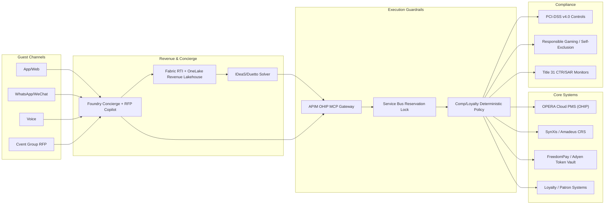
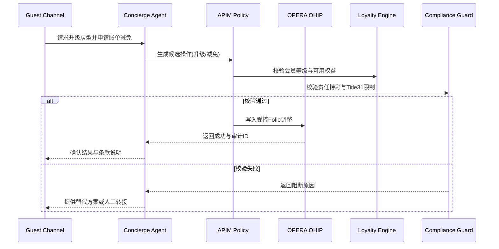

# 全球酒店与综合度假村智能体选型 FAQ：RevPAR/TRevPAR 收益管理、OPERA Folio 与 VIP Concierge 合规执行

> 读者对象：Cloud & AI Solution Architect、酒店与综合度假村集团数字化平台主管、收益管理负责人、合规与内控团队。  
> 适用范围：500–8,000 物业的国际酒店集团、含博彩与会员体系的综合度假村（IR）、多品牌多区域混合运营。  
> 核心挑战：提升入住与总收益的同时，不能突破 Loyalty/Comp 上限、PCI-DSS、隐私驻留与 Title 31 风险边界。  
> 目标输出：在 Fabric、Foundry 与 APIM+OHIP MCP 三类路径中给出分层决策、成本模型与落地步骤。  

## 1. 为什么酒店与综合度假村 Agent 架构比航空 IROPS 更复杂

航空 IROPS 主要围绕航段、座位、改签规则。  
酒店与 IR 场景同时叠加：  

- 房晚库存与房型升级锁定。  
- F&B、宴会、会展、赌场理论赢额（Theo）等多收益维度。  
- 多渠道 CRS、PMS、Loyalty、支付网关并行联动。  
- 24x7 多语种高净值客群即时服务。  

在实践中，  
一个 MICE 团队报价决策不仅影响客房收入，  
还会影响宴会、餐饮、会场、博彩、会员积分负债。  

因此“只优化房价”会导致局部最优。  
企业需要的是总收益与风险协同优化。  

## 2. 业务边界：不是普通客服机器人，而是收入中枢与合规中枢协同

本题不等同于一般客服自动化。  

原因在于：  

- 决策金额高，组团会议一单可达百万美元级。  
- 数据敏感度高，Folio 涉及支付与身份信息。  
- 执行后果高，Comp 超发会直接冲击利润与审计。  
- 监管刚性高，Title 31 与责任博彩触发必须硬阻断。  

所以架构必须把“推理灵活性”与“执行确定性”分层。  

## 3. 负载与系统现实：OHIP、CRS、RMS、支付、Loyalty 的多平面耦合

典型技术版图：  

- `Oracle OPERA Cloud PMS (OHIP)`：预订、入住、Folio、客史。  
- `SynXis / Amadeus CRS`：渠道分发与库存。  
- `IDeaS G3 / Duetto`：收益与位移模型。  
- `FreedomPay / Adyen`：支付与令牌化。  
- `Oasis / IGT`：博彩与会员奖励。  

常见耦合痛点：  

- 不同系统时间粒度不一致。  
- 库存锁冲突导致超卖风险。  
- 会员等级和 Comp 规则跨区域差异大。  
- 监管字段在多系统间命名不统一。  

因此必须有统一网关与策略平面。  

## 4. 方案 A：Fabric 实时收益平面 + 确定性位移求解 + Foundry RFP 副驾

方案 A 定位在“决策前台优化”。  

核心做法：  

- 用 Fabric Eventstreams 汇聚预订与入住事件。  
- OneLake 建立 Revenue Lakehouse。  
- 结合 IDeaS/Duetto 输出位移阈值。  
- Foundry 负责将复杂 RFP 文本结构化并给出建议。  

优点：  

- 对 RevPAR/TRevPAR 提升直接。  
- 适合集团级收益管理中台。  
- 可把报价建议与证据链统一。  

限制：  

- 如果缺少执行闸门，容易在 Comp 与合规层失控。  
- 对实时 API 写回依赖较强。  

## 5. 方案 B：Foundry 多渠道 VIP Concierge + Cosmos 偏好记忆 + APIM 权益闸门

方案 B 聚焦“对客体验与主机服务效率”。  

关键构件：  

- Foundry Omnichannel Agent（App/WhatsApp/WeChat/Voice）。  
- Cosmos DB 存储偏好与会话上下文。  
- APIM 统一权益与积分核验策略。  
- 通过确定性规则控制升级、延退、积分兑换。  

优势：  

- VIP 服务响应速度快。  
- 可沉淀跨渠道一致体验。  
- Host 团队知识可结构化沉淀。  

风险点：  

- 若 Comp 上限与资质校验未前置，会出现越权赠送。  
- 对高并发库存锁要求高。  

## 6. 方案 C：APIM + OHIP MCP 网关 + 支付气隙 + 预订锁编排

方案 C 重点在“执行安全与事务一致性”。  

核心控制：  

- APIM 统一接入 OHIP API，注入 app-key 与审计头。  
- Folio 只处理令牌，不处理 PAN 明文。  
- Service Bus 按 ReservationId 串行化关键写操作。  
- 写操作前后强制策略校验与幂等处理。  

优点：  

- 审计与合规证据完备。  
- 适合高监管 IR 场景。  
- 能显著降低并发冲突。  

代价：  

- 集成工程量高。  
- 上线节奏需要更严格变更管理。  

## 7. 12 维选型矩阵：A / B / C

| 维度 | 方案 A：收益优化中台 | 方案 B：VIP 服务中台 | 方案 C：执行与合规中台 |
|---|---|---|---|
| RevPAR/TRevPAR 提升潜力 | 很高 | 中到高 | 中 |
| 多渠道客诉响应 | 中 | 很高 | 中 |
| Folio/Comp 执行安全 | 中 | 高 | 很高 |
| PCI 风险控制 | 中 | 高 | 很高 |
| Title 31/责任博彩适配 | 中 | 高 | 很高 |
| 实施速度 | 中 | 快到中 | 中到慢 |
| 系统耦合复杂度 | 高 | 中 | 高 |
| 审计可追溯性 | 高 | 高 | 很高 |
| 运营团队采用门槛 | 中 | 低到中 | 中 |
| 跨区域复制性 | 高 | 高 | 中到高 |
| 3 年 TCO | 中 | 中 | 中到高 |
| 推荐角色 | 决策层主引擎 | 体验层主引擎 | 执行层硬闸门 |

建议：  
集团级通常需要三者组合，  
而不是互斥替代。  

## 8. 参考架构图：收益、服务、合规三平面分层



## 9. 流程图：VIP 请求与 Folio 信用调整的受控执行



## 10. 生产策略片段：APIM 注入 OHIP app-key + PAN 脱敏 + Comp 上限硬闸门

```xml
<policies>
  <inbound>
    <base />
    <set-header name="x-app-key" exists-action="override">
      <value>{{ohip-app-key}}</value>
    </set-header>
    <set-variable name="tier" value="@((string)context.Principal?.Claims.GetValueOrDefault("loyaltyTier","standard"))" />
    <set-variable name="theo" value="@((decimal)context.Principal?.Claims.GetValueOrDefault("theo","0"))" />
    <choose>
      <when condition="@((string)context.Variables["tier"] == "vip")">
        <set-variable name="compCapPct" value="0.18" />
      </when>
      <otherwise>
        <set-variable name="compCapPct" value="0.08" />
      </otherwise>
    </choose>
  </inbound>
  <backend>
    <base />
  </backend>
  <outbound>
    <base />
    <set-body template="none">@{
      var body = context.Response.Body.As<string>(preserveContent: true);
      body = System.Text.RegularExpressions.Regex.Replace(body, "\"pan\"\\s*:\\s*\"[0-9]{12,19}\"", "\"pan\":\"[REDACTED]\"");
      return body;
    }</set-body>
  </outbound>
  <on-error>
    <base />
    <log-to-eventhub logger-id="hospitality-audit">@("folio_policy_block:" + context.LastError?.Message)</log-to-eventhub>
  </on-error>
</policies>
```

该策略需与 Comp 计算服务联动，  
确保任何折扣与信用都可追溯。  

## 11. 架构部署片段：Fabric + Foundry + APIM + Service Bus 组合 Bicep

```bicep
resource apim 'Microsoft.ApiManagement/service@2023-05-01-preview' = {
  name: 'apim-hospitality-prod'
  location: location
  sku: {
    name: 'PremiumV2'
    capacity: 2
  }
}

resource bus 'Microsoft.ServiceBus/namespaces@2023-01-01-preview' = {
  name: 'sb-hospitality-prod'
  location: location
  sku: {
    name: 'Premium'
    tier: 'Premium'
    capacity: 2
  }
}

resource cosmos 'Microsoft.DocumentDB/databaseAccounts@2024-05-15' = {
  name: 'cosmos-hospitality-prod'
  location: location
  kind: 'GlobalDocumentDB'
  properties: {
    databaseAccountOfferType: 'Standard'
    locations: [
      { locationName: location, failoverPriority: 0 }
      { locationName: secondaryLocation, failoverPriority: 1 }
    ]
  }
}
```

实施重点：  

- 预订/升级关键写操作通过队列串行化。  
- Agent 只拿到令牌化支付数据。  
- 区域级故障时保持核心只读降级。  

## 12. 容量与 3 年 TCO：收益提升与合规成本的平衡

规模假设：  

- 物业数：4,200。  
- 日均客诉与服务会话：96 万。  
- MICE RFP 月均：3.8 万。  
- VIP/Host 涉及权益请求占比：6.5%。  

### 12.1 方案 A 月成本（USD）

- Fabric 容量 + Eventstreams：$54k。  
- 收益引擎与数据处理：$28k。  
- Foundry RFP 副驾：$17k。  
- **合计：$99k/月**。  

### 12.2 方案 B 月成本（USD）

- Foundry 多渠道会话与语音：$31k。  
- Cosmos 偏好记忆与缓存：$12k。  
- APIM 权益策略与审计：$15k。  
- **合计：$58k/月**。  

### 12.3 方案 C 月成本（USD）

- APIM Premium + 网关安全：$22k。  
- Service Bus 锁编排：$9k。  
- 合规日志与风控规则：$19k。  
- **合计：$50k/月**。  

### 12.4 3 年综合评估

若只看基础 IT 成本，  
B 与 C 较低。  
但若计入收益提升：  

- A+C 往往带来更高净增益。  
- A+B+C 在高端品牌与 IR 通常 ROI 最稳。  

3 年总拥有成本（含运维人力）参考：  

- A+B+C：约 $8.1M。  
- A+C：约 $6.9M。  
- B+C：约 $5.4M，但收益提升上限较低。  

## 13. 场景一：4,200 物业全球酒店集团的多语种 VIP Concierge 与团体报价

痛点：  

- 不同区域客服渠道分散。  
- 团体 RFP 审批周期长。  
- VIP 服务与收益目标常冲突。  

改造路径：  

- 用 Foundry 做多语种 Concierge。  
- 用 Fabric 聚合渠道与入住事件。  
- 用 APIM 对 OHIP 写操作设策略硬闸门。  

结果（16 周）：  

- VIP 首次响应时长下降 44%。  
- Group RFP 平均出价时长下降 37%。  
- 因权益越权导致的财务冲销下降 62%。  

## 14. 场景二：6,000 间客房 IR 的 Host Comp Copilot + 责任博彩合规

痛点：  

- Host 手工判断 Comp，口径不一致。  
- 责任博彩名单同步滞后。  
- Title 31 触发靠人工补录。  

实施：  

- 执行面统一走 APIM + 规则引擎。  
- 自我排除与风控事件实时拦截。  
- Comp 建议由 Agent 生成，但最终执行受硬阈值限制。  

结果（季度）：  

- Comp 审批一致性提升到 97%+。  
- 高风险请求零漏放。  
- 合规审计准备时间缩短 39%。  

## 15. 深度定量 FAQ + 五步落地

### Q1：何时需要把收益引擎与 Concierge 分离为两条独立平面？

当满足以下任一条件建议分离：  

- 日会话 > 50 万且峰值波动显著。  
- Group RFP 月单量 > 1 万。  
- VIP 权益请求涉及多系统审批。  

### Q2：Comp 上限如何量化，不同等级如何映射？

常见做法：  

- Standard：Theo 的 5%–8%。  
- VIP：Theo 的 12%–18%。  
- Premium Host 客户：可到 20%，但需双重审批。  

超限请求必须自动转人工审批，  
并记录审计 ID。  

### Q3：如何降低 Folio 争议与误调账？

建议组合：  

- 令牌化支付字段。  
- 幂等写入键。  
- 每次减免动作绑定 policy trace。  

这样可把争议回溯从“人工查日志”变成“结构化检索”。  

### Q4：Title 31 与责任博彩规则应放在模型前还是模型后？

结论：  
必须双层。  

- 模型前：请求预筛。  
- 模型后：执行前硬阻断。  

只做模型前筛查会被后续链路绕过。  

### Q5：跨区域隐私驻留如何与全球会员体验兼容？

可采用：  

- 客史主档按区域驻留。  
- 跨区只传最小必要字段与匿名特征。  
- 高敏字段通过区域代理查询，不跨境复制。  

### Q6：收益优化与合规控制发生冲突时谁优先？

原则：  
执行层永远合规优先。  

收益模型可以给“最佳建议”，  
但一旦触发监管阈值，  
必须硬拒绝或人工接管。  

---

### 五步落地指南

1. **盘点系统与数据契约**：OHIP、CRS、RMS、支付、Loyalty 字段统一映射。  
2. **建立三平面职责**：收益决策、服务交互、执行合规分层。  
3. **上线 APIM 硬闸门**：app-key、PAN 脱敏、Comp 上限、风控阻断。  
4. **接入实时观测闭环**：事件、策略命中、执行结果统一追踪。  
5. **按品牌与区域逐步推广**：先试点再扩展，持续调参。  

### Good Fit vs Not for

**Good Fit**：  

- 多品牌多区域运营。  
- 既追求收益增长又受强监管约束。  
- 存在复杂会员权益与 Host 流程。  

**Not for**：  

- 单体小酒店、无复杂收益与合规场景。  
- 没有跨系统联动需求。  

即便是中小规模，  
也建议先从执行闸门开始，  
再逐步引入收益与 Concierge 智能层。  
