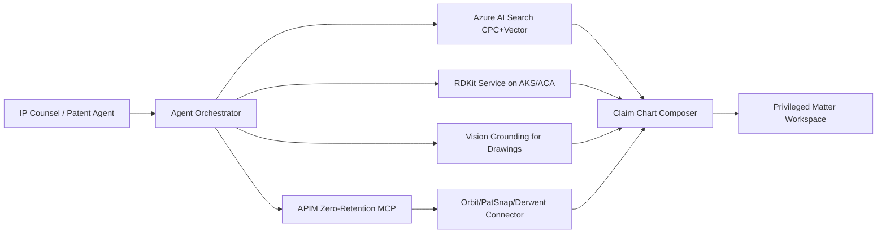
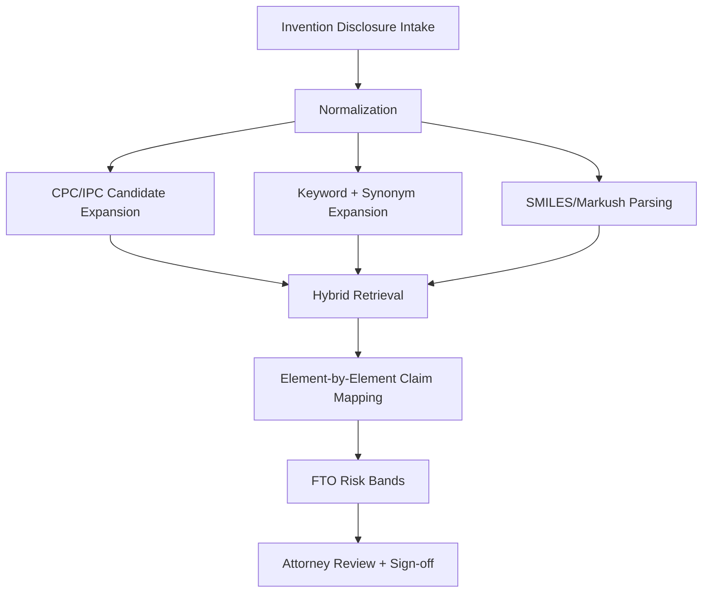

# Global Patent & IP Prosecution Agent Selection FAQ: Prior-Art/FTO Claim Charting with Multimodal Retrieval (Foundry + AI Search + RDKit) vs Commercial Patent SaaS

## 1. Problem framing: this is pre-filing trade-secret protection, not generic legal redlining

At first glance, patent workflows and legal contract workflows both look like “legal AI.”

Architecturally, they are not equivalent.

Pre-filing invention disclosures carry existential secrecy constraints.

A single uncontrolled external retention path can damage novelty posture and litigation strategy.

So the first architecture question is not model benchmark rank.

The first architecture question is confidentiality boundary integrity.

High-risk artifacts include:

- unpublished invention disclosures,
- draft claim trees and amendment strategies,
- FTO comparison notes,
- invalidity and prior-art search rationale,
- Markush and structure-function mapping notes.

If these materials leak into uncontrolled logs or retention stores, remediation is often impossible.

Therefore architecture selection must start with zero-retention and least-exposure boundaries.

## 2. Legal and governance boundary translation: novelty risk, privilege posture, cross-jurisdiction evidence pressure

Global IP teams often operate across:

- USPTO,
- EPO,
- WIPO/PCT,
- CNIPA,
- JPO.

Each jurisdiction has procedural differences.

But from architecture perspective, common governance controls are still required:

- no uncontrolled external retention of confidential drafts,
- matter-level segmentation and access traceability,
- strict separation between public corpus and privileged workspace,
- reproducible evidence lineage for claim-chart assertions.

Architecture must make these controls enforceable, not merely policy-text promises.

## 3. Option map: A commercial SaaS direct usage, B private Azure layered architecture, C generic copilot/public web grounding

### Option A: commercial patent SaaS as primary workspace

Advantages:

- fast onboarding,
- rich prebuilt corpus tooling,
- familiar UI for patent professionals.

Limitations:

- retention and logging controls are vendor-defined,
- zero-retention guarantees may not match internal standards,
- specialized multimodal customization depth can be constrained.

### Option B: private Azure layered architecture with controlled external connectors

Typical composition:

- Foundry for multimodal orchestration and guarded reasoning,
- AI Search for CPC/IPC + lexical + vector retrieval,
- RDKit services on AKS/ACA for substructure and similarity search,
- APIM for zero-retention MCP governance and connector policy enforcement,
- selective controlled access to premium external IP databases.

Advantages:

- stronger confidentiality boundary control,
- auditable retrieval-to-claim mapping lineage,
- higher extensibility for chemistry and drawing-centric workflows.

Tradeoffs:

- higher platform engineering complexity,
- stronger data governance operating model needed.

### Option C: generic M365 copilot/public web search for pre-filing content

For unpublished invention disclosures, this path is generally prohibited.

It may be convenient.

It is not defensible under strict novelty and privilege risk posture.

## 4. 12-dimension selection matrix

| Dimension | Option A: Commercial SaaS | Option B: Private Azure Layer | Option C: Generic Copilot/Public Web |
|---|---|---|---|
| Unpublished disclosure confidentiality control | medium | high | low |
| Verifiable zero-retention posture | low-medium | high | low |
| Markush/SMILES retrieval depth | medium | high | low |
| Mechanical drawing grounding quality | medium | high | low |
| CPC/IPC hierarchy integration | medium | high | low-medium |
| Litigation-grade explainability | medium | high | low |
| Time-to-first-value | high | medium | high |
| Governance complexity | low | high | low |
| Customization ceiling | medium | high | low |
| 3-year TCO controllability | medium | high | low |
| Evidence-chain completeness | medium | high | low |
| Recommendation | transitional use | primary architecture | prohibited for pre-filing |

The matrix prioritizes defensibility under real dispute and prosecution pressure.

## 5. Data-plane layering: corpus mirror, semantic index, multimodal feature plane, privileged matter workspace

A practical architecture separates four data layers:

- public patent corpus mirror layer,
- jurisdiction and classification semantic layer,
- multimodal feature layer (text, figures, chemistry),
- privileged matter workspace layer.

Each layer gets independent lifecycle controls.

Public corpus can use scheduled ingestion refresh patterns.

Privileged matter workspace must enforce strict key rotation, short-lived caching, and minimum-retention processing.

This separation prevents cross-contamination between public and privileged data domains.

## 6. End-to-end architecture: retrieval quality and confidentiality governance as equal first-class concerns



This architecture treats premium external databases as governed inputs, not default unbounded workspaces.

## 7. Retrieval pipeline: prior-art and FTO claim charting as staged evidence construction



A staged process reduces false confidence from single-pass answer generation.

## 8. Production snippets: AI Search hierarchical schema, RDKit Tanimoto scoring, and APIM zero-retention policy

### 8.1 AI Search schema for CPC hierarchy and parent-child claims

```json
{
  "name": "patent-claims-index",
  "fields": [
    {"name": "doc_id", "type": "Edm.String", "key": true, "filterable": true},
    {"name": "jurisdiction", "type": "Edm.String", "filterable": true, "facetable": true},
    {"name": "publication_no", "type": "Edm.String", "searchable": true, "filterable": true},
    {"name": "cpc_codes", "type": "Collection(Edm.String)", "searchable": true, "filterable": true, "facetable": true},
    {"name": "ipc_codes", "type": "Collection(Edm.String)", "searchable": true, "filterable": true, "facetable": true},
    {"name": "claim_id", "type": "Edm.String", "filterable": true},
    {"name": "parent_claim_id", "type": "Edm.String", "filterable": true},
    {"name": "claim_text", "type": "Edm.String", "searchable": true},
    {"name": "claim_vector", "type": "Collection(Edm.Single)", "searchable": true, "vectorSearchDimensions": 3072, "vectorSearchProfile": "hnsw-profile"},
    {"name": "figure_refs", "type": "Collection(Edm.String)", "searchable": true},
    {"name": "smiles_tokens", "type": "Collection(Edm.String)", "searchable": true},
    {"name": "matter_id", "type": "Edm.String", "filterable": true}
  ]
}
```

### 8.2 RDKit Tanimoto example

```python
from rdkit import Chem, DataStructs
from rdkit.Chem import AllChem

def tanimoto_score(query_smiles: str, candidate_smiles: str) -> float:
    q = Chem.MolFromSmiles(query_smiles)
    c = Chem.MolFromSmiles(candidate_smiles)
    qfp = AllChem.GetMorganFingerprintAsBitVect(q, 2, nBits=2048)
    cfp = AllChem.GetMorganFingerprintAsBitVect(c, 2, nBits=2048)
    return DataStructs.TanimotoSimilarity(qfp, cfp)
```

### 8.3 APIM policy with zero-retention and no-store controls

```xml
<policies>
  <inbound>
    <base />
    <set-header name="x-retention-policy" exists-action="override">
      <value>zero-retention</value>
    </set-header>
    <set-header name="x-matter-id" exists-action="override">
      <value>@(context.Request.Headers.GetValueOrDefault("x-matter-id",""))</value>
    </set-header>
    <choose>
      <when condition="@(!context.Principal.Claims.Any(c => c.Type == &quot;roles&quot; &amp;&amp; c.Value == &quot;ip.counsel&quot;))">
        <return-response>
          <set-status code="403" reason="ip.counsel role required" />
        </return-response>
      </when>
    </choose>
  </inbound>
  <backend><base /></backend>
  <outbound>
    <base />
    <set-header name="cache-control" exists-action="override">
      <value>no-store</value>
    </set-header>
  </outbound>
  <on-error><base /></on-error>
</policies>
```

These controls convert legal-risk posture into deterministic runtime policy.

## 9. Option A deep dive: commercial speed with confidentiality tradeoff boundaries

Option A is attractive for fast enablement and broad corpus access.

It is often useful for public-domain scouting and analyst onboarding.

However, for unpublished disclosure workflows, architecture constraints appear quickly:

- vendor retention policy asymmetry,
- limited matter-segmentation control depth,
- weaker enterprise-specific multimodal extensibility.

Therefore Option A is commonly a tactical bridge, not a comprehensive strategic architecture for all prosecution workflows.

## 10. Option B deep dive: private architecture for long-run control and litigation-grade lineage

Option B aligns retrieval quality with confidentiality governance.

With VNet, private networking, key isolation, and matter-level ACL, sensitive disclosure flow can be constrained by design.

With AI Search + RDKit + vision grounding, multimodal evidence assembly becomes operationally tractable.

With APIM-governed external connectors, premium data access can be narrowed to auditable and revocable call paths.

The result is stronger control over both quality and legal-risk posture.

The main cost is higher engineering complexity in day-1 and day-2 operations.

## 11. Option C risk position: why generic copilot/public web grounding should be prohibited for pre-filing disclosures

Option C may appear low-friction.

For unpublished inventions, it is generally misaligned with enterprise legal-risk constraints.

Primary concerns include:

- uncontrolled retention paths,
- weak matter segmentation,
- insufficiently provable privilege boundaries,
- inability to demonstrate strict evidence-chain governance.

This option can still serve public trend research.

It should not be used for privileged pre-filing substance.

## 12. Azure sizing and 3-year TCO with controlled premium connector usage

### 12.1 planning assumptions

- 18 global R&D centers,
- 6,500 annual new invention disclosures,
- 120M+ paragraph-level patent corpus mirror entries,
- 32M chemistry records,
- 85M drawing-level annotated objects,
- 1,200 monthly FTO/claim-chart projects.

### 12.2 Option A rough economics

- commercial platform subscription and seats: `$310k/month`
- premium retrieval API and exports: `$42k/month`
- compliance and legal preparation overhead: `$33k/month`
- total: `$385k/month`
- 3-year: `$13.86M`

### 12.3 Option B rough economics

- AI Search + ingestion/indexing stack: `$118k/month`
- RDKit and multimodal AKS/ACA services: `$74k/month`
- Foundry orchestration and model inference: `$66k/month`
- APIM governance + connector policy: `$39k/month`
- platform engineering and SRE: `$52k/month`
- total: `$349k/month`
- 3-year: `$12.56M`

### 12.4 Option C rough economics with governance risk premium

- generic tooling and external query consumption: `$241k/month`
- compensating audit and remediation workload: `$71k/month`
- modeled legal-risk reserve: `$126k/month`
- total: `$438k/month`
- 3-year: `$15.77M`

The highest apparent convenience path can become the highest long-run risk-adjusted cost path.

## 13. Scenario A: global biopharma Markush FTO and Paragraph IV litigation preparation

Target outcomes:

- reduce candidate prior-art pool from 200k to 12k high-relevance set,
- cut first-pass claim-chart draft cycle from 3.5 days to 9 hours,
- provide reproducible structure-similarity evidence for legal review.

Execution pattern:

- RDKit performs first-pass substructure and similarity narrowing,
- AI Search fuses claim text, CPC/IPC classes, and office-action context,
- Foundry composes element-by-element mapping drafts,
- legal experts perform matter-governed sign-off for formal output.

Business value:

- faster prosecution and litigation preparation loops,
- higher explainability for internal and external counsel coordination,
- reduced variance in analyst quality.

## 14. Scenario B: semiconductor and consumer hardware 12,000-patent cross-licensing with drawing-element mapping

Target outcomes:

- accelerate SEP relevance triage,
- map drawing reference numerals to claim elements at scale,
- produce auditable evidence packets for negotiation readiness.

Execution pattern:

- normalize drawing object references and figure callouts,
- model independent/dependent claim graph relationships,
- isolate project workspaces by matter and legal team role,
- enforce premium connector calls through APIM policy controls.

Outcome:

- shorter cycle for high-value negotiation dossiers,
- lower cross-team friction between legal and engineering groups,
- stronger consistency in pre-negotiation evidence quality.

## 15. Deep Q&A and five-step implementation guide

Q1: why do generic text embeddings underperform for Markush-heavy workloads?

Because Markush logic encodes variable substituent spaces and structural constraints that plain text similarity often fails to preserve.

Q2: should CPC/IPC be hard filters or soft retrieval signals?

Use a staged hybrid pattern:

soft expansion for recall,

then policy-driven hard narrowing by jurisdiction and matter context.

Q3: how do teams avoid plausible-but-misaligned claim chart outputs?

Bind every claim element to explicit citation anchors:

- text evidence span,
- figure callout anchor,
- optional chemistry similarity proof point.

Require human legal sign-off before external use.

Q4: does zero-retention eliminate observability?

Not necessarily.

Keep control-plane telemetry and anonymized metrics while avoiding business-content persistence.

Q5: should commercial premium databases be fully removed in private architectures?

No.

Use controlled connector calls for high-value enrichment while preserving private governance boundaries.

Q6: what is a strong Good fit profile?

- large global R&D footprint,
- high volume of confidential pre-filing workflows,
- strict litigation-grade evidence expectations,
- ability to operate private governance platforms.

Q7: what is a strong Not for profile?

- public-only desk research teams,
- organizations unable to fund governance operations,
- environments without strict matter-level access controls.

Q8: practical five-step implementation sequence

Step 1: implement matter-level partitioning, key strategy, and role boundaries.

Step 2: build CPC/IPC + lexical + vector hybrid retrieval with parent-child claim graph support.

Step 3: add RDKit chemistry and drawing-grounding multimodal layers.

Step 4: enforce zero-retention and no-store controls through APIM policy and connector governance.

Step 5: run quarterly quality-risk-cost reviews with legal and engineering leadership.

Final recommendation:

In global patent prosecution and FTO programs, the winning architecture is not the one that answers fastest in demos.

The winning architecture is the one that delivers reliable multimodal evidence under strict confidentiality and litigation-defensible governance, repeatedly and at scale.

Q9: how should teams implement minimum external-connector usage policies?

A practical pattern is phase-based allowlisting:

- ideation phase: public corpus only,
- drafting phase: controlled premium summary endpoints,
- dispute preparation phase: approved deep-comparison endpoints.

Every call should carry matter-id, purpose tag, and accountable approver identity.

Q10: what controls reduce cross-border over-sharing risk in distributed legal teams?

Use a combination of:

- document-level ABAC,
- role-minimized group grants,
- time-bounded secure sharing links,
- dual-review requirements for high-sensitivity matters.

Q11: how can drawing-element mapping become litigation-review ready evidence?

Publish evidence triplets for each mapped element:

- anchored figure snippet,
- corresponding claim text span,
- machine confidence plus human reviewer verdict.

This dramatically improves defensibility in adversarial review.

Q12: what quarterly governance KPI set is most useful?

A practical set includes:

- false-retrieval and missed-retrieval rates,
- claim-chart rework rate after attorney review,
- unauthorized access incidents on sensitive matters,
- average per-matter analysis cycle time and total cost.
