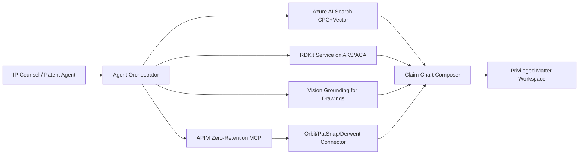
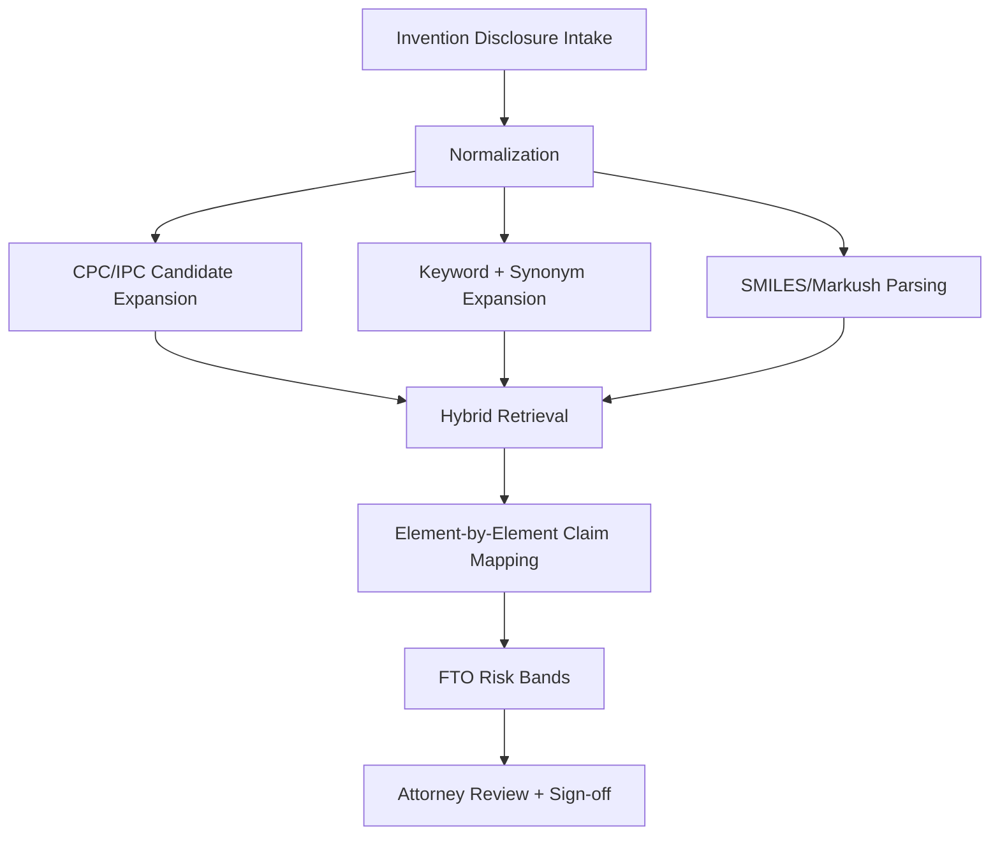

# 全球专利与 IP 诉讼智能体选型 FAQ：Prior Art/FTO Claim Charting 多模态检索（Foundry + AI Search + RDKit）vs 商业专利 SaaS 平台

## 1. 问题定义：这是“未公开发明保密”场景，不是通用法务红线审阅

企业法务与 IP 场景看似都属于“法律文本处理”。

但专利申请前的发明披露有更严格的数据泄露后果。

一旦外泄，可能直接影响新颖性认定。

也可能冲击后续诉讼中的特权保护边界。

所以本议题的首要问题不是模型分数。

首要问题是**保密与留痕边界**。

典型高风险数据包括：

- 未公开发明 disclosure；
- claim drafting 过程记录；
- FTO 比对结论草稿；
- 对手专利无效检索策略；
- 化学 Markush 结构与内部实验关系映射。

这类数据一旦被外部平台日志长期保留，后果不可逆。

因此架构选择必须从“零泄露与最小暴露”开始。

## 2. 风险边界：新颖性破坏、特权豁免与跨司法辖区取证压力

在跨法域专利实践中，团队常同时面对：

- USPTO、EPO、WIPO、CNIPA、JPO 的检索规则差异；
- 诉讼阶段的证据可发现性要求；
- 律师—客户特权与 work-product 边界维护。

对架构师而言，需要把法律风险转译为技术控制点：

- 数据是否出 VNet；
- 是否存在第三方查询留存；
- 提示词与中间结果是否被缓存；
- 是否可按 matter 做加密与访问隔离；
- 审计记录能否证明“谁在何时看过何内容”。

这些控制点必须在平台层可验证，而非仅靠流程承诺。

## 3. 三种候选路线：A 商业专利 SaaS、B 私有化分层检索、C 通用 Copilot/公网搜索

### Option A：商业专利 SaaS 直连工作台

优势：

- 数据覆盖广；
- 上手快；
- UI 成熟；
- 对非技术检索人员友好。

风险：

- 查询与文档驻留策略受供应商约束；
- 对未公开发明材料的“零保留”保证难以统一；
- 多模态（化学结构+机械图纸）深度定制受限。

### Option B：VNet 隔离的 Azure 私有化组合

核心构成：

- Foundry 负责多模态理解与编排；
- AI Search 承担 CPC/IPC + 向量 + 词法混合检索；
- AKS/ACA 上 RDKit 做子结构与相似度检索；
- APIM 作为零保留 MCP 治理层；
- 商业数据库仅通过受控连接器按需调用。

优势：

- 可控的保密边界；
- 可解释的检索链路；
- 对化学与机械多模态支持更可扩展。

挑战：

- 架构复杂度高；
- 数据治理与主数据建设投入较大。

### Option C：通用办公 Copilot 或公网搜索兜底

该路线对未公开发明披露通常应列入禁止清单。

即使“看起来便捷”，也可能带来不可逆合规风险。

## 4. 12 维选型矩阵：检索能力、隐私边界、成本与可诉讼性

| 维度 | Option A：商业 SaaS | Option B：Azure 私有化组合 | Option C：通用 Copilot/公网 |
|---|---|---|---|
| 未公开发明保密边界 | 中 | 高 | 低 |
| 零保留可验证性 | 低-中 | 高 | 低 |
| 化学 Markush 检索深度 | 中 | 高 | 低 |
| 机械图纸标注 grounding | 中 | 高 | 低 |
| CPC/IPC 语义融合 | 中 | 高 | 低-中 |
| 律所审计可解释性 | 中 | 高 | 低 |
| 上线速度 | 高 | 中 | 高 |
| 平台治理复杂度 | 低 | 高 | 低 |
| 定制化上限 | 中 | 高 | 低 |
| 三年 TCO 可控性 | 中 | 高 | 低 |
| 诉讼阶段证据链完整性 | 中 | 高 | 低 |
| 推荐结论 | 过渡可用 | 首选 | 禁止 |

该矩阵强调“可诉讼性”而非单一检索速度。

## 5. 数据平面分层：文献镜像、结构化索引、多模态特征与案件工作区隔离

建议把数据平面拆为四层：

- 公共专利文献层：USPTO/EPO/WIPO 等公开数据镜像；
- 法域语义层：CPC/IPC、法条语义标签、同族专利图谱；
- 多模态特征层：文字、图纸标注、化学结构指纹；
- 案件工作区层：matter 级隔离、最小权限访问、可撤销共享。

每层都需独立生命周期策略。

例如公开文献层可做周期性增量刷新。

而案件工作区层必须严格短期缓存与密钥轮换。

## 6. 端到端架构：检索编排与零保留治理并行



该图表示：

商业数据库是受控输入源，而非默认全量托管平面。

## 7. 检索与比对流程：Prior Art、FTO、无效检索的多阶段管道



多阶段流程有助于减少“单轮问答式误判”。

## 8. 生产片段：AI Search CPC 层级索引与 parent-child claim schema

### 8.1 AI Search 索引字段示例

```json
{
  "name": "patent-claims-index",
  "fields": [
    {"name": "doc_id", "type": "Edm.String", "key": true, "filterable": true},
    {"name": "jurisdiction", "type": "Edm.String", "filterable": true, "facetable": true},
    {"name": "publication_no", "type": "Edm.String", "searchable": true, "filterable": true},
    {"name": "cpc_codes", "type": "Collection(Edm.String)", "searchable": true, "filterable": true, "facetable": true},
    {"name": "ipc_codes", "type": "Collection(Edm.String)", "searchable": true, "filterable": true, "facetable": true},
    {"name": "claim_id", "type": "Edm.String", "filterable": true},
    {"name": "parent_claim_id", "type": "Edm.String", "filterable": true},
    {"name": "claim_text", "type": "Edm.String", "searchable": true},
    {"name": "claim_vector", "type": "Collection(Edm.Single)", "searchable": true, "vectorSearchDimensions": 3072, "vectorSearchProfile": "hnsw-profile"},
    {"name": "figure_refs", "type": "Collection(Edm.String)", "searchable": true},
    {"name": "smiles_tokens", "type": "Collection(Edm.String)", "searchable": true},
    {"name": "matter_id", "type": "Edm.String", "filterable": true}
  ]
}
```

### 8.2 RDKit 相似度查询示例（Tanimoto）

```python
from rdkit import Chem, DataStructs
from rdkit.Chem import AllChem

def tanimoto_score(query_smiles: str, candidate_smiles: str) -> float:
    q = Chem.MolFromSmiles(query_smiles)
    c = Chem.MolFromSmiles(candidate_smiles)
    qfp = AllChem.GetMorganFingerprintAsBitVect(q, 2, nBits=2048)
    cfp = AllChem.GetMorganFingerprintAsBitVect(c, 2, nBits=2048)
    return DataStructs.TanimotoSimilarity(qfp, cfp)
```

### 8.3 APIM 零保留策略示例

```xml
<policies>
  <inbound>
    <base />
    <set-header name="x-retention-policy" exists-action="override">
      <value>zero-retention</value>
    </set-header>
    <set-header name="x-matter-id" exists-action="override">
      <value>@(context.Request.Headers.GetValueOrDefault("x-matter-id",""))</value>
    </set-header>
    <choose>
      <when condition="@(!context.Principal.Claims.Any(c => c.Type == &quot;roles&quot; &amp;&amp; c.Value == &quot;ip.counsel&quot;))">
        <return-response>
          <set-status code="403" reason="ip.counsel role required" />
        </return-response>
      </when>
    </choose>
  </inbound>
  <backend><base /></backend>
  <outbound>
    <base />
    <set-header name="cache-control" exists-action="override">
      <value>no-store</value>
    </set-header>
  </outbound>
  <on-error><base /></on-error>
</policies>
```

## 9. Option A 深度分析：商业平台的速度优势与保密边界短板

Option A 的最大优势是“快速可用”。

对早期团队，UI 与检索功能成熟度很有吸引力。

但在未公开发明场景，A 的风险在于：

- 查询日志策略不可完全自定义；
- 供应商侧保留与审计边界不一定满足内部 policy；
- 化学结构与图纸解析能力难以按企业标准扩展。

因此 A 更适合：

- 公开专利情报监测；
- 非核心秘密数据训练；
- 过渡期人员启蒙。

不适合承载全部 pre-filing 工作流。

## 10. Option B 深度分析：私有化组合的长期可控性

Option B 的关键价值是：

把“检索能力”和“保密治理”放在同一平台策略下。

通过 VNet、Private Link、客户管理密钥、matter 级 ACL，可实现细粒度隔离。

通过 AI Search + RDKit + 多模态 grounding，可覆盖专利检索中的异构信息类型。

通过 APIM 统一连接器策略，可把外部商业数据源纳入可审计边界。

其代价是前期工程建设更重。

但对全球 R&D 与诉讼协同组织，通常是更可持续路线。

## 11. Option C 风险说明：为何在未公开披露场景应列为禁止

Option C 常见误区是“先用通用工具凑合”。

但在未公开发明场景，这种“凑合”会触及红线：

- 公开网络检索不可控；
- 数据驻留不可证；
- 提示与输出缓存策略不透明；
- 律师特权边界难以证明。

因此 C 可用于公开情报的泛化研究。

但不应用于 pre-filing 实质内容。

## 12. Azure 规模估算与三年 TCO（含商业数据库受控调用）

### 12.1 规模假设

- 全球研发中心 18 个；
- 年新增 invention disclosures 6,500 份；
- 历史专利文献镜像 1.2 亿条段落级索引；
- 化学结构库 3,200 万条；
- 机械图纸片段 8,500 万张标注对象；
- 每月 FTO/claim chart 项目 1,200 个。

### 12.2 Option A 成本估算

- 商业 SaaS 订阅与席位：`$310k/month`
- 增值检索 API 与导出费用：`$42k/month`
- 合规附加与法律审计准备：`$33k/month`
- 合计：`$385k/month`
- 三年：`$13.86M`

### 12.3 Option B 成本估算

- AI Search + 存储与索引管道：`$118k/month`
- AKS/ACA RDKit 与多模态服务：`$74k/month`
- Foundry 编排与模型调用：`$66k/month`
- APIM + 安全治理 + 连接器：`$39k/month`
- 平台工程与 SRE：`$52k/month`
- 合计：`$349k/month`
- 三年：`$12.56M`

### 12.4 Option C 成本估算（含风险溢价）

- 通用工具与外部检索成本：`$241k/month`
- 补救性审计与合规处置：`$71k/month`
- 风险准备金（估算）：`$126k/month`
- 合计：`$438k/month`
- 三年：`$15.77M`

## 13. 场景一：生物制药小分子 Markush FTO 与 Paragraph IV 诉讼辅助

目标：

- 把候选 prior-art 池从 200k 缩到 12k 高相关集合；
- 把 claim chart 首稿时间从 3.5 天降到 9 小时；
- 对关键化学结构相似度给出可复算证据。

实施路径：

- RDKit 对 SMILES/子结构做第一轮筛选；
- AI Search 对 claim 文本、CPC/IPC、审查意见做融合检索；
- Foundry 生成 element-by-element 映射草稿；
- 律师团队对高风险条目做逐项签发。

价值：

- 检索效率提高；
- 可解释性增强；
- 诉讼准备周期明显缩短。

## 14. 场景二：半导体/消费硬件 12,000 专利交叉许可与图纸要素映射

目标：

- 快速识别潜在 SEP 关联；
- 对 CAD 图纸标注要素与 claim 元素做半自动对齐；
- 形成可审计的交叉许可谈判证据包。

实施路径：

- 图纸对象检测与 reference numeral 归一；
- claim dependent/independent 关系建模；
- 通过 matter 隔离工作区管理跨团队协作；
- APIM 控制外部商业数据库最小化调用。

结果：

- 分析团队可在更短周期完成高价值候选包；
- 法务与技术团队沟通成本下降；
- 谈判前证据准备质量更稳定。

## 15. 深度 Q&A 与五步落地指南

Q1：为什么普通文本 embedding 无法覆盖 Markush 检索需求？

因为 Markush 结构包含组合位点与可变基团，纯文本相似度无法稳定表达子结构约束。

Q2：CPC/IPC 在检索里应作为硬过滤还是软信号？

建议混合使用。

先做软扩展召回，再按法域与案件策略硬过滤。

Q3：如何避免 claim chart 生成“看似合理但证据错配”？

必须把每个 claim element 绑定到具体证据段落与图纸锚点。

并要求人工签核才能出正式结论。

Q4：零保留策略是否会损失排障能力？

可以通过脱敏审计指标与最小必要元数据保留平衡。

关键是业务内容不落盘，控制面指标可保留。

Q5：是否应该完全放弃商业数据库？

不必。

建议通过受控 MCP 连接器按需调用，保留高价值数据能力，同时维持治理边界。

Q6：如何定义 Good fit？

- 研发与法务协同紧密；
- 未公开披露数据规模大；
- 对可诉讼证据链要求高；
- 有能力建设私有化治理平台。

Q7：Not for 的典型组织？

- 仅做公开信息快检；
- 无法承担平台治理投入；
- 对数据驻留与审计没有强约束。

Q8：五步落地建议

第一步：建立 matter 级数据分区与密钥策略。

第二步：建设 CPC/IPC + 向量 + 词法混合索引。

第三步：引入 RDKit 与图纸 grounding 形成多模态检索闭环。

第四步：APIM 统一外部连接器策略并启用零保留头与 no-store 控制。

第五步：按季度复盘检索质量、诉讼支持效果、成本与风险事件。

收官建议：

在全球专利与 FTO 场景中，真正的架构护城河不是“回答更快”，而是“在严格保密与可诉讼证据链下持续给出可执行结论”。

Q9：如何设计“外部连接器最小化调用”策略？

建议按案件阶段定义白名单。

立项期仅允许公开文献检索。

起草期允许受控调用商业库摘要接口。

诉讼准备期才允许扩展到深度对比接口。

每一类调用都应绑定 matter-id、审批人、用途标签。

Q10：跨国团队协作时如何控制“越权共享”？

应同时启用：

- 文档级 ABAC；
- 组级最小权限；
- 共享链接有效期；
- 高敏案件的双人复核分享机制。

Q11：如何把图纸要素映射结果做成可复核证据？

建议输出三联体：

- 图纸锚点截图；
- claim 元素文本片段；
- 机器匹配置信度与人工复核结论。

这样在法庭或仲裁场景下更容易解释。

Q12：如何规划季度治理 KPI？

可以使用四类核心指标：

- 误检索率与漏检索率；
- claim chart 人工返工率；
- 高敏案件未授权访问事件数；
- 单案件平均分析成本与周期。
