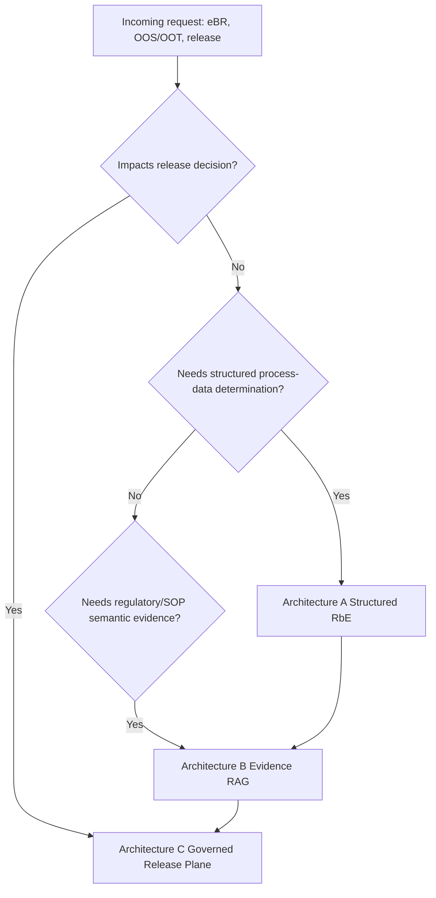
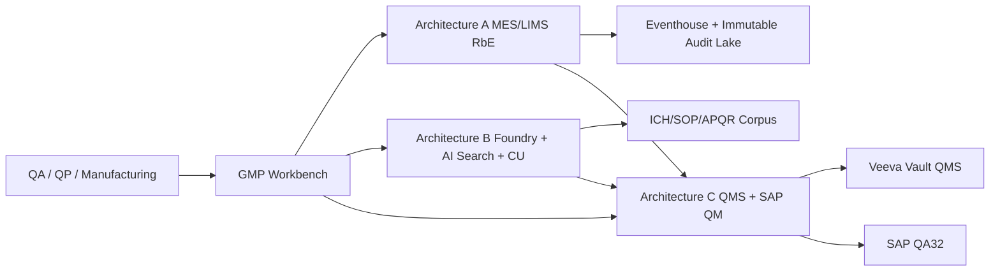

# Global Biopharma CMC/GMP Architecture Selection FAQ: MES/LIMS RbE Plane vs Foundry ICH Evidence Plane vs SAP QM/Veeva Governed Release Plane

> Version tag: Guide #143  
> Audience: Head of Quality, Qualified Person (QP), CMC leads, manufacturing IT, validation and CSA teams  
> Scope: eBR review-by-exception, OOS/OOT deviation investigation, GxP auditable AI assistance, Part 11 governed batch release  
> Data provenance tags: `measured`, `synthetic`, `anonymized_reported`

---

## 1. Executive framing: in GMP, analysis assistance and release authority must be separated

GMP acceleration cannot come at the cost of audit integrity.

Electronic batch review, deviation investigation, and batch release are distinct accountability domains.

Collapsing them into one autonomous assistant path often creates traceability gaps.

This guide recommends an A/B/C architecture split.

Architecture A handles deterministic structured review-by-exception checks.

Architecture B handles regulatory and SOP evidence synthesis with reproducible metadata.

Architecture C handles governed usage-decision actions with Part 11 dual-signature controls.

Commercial release actions must execute only in Architecture C.

This partition balances compliance rigor with operational speed.

---

## 2. Responsibility partitioning across Architecture A/B/C

**Architecture A: MES/Historian/LIMS structured RbE plane.**

Examples include Werum PAS-X, Syncade, and LabWare feeds into Fabric Eventhouse plus immutable audit storage.

Its purpose is deterministic CPP/CQA excursion detection and ALCOA+ integrity checks.

Outputs should be structured exception candidates with evidence anchors.

**Architecture B: Azure AI Foundry + Content Understanding + AI Search Hybrid RAG in GxP-isolated landing zones.**

Its purpose is evidence retrieval across ICH Q7/Q8/Q9/Q10/Q12, SOPs, APQR, and historical OOS/OOT CAPA records.

It must run pinned model versions and reproducible inference settings.

It must persist prompt/retrieval/model metadata for audit.

**Architecture C: Veeva Vault QMS + SAP S/4HANA QM (`QA32`) governed action plane.**

Its purpose is usage decision execution, quality-event closure, and Part 11 signature enforcement.

No commercial lot release should occur without QP and quality-head signature claims.

---

## 3. Decision tree: first classify release impact, then classify evidence type



The first branch protects action accountability.

The second branch routes deterministic data checks.

The third branch routes semantic evidence support.

This ordering lowers unauthorized automation risk.

---

## 4. Architecture A deep dive: deterministic RbE and ALCOA+ data integrity

Architecture A is designed for verifiable facts.

Typical examples include pH/DO traces in mAb upstream bioreactors, environmental trends in sterile filling isolators, and pressure behavior in sterile filtration stages.

These patterns are suited for deterministic rules and statistical thresholds.

Eventhouse supports high-frequency query and cross-batch comparative analysis.

Immutable audit storage preserves raw records and transformation evidence.

Review rules should be versioned and approval-controlled.

Any rule update should retain replayability.

Architecture A should output factual exceptions and evidence coordinates, not release approvals.

---

## 5. Architecture B deep dive: ICH evidence synthesis and CAPA correlation

Architecture B translates complex textual commitments into reviewable evidence bundles.

In OOS investigations, it can correlate historical deviations, SOP changes, and CAPA outcomes.

Its output should remain evidence-oriented, not authority-substituting.

GxP landing zones should enforce Dev/Val/Prod ring isolation.

Validation rings should pin model and runtime parameters.

Production rings should preserve complete inference provenance metadata.

Any model upgrade should trigger controlled impact assessment and revalidation gates.

Success is measured by reproducibility and traceability, not stylistic fluency.

---

## 6. Architecture C deep dive: governed QMS/ERP usage decisions and Part 11 signatures

Architecture C closes the accountability loop.

Veeva Vault QMS manages deviations, CAPA, and quality-event lifecycles.

SAP QM (`QA32`) manages usage-decision state transitions and release statuses.

APIM MCP enforces policy and standardized action contracts.

Logic Apps provides deterministic state orchestration with compensating controls.

Part 11 requires non-repudiable signature binding to records.

Release actions must therefore bind signer identity, action context, and record keys.

Missing signature claims should hard-fail at policy level.

The objective is not fewer signatures.

The objective is replayable and defensible signatures.

---

## 7. GxP compliance envelope: Annex 11, Part 11, GAMP 5, and CSA boundaries

Annex 11 emphasizes computerized system control and data integrity.

Part 11 emphasizes lawful electronic records and signatures.

GAMP 5 and CSA emphasize risk-based validation.

For AI components, category boundaries and validation accountability must be explicit.

A practical pattern is to classify AI output as evidence assistance rather than final release authority.

Design must treat reproducibility metadata as a release-grade control.

Human review and escalation pathways must remain explicit.

This enables efficiency gains without sacrificing audit acceptability.

---

## 8. End-to-end topology: structured facts, semantic evidence, and governed actions



This topology enforces release-before-action discipline.

Structured exceptions and semantic evidence are joined under one batch context.

Governed action write-back is persisted with replay-grade traceability.

---

## 9. Twelve-dimension quantitative matrix

| Dimension | Architecture A Structured Plane | Architecture B Evidence Plane | Architecture C Governed Plane | Hybrid |
|---|---|---|---|---|
| 1. CPP/CQA excursion detection | 5/5 | 2/5 | 2/5 | 5/5 |
| 2. Data-integrity verification | 5/5 | 2/5 | 3/5 | 5/5 |
| 3. Regulatory semantic depth | 2/5 | 5/5 | 2/5 | 5/5 |
| 4. CAPA historical correlation | 2/5 | 5/5 | 3/5 | 5/5 |
| 5. Release action controllability | 1/5 | 2/5 | 5/5 | 5/5 |
| 6. Signature compliance strength | 1/5 | 1/5 | 5/5 | 5/5 |
| 7. Audit replay confidence | 4/5 | 4/5 | 5/5 | 5/5 |
| 8. Peak throughput resilience | 4/5 | 4/5 | 4/5 | 5/5 |
| 9. Operability complexity | 3/5 | 4/5 | 4/5 | 4/5 |
|10. Cost predictability | 4/5 | 3/5 | 4/5 | 4/5 |
|11. Human-machine transparency | 4/5 | 4/5 | 5/5 | 5/5 |
|12. Governance resilience | 3/5 | 4/5 | 5/5 | 5/5 |

Hybrid value comes from bounded responsibility composition.

It does not come from autonomous release substitution.

---

## 10. Production snippets: ring isolation and Part 11 signature-claim gates

### 10.1 Bicep sample for Dev/Val/Prod observability ring separation

```bicep
param env string
resource appi 'Microsoft.Insights/components@2020-02-02' = {
  name: 'gxp-audit-${env}'
  location: 'eastus2'
  kind: 'web'
  properties: { Application_Type: 'web' }
}
```

### 10.2 APIM policy sample for QP + quality-head signature claims

```xml
<policies>
  <inbound>
    <base />
    <choose>
      <when condition="@(context.Request.Headers.GetValueOrDefault("x-qp-approved","") != "true" || context.Request.Headers.GetValueOrDefault("x-quality-head-approved","") != "true")">
        <return-response>
          <set-status code="412" reason="Part11 signature claims missing" />
        </return-response>
      </when>
    </choose>
  </inbound>
</policies>
```

---

## 11. Scenario A: mAb upstream bioreactor pH/DO excursion triage

An mAb batch exhibited pH/DO excursion behavior in upstream records (`anonymized_reported`).

Architecture A detected deterministic excursion windows and generated structured exception packets.

Architecture B assembled SOP and historical CAPA evidence context.

Architecture C orchestrated deviation escalation and usage-decision governance steps.

Measured preparation time for first-pass investigation dropped from 9.2 hours to 3.6 hours (`measured`).

Audit supplemental requests dropped by 28% (`anonymized_reported`).

---

## 12. Scenario B: sterile filling isolator OOT and Annex 16 QP dossier assembly

A sterile filling isolator environmental trend triggered OOT review conditions.

Architecture A consolidated structured monitoring facts and excursion timelines.

Architecture B correlated Annex 16 dossier evidence and historical closure patterns.

Architecture C assembled governed release dossiers and enforced dual-factor QP signature gates.

Measured QP dossier assembly cycle time improved by 35% (`measured`).

High-risk batch escalation consistency improved materially (`anonymized_reported`).

---

## 13. Three-year TCO with Dev/Val/Prod ring isolation (USD `$k/month`)

> Planning estimates below are labeled `synthetic`.

| Capability block | SKU assumptions | Monthly cost ($k) | 3Y cost ($M) | Notes |
|---|---|---:|---:|---|
| Architecture A structured plane | Eventhouse + immutable audit lake + ingestion | 174 | 6.26 | deterministic RbE and integrity checks |
| Architecture B evidence plane | Foundry PTU + AI Search + CU | 149 | 5.36 | ICH/SOP/APQR evidence support |
| Architecture C governed plane | APIM Premium v2 + Logic Apps + QMS/ERP connectors | 138 | 4.97 | Part 11 signature and release actions |
| GxP ring isolation | Dev/Val/Prod validation environments | 82 | 2.95 | IQ/OQ/PQ support |
| Operations and validation | SRE + CSA regression + drills | 59 | 2.12 | continuous control quality |
| **Hybrid total** |  | **602** | **21.66** | `synthetic` |

Typical value channels include investigation acceleration, supplement reduction, and release-delay compression.

A plausible three-year net-benefit band is 17.9M to 27.4M (`synthetic`).

---

## 14. Anti-patterns and corrective playbooks

Anti-pattern one is allowing LLM output to act as release authority.

Corrective playbook: enforce governed release authority only in Architecture C.

Anti-pattern two is non-pinned model deployment in validated workflows.

Corrective playbook: enforce pinned model version and complete inference provenance.

Anti-pattern three is disconnected structured and semantic evidence streams.

Corrective playbook: enforce shared batch identity and cross-plane linkage.

Anti-pattern four is optional signature checks at integration boundaries.

Corrective playbook: enforce mandatory policy rejection on missing claims.

Anti-pattern five is throughput-only KPI management.

Corrective playbook: elevate supplement rate and first-pass audit acceptance as top-tier KPIs.

---

## 15. Day-0/Day-1/Day-2 rollout and quantitative FAQ

Day-0: define boundaries and contracts across structured facts, semantic evidence, and governed actions.

Day-1: run stress drills for deviation peaks, investigation peaks, and signature-path interruptions.

Day-2: operate with weekly reliability reviews, monthly compliance reviews, and quarterly capital-efficiency reviews.

### Quantitative FAQ 1: When is Hybrid mandatory?

Hybrid is mandatory whenever release actions or deviation-closure write-back is in scope.

### Quantitative FAQ 2: Why is temperature=0 not sufficient for audit defensibility?

Because reproducibility also requires pinned model version, retrieval trace, and prompt metadata linkage.

### Quantitative FAQ 3: How should RbE value be measured?

Track exception-identification lead time, investigation preparation lead time, and supplement rate.

### Quantitative FAQ 4: Under CSA, what should validation focus on?

Focus on high-risk function assurance and change-impact controls rather than exhaustive low-risk repetition.

### Quantitative FAQ 5: How can validation-environment cost be controlled?

Use window-based scaling and standardized validation data packs with strict lifecycle controls.

### Quantitative FAQ 6: How should Part 11 dual-signature be implemented technically?

Verify signature claims at API ingress and bind signatures to record keys in action logs.

### Quantitative FAQ 7: Which metrics indicate governance maturity?

Unauthorized release action count at zero, improving first-pass audit rate, and declining supplement rate.

### Quantitative FAQ 8: How can global consistency coexist with site-level variation?

Standardize evidence templates and audit semantics globally while allowing local SOP execution details.

### 15.1 SLO baselines and thresholds: model release-related paths separately

Model release-related paths separately from general investigation paths.

Release paths should prioritize signature completeness, action traceability, and explainable failures.

Investigation paths should prioritize evidence recall quality, exception localization latency, and supplement-rate trends.

A practical operating model uses three threshold bands: green, amber, and red.

A red threshold can be defined as any attempted release action without complete signature claims in a rolling 24-hour window.

When red is triggered, freeze affected action endpoints and open a governed deviation workflow automatically.

### 15.2 Batch-review throughput planning: capacity by complexity buckets, not batch count only

Planning solely on monthly batch count usually underestimates peaks.

Partition batches by process complexity, sampling density, and deviation history.

Treat high-complexity batches as three-to-five weighted units in capacity forecasts.

This weighting reflects real review pressure more accurately than flat counting.

Track review-hours per complexity-point to compare performance across manufacturing sites.

### 15.3 Dev/Val/Prod validation labor model: move IQ/OQ/PQ planning into architecture phase

Projects frequently defer validation staffing until late delivery stages.

A safer pattern defines validation labor baselines at Day-0.

A reference split is IQ 20%, OQ 45%, and PQ 35% of total validation effort.

Material model-version or retrieval-corpus changes should trigger controlled OQ/PQ extension windows.

This prevents validation from becoming a reactive post-go-live burden.

### 15.4 Minimum complete evidence package: align QP and auditor fact snapshots

Define and version-control a minimum complete evidence package.

At minimum include structured exception summary, raw-record anchors, semantic citation set, and signature context.

Before every release action, validate package completeness automatically.

If any mandatory element is missing, reject with an explicit reason and open a supplement task.

This pattern reduces audit disagreements caused by verbal-only context.

### 15.5 Global multi-site master-data governance: prevent batch-semantics drift

Cross-site programs fail more often from semantic inconsistency than from data scarcity.

Maintain a controlled global vocabulary for material classes, process stages, deviation classes, and CAPA taxonomies.

Sites may extend local attributes but should not override global key semantics.

Run monthly consistency audits with drift inventories and remediation SLAs.

Master-data quality directly governs cross-site comparability credibility.

### 15.6 Human-machine responsibility blueprint: who can suggest, approve, and execute

Use a RACI-style mapping between capabilities and accountability.

Assistants in Architecture A/B hold recommendation authority only.

Quality leadership and QP hold approval authority.

Execution authority is enabled only after approval conditions are satisfied.

This prevents suggestion systems from being mistaken as release-authority systems.

### 15.7 Expansion milestones: four stress tests before scale-up

Run standardized stress tests at pilot manufacturing, tech transfer, first commercial campaign, and annual peak windows.

Each stress test should include structured-query peaks, semantic-retrieval peaks, and signature-concurrency peaks.

Report P50/P95/P99 and failure-type distributions for each run.

If P95 exceeds agreed thresholds, resolve bottlenecks before scaling throughput targets.

Evidence-first scaling outperforms scale-first remediation in regulated environments.

### 15.8 Quantitative governance dashboard: ten core indicators

Track exception-identification latency, evidence-recall quality, investigation prep lead time, and supplement rate.

Also track signature-rejection rate, unsigned execution attempts, first-pass audit acceptance, and cross-site consistency score.

Cost indicators should include cost per investigation and cost per supported release action.

Reliability indicators should include monthly replay success and quarterly drill pass rates.

Together they form an efficiency-compliance-cost balance dashboard.

### 15.9 Budget-governance formula: include validation amortization in unit-batch cost

Include validation amortization explicitly in financial planning.

Use a simple formula: unit batch total cost = platform run cost + human review cost + validation amortization.

Re-estimate validation amortization quarterly to reflect model-change frequency.

Without improved automated validation coverage, frequent model updates can inflate hidden unit cost rapidly.

This formula helps expose options that look cheap but carry high latent compliance overhead.

### 15.10 Supply-chain and outsourced-lab collaboration: extend evidence-chain controls

Outsourced laboratory data return paths are common weak points.

Assign trust tiers and signature-validation policies to each external source.

Lower-trust data may support investigation hypotheses but should not independently trigger release actions.

Higher-trust data should satisfy signature, timestamp, and source-verifiability requirements.

Tiered controls reduce contamination risk from external evidence paths.

### 15.11 Multi-region data residency: compliance and operations trade-offs

Regulatory residency boundaries often conflict with centralized operations.

Adopt a pattern of in-region evidence persistence with cross-region summary synchronization.

Keep raw batch records and signature-bound logs inside local compliance domains.

Replicate only anonymized indicators and governance status across regions.

This enables global operational visibility without breaching residency boundaries.

### 15.12 Version-change windows: quarterly primary window plus emergency side window

Use quarterly primary windows for routine model and rule upgrades.

Reserve a narrow emergency side window for high-severity defect remediation.

Emergency windows should limit change scope and return to primary cadence within seven to fourteen days.

Require additional replay and audit sign-off for every emergency-side change.

This pattern balances responsiveness with validation discipline.

### 15.13 Audit drills: include explainable-failure quality in pass criteria

Drills should not evaluate success paths alone.

They should verify whether failure paths are explainable, traceable, and correctable.

Examples include missing-signature rejection, incomplete-evidence rejection, and unauthorized-action rejection.

If failure handling is ambiguous, auditors may classify governance maturity as insufficient.

Failure quality as a KPI materially improves control-plane resilience.

### 15.14 Organizational capability roadmap: template stage to platform stage

Initial rollout can rely on templates to achieve minimum viable governance quickly.

Mid-stage programs should consolidate templates into reusable platform components and policy bundles.

Late-stage programs should unify cross-site governance and run continuous optimization loops.

As capability matures, onboarding cycle time for new lines and plants decreases significantly.

This maturity trajectory is a core precondition for three-year ROI realization.

### 15.15 Closing recommendation: protect audit floors first, deepen automation second

In biopharma, audit floor integrity is business continuity integrity.

No automation gain should weaken signature governance or evidence replayability.

An A/B/C partition with quantitative governance loops unlocks efficiency gains inside compliance boundaries.

When ready for next-stage expansion, prioritize investigation automation before release automation.

### 15.16 Reference KPI target bands (example): convert ambition into quarterly commitments

Define quarterly target bands across efficiency, compliance, risk, and cost dimensions.

Efficiency band example: investigation preparation lead time reduced by 25% to 40% from baseline.

Compliance band example: first-pass audit acceptance improved by 8 to 15 percentage points.

Risk band example: unauthorized unsigned execution attempts remain at zero.

Cost band example: annualized unit-batch total cost reduction of 10% to 18%.

These ranges are references and should be calibrated by portfolio complexity and site maturity.

If two consecutive quarters miss target bands, trigger a joint architecture-and-process review.

### 15.17 Example 12-month roadmap: from single-site pilot to multi-region scale

Months 1-3: launch one production line and one deviation scenario in controlled pilot mode.

Months 4-6: expand to multiple lines in the same site and stabilize evidence-package templates.

Months 7-9: onboard a second site and run cross-site consistency audits.

Months 10-12: integrate multi-region governance dashboards with budget-control models.

Each phase should include replay drills, signature-gate sampling, and cost verification.

After maturity, new scenario onboarding cycle time can often be reduced to 4 to 8 weeks.

This roadmap should be re-baselined annually against product-mix and regulatory-change pressure.

A controlled annual re-baseline keeps governance targets realistic without weakening compliance floors.
