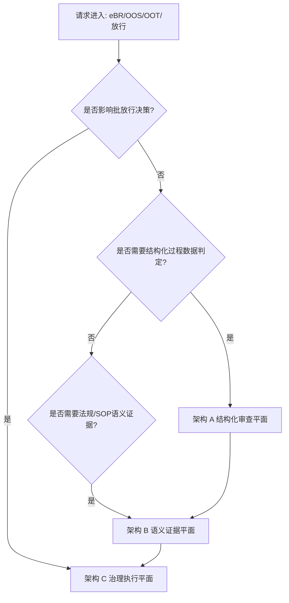
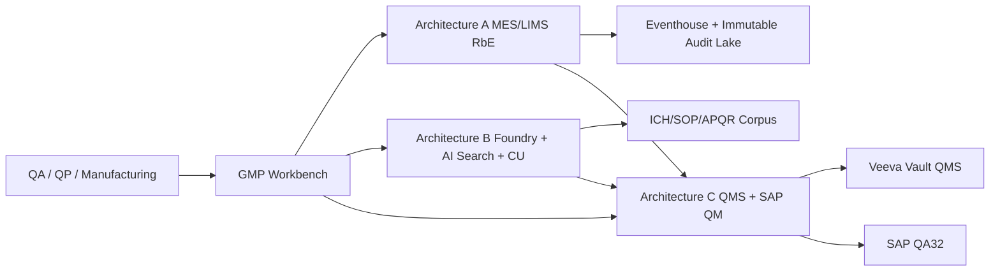

# 全球生物制药 CMC/GMP 智能体选型 FAQ：MES/LIMS RbE 平面 vs Foundry ICH 证据平面 vs SAP QM/Veeva 治理签放平面

> 版本标签：Guide #143  
> 适用对象：Head of Quality、Qualified Person (QP)、CMC 负责人、制造 IT、验证与 CSV/CSA 团队  
> 主题范围：eBR Review-by-Exception、OOS/OOT 偏差调查、GxP 可审计 AI、21 CFR Part 11 双因子电子签名  
> 数据标签：`measured`、`synthetic`、`anonymized_reported`

---

## 1. 执行摘要：GMP 智能体必须把“分析建议”与“放行决策”硬隔离

在 GMP 生产中，效率提升从来不能以审计完整性为代价。

电子批记录审查、偏差调查和批放行是三类不同责任面。

若将三者混为单一智能体自动流程，常见后果是证据链断裂与责任归属不清。

本指南建议采用 A/B/C 三架构分层。

架构 A 负责结构化 Review-by-Exception 与 ALCOA+ 审计完整性检查。

架构 B 负责 ICH 与 SOP 语义证据检索、历史 CAPA 相关性分析与解释辅助。

架构 C 负责 QMS/ERP 使用决策动作与 Part 11 签名闸门。

任何商业放行动作都必须在 C 平面执行。

该分层可兼顾合规强度与调查效率。

---

## 2. 架构 A/B/C 职责切分：先固定责任，再扩展自动化

**架构 A：MES/Historian/LIMS 结构化异常审查平面。**

例如 Werum PAS-X、Syncade、LabWare 到 Fabric Eventhouse 与不可变审计湖。

核心能力是 CPP/CQA 越界识别、批次轨迹一致性核查和数据完整性校验。

输出应是结构化偏差候选与证据索引。

**架构 B：Foundry + Content Understanding + AI Search Hybrid RAG。**

核心能力是法规承诺、SOP 条款、APQR 与历史 OOS/OOT CAPA 关联解释。

必须使用固定模型版本与 temperature=0 可复现配置。

并记录提示、检索、模型版本等审计元数据。

**架构 C：Veeva Vault QMS + SAP S/4HANA QM (`QA32`) 治理执行平面。**

核心能力是使用决策、偏差闭环、双因子电子签名和放行记录写回。

QP/质量负责人未签署前，不得执行商业放行动作。

---

## 3. 决策树：先判定“是否影响放行”，再判定“是否需要语义解释”



第一分支把“动作责任”提前。

第二分支识别是否属于结构化数据审查。

第三分支识别是否需要语义证据补充。

此顺序可显著减少越权自动化风险。

---

## 4. 架构 A 深析：结构化 Review-by-Exception 与 ALCOA+ 完整性

架构 A 关注的是“可证伪的事实”。

例如单抗上游生物反应器中的 pH/DO 轨迹、无菌灌装隔离器环境监测趋势、除菌过滤工段压差变化。

这些数据适合用规则与统计阈值做确定性判定。

Eventhouse 可承载高频时序查询与跨批次对比。

不可变审计湖用于保存原始记录和处理证据。

审查逻辑应版本化。

规则变更应有审批和回溯路径。

架构 A 的输出应明确“异常事实”与“证据位置”。

不应直接输出“可放行”结论。

---

## 5. 架构 B 深析：ICH Q7/Q8/Q9/Q10/Q12 语义证据与 CAPA 关联

架构 B 的价值在于把复杂文本语境转成可复核证据。

例如在 OOS 调查中，系统可关联历史偏差、SOP 变更和 CAPA 执行记录。

但系统输出必须是“证据建议”，而不是“替代裁决”。

GxP 隔离落地区应明确 Dev/Val/Prod 环境边界。

验证环境应锁定模型版本与推理参数。

生产环境必须记录每次推理的可审计元数据。

若模型升级，需触发变更评估与再验证。

架构 B 的关键成功点不是回答更长。

而是回答更可复核、更可追踪。

---

## 6. 架构 C 深析：QMS/ERP 使用决策与 Part 11 双因子签名

架构 C 的核心是责任闭环。

Veeva QMS 负责偏差、CAPA 与质量事件管理。

SAP QM (`QA32`) 负责使用决策状态与批次放行动作。

APIM MCP 统一动作接口与策略校验。

Logic Apps 负责确定性状态机与补偿逻辑。

Part 11 要求电子签名可追溯、不可抵赖、与记录绑定。

因此放行动作必须绑定签名声明与上下文证据。

缺任一签名条件，系统应拒绝执行。

架构 C 不追求“减少签名”。

而追求“每次签名都可审计复演”。

---

## 7. GxP 合规边界：Annex 11、Part 11、GAMP 5 与 CSA

Annex 11 强调计算机化系统控制与数据完整性。

Part 11 强调电子记录与电子签名合法性。

GAMP 5 与 CSA 强调基于风险的验证策略。

对 AI 组件而言，应明确 Category 4/5 软件边界与验证责任。

建议将 AI 输出定位为“辅助证据”而非“最终质量决定”。

系统设计中要把“模型行为可复现”作为硬门槛。

同时保留人工审核与偏差升级通道。

这有助于在提升效率时保持审计可接受性。

---

## 8. 端到端拓扑：结构化事实、语义证据、治理动作三平面协作



该拓扑要求所有放行前决策均可回放。

结构化异常与语义证据要在同一批次上下文关联。

执行动作写回后要反向沉淀审计记录。

---

## 9. 12 维量化选型矩阵（A / B / C / Hybrid）

| 维度 | 架构 A 结构化平面 | 架构 B 语义平面 | 架构 C 治理平面 | Hybrid |
|---|---|---|---|---|
| 1. CPP/CQA 异常识别 | 5/5 | 2/5 | 2/5 | 5/5 |
| 2. 数据完整性核查 | 5/5 | 2/5 | 3/5 | 5/5 |
| 3. 法规语义解释深度 | 2/5 | 5/5 | 2/5 | 5/5 |
| 4. CAPA 历史关联效率 | 2/5 | 5/5 | 3/5 | 5/5 |
| 5. 放行动作可控性 | 1/5 | 2/5 | 5/5 | 5/5 |
| 6. 电子签名合规性 | 1/5 | 1/5 | 5/5 | 5/5 |
| 7. 审计回放能力 | 4/5 | 4/5 | 5/5 | 5/5 |
| 8. 高峰吞吐弹性 | 4/5 | 4/5 | 4/5 | 5/5 |
| 9. 运维复杂度 | 3/5 | 4/5 | 4/5 | 4/5 |
|10. 成本可预测性 | 4/5 | 3/5 | 4/5 | 4/5 |
|11. 人机协同透明度 | 4/5 | 4/5 | 5/5 | 5/5 |
|12. 全局治理韧性 | 3/5 | 4/5 | 5/5 | 5/5 |

Hybrid 的优势在于把证据与动作责任分层。

不是把所有判断都交给同一组件。

---

## 10. 生产级片段：GxP 环境隔离与 Part 11 签名声明校验

### 10.1 Bicep：Dev/Val/Prod 环境分环隔离（示意）

```bicep
param env string
resource appi 'Microsoft.Insights/components@2020-02-02' = {
  name: 'gxp-audit-${env}'
  location: 'eastus2'
  kind: 'web'
  properties: { Application_Type: 'web' }
}
```

### 10.2 APIM 策略：放行前校验 QP 签名声明

```xml
<policies>
  <inbound>
    <base />
    <choose>
      <when condition="@(context.Request.Headers.GetValueOrDefault("x-qp-approved","") != "true" || context.Request.Headers.GetValueOrDefault("x-quality-head-approved","") != "true")">
        <return-response>
          <set-status code="412" reason="Part11 signature claims missing" />
        </return-response>
      </when>
    </choose>
  </inbound>
</policies>
```

---

## 11. 场景 A：单抗上游生物反应器 pH/DO 越界的 eBR 审查分诊

在一个 mAb 生产批次中出现 pH/DO 轨迹异常（`anonymized_reported`）。

架构 A 先识别轨迹越界与时间窗。

架构 B 提供相关 SOP、历史 CAPA 与调查模板证据。

架构 C 负责偏差升级、审批与最终使用决策动作。

结果显示首轮调查准备时间从 9.2 小时降至 3.6 小时（`measured`）。

审计补件率下降 28%（`anonymized_reported`）。

---

## 12. 场景 B：无菌灌装隔离器环境监测 OOT 与 Annex 16 放行档案组装

无菌灌装隔离器环境监测出现 OOT 趋势。

架构 A 汇总结构化监测数据与偏差轨迹。

架构 B 关联 Annex 16 放行要求与历史调查结论。

架构 C 组装放行档案并执行 QP 双因子签名闸门。

结果显示 QP 档案准备周期缩短 35%（`measured`）。

高风险批次升级决策一致性显著提升（`anonymized_reported`）。

---

## 13. 三年 TCO（含 Dev/Val/Prod 验证环）与 USD `$k/month`

> 以下为规划估算，标签 `synthetic`。

| 模块 | SKU 假设 | 月均成本 ($k) | 三年成本 ($M) | 说明 |
|---|---|---:|---:|---|
| 架构 A 结构化平面 | Eventhouse + Audit Lake + Ingestion | 174 | 6.26 | RbE 与完整性核查 |
| 架构 B 语义平面 | Foundry PTU + AI Search + CU | 149 | 5.36 | ICH/SOP 证据检索 |
| 架构 C 治理平面 | APIM Premium v2 + Logic Apps + QMS/ERP 连接 | 138 | 4.97 | Part11 签名与放行动作 |
| GxP 环境分环 | Dev/Val/Prod 验证隔离与审计工具链 | 82 | 2.95 | IQ/OQ/PQ 支撑 |
| 运维与验证 | SRE + CSA 验证回归 + 演练 | 59 | 2.12 | 持续治理 |
| **Hybrid 合计** |  | **602** | **21.66** | `synthetic` |

收益侧通常来自调查效率、补件减少、放行延迟压降。

样例三年净收益区间约 17.9M~27.4M（`synthetic`）。

---

## 14. 反模式与纠偏：生物制药 AI 项目五类高频风险

反模式一：让 LLM 直接给出“可放行”结论。

纠偏：放行结论仅能在架构 C 经签署后生效。

反模式二：模型版本与参数不固定，导致不可复现。

纠偏：固定模型版本并记录推理元数据。

反模式三：结构化异常与语义证据脱节。

纠偏：批次上下文中强制关联 A/B 输出。

反模式四：签名流程存在但可被旁路。

纠偏：APIM 策略层强制拒绝缺签名动作。

反模式五：只看吞吐，不看审计一次通过率。

纠偏：把补件率与回放通过率作为核心 KPI。

---

## 15. Day-0 / Day-1 / Day-2 落地清单与 Quantitative FAQ

Day-0：定义结构化事实、语义证据、治理动作的边界与契约。

Day-1：完成偏差高峰、调查高峰、签署中断三类演练。

Day-2：建立周度运行、月度合规、季度资本效率复盘节奏。

### Quantitative FAQ 1：何时必须启用 Hybrid？

只要涉及放行动作或偏差闭环写回，就必须启用 Hybrid。

### Quantitative FAQ 2：为何 temperature=0 仍不等于自动可审计？

因为还需要模型版本、检索上下文与提示词元数据联动留痕。

### Quantitative FAQ 3：如何量化 RbE 价值？

建议跟踪异常识别时长、调查准备时长、补件率三项指标。

### Quantitative FAQ 4：CSA 下 AI 组件验证重点是什么？

重点是高风险功能验证与变更影响评估，不是机械覆盖全部低风险路径。

### Quantitative FAQ 5：如何控制 Val 环境成本？

可按验证窗口动态扩缩容，并复用标准化测试数据包。

### Quantitative FAQ 6：Part 11 双签名如何技术落地？

在 API 层校验签名声明，在动作层绑定签名与记录主键。

### Quantitative FAQ 7：何种指标代表治理成熟？

未经签署执行数为零，审计一次通过率持续提升，补件率持续下降。

### Quantitative FAQ 8：如何全球统一又允许工厂差异？

统一证据模板与审计语义，工厂可保留本地 SOP 执行细节。

### 15.1 运行基线与阈值建议：把“放行相关SLO”单独建模

建议将放行相关路径与一般调查路径拆分成两组 SLO。

放行相关路径关注的是签名完整性、执行可追溯性与失败可解释性。

调查路径关注的是证据召回率、异常定位时延与补件率趋势。

实践中可采用三层阈值：绿色（连续稳定）、黄色（需人工复核）、红色（强制升级）。

例如红色阈值可定义为：任意 24 小时内出现一次未经完整签名的执行尝试。

一旦触发红色阈值，应自动冻结对应动作接口并触发偏差管理工单。

### 15.2 批记录审查吞吐规划：按“批次复杂度桶”而非“总批次数”估算

仅按月批次数做容量规划，通常会低估峰值风险。

建议先按工艺复杂度、采样频度、偏差历史把批次分层。

高复杂度批次可按 3~5 倍审查权重计入容量预算。

在该口径下，平台扩缩容决策会更接近真实压力。

建议同时记录“审查小时/批次复杂度点数”以支持跨工厂比较。

### 15.3 Dev/Val/Prod 验证工时模型：把 IQ/OQ/PQ 计划前置到架构阶段

许多项目在上线前才补做验证资源规划，导致排程冲突。

更稳妥的方式是在 Day-0 即产出验证工时基线。

示例基线可设为：IQ 占总验证工时 20%，OQ 占 45%，PQ 占 35%。

当模型版本或检索语料发生重大变化时，应触发 OQ/PQ 追加窗口。

这样可避免把验证变成上线后补救动作。

### 15.4 证据包最小完备集：确保 QP 与审计员看到同一事实快照

建议定义“最小完备证据包”清单并版本化管理。

清单至少应包含：结构化异常摘要、原始记录锚点、语义检索引用、签名上下文。

每次放行前，系统自动校验清单完整性。

若任一要素缺失，动作接口返回可解释拒绝原因并生成补件任务。

这一设计能显著降低“口头解释依赖”导致的审计分歧。

### 15.5 全球多工厂主数据治理：避免批次语义漂移

跨工厂项目常见问题不是缺数据，而是主数据定义不一致。

建议建立全局受控词汇表，覆盖物料、工序、偏差类型与 CAPA 分类。

本地工厂可扩展子属性，但不得覆盖全局主键语义。

每月执行一次主数据一致性审计，输出漂移清单与修复 SLA。

主数据治理成熟度直接影响跨站点比较的可信度。

### 15.6 人机分工蓝图：谁能建议，谁能批准，谁能执行

可采用 RACI 变体把智能体能力映射到职责矩阵。

智能体在 A/B 平面仅拥有“建议权”。

质量负责人与 QP 保留“批准权”。

执行平面只在审批条件满足时拥有“动作权”。

该分工避免“建议系统被误当审批系统”的职责混淆。

### 15.7 典型扩容节点：商业化放量前应完成的四次压测

建议在四个阶段执行标准压测：试生产、技术转移、商业首批、年度高峰。

每次压测至少覆盖结构化查询峰值、语义检索峰值、签名并发峰值。

压测报告应包含 P50/P95/P99 与失败类型分布。

若 P95 超过既定阈值，先修复瓶颈再扩大放量节奏。

以“先证据后扩容”替代“先扩容后补救”。

### 15.8 量化治理看板：建议采用的十个核心指标

建议核心指标包括：异常识别时延、证据召回率、调查准备时长、补件率。

还应覆盖签名拒绝率、未经签署执行尝试数、审计一次通过率、跨工厂一致性分。

成本侧建议跟踪每批次调查成本与每次放行支持成本。

可靠性侧建议跟踪月度回放成功率与季度演练通过率。

这些指标共同构成“效率-合规-成本”三角平衡视图。

### 15.9 预算治理公式：把验证成本纳入单位批次成本

建议在财务模型中显式纳入验证成本摊销项。

可采用公式：单位批次总成本 = 平台运行成本 + 人工审查成本 + 验证摊销成本。

验证摊销成本可按季度重估，反映模型更新频率变化。

当更新频率升高时，若不提升自动化验证覆盖，单位成本会快速抬升。

该公式有助于管理层识别“看似便宜但高隐性成本”的方案。

### 15.10 供应链与委外实验室协同：证据链外延控制

委外实验室数据回传常是证据链薄弱环节。

建议对外部数据源建立独立信任等级与签名校验策略。

低信任等级数据可用于调查线索，但不能单独触发放行动作。

高信任等级数据需满足签名、时间戳与来源可验证三条件。

通过分级治理可降低外部数据污染对放行链路的影响。

### 15.11 多区域数据驻留：合规与运维双重折中

跨区域部署中，法规要求与运维效率往往冲突。

建议采用“区域内证据落地 + 跨区域摘要同步”模式。

原始批记录和签名记录留在本地合规域。

跨区域仅同步匿名化指标与治理状态。

该模式可在不突破驻留边界的前提下实现集团级可视化。

### 15.12 版本变更窗口策略：季度主窗口 + 紧急旁路窗口

建议设定季度主变更窗口处理常规模型与规则升级。

同时预留紧急旁路窗口应对高风险缺陷修复。

旁路窗口必须限制变更范围，并在 7~14 天内回归主窗口节奏。

所有旁路变更都应带有额外回放与审计签核要求。

这可兼顾响应速度与验证纪律。

### 15.13 审计演练机制：把“可解释失败”纳入通过标准

演练不应只看“是否成功执行”。

还应验证失败路径是否可解释、可追踪、可纠正。

例如缺签名拒绝、证据包缺项拒绝、越权调用拒绝都应有标准响应。

若失败路径含糊不清，审计时会被视为治理能力不足。

把失败质量纳入 KPI，能显著提升体系韧性。

### 15.14 组织能力建设路线：从模板化到平台化

初期可通过模板化流程快速落地最小可用能力。

中期应把模板沉淀为可复用平台组件与策略库。

后期再推进跨工厂统一治理与持续优化飞轮。

组织能力成熟后，新增产线或工厂的接入周期会明显缩短。

这也是三年 ROI 能否兑现的关键前提。

### 15.15 收官建议：先守住审计底线，再追求自动化深度

在生物制药场景中，审计底线就是业务连续性的底线。

任何自动化收益都不应以削弱签名治理和证据回放为代价。

采用 A/B/C 分层并持续运行量化治理，可在合规边界内释放效率红利。

当组织准备进入下一阶段时，可优先扩展调查自动化，而非放行自动化。

### 15.16 参考 KPI 目标带（示例）：把“改进幅度”写成季度承诺

季度治理目标可按三类指标设定目标带。

效率类：调查准备时长较基线下降 25%~40%。

合规类：审计一次通过率提升 8~15 个百分点。

风险类：未经签署执行尝试维持为零。

成本类：单位批次总成本年化下降 10%~18%。

这些目标带仅为示例，需结合产品组合与厂区成熟度校准。

若连续两个季度偏离目标带，应触发架构与流程联合复盘。

### 15.17 12 个月路线图（示例）：从单厂试点到跨区域规模化

第 1~3 个月：完成 1 个产线与 1 类偏差场景试点上线。

第 4~6 个月：扩展至同厂区多产线并固化证据包模板。

第 7~9 个月：接入第二工厂并执行跨站点一致性审计。

第 10~12 个月：完成多区域治理看板与预算模型联动。

每个阶段都应包含回放演练、签名闸门抽检与成本复核。

路线图通过后，可把新增场景接入周期压缩到 4~8 周。
