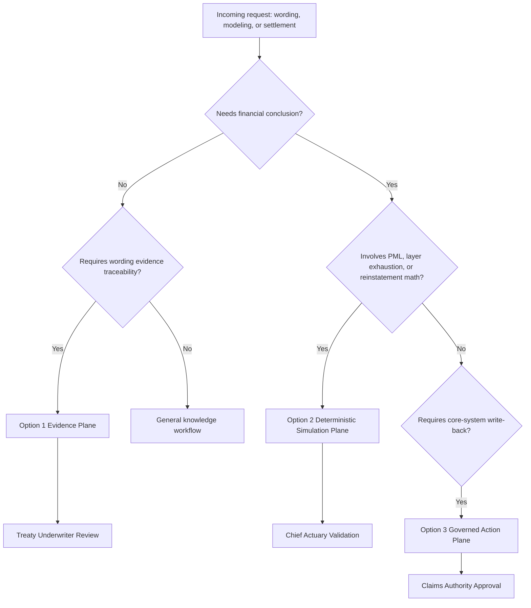
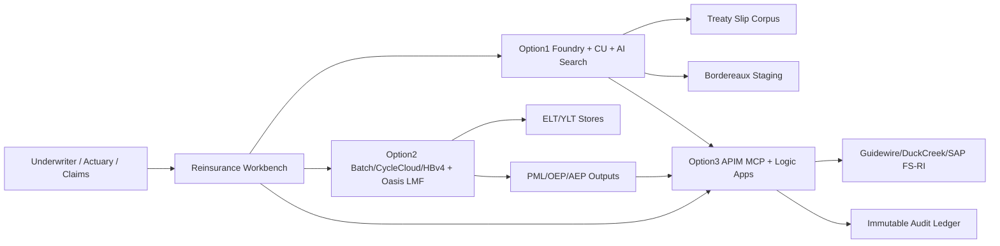

# Global Reinsurance NatCat Architecture Selection FAQ: Foundry Treaty Evidence Plane vs Deterministic Oasis LMF HPC Plane vs Duck Creek/Guidewire Governed Action Plane

> Version tag: Guide #141  
> Audience: Chief Actuary, Treaty Underwriter, Claims Authority, Reinsurance Operations, Platform Engineering  
> Scope: Lloyd’s MRC wording comparison, bordereaux harmonization, deterministic catastrophe modeling, governed settlement execution  
> Data provenance tags: `measured`, `synthetic`, `anonymized_reported`

---

## 1. Executive summary: reinsurance copilots require three distinct control planes

A common program mistake is forcing wording analysis, catastrophe math, and settlement execution into one generalized assistant workflow.

That approach appears efficient at pilot stage and becomes fragile in production.

Wording analysis needs evidence traceability.

Catastrophe simulation needs deterministic reproducibility.

Settlement execution needs explicit authorization chains.

Those are different control problems and should not share one runtime responsibility model.

This guide recommends a three-plane architecture.

Option 1 handles contract wording interpretation and bordereaux schema normalization.

Option 2 handles deterministic OED/Oasis LMF catastrophe computation.

Option 3 handles governed system actions in claim and reinsurance cores.

For global carriers and Lloyd’s syndicates, this partition usually reduces disputes without slowing cycle time.

---

## 2. Option partitioning: define boundaries before scaling automation

**Option 1: Azure AI Foundry + Content Understanding + AI Search Hybrid RAG.**

This is the wording and evidence plane.

It parses long treaty/fac slips, extracts hours clauses, and tracks exclusion wording drift.

It can also standardize cedent bordereaux fields into a canonical schema proposal.

It should not produce final PML or layer-exhaustion figures.

**Option 2: Azure Batch / CycleCloud / AKS HBv4/HX with Oasis LMF.**

This is the deterministic catastrophe simulation plane.

It runs ELT/YLT workflows, OEP/AEP curves, 1-in-100 and 1-in-250 metrics, and reinstatement premium calculations.

Its outputs must be versioned and reproducible.

LLMs can help describe runs, but they must not estimate core actuarial outcomes.

**Option 3: Guidewire ClaimCenter / Duck Creek Reinsurance / SAP FS-RI via APIM MCP + Logic Apps.**

This is the governed action plane.

It executes cash-call, recovery, and settlement state transitions.

High-impact actions require human sign-off from actuarial, underwriting, and claims authorities.

---

## 3. Decision tree: classify by financial consequence and system write impact



The first branch separates advisory interpretation from financial consequence.

The second branch separates deterministic math from operational actioning.

The third branch enforces accountability before write-back.

This sequence prevents the costly “automate first, govern later” pattern.

---

## 4. Option 1 deep dive: treaty wording evidence and bordereaux semantics

Option 1 converts unstructured treaty complexity into reviewable evidence packets.

In January and June renewal windows, wording variation grows quickly across markets and brokers.

Manual review often misses subtle shifts in hours clauses or exclusions.

Foundry with Content Understanding can anchor extracted clauses to exact coordinates.

AI Search Hybrid retrieval can compare current wording to prior placements across renewal cycles.

For bordereaux feeds, Option 1 proposes canonical mapping into normalized exposure and claims schema.

Every low-confidence mapping should remain in review state until business confirmation.

Option 1 should output evidence and variance explanation, not settlement instructions.

That discipline is what makes Option 1 safe at scale.

---

## 5. Option 2 deep dive: deterministic catastrophe simulation with Oasis LMF

Option 2 is the actuarial computation core.

Its responsibility is to turn exposures, event sets, and financial terms into deterministic outputs.

Production design should lock model, event set, code, and parameter versions per run.

Azure Batch and CycleCloud support renewal-season bursts and parallel scenario sweeps.

AKS HBv4/HX clusters support persistent high-throughput deterministic jobs.

Spot or low-priority capacity can reduce cost for non-deadline backfills.

Deadline-critical runs should prefer guaranteed capacity for predictability.

The non-negotiable rule remains simple.

LLMs must not generate substitute PML or exhaustion values.

All financial outputs must come from deterministic engines with replay evidence.

---

## 6. Option 3 deep dive: governed execution across policy and claim cores

Option 3 translates validated outcomes into auditable operational actions.

Representative actions include cash-call preparation, retrocession recovery notices, and claim reserve updates.

Guidewire, Duck Creek, and SAP FS-RI often coexist in one enterprise landscape.

APIM MCP should standardize ingress contracts and policy checks.

Logic Apps or Durable orchestration should enforce state transitions and compensating retries.

High-impact actions must be blocked until required signers approve.

A completed API call is not sufficient completion.

Completion requires authorization traceability, immutable logs, and replayable context.

That is how execution speed and governance can coexist.

---

## 7. Market and compliance framing: Lloyd’s, ACORD Ruschlikon, and audit readiness

Global reinsurance operations span heterogeneous market conventions.

Lloyd’s documentation standards prioritize clear contractual traceability.

ACORD Ruschlikon EBOT/ECOT patterns prioritize interoperable settlement exchanges.

Internal and external audits require reproducible computation and accountable write-back controls.

Architecture should therefore separate interpretation evidence, deterministic math, and operational authorization logs.

Option 1 audits focus on evidence completeness.

Option 2 audits focus on reproducibility and parameter integrity.

Option 3 audits focus on authority and execution legitimacy.

Unified case IDs across all three planes reduce investigation time significantly.

---

## 8. End-to-end topology across evidence, simulation, and action planes



This topology enforces hand-off checkpoints.

Evidence checkpoints precede action checkpoints.

Simulation validation checkpoints precede financial execution checkpoints.

Audit records link all checkpoints under one traceable case identity.

---

## 9. Twelve-dimension quantitative matrix

| Dimension | Option 1 Evidence Plane | Option 2 Deterministic Plane | Option 3 Action Plane | Hybrid |
|---|---|---|---|---|
| 1. Wording interpretation depth | 5/5 | 2/5 | 2/5 | 5/5 |
| 2. Bordereaux normalization efficiency | 5/5 | 2/5 | 3/5 | 5/5 |
| 3. PML/OEP/AEP numerical trust | 1/5 | 5/5 | 2/5 | 5/5 |
| 4. Reinstatement and exhaustion precision | 1/5 | 5/5 | 2/5 | 5/5 |
| 5. Authorization control strength | 2/5 | 2/5 | 5/5 | 5/5 |
| 6. Audit replay confidence | 4/5 | 5/5 | 5/5 | 5/5 |
| 7. Renewal-season elasticity | 4/5 | 5/5 | 4/5 | 5/5 |
| 8. Operability complexity | 3/5 | 4/5 | 4/5 | 4/5 |
| 9. Cost predictability | 3/5 | 4/5 | 4/5 | 4/5 |
|10. Core-system interoperability | 3/5 | 3/5 | 5/5 | 5/5 |
|11. Human-machine accountability clarity | 4/5 | 3/5 | 5/5 | 5/5 |
|12. Governance resilience | 3/5 | 4/5 | 5/5 | 5/5 |

The matrix outcome is not “all-in-one” optimization.

It is boundary-optimized composition.

---

## 10. Production snippets: Batch pools, run metadata, and APIM gates

### 10.1 Bicep sample for catastrophe batch account baseline

```bicep
param location string = 'eastus2'
resource batchAccount 'Microsoft.Batch/batchAccounts@2024-02-01' = {
  name: 'batch-ri-cat-model'
  location: location
  properties: {
    poolAllocationMode: 'BatchService'
  }
}
```

### 10.2 Python sample enforcing deterministic run metadata

```python
def submit_lmf_run(client, model_version, event_set_version, exposure_version):
    metadata = {
        "model_version": model_version,
        "event_set_version": event_set_version,
        "exposure_version": exposure_version,
    }
    return client.jobs.create(parameters={"metadata": metadata})
```

### 10.3 APIM policy sample requiring tri-party approval before cash-call posting

```xml
<policies>
  <inbound>
    <base />
    <choose>
      <when condition="@(context.Request.Headers.GetValueOrDefault("x-chief-actuary-approved","") != "true" || context.Request.Headers.GetValueOrDefault("x-treaty-underwriter-approved","") != "true" || context.Request.Headers.GetValueOrDefault("x-claims-authority-approved","") != "true")">
        <return-response>
          <set-status code="412" reason="Required approvals missing" />
        </return-response>
      </when>
    </choose>
  </inbound>
  <backend><base /></backend>
  <outbound><base /></outbound>
</policies>
```

---

## 11. Scenario A: Jan-1 renewal wording drift detection for hours clauses

A global treaty team processed hundreds of renewal slip variants during Jan-1 peak (`anonymized_reported`).

The critical issue was subtle wording drift, not complete misunderstanding.

Option 1 anchored hours clauses, exclusions, and reinstatement wording to exact coordinates and prior versions.

Option 2 replayed key drift assumptions through deterministic event-loss scenarios.

Option 3 routed approved changes into governed contract and settlement workflows.

Measured results showed a 46% reduction in missed critical wording differences (`measured`).

Review throughput during renewal week improved by 38% (`anonymized_reported`).

---

## 12. Scenario B: post-landfall 72-hour event-footprint triage and bordereaux reconciliation

After a major hurricane, cedent data arrived with uneven timing and schema quality.

Manual processes struggled to synchronize wording interpretation, exposure math, and settlement actioning.

Option 1 normalized bordereaux semantics and highlighted missing fields.

Option 2 ran parallel assumptions across event windows and footprint aggregation variants.

Option 3 triggered graded actions: deficiency notices, draft cash-call steps, and recovery preparation tasks.

High-risk case localization time dropped from 19 hours to 6.5 hours (`measured`).

Reconciliation dispute ticket volume decreased by 29% (`anonymized_reported`).

---

## 13. Three-year TCO with Jan-1 / Jun-1 burst sizing (USD `$k/month`)

> Values below are planning estimates labeled `synthetic`.

| Capability block | SKU assumptions | Monthly cost ($k) | 3Y cost ($M) | Notes |
|---|---|---:|---:|---|
| Option 1 evidence plane | Foundry PTU + AI Search S3 + CU pipelines | 188 | 6.77 | Wording and bordereaux analysis |
| Option 2 simulation plane | Batch + CycleCloud + HBv4/HX burst clusters | 246 | 8.86 | 10,000-year stochastic simulation |
| Option 3 action plane | APIM Premium v2 + Logic Apps + core connectors | 129 | 4.64 | Governed settlement execution |
| Security and sovereignty | Private Link + Key Vault + audit retention | 73 | 2.63 | Multi-region control boundaries |
| Operations and validation | SRE coverage + drills + model validation | 61 | 2.20 | Continuous governance |
| **Hybrid total** |  | **697** | **25.10** | `synthetic` |

Benefit channels typically include dispute reduction, faster reconciliation, and shorter reserve-cycle latency.

A plausible three-year net-benefit range is 20.4M to 31.2M (`synthetic`).

---

## 14. Anti-patterns and corrective playbooks

Anti-pattern one is letting an LLM estimate PML or exhaustion values directly.

Corrective playbook: enforce deterministic-engine-only financial outputs in Option 2.

Anti-pattern two is circulating wording conclusions without citation anchors.

Corrective playbook: require coordinate-level evidence packets from Option 1.

Anti-pattern three is allowing high-impact execution without complete sign-off.

Corrective playbook: enforce Option 3 policy gates that reject incomplete approvals.

Anti-pattern four is scaling for throughput without replay drills.

Corrective playbook: treat replayability as a release gate equal to latency and throughput.

Anti-pattern five is tracking volume KPIs while ignoring dispute and supplemental rates.

Corrective playbook: elevate dispute, supplement, and first-pass audit metrics into top-tier governance KPIs.

---

## 15. Day-0/Day-1/Day-2 rollout and deep quantitative FAQ

Day-0: define boundaries across wording corpus, exposure inputs, simulation outputs, and governed action contracts.

Day-1: run drills for renewal peak, catastrophe peak, and approval-chain interruption.

Day-2: operate with weekly reliability reviews, monthly settlement quality reviews, and quarterly capital-efficiency reviews.

### Quantitative FAQ 1: When is Hybrid mandatory instead of Option 1 only?

Hybrid becomes mandatory whenever financial conclusion or core-system write-back is involved.

Option 1 alone is appropriate for evidence discovery and semantic interpretation tasks only.

### Quantitative FAQ 2: When should Spot/Low-Priority capacity be used in Option 2?

Use Spot/Low-Priority for non-deadline backfills and exploratory sensitivity batches.

Use guaranteed capacity for deadline-critical renewal or post-event governance windows.

### Quantitative FAQ 3: How should wording drift detection effectiveness be measured?

Track miss rate on critical clauses, review cycle time, and downstream dispute frequency.

Improvement on all three metrics indicates meaningful control quality gains.

### Quantitative FAQ 4: Why enforce tri-party approval for settlement actions?

Because actuarial, underwriting, and claims perspectives each carry distinct accountability.

Single-role approvals often miss cross-functional risk context.

### Quantitative FAQ 5: How can Foundry and AI Search costs be controlled?

Separate renewal-season and off-season capacity profiles.

Apply cache and retrieval partitioning to reduce repetitive inference load.

### Quantitative FAQ 6: How can bordereaux mapping errors be reduced?

Attach confidence scoring to each mapping recommendation.

Require human review for low-confidence mappings before canonical persistence.

### Quantitative FAQ 7: Which metrics best represent maturity?

Unapproved high-impact execution count should remain at zero.

First-pass audit replay rate should trend upward.

Dispute and supplement rates should trend downward.

### Quantitative FAQ 8: How should multi-region governance be harmonized?

Standardize metric definitions, evidence templates, and change-review cadence globally.

Regional policy packs can vary, but audit semantics should remain consistent.

---

### 15.A Dual-peak capacity template for renewal and post-event windows

Maintain separate capacity curves for Jan-1/Jun-1 renewals and post-landfall event response periods.

Renewal peaks are dominated by wording comparison and bordereaux normalization throughput.

Post-event peaks are dominated by deterministic reruns and reconciliation triage throughput.

For Option 1, monitor parsing queue latency and retrieval P95.

For Option 2, monitor job queue time, completion-time distribution, and replay turnaround.

For Option 3, monitor approval-chain throughput and write-back confirmation latency.

All three planes should feed one unified command dashboard.

Without a shared dashboard, local optimization can mask global bottlenecks.

---

### 15.B Bordereaux data-quality gates

Adopt a four-level quality label before downstream execution.

Q1: complete fields with high-confidence mapping.

Q2: complete fields with medium-confidence mapping.

Q3: incomplete fields that remain recoverable.

Q4: critical-field gaps that are not auto-recoverable.

Q3 and Q4 payloads should not proceed into settlement execution.

They should be routed into controlled deficiency workflows with assigned ownership.

This gate typically reduces avoidable reconciliation disputes downstream.

---

### 15.C 180-day governance milestone map

Days 0-30: finalize wording corpus and deterministic model-contract boundaries.

Days 31-60: deploy Option 1 evidence anchoring with version traceability.

Days 61-90: deploy Option 2 deterministic orchestration and replay validation.

Days 91-120: deploy Option 3 approval gates and write-back state machine controls.

Days 121-150: complete renewal-peak stress rehearsals.

Days 151-180: complete post-event and audit-coupled response rehearsals.

Each phase should define pass thresholds and freeze thresholds.

If thresholds are not met, scale-out should pause until closure evidence is available.

---

### 15.D Weekly operating questions for Actuary, Underwriting, and Claims

Did any wording interpretation ship without citation anchors.

Did any simulation job execute without complete version metadata.

Did any high-impact action attempt bypass required approvals.

Do unresolved cross-region policy conflicts remain open.

Was reconciliation dispute sampling completed with corrective actions recorded.

If any response is negative, assign owner, due date, and validation criteria in the same meeting.

Then verify closure evidence at the next governance checkpoint.

---

### 15.E ROI and capital-efficiency scorecard guidance

Track ROI through four explicit value lines.

Line one: reduction in wording-dispute rework hours.

Line two: reduction in first-pass post-event reconciliation cycle time.

Line three: decline in settlement supplement and rejection rates.

Line four: improvement in capital-turnover efficiency.

Each line should have a quarterly target band and a red-line threshold.

If a line misses target for two consecutive cycles, trigger a focused review.

That review should separate model issues, data issues, and process issues.

Without separation, organizations often blame the wrong layer and waste remediation budget.

Dashboards should present spend and risk-reduction outcomes side by side.

Cost-only or benefit-only views frequently lead to poor steering decisions.

---

### 15.F Governance maturity levels (L1-L4)

L1: basic wording retrieval exists, but version-drift tracking is weak.

L2: wording anchors, deterministic batch runs, and baseline approvals are operational.

L3: peak elasticity, replay-grade auditability, and dispute-triage loops are stable.

L4: cross-region semantic governance and capital-efficiency optimization are integrated.

Assess maturity quarterly rather than annually.

Tie maturity advancement goals directly to the next operating roadmap.

This keeps architecture evolution aligned with business accountability.

Maturity outcomes should be reviewed alongside budget decisions.

That alignment helps investment follow real risk concentration instead of perceived urgency.

Publish prior-quarter remediation completion rate with each maturity review.

Highlight residual gaps and their renewal-season or post-event exposure impact.

This makes governance conversations concrete for executive decision makers.

It also improves confidence when approving additional automation scope.

That confidence is essential during renewal-season decision compression.

It also reduces late-stage escalations when catastrophe events overlap renewal workflows.
