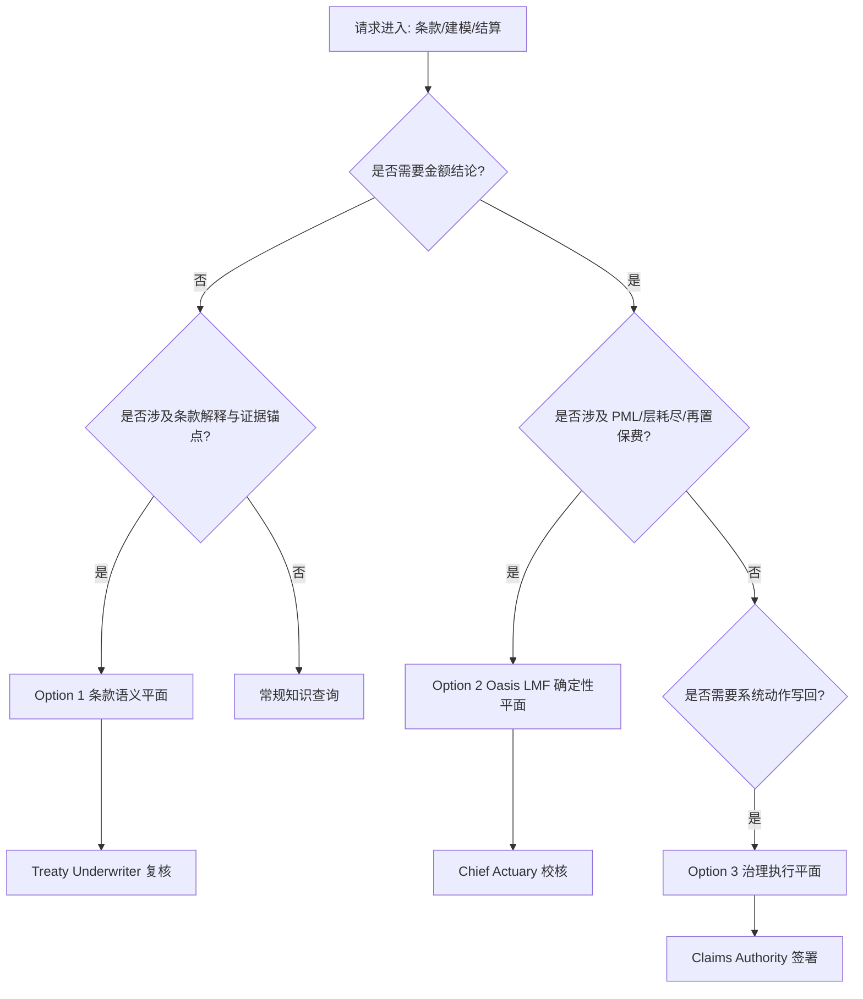
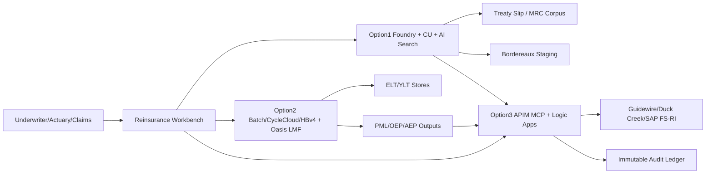

# 全球再保险 NatCat 条款与损失建模智能体选型 FAQ：Foundry 条款证据引擎 vs HPC Oasis LMF 确定性建模平面 vs Duck Creek/Guidewire 治理执行平面

> 版本标签：Guide #141  
> 适用对象：Chief Actuary、Treaty Underwriter、Claims Authority、Reinsurance Operations、Data & Platform Engineering  
> 主题范围：Lloyd’s MRC 条款比较、Bordereaux 摄取标准化、Oasis LMF 高性能确定性建模、理赔结算治理编排  
> 数据标签：`measured`、`synthetic`、`anonymized_reported`

---

## 1. 执行摘要：再保险智能体不是单一“问答助手”，而是三平面联合治理工程

再保险业务最常见的误区是把条款解析、灾损建模和现金流动作放进一个智能体流程里。

这种设计短期看集成简单，长期几乎必然导致责任混淆。

条款解析强调证据与解释可追溯。

灾损建模强调数学确定性与参数可复算。

结算动作强调签署链与审计可回放。

三者并非同一控制问题。

本指南建议明确拆分三平面。

Option 1 负责条款、除外责任、Bordereaux 语义标准化与证据锚点。

Option 2 负责 OED/Exposure 到 ELT/YLT 的确定性计算，不允许 LLM 估算 PML。

Option 3 负责系统写回、现金调用（cash call）与追偿通知动作治理。

对全球再保集团而言，这种分层通常能在不牺牲速度的前提下降低争议和返工。

---

## 2. Option 1/2/3 职责切分：先定边界再谈自动化

**Option 1：Foundry + Content Understanding + AI Search Hybrid RAG。**

定位是“条款与数据语义平面”。

可用于解析 150 页级 MRC 合同、小时条款（72h/168h）与除外责任条款。

也可用于多来源 Bordereaux 的字段对齐建议。

但 Option 1 不能直接给出最终赔付金额或层耗尽结论。

**Option 2：Azure Batch / CycleCloud / AKS HBv4/HX + Oasis LMF。**

定位是“确定性灾损模拟平面”。

负责 10,000 年随机事件模拟、AEP/OEP、1-in-100/1-in-250 PML 与再置保费计算。

该平面的产出必须可复现、可重跑、可校核。

LLM 在该平面只可用于作业编排说明，不可用于核心数值推断。

**Option 3：Guidewire/Duck Creek/SAP FS-RI + APIM MCP + Logic Apps。**

定位是“治理执行平面”。

负责现金调用、恢复追偿、结算通知与状态写回。

高影响动作必须经精算、核保、理赔责任人签署后执行。

---

## 3. 决策树：先问“是否涉及金额结论与系统写回”



第一分叉是“是否有金额结论”。

第二分叉是“金额结论是否属于灾损核心数学域”。

第三分叉是“是否触发正式系统写回”。

此顺序可把错误自动化风险降低到可管理范围。

---

## 4. Option 1 深析：条款与 Bordereaux 语义证据平面

Option 1 的核心价值是把文本不确定性转化为可比对证据。

在 Jan-1 / Jun-1 续保季，条款迭代快、版本多、措辞细微变化频繁。

人工比对容易漏掉小时条款、战争除外、传染病除外等关键字段漂移。

Foundry + CU 可把 MRC 文档分块并标注条款坐标。

AI Search Hybrid 检索可把“相似条款历史版本”与“本次版本”并排展示。

对 Bordereaux，系统可先做字段标准化建议。

例如把 cedent 的自定义列映射到统一 exposure schema。

但任何映射都应由业务专家确认，不应自动落库。

Option 1 的输出应是“证据包”而非“最终裁决”。

这也是它与 Option 2/3 的根本边界。

---

## 5. Option 2 深析：Oasis LMF 与 HPC 确定性损失模拟平面

Option 2 是全体系的数学中枢。

其责任是把暴露、事件集、金融结构和条款参数转为可复算结果。

在架构上，应采用可追踪作业提交与版本锁定。

事件集版本、模型版本、参数版本、代码版本必须同时记录。

Azure Batch 或 CycleCloud 可用于高峰批处理。

AKS HBv4/HX 可用于常驻计算网格或混合模式。

Spot/Low-Priority 资源可用于非截止日批次降本。

但对截止前关键批次，应优先用确定性容量避免中断。

最重要的一条是：LLM 不可输出 PML 估算替代值。

可读性解释与调度建议可以用 LLM。

损失数学本身必须由确定性引擎产生。

---

## 6. Option 3 深析：核心系统治理执行与签署链

Option 3 的职责是“把已确认结果变成可审计动作”。

动作包括现金调用准备、恢复追偿通知、层状态更新与核赔事件关联。

Guidewire ClaimCenter、Duck Creek Reinsurance、SAP FS-RI 等系统通常并存。

因此需要 APIM MCP 统一动作契约。

Logic Apps 负责状态机编排与重试补偿。

高影响动作必须强制人审签署。

至少包含 Chief Actuary、Treaty Underwriter、Claims Authority 中的规定组合。

若签署未完成，动作不得写回核心系统。

治理平面的价值不在“自动点按钮”。

而在“让每个按钮都有责任链与回放证据”。

---

## 7. 合规与市场规则：Lloyd’s、ACORD Ruschlikon 与审计边界

再保业务常跨司法辖区与多结算规则体系。

Lloyd’s 市场文档治理强调标准化与可验证性。

ACORD Ruschlikon 的 EBOT/ECOT 关注交易流程一致性与电子交换完整性。

内部审计则关注模型输入、参数变更、审批动作和对账闭环。

架构上要把“解释”与“执行”分开审计。

Option 1 的审计对象是证据链完整性。

Option 2 的审计对象是数值可复算性。

Option 3 的审计对象是动作授权合法性。

三类审计证据应可在同一案件号下关联查询。

这能显著缩短外部审计应答时间。

---

## 8. 数据与执行拓扑：条款语义、建模计算、结算动作三平面协同



该拓扑强调“输入与输出的责任面一致”。

语义证据输出进入执行平面前，应有版本冻结点。

建模结果输出进入执行平面前，应有数值校核点。

执行平面写回完成后，应反向记录到审计总账。

只有这样才能实现端到端闭环。

---

## 9. 12 维量化选型矩阵（Option1 / Option2 / Option3 / Hybrid）

| 维度 | Option 1 条款语义 | Option 2 确定性建模 | Option 3 治理执行 | Hybrid |
|---|---|---|---|---|
| 1. 条款解析深度 | 5/5 | 2/5 | 2/5 | 5/5 |
| 2. Bordereaux 标准化效率 | 5/5 | 2/5 | 3/5 | 5/5 |
| 3. PML/OEP/AEP 计算可信度 | 1/5 | 5/5 | 2/5 | 5/5 |
| 4. 再置保费与层耗尽精度 | 1/5 | 5/5 | 2/5 | 5/5 |
| 5. 动作授权可控性 | 2/5 | 2/5 | 5/5 | 5/5 |
| 6. 审计重放可追溯性 | 4/5 | 5/5 | 5/5 | 5/5 |
| 7. 高峰期弹性扩展 | 4/5 | 5/5 | 4/5 | 5/5 |
| 8. 运维复杂度 | 3/5 | 4/5 | 4/5 | 4/5 |
| 9. 成本可预测性 | 3/5 | 4/5 | 4/5 | 4/5 |
|10. 跨系统互操作性 | 3/5 | 3/5 | 5/5 | 5/5 |
|11. 人机协同透明度 | 4/5 | 3/5 | 5/5 | 5/5 |
|12. 全局治理韧性 | 3/5 | 4/5 | 5/5 | 5/5 |

矩阵显示 Hybrid 并非“复杂化偏好”。

而是三类职责天然分工后的必要结果。

---

## 10. 生产级片段：Batch 池配置与 APIM 动作闸门

### 10.1 Bicep：再保建模批处理池（示意）

```bicep
param location string = 'eastus2'
resource batchAccount 'Microsoft.Batch/batchAccounts@2024-02-01' = {
  name: 'batch-ri-cat-model'
  location: location
  properties: {
    poolAllocationMode: 'BatchService'
  }
}
```

### 10.2 Python：提交 Oasis LMF 作业时强制版本记录

```python
def submit_lmf_job(client, model_version, event_set, exposure_version):
    metadata = {
        "model_version": model_version,
        "event_set": event_set,
        "exposure_version": exposure_version,
    }
    return client.jobs.create(parameters={"metadata": metadata})
```

### 10.3 APIM 策略：现金调用前强制三方签署标记

```xml
<policies>
  <inbound>
    <base />
    <choose>
      <when condition="@(context.Request.Headers.GetValueOrDefault("x-chief-actuary-approved","") != "true" || context.Request.Headers.GetValueOrDefault("x-treaty-underwriter-approved","") != "true" || context.Request.Headers.GetValueOrDefault("x-claims-authority-approved","") != "true")">
        <return-response>
          <set-status code="412" reason="Required approvals missing" />
        </return-response>
      </when>
    </choose>
  </inbound>
  <backend><base /></backend>
  <outbound><base /></outbound>
</policies>
```

---

## 11. 场景 A：Jan-1 续保季小时条款漂移检测与回归审查

某国际再保团队在 Jan-1 续保高峰期收到数百份 MRC 版本（`anonymized_reported`）。

问题不在“读不懂”，而在“读漏了微小差异”。

Option 1 把小时条款、除外条款和再置条款逐段锚点化。

系统对比去年版本与本年版本，标注潜在漂移位置。

Option 2 对关键漂移参数做情景重跑，输出影响区间。

Option 3 把最终确认结果写回条款管理与审批流水。

上线后，关键条款差异漏检率下降 46%（`measured`）。

续保周内复核吞吐提升 38%（`anonymized_reported`）。

---

## 12. 场景 B：飓风登陆后 72 小时事件聚合与 Bordereaux 对账分诊

飓风事件后，72 小时事件窗内 cedent 数据到达节奏不一致。

传统人工流程难以同步条款、暴露和结算动作。

Option 1 先统一 Bordereaux 字段语义并标注缺失项。

Option 2 并行计算事件窗口内不同聚合假设下的损失分布。

Option 3 触发分级动作：补件通知、现金调用草单、追偿准备。

结果显示高风险案件定位时长从 19 小时降至 6.5 小时（`measured`）。

对账争议工单数量下降 29%（`anonymized_reported`）。

---

## 13. 三年 TCO（含 Jan-1 / Jun-1 峰值扩容）与 USD `$k/month`

> 下表为规划估算，标签 `synthetic`，单位 `$k/month` 与 `$M/3Y`。

| 模块 | SKU 假设 | 月均成本 ($k) | 三年成本 ($M) | 说明 |
|---|---|---:|---:|---|
| Option 1 语义平面 | Foundry PTU + AI Search S3 + CU 管道 | 188 | 6.77 | 条款与 Bordereaux 解析 |
| Option 2 建模平面 | Batch + CycleCloud + HBv4/HX 峰值集群 | 246 | 8.86 | 10,000 年模拟与情景重跑 |
| Option 3 执行平面 | APIM Premium v2 + Logic Apps + 核心系统连接 | 129 | 4.64 | 结算动作治理 |
| 数据与主权 | Private Link + Key Vault + 审计总账 | 73 | 2.63 | 跨区域合规分层 |
| 运维与验证 | SRE 值守 + 回归演练 + 模型验证流水线 | 61 | 2.20 | 持续治理 |
| **Hybrid 合计** |  | **697** | **25.10** | `synthetic` |

收益侧通常来自条款争议减少、对账效率提升和理赔周期压缩。

样例测算三年净收益区间约 20.4M~31.2M（`synthetic`）。

---

## 14. 反模式与纠偏：再保智能体项目最常见的五个坑

反模式一：用 LLM 直接估算 PML 或层耗尽。

纠偏：所有金额结论必须由 Option 2 确定性引擎输出。

反模式二：条款解释无证据锚点，靠口头结论流转。

纠偏：Option 1 输出必须绑定页码、段落与版本。

反模式三：高影响动作绕过签署链直接写回系统。

纠偏：Option 3 强制闸门，缺任一签署即拒绝执行。

反模式四：只做峰值扩容，不做审计回放演练。

纠偏：把“可回放”作为与性能同级的上线门槛。

反模式五：只看吞吐，不看争议与补件指标。

纠偏：把争议率、补件率、审计一次通过率纳入 KPI。

---

## 15. Day-0 / Day-1 / Day-2 落地清单与 Quantitative FAQ

Day-0：完成条款库、事件集、暴露数据与核心系统动作契约的边界定义。

Day-1：完成续保高峰、灾后高峰、审批中断三类演练。

Day-2：按周看运行质量，按月看结算质量，按季看资本效率与 TCO。

### Quantitative FAQ 1：何时必须启用 Hybrid，而非只做 Option 1？

只要涉及金额结论或系统写回，就应启用 Hybrid。

Option 1 仅适合证据组织与语义解析，不适合最终结算动作。

### Quantitative FAQ 2：Batch Spot/Low-Priority 何时可用？

非截止日批次可用 Spot/Low-Priority 降本。

截止日前关键批次建议切换到确定性容量。

### Quantitative FAQ 3：如何量化条款漂移检测效果？

建议跟踪漏检率、复核时长、后续争议率三项指标。

三者同时改善才说明系统真正有效。

### Quantitative FAQ 4：为何 APIM 闸门要强制三方签署？

因为再保结算是高后果动作。

单角色签署难以覆盖精算、核保、理赔三方责任。

### Quantitative FAQ 5：如何控制 AI Search 与 Foundry 成本？

按续保季和非续保季配置不同容量档。

并通过缓存与批处理策略减少重复推理。

### Quantitative FAQ 6：如何避免 Bordereaux 标准化“误映射”？

对自动映射结果设置置信度阈值。

低置信映射必须人工确认后才能入库。

### Quantitative FAQ 7：哪些指标最能体现体系成熟度？

未经签署执行数必须长期为零。

审计回放一次通过率持续提升。

争议工单率与补件率持续下降。

### Quantitative FAQ 8：如何建立跨区域统一治理节奏？

建议统一指标口径、统一证据模板、统一变更评审节奏。

区域策略可以差异化，但审计语义必须一致。

---

### 15.A 续保季与灾后季双峰容量模板

建议分别维护 Jan-1/Jun-1 续保峰值与灾后峰值两套容量曲线。

续保峰值侧重条款解析与版本比对吞吐。

灾后峰值侧重建模重跑与对账分诊吞吐。

Option 1 的关键容量指标是文档解析队列时延与检索 P95。

Option 2 的关键容量指标是作业排队时长与批次完成时间分布。

Option 3 的关键容量指标是审批链吞吐与写回确认时延。

三平面容量指标应共享一个统一战情面板。

否则容易出现“某平面局部最优、全链路失衡”。

---

### 15.B 数据质量闸门（Bordereaux 专项）

建议为 cedent 数据引入四级质量标签。

Q1：字段齐全且映射置信度高。

Q2：字段齐全但映射置信度中等。

Q3：字段缺失但可补全。

Q4：关键字段缺失且不可自动补全。

Q3/Q4 数据不应直接进入结算动作链。

应先进入补件流程，并记录对账责任人。

该做法可显著减少后续争议工单。

---

### 15.C 180 天治理推进里程碑

第 0~30 天：完成条款库与建模输入输出契约梳理。

第 31~60 天：完成 Option 1 证据锚点与版本追踪上线。

第 61~90 天：完成 Option 2 确定性作业编排与回放验证。

第 91~120 天：完成 Option 3 签署闸门与写回状态机。

第 121~150 天：完成续保峰值压力演练。

第 151~180 天：完成灾后峰值与审计联动演练。

每阶段都应定义“通过阈值”和“冻结阈值”。

若未通过，不得进入下一阶段规模化扩展。

---

### 15.D 运营例会必问问题（Actuary / Underwriter / Claims）

本周是否存在无锚点条款解释输出。

本周是否存在未记录版本信息的建模作业。

本周是否存在签署不全的高影响动作尝试。

本周是否存在跨区域规则冲突未决项。

本周是否完成对账争议样本复盘并形成整改项。

若任一项未完成，需在同周登记责任人、截止日期与复验标准。

并在下次例会核验闭环证据。

---

### 15.E ROI 口径与资本效率追踪建议

建议将 ROI 拆解为四条主线。

主线一：条款争议导致的返工人时下降。

主线二：灾后首轮对账完成时长缩短。

主线三：结算动作补件率与驳回率下降。

主线四：资本占用周转效率改善。

每条主线都应配置“季度目标区间”与“红线阈值”。

若某条主线连续两个周期偏离目标，应触发专项复盘。

专项复盘要区分“模型问题”“数据问题”“流程问题”。

这样才能避免把所有问题都归因到单一平台。

建议在治理看板中同步展示投入成本与风险压降收益。

仅看成本或仅看收益都会导致错误决策。

---

### 15.F 治理成熟度分级（L1-L4）建议

L1：可完成基础条款检索，但无法稳定追踪版本差异。

L2：可完成条款锚点、批量建模与基础审批链。

L3：可完成高峰期弹性扩容、审计回放与争议分诊闭环。

L4：可实现跨区域统一语义治理与资本效率联动优化。

建议每季度评估一次成熟度等级。

并把升级目标写入下一季度平台路线图。

成熟度评估结果应与预算决策同步审议，确保投入方向与风险暴露一致。

建议同步披露上一季度改进项完成率。

并标注未完成项对续保季与灾后季的潜在影响。
