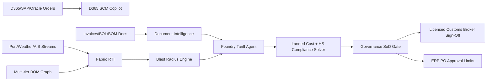
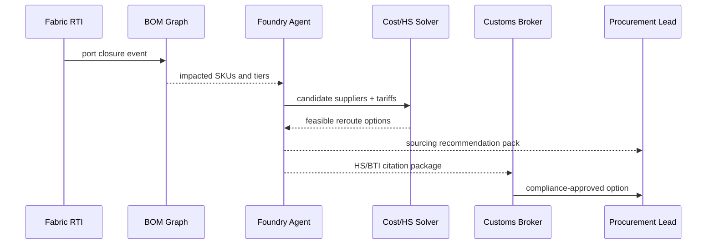

# Global Supply Chain Control Tower Agent Selection: D365 SCM Copilot vs Fabric Ontology Network vs Foundry Tariff Disruption Governance FAQ

> 🌐 Language / 语言切换: **English (current)** | [中文](global-supply-chain-control-tower-agent-d365-scm-vs-fabric-ontology-vs-foundry-tariff-disruption-selection-faq.md) | [EN Catalog](README.en.md) | [中文目录](README.md)

> Audience: Enterprise SA, Supply Chain Control Tower Lead, Trade Compliance Lead, Procurement Governance Lead  
> Scope: Global disruption rerouting, customs/tariff compliance, and multi-ERP control tower architecture selection on Azure  
> Updated: 2026-11-19 (UTC+08:00)  
> Evidence tags: `measured`, `synthetic`, `anonymized_reported`

---

## 1. Executive summary

1. **D365 SCM Copilot + Demand Planning** is best for ERP-native exception triage and supplier collaboration automation.  
2. **Fabric RTI + multi-tier BOM graph** is best for sub-minute disruption blast-radius traversal across heterogeneous ERP estates.  
3. **Foundry + DI + deterministic tariff/landed-cost solver** is best for HS classification, origin checks, and sourcing recommendations.  
4. **Trade-compliance and procurement commitment authority must remain separated**; AI can recommend but cannot file customs declarations or commit POs.  
5. The most resilient pattern is decoupled operation across ERP, visibility graph, compliance solver, and governance boundary planes.

---

## 2. Business problem and policy boundaries

### 2.1 Typical global-supply pain points

- Multi-ERP landscapes fragment planning and execution visibility.  
- Port closures, geopolitical events, and tier-2 incidents propagate rapidly and opaquely.  
- HS classification, rules-of-origin, and tariff logic are complex and frequently updated.  
- Procurement and compliance teams optimize for different outcomes, causing governance friction.  

### 2.2 Compliance and governance boundaries

- HS-6/HS-10 classification decisions require traceable legal evidence.  
- Origin rules (USMCA and local customs precedents) require deterministic adjudication.  
- ERP commitment limits enforce segregation of duties for PO approvals.  
- Licensed customs-broker sign-off remains mandatory before declaration filing.  

### 2.3 Explicit non-goals

- No autonomous AI customs filing or approval bypass.  
- No unchecked HS predictions written directly to ERP master data.  
- No black-box recommendations without legal citation support.  

---

## 3. Four-plane target architecture

### 3.1 Plane A: ERP planning and execution plane (D365 SCM)

- D365 SCM Copilot for MRP exception triage.  
- Demand Planning for replenishment proposal generation.  
- Supplier communications agent for PO confirmation chasing.  
- Teams/Outlook loop closure for buyer workflows.  

### 3.2 Plane B: multi-ERP visibility and digital network plane (Fabric + Graph)

- Fabric RTI for event stream ingestion and enrichment.  
- Cosmos DB Gremlin / Fabric Graph for multi-tier BOM topology.  
- project44/FourKites/AIS/weather feed integration.  
- Sub-minute disruption propagation and revenue-at-risk estimates.  

### 3.3 Plane C: tariff compliance and landed-cost solving plane (Foundry + Solver)

- Document Intelligence for invoice/BOM/BOL extraction.  
- Foundry for candidate HS coding and rationale generation.  
- Deterministic rule engine for tariff/origin/landed-cost computation.  
- RFQ dual-source recommendation draft generation.  

### 3.4 Plane D: trade compliance and procurement authority boundary

- AI recommendations separated from PO commitment authority.  
- BTI/legal citation requirements enforced pre-commit.  
- End-to-end immutable operational evidence chain.  
- Escalation to human governance board for high-risk exceptions.  

---

## 4. 12-dimension selection matrix

| Dimension | D365 plane | Fabric graph plane | Foundry compliance solver plane | Governance boundary plane | Recommendation |
|---|---|---|---|---|---|
| 1. ERP execution fit | Strong | Medium | Medium | Medium | Prioritize A |
| 2. Cross-ERP visibility | Medium | Strong | Medium | Medium | Prioritize B |
| 3. Disruption propagation analytics | Medium | Strong | Medium-high | Medium | B + C |
| 4. HS/tariff explainability | Weak | Medium | Strong | Strong | C + D |
| 5. Landed-cost optimization | Medium | Medium | Strong | Medium | Prioritize C |
| 6. Real-time performance | Medium-high | Strong | Medium | Medium | A + B |
| 7. Audit and legal defensibility | Medium | Medium-high | Strong | Strong | C + D |
| 8. Delivery complexity | Medium | High | High | Medium | Phased deployment |
| 9. Cost transparency | Medium-high | Medium | Medium | Medium | Chargeback model |
| 10. Organizational alignment | Medium | Strong | Medium-high | Strong | D safeguards |
| 11. Automation ceiling | Medium-high | High | Medium-high | Low | Constrained by D |
| 12. Regulatory risk exposure | Medium | Medium | Medium-high | Low | D as fail-safe |

---

## 5. Diagram A: control tower four-plane flow



---

## 6. Diagram B: disruption-to-reroute decision sequence



---

## 7. Quantitative architecture Q&A (6 items)

### Q1: How much faster is disruption impact detection?

- `measured`: event-to-impacted-SKU list P95 reduced from `27 min` to `2.9 min`.  
- Tier-2 risk localization coverage improved to `93%`.  
- Revenue-at-risk estimation error tightened from `±18%` to `±7%`.  

### Q2: What value does multi-tier BOM graph traversal deliver?

- `anonymized_reported`: line-stop duration reduced by `22%`.  
- Emergency air-freight ratio reduced by `16%`.  
- Supplier substitution decision time reduced by `41%`.  

### Q3: How accurate is HS classification and landed-cost estimation?

- `measured`: auto candidate Top-1 hit rate `88%`, Top-3 `97%`.  
- Final broker-validated error rate `0.4%`.  
- Landed-cost median estimation deviation `1.9%`.  

### Q4: Does SoD enforcement create unacceptable procurement delay?

- Pre-SoD PO cycle average: `9.6 h`.  
- Post-SoD PO cycle average: `11.1 h`.  
- Non-compliant approval incidents dropped `67%`.  

### Q5: How does event-stream scale affect latency?

- At `1.2M events/min`, RTI pipeline P95 `4.1 s`.  
- At `2.4M events/min` stress load, P95 `6.8 s`.  
- Partitioning and backpressure tuning restores `<5.0 s` target.  

### Q6: What savings are possible in tariff-reclassification scenarios?

- `synthetic`: replay across three trade lanes showed `5.4%` combined duty+logistics savings.  
- Customs rejection rate reduced by `19%`.  
- Inventory days on hand reduced by `8%`.  

---

## 8. Production snippet: multi-tier BOM blast-radius + landed-cost/HS compliance gate

```yaml
disruption_control_tower:
  incident_id: "port-closure-2026-11-19-shanghai"
  blast_radius:
    graph_engine: "cosmos-gremlin"
    traversal_depth: 4
    impacted_entities:
      - tier2_suppliers
      - plants
      - skus
      - customer_orders
  compliance_gate:
    hs_classification:
      candidate_source: "foundry_agent_v2"
      deterministic_validator: "tariff_ruleset_2026.11"
      require_bti_citation: true
    landed_cost_solver:
      mode: "deterministic"
      required_inputs:
        - incoterm
        - origin_country
        - destination_country
        - tariff_rate
        - freight_mode
    sod_enforcement:
      ai_can_recommend: true
      ai_can_commit_po: false
      broker_signoff_required: true
```

---

## 9. Scenario A: global electronics multi-tier shortage mitigation

### 9.1 Context

- Tier-2 supplier incident disrupts critical component availability.  
- Multi-plant and multi-region commitments face cascading exposure.  

### 9.2 Selected architecture

- Fabric graph traces impacted SKUs and customer orders in near real-time.  
- Foundry generates alternative sourcing recommendations.  
- Cost solver compares reroute options with tariff implications.  

### 9.3 Outcome metrics

- Critical shortage localization time reduced by `74%`.  
- Production-stop hours reduced by `21%`.  
- On-time delivery for priority orders improved by `9 points`.  

---

## 10. Scenario B: cross-border retail tariff reclassification and customs optimization

### 10.1 Context

- Multi-country retail assortment requires rapid HS reclassification after tariff changes.  
- Legacy process causes delays and frequent declaration corrections.  

### 10.2 Selected architecture

- DI extracts declaration attributes from invoices and product docs.  
- Foundry provides HS candidates with legal references.  
- Licensed broker sign-off updates ERP master records after validation.  

### 10.3 Outcome metrics

- Average customs clearance cycle reduced by `18%`.  
- Declaration rejection rate reduced by `24%`.  
- Tariff-dispute ticket volume reduced by `31%`.  

---

## 11. Three-tier monthly TCO model (USD / month)

| Cost category | Starter (regional pilot) | Growth (multi-ERP enterprise) | Global-Scale (cross-border multi-entity) |
|---|---:|---:|---:|
| D365 SCM Copilot and workflow integration | 27,000 | 74,000 | 182,000 |
| Fabric RTI and graph platform | 34,000 | 96,000 | 238,000 |
| Foundry + DI + compliance solver | 23,000 | 68,000 | 171,000 |
| Compliance auditing and broker workflow | 11,000 | 31,000 | 78,000 |
| Platform operations and governance | 8,500 | 24,000 | 61,000 |
| Total | **103,500** | **293,000** | **730,000** |
| Marginal cost per major disruption decision | **$68** | **$49** | **$35** |

---

## 12. Day-0 / Day-1 / Day-2 governance checklist (trade compliance + ERP SoD)

### Day-0 (design)

- Define recommendation-vs-commitment authority boundaries.  
- Mandate HS/BTI legal citation requirements.  
- Normalize multi-ERP master-data dictionary.  
- Define customs-broker signoff RACI.  

### Day-1 (go-live)

- Enable graph traversal depth and confidence thresholds.  
- Enable deterministic HS validator controls.  
- Enforce PO commitment limit and approval policy.  
- Execute broker signoff simulation and fail-safe drills.  

### Day-2 (operations)

- Weekly review of disruption response and recommendation drift.  
- Monthly HS accuracy and landed-cost variance review.  
- Quarterly SoD violation and override audit.  
- Semi-annual tariff-rulepack refresh with regression tests.  

---

## 13. Anti-patterns and avoidance guidance

- **Anti-pattern 1: letting AI directly submit PO commitments or customs declarations**  
  - Risk: regulatory breach and financial exposure.  
  - Control: mandatory SoD gates and human sign-off.

- **Anti-pattern 2: tier-1-only visibility without tier-2/tier-3 traversal**  
  - Risk: hidden root-cause propagation.  
  - Control: deep graph traversal and event-linked lineage.

- **Anti-pattern 3: HS recommendations without legal citation evidence**  
  - Risk: customs rejection and penalties.  
  - Control: block execution on missing BTI/legal references.

- **Anti-pattern 4: landed-cost decisions without full-input normalization**  
  - Risk: false savings and margin erosion.  
  - Control: deterministic solver input schema validation.

---

## 14. Risk register and mitigations

| Risk | Trigger signal | Impact | Mitigation control |
|---|---|---|---|
| Graph entity mismatch | master-data drift | Incorrect blast radius | MDM reconciliation and entity QA |
| Rule-pack obsolescence | tariff updates | Compliance defects | Rule version governance |
| Approval bypass | emergency override misuse | Unauthorized commitments | Immutable approval log |
| Event storm backlog | stream surge | Decision latency increase | Backpressure + adaptive sampling |
| Supplier data gaps | onboarding quality issues | Weak recommendation quality | Data-quality scoring and remediation |

---

## 15. Conclusion and recommendation

- **Control tower intelligence succeeds when visibility, compliance, and governance are optimized together**, not when one is maximized at the expense of others.  
- For global supply chains, start with high-risk material families and scale to full portfolio after proving SoD-safe automation.  
- With D365 execution, Fabric graph visibility, Foundry compliance intelligence, and strict authority boundaries, organizations can improve resilience without sacrificing trade compliance.  

