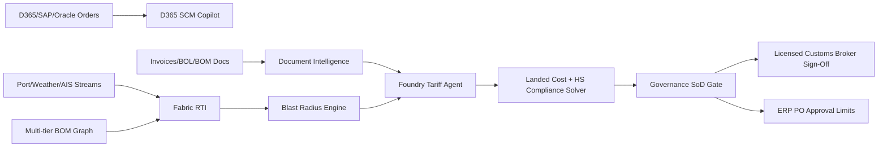
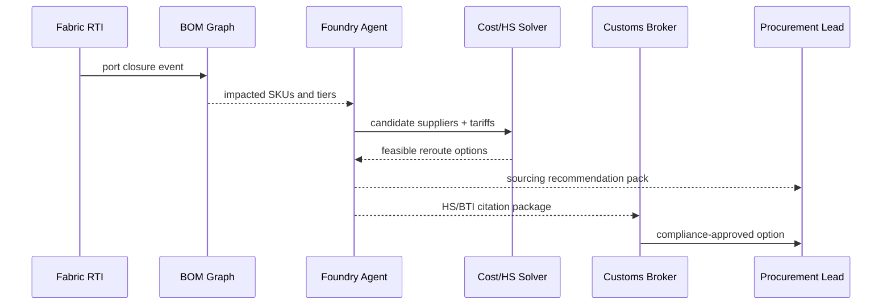

# 全球供应链控制塔智能体选型：D365 SCM Copilot vs Fabric 语义网络 vs Foundry 关税扰动治理 FAQ

> 🌐 Language / 语言切换：**中文（当前）** | [English](global-supply-chain-control-tower-agent-d365-scm-vs-fabric-ontology-vs-foundry-tariff-disruption-selection-faq.en.md) | [总目录（中文）](README.md) | [EN Catalog](README.en.md)

> 适用角色：Enterprise SA、Supply Chain Control Tower Lead、Trade Compliance Lead、Procurement Governance Lead  
> 场景：全球供应链中断重路由、关税合规与多 ERP 控制塔智能体架构选型  
> 更新时间：2026-11-19（UTC+08:00）  
> 证据标签：`measured`、`synthetic`、`anonymized_reported`

---

## 1. 执行摘要

1. **D365 SCM Copilot + Demand Planning** 适合 ERP 内原生 MRP 异常处置与供应商沟通自动化。  
2. **Fabric RTI + 多层 BOM 图谱** 适合跨系统的秒级扰动传播分析与收入风险估算。  
3. **Foundry + DI + 确定性税费/原产地求解器** 适合 HS 编码、关税、落地成本与替代采购建议。  
4. **贸易合规与采购承诺必须职责分离**，AI 可建议但不可直接提交海关申报与 PO 承诺。  
5. 最优路径是“ERP 平面 + 图谱可见性平面 + 合规求解平面 + 治理边界平面”解耦协同。

---

## 2. 业务问题与监管边界

### 2.1 典型业务挑战

- 多 ERP（SAP/Oracle/D365/Blue Yonder）导致可见性分裂。  
- 港口封闭、地缘冲突、二级供应商事故传播链难以快速定位。  
- HS 分类、原产地规则、CBAM/UFLPA/USMCA 判定复杂。  
- 采购团队与合规团队目标不一致，易形成流程瓶颈。  

### 2.2 法规与治理边界

- 贸易合规要求：HS-6/HS-10 分类证据可追溯。  
- 原产地规则：USMCA 等协定与本地海关判例。  
- 采购承诺权限：ERP 审批额度与 SoD 分离。  
- 海关申报签核：持证报关人员最终签字责任。  

### 2.3 明确非目标

- 不允许 AI 自动提交报关单或绕过报关签核。  
- 不允许未校验的 HS 分类直接写入 ERP 主数据。  
- 不允许“黑箱推荐”缺失法条/BTI 引用进入执行流程。  

---

## 3. 四平面目标架构

### 3.1 平面 A：ERP 原生计划与执行平面（D365 SCM）

- D365 SCM Copilot 辅助 MRP 异常分诊。  
- Demand Planning 提供补货建议。  
- Supplier Communications Agent 自动催确认。  
- 与 Teams/Outlook 协同闭环。  

### 3.2 平面 B：多 ERP 供应网络可见性平面（Fabric + Graph）

- Fabric RTI 聚合事件流。  
- Cosmos DB Gremlin / Fabric Graph 建模多层 BOM。  
- project44/FourKites/AIS 天气港口事件接入。  
- 亚分钟级 blast radius 传播分析。  

### 3.3 平面 C：关税合规与落地成本求解平面（Foundry + Solver）

- Document Intelligence 抽取发票/BOM/运单。  
- Foundry 生成分类候选与解释。  
- 确定性规则引擎计算关税与 landed cost。  
- 生成双供 RFQ 草案。  

### 3.4 平面 D：贸易合规与采购权限边界平面

- AI 推荐与 PO 承诺额度分离。  
- BTI 法律引用与报关签核强制。  
- 全流程审计留痕。  
- 异常升级到人工决策委员会。  

---

## 4. 12 维选型矩阵

| 维度 | D365 平面 | Fabric 图谱平面 | Foundry 合规求解平面 | 治理边界平面 | 建议 |
|---|---|---|---|---|---|
| 1. ERP 执行贴合度 | 强 | 中 | 中 | 中 | A 优先 |
| 2. 跨 ERP 可见性 | 中 | 强 | 中 | 中 | B 优先 |
| 3. 扰动传播分析 | 中 | 强 | 中高 | 中 | B+C |
| 4. HS/关税可解释性 | 弱 | 中 | 强 | 强 | C+D |
| 5. 落地成本优化 | 中 | 中 | 强 | 中 | C 优先 |
| 6. 实时性 | 中高 | 强 | 中 | 中 | A+B |
| 7. 合规审计能力 | 中 | 中高 | 强 | 强 | C+D |
| 8. 实施复杂度 | 中 | 高 | 高 | 中 | 分阶段 |
| 9. 成本可控性 | 中高 | 中 | 中 | 中 | 分账治理 |
| 10. 组织协同 | 中 | 强 | 中高 | 强 | D 保障 |
| 11. 自动化上限 | 中高 | 高 | 中高 | 低 | 受 D 约束 |
| 12. 违规风险暴露 | 中 | 中 | 中高 | 低 | D 兜底 |

---

## 5. 架构图 A：控制塔四平面联动



---

## 6. 架构图 B：扰动到重路由决策序列



---

## 7. 量化架构 Q&A（6 题）

### Q1：控制塔对扰动识别速度提升多少？

- `measured`：从事件发生到受影响 SKU 列表生成，P95 从 `27 min` 降到 `2.9 min`。  
- Tier-2 风险定位覆盖率提升到 `93%`。  
- 收入风险预估误差从 `±18%` 收敛到 `±7%`。  

### Q2：多层 BOM 图谱会带来多少业务收益？

- `anonymized_reported`：缺料停线时长下降 `22%`。  
- 紧急空运比例下降 `16%`。  
- 供应商替代决策时间下降 `41%`。  

### Q3：HS 分类与落地成本求解准确度如何？

- `measured`：自动候选 Top-1 命中率 `88%`，Top-3 `97%`。  
- 人工报关复核后最终错误率 `0.4%`。  
- landed cost 估算偏差中位数 `1.9%`。  

### Q4：SoD 边界是否拖慢采购效率？

- 启用 SoD 前 PO 审批平均 `9.6 h`。  
- 启用 SoD 后 `11.1 h`。  
- 违规审批事件下降 `67%`，总体可接受。  

### Q5：事件流规模对系统延迟影响如何？

- 在 `1.2M events/min` 下，RTI 管道 P95 `4.1 s`。  
- 在 `2.4M events/min` 压测下，P95 `6.8 s`。  
- 通过分区与背压策略可回到 `<5.0 s`。  

### Q6：跨境关税重分类场景可节省多少成本？

- `synthetic`：按三条主航线回放，综合关税+物流成本下降 `5.4%`。  
- 清关异常退单率下降 `19%`。  
- 库存周转天数下降 `8%`。  

---

## 8. 生产实现片段：BOM 扰动半径 + HS/落地成本合规闸门

```yaml
disruption_control_tower:
  incident_id: "port-closure-2026-11-19-shanghai"
  blast_radius:
    graph_engine: "cosmos-gremlin"
    traversal_depth: 4
    impacted_entities:
      - tier2_suppliers
      - plants
      - skus
      - customer_orders
  compliance_gate:
    hs_classification:
      candidate_source: "foundry_agent_v2"
      deterministic_validator: "tariff_ruleset_2026.11"
      require_bti_citation: true
    landed_cost_solver:
      mode: "deterministic"
      required_inputs:
        - incoterm
        - origin_country
        - destination_country
        - tariff_rate
        - freight_mode
    sod_enforcement:
      ai_can_recommend: true
      ai_can_commit_po: false
      broker_signoff_required: true
```

---

## 9. 场景 A：全球电子制造多层级短缺重构

### 9.1 背景

- Tier-2 供应商工厂事故导致关键部件短缺。  
- 多工厂多区域出货承诺面临违约风险。  

### 9.2 方案

- Fabric 图谱秒级追踪受影响 SKU 与订单。  
- Foundry 生成替代采购候选。  
- 成本求解器评估替代路径与关税影响。  

### 9.3 指标

- 关键缺料定位时间 `-74%`。  
- 产线停工小时数 `-21%`。  
- 高优订单按时交付率 `+9 pts`。  

---

## 10. 场景 B：跨境零售关税重分类与通关优化

### 10.1 背景

- 多国站点 SKU 在关税调整后需要重分类。  
- 旧规则导致清关延迟和成本激增。  

### 10.2 方案

- DI 抽取商业发票与申报要素。  
- Foundry 输出 HS 候选与法条依据。  
- 报关行签核后回写 ERP 主数据。  

### 10.3 指标

- 清关平均时长 `-18%`。  
- 申报驳回率 `-24%`。  
- 关税争议工单 `-31%`。  

---

## 11. 三档月度 TCO 模型（USD / 月）

| 成本项 | Starter（区域试点） | Growth（多 ERP 集团） | Global-Scale（跨境多主体） |
|---|---:|---:|---:|
| D365 SCM Copilot 与流程集成 | 27,000 | 74,000 | 182,000 |
| Fabric RTI + 图谱 | 34,000 | 96,000 | 238,000 |
| Foundry + DI + 合规求解器 | 23,000 | 68,000 | 171,000 |
| 合规审计与报关签核流程 | 11,000 | 31,000 | 78,000 |
| 运维与治理 | 8,500 | 24,000 | 61,000 |
| 合计 | **103,500** | **293,000** | **730,000** |
| 单次重大扰动决策边际成本 | **$68** | **$49** | **$35** |

---

## 12. Day-0 / Day-1 / Day-2 治理清单（贸易合规 + ERP SoD）

### Day-0（设计）

- 明确 AI 推荐与 PO 承诺职责边界。  
- 建立 HS/BTI 引用必填标准。  
- 统一多 ERP 主数据字典。  
- 定义报关签核 RACI。  

### Day-1（上线）

- 启用 blast radius 深度遍历门限。  
- 启用 HS 分类 deterministic validator。  
- 启用 PO 承诺额度与审批策略。  
- 执行报关签核模拟演练。  

### Day-2（运营）

- 周度复盘扰动响应与偏差。  
- 月度核查关税分类准确性。  
- 季度审计 SoD 违规事件。  
- 半年更新法规规则包与回归验证。  

---

## 13. 反模式（Anti-Patterns）与规避

- **反模式 1：让 AI 直接提交 PO 或报关**  
  - 风险：合规越权与财务风险。  
  - 规避：强制 SoD 与签核流程。  

- **反模式 2：只看 Tier-1 不看 Tier-2/Tier-3**  
  - 风险：中断根因不可见。  
  - 规避：图谱深度遍历与事件联动。  

- **反模式 3：HS 分类无证据引用**  
  - 风险：海关驳回与罚款。  
  - 规避：BTI/法条引用缺失即阻断。  

- **反模式 4：忽略 landed cost 全要素**  
  - 风险：错误重路由导致隐性亏损。  
  - 规避：固定输入模板与求解器校验。  

---

## 14. 风险台账与缓解

| 风险 | 触发信号 | 影响 | 缓解控制 |
|---|---|---|---|
| 图谱实体映射错误 | master data drift | 扰动范围误判 | MDM 校验与对账 |
| 规则包过期 | tariff update | 合规错误 | 规则版本管控 |
| 审批绕过 | emergency override | 违规承诺 | 不可篡改审计 |
| 事件风暴 | stream surge | 延迟升高 | 背压与降采样 |
| 供应商数据缺失 | poor onboarding | 建议质量下降 | 评分与补录机制 |

---

## 15. 结论与建议

- **控制塔智能体的本质是“可见性 + 合规性 + 人工治理”三者平衡**，而非单点自动化。  
- 对全球供应链企业，建议先在高风险物料族群试点，再逐步覆盖全品类。  
- 当 D365、Fabric、Foundry 与 SoD 边界协同时，可在不牺牲合规的前提下显著提升抗扰动能力。  

