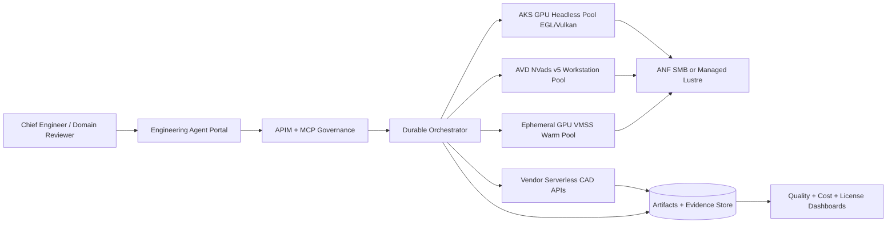
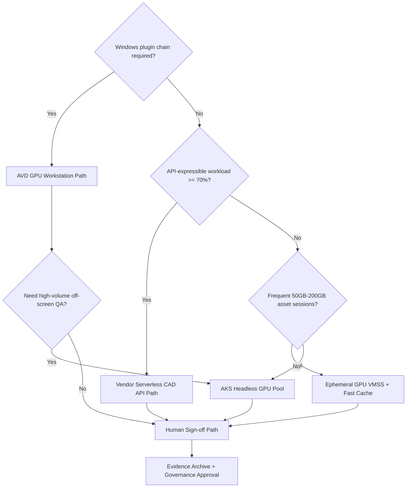

# 3D/CAD/BIM Engineering Workstation Agent Selection FAQ: AKS EGL/Vulkan Headless Pools vs AVD NVads v5 Real-Time Takeover vs Vendor Serverless CAD APIs vs Ephemeral GPU VMSS
> 🌐 **Language / 语言切换**: **[🇬🇧 English (gpu-3d-cad-bim-workstation-agent-aks-egl-vulkan-headless-vs-avd-nvads-v5-webrtc-selection-faq.en.md)](gpu-3d-cad-bim-workstation-agent-aks-egl-vulkan-headless-vs-avd-nvads-v5-webrtc-selection-faq.en.md)** | **[🇨🇳 中文版 (gpu-3d-cad-bim-workstation-agent-aks-egl-vulkan-headless-vs-avd-nvads-v5-webrtc-selection-faq.md)](gpu-3d-cad-bim-workstation-agent-aks-egl-vulkan-headless-vs-avd-nvads-v5-webrtc-selection-faq.md)** | **[📚 Back to Catalog](README.en.md)**
> Evidence labels: `measured` / `synthetic` / `anonymized_reported`
> Focus industries: automotive R&D, advanced manufacturing, AEC/BIM, industrial digital twins, and enterprise engineering review operations

## 1) Executive Summary: use a workload-tiered architecture, not a single execution substrate
Enterprise 3D/CAD/BIM agent programs usually fail
when platform decisions are made as if all jobs were equivalent.
In practice,
at least four workload families co-exist:
1. parameterized generation and deterministic geometry checks;
2. multi-view off-screen rendering for VLM-based clash and compliance inspection;
3. plugin-heavy interactive desktop review requiring human takeover;
4. ultra-large assembly and point-cloud sessions that are storage-bound before they become compute-bound.
Those four families have conflicting optimization targets.
A single platform can be good for one or two classes,
but rarely optimal for all.
The production-safe architecture is a tiered topology:
- AKS headless GPU pools for high-throughput automated geometry workflows;
- AVD GPU workstations for Windows-native toolchains and low-latency engineer takeover;
- vendor serverless CAD APIs for API-first batch regeneration and conversion;
- ephemeral GPU VMSS plus high-speed file caches for massive model cold-start mitigation.
Key principle:
separate platform choices by interaction constraints first,
not by raw VM cost first.
Official and verifiable references (`measured`, retrieved 2026-11-21):
1. Azure Virtual Desktop documentation  
   https://learn.microsoft.com/azure/virtual-desktop/
2. NVads A10 v5 VM sizes and capabilities  
   https://learn.microsoft.com/azure/virtual-machines/sizes/gpu-accelerated/nvadsa10v5-series
3. AKS GPU node pools and scheduling guidance  
   https://learn.microsoft.com/azure/aks/gpu-cluster
4. Azure NetApp Files documentation  
   https://learn.microsoft.com/azure/azure-netapp-files/
5. Azure Managed Lustre documentation  
   https://learn.microsoft.com/azure/azure-managed-lustre/
6. Autodesk Platform Services (Design Automation)  
   https://aps.autodesk.com/
7. Onshape API and FeatureScript docs  
   https://onshape-public.github.io/docs/
8. enterprise anonymized production baselines (`anonymized_reported`)
9. controlled replay and stress tests (`synthetic`)

## 2) Scope and boundary conditions: classify by interaction and plugin dependency before cost
### Why this topic matters to Cloud & AI Solution Architects
In enterprise engineering organizations,
agent automation does not replace human engineers.
It changes where humans spend attention.
If architecture design ignores interactive takeover needs,
programs often regress into either:
- expensive desktop sprawl with poor automation yield,
or
- high-throughput automation that cannot pass final design governance.
### Workload taxonomy used in this guide
Type A:
batch geometry and rule-checking tasks
where deterministic scriptability is high.
Type B:
visual compliance and collision inspection
where off-screen rendering quality and repeatability matter.
Type C:
interactive review and design intervention
requiring low-latency viewport control by chief engineers.
Type D:
massive model handling
where file hydration and cache locality dominate response time.
### Non-goals
This guide does not prescribe
low-level graphics driver register tuning.
This guide does not replace
tool-vendor certification processes.
This guide does not cover
consumer-grade workstation optimization.

## 3) End-to-end enterprise reference architecture
The recommended pattern is a four-plane architecture:
control plane,
compute plane,
interaction plane,
and file/data plane.
Control plane:
APIM and MCP governance,
with policy-driven workload routing.
Compute plane:
AKS headless pools,
vendor serverless APIs,
and ephemeral GPU VMSS.
Interaction plane:
AVD GPU sessions for human takeover and sign-off.
File/data plane:
ANF SMB or Managed Lustre as the shared hot data backbone.
Design invariants:
- every agent run has a deterministic job envelope;
- every generated artifact has immutable evidence metadata;
- every takeover decision is auditable and attributable;
- every expensive license checkout has explicit lease lifecycle telemetry.
### Mermaid #1: four-plane production topology


## 4) Option A deep dive: AKS GPU Linux headless rendering pools (EGL/Vulkan)
Option A is optimized for automation density.
It is strong when rendering and geometry checks can be executed
without desktop UI dependencies.
Typical stack:
- Blender `bpy` pipelines;
- FreeCAD automation;
- OpenUSD scene packaging;
- IfcOpenShell model parsing;
- VLM inspection prompts over deterministic image bundles.
Typical density target:
`4–8` concurrent sessions per A10 GPU
depending on scene complexity and quality profiles.
Strengths:
1. high batch throughput;
2. no Windows desktop licensing tax;
3. policy-driven queue autoscaling with KEDA;
4. reproducible evidence outputs.
Risks:
1. weak compatibility with COM/.NET-only legacy plugins;
2. pipeline drift if toolchain versions are not pinned;
3. quality variance if camera and shader profiles are not standardized.
Platform controls:
- signed immutable images and SBOM enforcement;
- deterministic render profile catalogs;
- strict input contracts with schema validation;
- per-job artifact hashing and retention policies.

## 5) Option B deep dive: AVD GPU workstation pools with low-latency takeover
Option B is optimized for ecosystem compatibility.
It is often mandatory
when engineering flows rely on Windows-native plugins
in tools such as Revit, SolidWorks, CATIA, and AutoCAD.
Typical architecture components:
- NVadsA10 v5 or NV36adms A10 v5 pools;
- Windows 11 multi-session or single-session profiles;
- RDP Shortpath UDP and optional NICE DCV / Parsec streaming;
- private license servers over private network paths.
For production governance,
split the estate into two logical pools:
1. agent-run desktop sessions;
2. human-priority takeover sessions.
Without this split,
agent bursts can starve critical review windows.
License lifecycle controls are mandatory:
- enforce idle reclamation after `>180s`;
- persist checkout and release timestamps;
- flag orphaned leases with compensating release jobs.
This pattern directly protects
high-value floating license capacity.

## 6) Option C deep dive: vendor serverless CAD APIs (APS/Onshape)
Option C is optimized for operational simplicity.
It can eliminate GPU workstation operations
for API-expressible tasks.
Good candidates:
- format conversion pipelines (`DWG/RVT/STEP`);
- parameterized model regeneration;
- standards-driven geometry normalization.
Core strengths:
1. no GPU VM fleet management;
2. clear pay-per-job economics;
3. strong API contract boundaries.
Core limitations:
1. limited native interactive viewport control;
2. private plugin compatibility boundaries;
3. vendor-specific semantics that may require adaptation layers.
Solution Architect recommendation:
apply API-first migration selectively,
not universally.
Keep desktop-compatible fallback paths
for business-critical workflows that cannot be API-normalized.

## 7) Option D deep dive: ephemeral GPU VMSS + high-speed engineering cache fabric
Option D targets giant-model cold-start pain.
When engineering assets routinely exceed `50GB–200GB`,
copy storms and hydration delays dominate user experience.
Core pattern:
1. warm image pools with TTL-managed hibernation;
2. high-performance shared storage via ANF SMB or Managed Lustre;
3. local NVMe short-lived hot cache;
4. deterministic teardown and evidence persistence.
Primary objective:
achieve `<15s` wake-and-mount in peak windows
without paying always-on costs for all sessions.
Benefits:
- reduced repeated model hydration penalties;
- improved first-usable-frame latency;
- faster incident-time takeover for critical reviews.
Risks:
- over-warming can waste budget;
- poor metadata strategy can cause stale artifact confusion.
Mitigation:
use project-phase and file-hotness signals
to drive cache prefetch windows.

## 8) 12-dimension enterprise comparison matrix
| Dimension | AKS Headless EGL/Vulkan | AVD NVads v5 Workstations | Vendor Serverless CAD APIs | Ephemeral GPU VMSS + Fast Cache |
|---|---|---|---|---|
| Interactive viewport takeover quality | Medium | High | Low to medium | Medium to high |
| Windows plugin compatibility | Low | High | Low | Medium |
| Batch automation throughput | High | Medium | High | High |
| Deterministic script control | High | Medium | Medium | High |
| Cold-start profile | Medium | Medium | Low | Medium (low when prewarmed) |
| Ultra-large model handling | Medium | Medium | Low to medium | High |
| License dependency pressure | Low | High | Low | Medium |
| Platform operations complexity | Medium to high | Medium | Low | High |
| Cost predictability | Medium | Medium | Medium to high | Medium |
| Audit traceability depth | High | High | Medium | High |
| Human takeover ergonomics | Medium | High | Low | Medium |
| Multi-tenant isolation flexibility | High | Medium | Medium | High |
Interpretation:
do not optimize for a global single winner.
Optimize for workload class fit
and governance priorities per class.

## 9) Scenario-based decision tree with takeover gates
The first decision is plugin compatibility,
not GPU list price.
If Windows-native plugin chains are mandatory,
start with AVD.
If not,
evaluate API-expressibility ratio.
If API coverage is high,
vendor serverless CAD APIs can be primary.
If API coverage is low,
choose between AKS and VMSS based on model-size behavior.
If giant assets are frequent,
introduce ephemeral VMSS with high-speed cache coordination.
If giant assets are uncommon,
AKS headless pools usually maximize throughput economics.
### Mermaid #2: routing and state transitions


## 10) Deep engineering FAQ block A (Q1 and Q2)
### Q1: how should we define a credible 60fps takeover SLO?
A stable takeover experience is not only about frame rate.
It is about end-to-end interaction closure.
Use a decomposed latency model:
```text
interaction_ms = input_capture + transport + remote_render + decode_display
target for critical sessions: p95 < 35ms
```
Observed ranges (`anonymized_reported`):
- regional private network sessions: roughly `22–32ms`;
- cross-region paths: often `45–70ms`.
Design implication:
place takeover pools and license infrastructure
close to the dominant reviewer population.
### Q2: how do we keep off-screen render evidence reproducible?
Use immutable render profiles.
Persist:
- camera matrices;
- material profile ids;
- light setup identifiers;
- toolchain image digest.
Also enforce deterministic view bundles:
top,
front,
side,
isometric,
sectional.
This allows VLM and human reviewers
to compare equivalent evidence across runs.

## 11) Deep engineering FAQ block B (Q3 and Q4)
### Q3: how should floating CAD licenses be sized for hybrid agent + human demand?
Use peak concurrency envelopes,
not static seat purchase counts.
A practical formula:
```text
required_pool =
  (peak_human_interactive + peak_agent_desktop_sessions) * safety_factor
```
Example:
`peak_human=120`,
`peak_agent=40`,
`safety_factor=1.15`,
which yields approximately `184` licenses.
Then apply idle reclaim and tiered checkout policies.
### Q4: how do we prevent license deadlocks after agent crashes?
Implement dual-layer reclaim:
1. session heartbeat timeout reclaim;
2. periodic license reconciler reclaim.
Recommended telemetry fields:
`license_checkout_ts`,
`license_release_ts`,
`reclaim_reason`,
`job_id`,
`session_id`.
This gives finance and operations
a consistent evidentiary basis.

## 12) Deep engineering FAQ block C (Q5 and Q6)
### Q5: when should AKS and AVD be composed instead of chosen as alternatives?
Compose them when automation and interactive governance coexist.
Typical split:
- AKS handles automated geometry generation and off-screen validation;
- AVD handles expert takeover and final sign-off.
Escalation triggers can include:
- low confidence clash verdicts;
- policy gate conflicts;
- high business-impact model zones.
### Q6: when does vendor serverless CAD API become the primary path?
Use API-first as primary when:
- API-expressible work exceeds `70%`;
- interactive takeover ratio stays below `15%`;
- plugin lock-in can be reduced without quality regression.
If those thresholds are not met,
an API-only strategy usually creates hidden rework loops.

## 13) Deep engineering FAQ block D (Q7 and Q8)
### Q7: how do we avoid copy storms with 50GB-200GB engineering assets?
Bandwidth alone is not the answer.
You need cache policy discipline:
1. project-phase-aware prewarming;
2. hot-directory NVMe local cache;
3. cold path on-demand hydration;
4. decay-based eviction.
Track:
- first-usable-frame latency;
- cache hit ratio;
- transfer burst peaks;
- prewarm waste ratio.
If hit ratio stays below `35%`,
your prewarm scope is likely too broad.
### Q8: how do we build one governance dashboard for quality, latency, and cost?
Define one shared job identity
across all platforms and trails.
Quality KPIs:
false-positive clash rate,
missed-clash rate,
human rejection ratio.
Performance KPIs:
off-screen render p95,
takeover interaction p95,
job completion p95.
FinOps KPIs:
cost per successful review,
cost per accepted model change,
license utilization efficiency.

## 14) TCO model and floating-license concurrency ratio planning
Assumptions (`synthetic`):
- monthly jobs: `180,000`;
- interactive review share: `22%`;
- average model payload: `38GB`;
- peak day concurrency: `1,200` jobs.
Add one more architect-level correction factor:
include rework-chain economics in the same model, because a cheaper compute path can still produce a higher total program cost when takeover latency, plugin incompatibility, or incomplete evidence trails increase revision loops; a practical additive term is `rework_cost = rework_rate * avg_rework_hours * blended_engineering_rate`, and this should be reviewed alongside GPU, storage, and license lines in every quarterly architecture governance review.
| Monthly cost category | AKS Headless | AVD GPU | Vendor API | Ephemeral VMSS + Cache |
|---|---:|---:|---:|---:|
| GPU and compute spend | 132,000 USD | 168,000 USD | 94,000 USD | 149,000 USD |
| Storage and cache fabric | 36,000 USD | 29,000 USD | 18,000 USD | 51,000 USD |
| Data transfer and network | 21,000 USD | 25,000 USD | 17,000 USD | 28,000 USD |
| Licensing and desktop ecosystem | 24,000 USD | 112,000 USD | 9,000 USD | 46,000 USD |
| Ops and on-call allocation | 41,000 USD | 34,000 USD | 19,000 USD | 47,000 USD |
| **Total** | **254,000 USD** | **368,000 USD** | **157,000 USD** | **321,000 USD** |
Interpretation:
the lowest apparent compute cost
does not always produce the lowest end-to-end cost.
If governance overhead and license inefficiency are ignored,
architecture choices can look cheaper than they actually are.
License optimization example (`anonymized_reported`):
- baseline utilization: `42%`;
- after idle reclaim + tiered checkout: `68%`;
- capacity gain achieved without immediate seat expansion.

## 15) Day-0/Day-2 checklist, good fit, and not-for boundaries
Day-0 readiness checklist:
- [ ] 1. classify workflows by plugin dependency and takeover criticality.
- [ ] 2. define routing rules across AKS, AVD, vendor APIs, and VMSS.
- [ ] 3. implement floating-license lease lifecycle controls.
- [ ] 4. enforce immutable render profile and artifact hash governance.
- [ ] 5. establish cache prewarm policy for giant model paths.
- [ ] 6. define takeover interaction SLO and escalation paths.
Day-2 operations checklist:
- [ ] 7. audit plugin failure patterns and fallback reasons weekly.
- [ ] 8. monitor orphaned license reclaim and deadlock incidents.
- [ ] 9. tune cache hit ratio and prewarm waste continuously.
- [ ] 10. track mismatch between automated verdicts and human sign-off.
- [ ] 11. maintain image/toolchain pinning and controlled upgrades.
- [ ] 12. run periodic end-to-end replay for audit readiness.
Good fit:
- organizations needing both large-scale automation and expert interactive takeover;
- engineering pipelines with mixed batch geometry, visual inspection, and desktop intervention;
- programs requiring joint governance over quality, latency, and license economics.
Not for:
- lightweight document-only review without 3D interactivity;
- greenfield teams with fully API-native CAD paths and no desktop legacy;
- organizations unwilling to operate a minimal hybrid platform governance capability.
Delivery recommendation:
run a six-week baseline pilot by workload class,
then scale by measured fit.
Avoid one-shot full replacement programs
that collapse governance and migration into one risky cutover.

