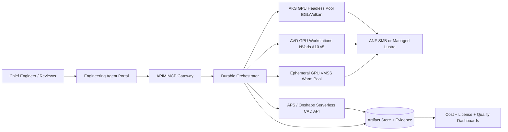
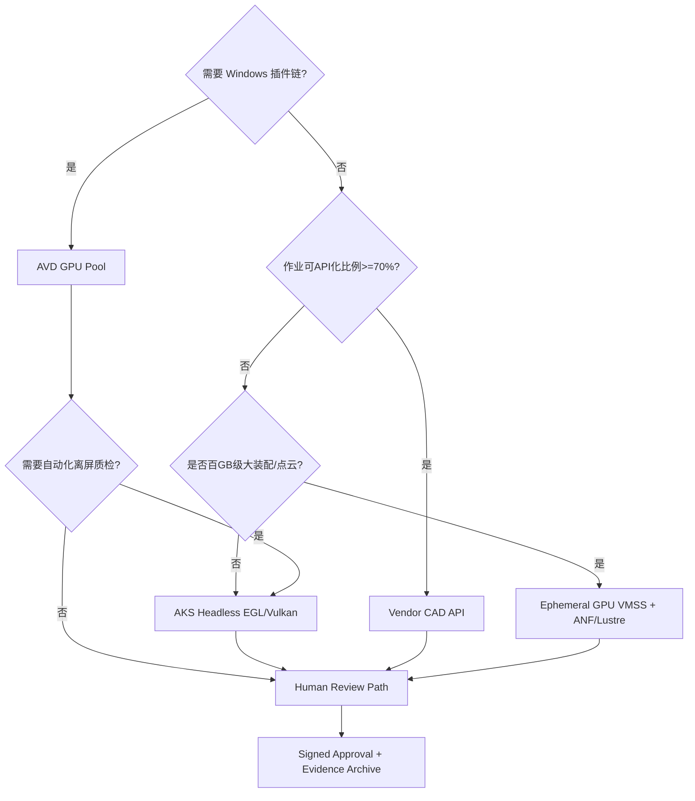

# 3D/CAD/BIM 工程工作站智能体选型 FAQ：AKS EGL/Vulkan 无头池 vs AVD NVads v5 实时接管 vs 厂商云 API vs 瞬态 GPU VMSS
> 🌐 **Language / 语言切换**: **[🇨🇳 中文版 (gpu-3d-cad-bim-workstation-agent-aks-egl-vulkan-headless-vs-avd-nvads-v5-webrtc-selection-faq.md)](gpu-3d-cad-bim-workstation-agent-aks-egl-vulkan-headless-vs-avd-nvads-v5-webrtc-selection-faq.md)** | **[🇬🇧 English (gpu-3d-cad-bim-workstation-agent-aks-egl-vulkan-headless-vs-avd-nvads-v5-webrtc-selection-faq.en.md)](gpu-3d-cad-bim-workstation-agent-aks-egl-vulkan-headless-vs-avd-nvads-v5-webrtc-selection-faq.en.md)** | **[📚 返回目录](README.md)**
> 证据标签：`measured` / `synthetic` / `anonymized_reported`
> 适用行业：汽车研发、高端装备制造、AEC/BIM、工业数字孪生、工程审图与协同评审

## 1) Executive Summary：先把四条路线分层，不要用单一路径硬吃全部工作负载
企业把 3D/CAD/BIM 设计智能体推向生产后，
通常会同时面对四类任务。
第一类是参数化批量生成与几何规则检查。
第二类是离屏多视角渲染并喂给 VLM 做碰撞与可制造性审查。
第三类是需要保留历史商业插件链路的重型桌面交互。
第四类是超大装配体与点云的“算存协同”瞬态高峰。
这四类任务的约束互相冲突。
因此，
最佳实践不是“单平台全包”，
而是“按工作负载拆分承载平面”。
本指南对比四条可落地路径：
1. AKS GPU Linux 无头离屏渲染容器池；
2. AVD GPU 工作站池 + WebRTC/RDP 低延迟接管；
3. 厂商云端无服务器 CAD API；
4. 专属瞬态 GPU VMSS + 高速工程文件缓存。
结论先行：
- 大规模自动化几何检查首选 AKS 无头池；
- 依赖 Windows COM/.NET 插件链的交互审图首选 AVD；
- 批处理转换与参数重生成优先走厂商云 API；
- 超大模型文件与点云流优先“瞬态算力 + 高速缓存”。
官方/可验证来源（抓取日期：2026-11-21）：
1. Azure Virtual Desktop 架构与性能文档（`measured`）  
   https://learn.microsoft.com/azure/virtual-desktop/
2. Azure NVads A10 v5 虚机规格（`measured`）  
   https://learn.microsoft.com/azure/virtual-machines/sizes/gpu-accelerated/nvadsa10v5-series
3. AKS GPU 节点池与调度（`measured`）  
   https://learn.microsoft.com/azure/aks/gpu-cluster
4. Azure NetApp Files（`measured`）  
   https://learn.microsoft.com/azure/azure-netapp-files/
5. Azure Managed Lustre（`measured`）  
   https://learn.microsoft.com/azure/azure-managed-lustre/
6. Autodesk Platform Services Design Automation（`measured`）  
   https://aps.autodesk.com/
7. Onshape API/FeatureScript 文档（`measured`）  
   https://onshape-public.github.io/docs/
8. 企业匿名运行样本（`anonymized_reported`）
9. 统一负载回放压测（`synthetic`）

## 2) 典型企业场景与约束边界：先问“交互刚性”再问“成本最低”
场景 A：汽车白车身与底盘总装协同。
特点是模型大、依赖链深、几何干涉检查频繁。
场景 B：装备制造工艺规划与夹具校核。
特点是版本分叉多、批处理多、审核窗口短。
场景 C：AEC/BIM 多专业会签。
特点是 IFC/RVT/DWG 多格式并存，
并且总工需要随时接管视口。
三类场景共同边界：
1. 需要把 Agent 自动输出与人类审批并联；
2. 需要审计证据链可回放；
3. 需要把许可证成本纳入 FinOps；
4. 需要避免文件跨网复制风暴。
架构判断顺序建议：
先判断是否需要原生桌面交互插件；
再判断是否可接受 API 化建模语义收敛；
再判断是否存在百 GB 级资产热集；
最后才是单次作业成本最小化。
很多项目失败点在于把“最低单作业成本”
误当成“最低全链路成本”。

## 3) 端到端分层参考架构：四平面协同而非互斥替代
建议采用“控制平面 + 计算平面 + 交互平面 + 文件平面”四平面设计。
控制平面：
由 APIM/MCP 网关统一接入任务。
计算平面：
AKS 无头池、厂商 API、瞬态 VMSS 并行承载。
交互平面：
AVD GPU 会话用于总工接管与复核。
文件平面：
ANF SMB 或 Managed Lustre 作为热数据中枢。
统一原则：
- 参数化与批处理先自动；
- 关键改动必须可人工接管；
- 审批后结果写回主线模型库；
- 全链路记录 JobID / SessionID / LicenseID。
### Mermaid #1：四平面生产拓扑


## 4) 方案 A 深潜：AKS GPU Linux 无头离屏渲染池（EGL/Vulkan）
方案 A 的核心价值是“高密度自动化”。
在 NVadsA10 v5 节点上，
可按任务类型做 `4–8` 会话并发分片。
每个作业只输出截图、几何摘要、规则结果，
不强依赖 Windows 桌面会话。
典型工具链：
- Blender `bpy`；
- FreeCAD Python；
- OpenUSD 资产组织；
- IfcOpenShell BIM 解析；
- 自定义 VLM 质检提示词模板。
关键收益：
1. 单卡并发高，适合批量几何审查；
2. 无需 Windows 桌面授权税；
3. 可与 KEDA 队列弹性联动；
4. 渲染结果天然可审计留痕。
关键风险：
1. 对依赖 COM 插件的商业软件兼容差；
2. 某些复杂着色管线需额外验证；
3. 工具链版本漂移会带来结果差异。
治理要点：
- 镜像固定与 SBOM 签名；
- 任务输入模板化，避免 prompt 污染几何脚本；
- 渲染输出哈希与回放脚本绑定。

## 5) 方案 B 深潜：AVD GPU 工作站池（NVads A10 v5 + 实时接管）
方案 B 的核心价值是“兼容历史资产”。
当企业流程强依赖 Revit、CATIA、SolidWorks、AutoCAD 插件生态时，
AVD 是迁移阻力最小的承载。
关键能力：
- Windows 11 会话环境；
- DirectX 图形栈；
- RDP Shortpath UDP 或 NICE DCV / Parsec；
- 人类工程师低延迟接管。
实践上要把 AVD 分成两层池：
1. Agent 自动会话池；
2. 人类接管优先池。
否则会出现“自动任务挤占人工审图窗口”。
许可证治理是方案 B 成败点。
建议将 FlexNet/RLM 许可服务放入私网，
并在会话空闲 `>180s` 触发自动归还。
对每个 Job 记录：
`license_checkout_ts`,
`license_release_ts`,
`idle_timeout_reason`。
可直接压缩“僵死会话占坑”。
在高价值许可证单席 `5k–12k USD/年` 场景，
归还门禁可显著改善并发供给。

## 6) 方案 C 深潜：厂商云端无服务器 CAD API（APS/Onshape）
方案 C 的核心价值是“零 GPU 运维”。
适合标准化参数重生成、
批量格式转换、
规则性几何任务。
优势：
1. 省掉自建 GPU 平台运维；
2. 作业计费可按量对齐业务波峰；
3. 版本 API 边界清晰，易于治理。
边界：
1. 交互式实时三维视口能力有限；
2. 私有插件或本地宏可能无法等价迁移；
3. 对跨租户数据主权要求高的行业需额外评估。
建议采用“API 优先 + 桌面兜底”的混合路线。
把可 API 化流程优先迁出，
把不可替代的交互链路保留在 AVD。
这样可以先拿到自动化收益，
再逐步降低桌面会话占比。

## 7) 方案 D 深潜：瞬态 GPU VMSS + 高速工程文件缓存
方案 D 解决的是“巨型资产冷启动”。
当单项目装配体/点云规模达到 `50GB–200GB`，
跨网拉取会严重拉长首帧时间。
此时应做“算力与文件热缓存协同”：
1. VMSS 黄金镜像休眠池；
2. ANF SMB 或 Managed Lustre 热挂载；
3. 本地 NVMe 二级缓存；
4. 任务结束后按 TTL 回收。
目标不是让每个会话都常驻，
而是在高峰到来时实现 `<15s` 唤醒挂载。
典型收益：
- 避免重复拷贝造成网络突刺；
- 降低大文件首次打开等待；
- 提升总工临时介入响应速度。
典型风险：
- 缓存失效策略不当会放大成本；
- 元数据一致性处理不当会引发误审图。
建议采用“目录热度 + 项目阶段”双信号预热，
避免盲目全量预热。

## 8) 12 维企业级选型对比矩阵（四路并行评估）
| 维度 | AKS 无头离屏池 | AVD GPU 工作站 | 厂商云 CAD API | 瞬态 GPU VMSS + 高速缓存 |
|---|---|---|---|---|
| 交互视口实时性 | 中 | 高 | 低到中 | 中到高 |
| Windows 插件兼容性 | 低 | 高 | 低 | 中 |
| 批处理吞吐 | 高 | 中 | 高 | 高 |
| 自动化脚本可控性 | 高 | 中 | 中 | 高 |
| 首次启动时延 | 中 | 中 | 低 | 中（预热后低） |
| 超大文件加载能力 | 中 | 中 | 低到中 | 高 |
| 许可证依赖强度 | 低 | 高 | 低 | 中 |
| 运维复杂度 | 中到高 | 中 | 低 | 高 |
| 成本可预测性 | 中 | 中 | 中到高 | 中 |
| 审计可追溯性 | 高 | 高 | 中 | 高 |
| 人类接管体验 | 中 | 高 | 低 | 中 |
| 多租户隔离灵活度 | 高 | 中 | 中 | 高 |
矩阵解读：
不是选“最高分”，
而是按任务类型做权重重排。
若交互实时性和插件兼容权重最高，
AVD 往往成为主路径。
若自动化吞吐与离屏质检权重最高，
AKS 无头池通常是主路径。

## 9) 分场景选型决策树（含人类接管路径）
先问业务是否要求原生桌面插件。
如果是，
优先 AVD。
若还要批量渲染，
并行挂接 AKS 无头池。
若无需桌面交互，
继续判断是否存在可 API 化作业语义。
可 API 化程度高则优先厂商云 API。
否则进入 AKS 或 VMSS 分支。
若资产体量超大且冷加载瓶颈明显，
引入瞬态 VMSS + 高速缓存。
### Mermaid #2：选型决策与状态流


## 10) 深度 FAQ（1/8）：如何定义“60fps 接管”与 `<35ms` 交互预算？
问题本质不是“帧率越高越好”，
而是“操作闭环是否稳定”。
建议将接管体验拆成四段：
输入采集、
编码传输、
远端渲染、
回传显示。
预算模型：
```text
total_interaction_ms = input + transport + render + decode
target: p95 < 35ms for critical review sessions
```
经验值（`anonymized_reported`）：
- 专网近域可接近 `22–32ms`；
- 跨区路径常上升到 `45–70ms`；
- 需就近部署接管池和许可服务。
因此，
“能跑 60fps”不代表“可生产接管”。
必须看 p95/p99 交互闭环。

### FAQ #2：离屏多视角 VLM 质检怎样保证几何一致性？
关键做法是固定视角组与渲染参数。
每次作业输出标准视角：
俯视、正视、侧视、等轴、剖切。
同时保留相机矩阵与材质配置指纹。
这样，
VLM 判定结果才具备可复验性。
指标建议：
- 截图完成 p95 `<800ms`；
- 同模型重复渲染差异率 `<1%`；
- 误报碰撞率按模型复杂度分层统计。

## 11) 深度 FAQ（3/8）：商业 CAD 浮动许可如何做并发配比与回收门禁？
常见误区是只看“购买席位数”。
生产上应看“峰值并发需求曲线”。
可用简化模型：
```text
required_licenses =
  (peak_human_sessions + peak_agent_windows_sessions) * safety_factor
```
若 `peak_human=120`,
`peak_agent=40`,
`safety_factor=1.15`，
则建议池约 `184` 席。
再配合空闲 `>180s` 自动归还，
通常可降低僵尸占用。
对高价许可，
应额外设置“审批后借出”策略：
高风险操作才占用高阶许可层级。
避免普通任务长期占用昂贵席位。

### FAQ #4：如何防止 Agent 会话崩溃导致许可证死锁？
需要“双保险”。
第一层是会话心跳超时回收。
第二层是 License 守护进程巡检补偿回收。
每 60 秒巡检一次：
若会话不存在但许可证仍占用，
自动触发释放并记录事件。
审计字段建议：
`reclaim_reason`,
`reclaim_actor`,
`job_id`,
`license_server_response`。
这样可以在财务核算与故障复盘时追责到位。

## 12) 深度 FAQ（5/8）：AKS 无头池与 AVD 如何协同，而不是互相替代？
最有效模式是“双轨工作流”。
轨道 1：
AKS 负责批量参数任务、离屏渲染、预检查。
轨道 2：
AVD 负责人类总工复核和最终签发。
切换条件可由规则触发：
- 几何碰撞置信度低；
- 成本超预算；
- 规则冲突；
- 关键规范未满足。
这样可以把“需要人工时间”的样本压到最少，
同时保留工程责任链。

### FAQ #6：什么时候优先厂商云 API，而不是自建 GPU？
当任务结构偏批处理，
并且交互依赖弱时，
厂商 API 的 ROI 通常更高。
典型阈值：
- API 可覆盖流程占比 `>=70%`；
- 人工接管比例 `<15%`；
- 插件依赖可替代率 `>=80%`。
若未达到这些阈值，
直接 API 化往往会遇到“最后一公里断层”。

## 13) 深度 FAQ（7/8）：`50–200GB` 文件如何避免跨网复制风暴？
核心不是“带宽够不够”，
而是“是否重复复制同一热资产”。
建议策略：
1. 项目阶段前置预热；
2. 热目录本地 NVMe 缓存；
3. 冷目录按需拉取；
4. 任务后按温度衰减回收。
衡量指标：
- 首次可操作时间（TTI）；
- 缓存命中率；
- 网络峰值突刺；
- 预热浪费率。
当缓存命中率持续低于 `35%`，
说明预热策略过宽，
需要收敛。

### FAQ #8：如何把质量、成本、时延放到同一张治理看板？
建议建立三类统一 KPI：
质量：
碰撞漏检率、误检率、人工驳回率。
性能：
离屏渲染 p95、接管闭环 p95、作业完成时间。
成本：
每作业 GPU 成本、每有效审图成本、许可证利用率。
这三类指标必须同一 JobID 贯通。
否则很难解释“为什么便宜了但返工上升”。

## 14) TCO 与许可证并发配比测算（含四路方案）
假设（`synthetic`）：
- 月作业数：`180,000`；
- 其中交互审图占比：`22%`；
- 平均模型资产：`38GB`；
- 峰值日并发：`1,200` 作业。
补充一个常被忽略的架构师测算维度：
“返工链成本”。
即便单位作业计算成本更低，
如果因为视口接管延迟、插件不兼容或证据链不完整导致返工，
项目总成本仍会抬升。
因此建议在财务模型中加入
`rework_cost = rework_rate * avg_rework_hours * blended_engineering_rate`，
并将其与 GPU 与许可证账单并列展示，
避免在评审会上只看云账单却忽略工程产能损耗。
| 成本项（月） | AKS 无头池 | AVD GPU 池 | 厂商云 API | 瞬态 VMSS + 高速缓存 |
|---|---:|---:|---:|---:|
| GPU/计算 | 132,000 USD | 168,000 USD | 94,000 USD | 149,000 USD |
| 存储与缓存 | 36,000 USD | 29,000 USD | 18,000 USD | 51,000 USD |
| 网络与传输 | 21,000 USD | 25,000 USD | 17,000 USD | 28,000 USD |
| 许可证与桌面生态 | 24,000 USD | 112,000 USD | 9,000 USD | 46,000 USD |
| 运维与值班折算 | 41,000 USD | 34,000 USD | 19,000 USD | 47,000 USD |
| **总计** | **254,000 USD** | **368,000 USD** | **157,000 USD** | **321,000 USD** |
许可证并发示例（`anonymized_reported`）：
- 目标：将许可证利用率从 `42%` 提升到 `68%`；
- 做法：空闲回收 + 任务分层借出；
- 结果：在不加购席位前提下支持更多高峰作业。
这类收益不能只在 IT 成本看，
还应体现在工程交付周期缩短。

## 15) Day-0/Day-2 上线清单 + Good fit / Not for
Day-0（上线前）：
- [ ] 1. 识别必须 Windows 插件的任务清单。
- [ ] 2. 定义 AKS/AVD/API/VMSS 四轨路由规则。
- [ ] 3. 建立 License 借还与空闲归还策略。
- [ ] 4. 完成渲染输出证据链哈希设计。
- [ ] 5. 为超大文件建立热度预热策略。
- [ ] 6. 设定接管闭环时延 SLO。
Day-2（运行期）：
- [ ] 7. 每周复盘插件失败与回退原因。
- [ ] 8. 监控许可证僵死回收事件趋势。
- [ ] 9. 追踪缓存命中率与预热浪费率。
- [ ] 10. 对比自动审图误检与人工返工成本。
- [ ] 11. 维护镜像与工具链版本锁定。
- [ ] 12. 对关键项目做全链路演练回放。
Good fit：
- 需要同时支持自动化审图与人类低延迟接管；
- 任务负载包含批处理、离屏渲染、桌面交互并存；
- 对许可证成本、审计追踪、交付周期有统一治理目标。
Not for：
- 仅有轻量 2D 文档审阅且无 3D 交互；
- 没有插件历史包袱且全部流程可 API 化；
- 无法投入最小平台工程能力维护混合路线。
实施建议：
先用 6 周试点做“任务分层基线”。
再按任务权重扩展到全业务线。
不要在第一阶段就追求“一次性替代全部旧系统”。

