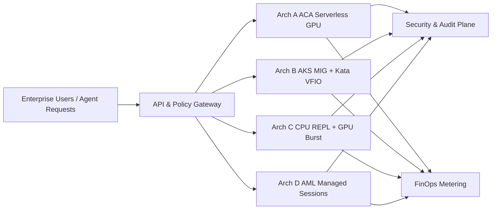
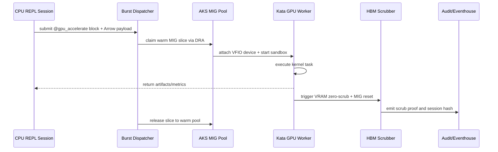
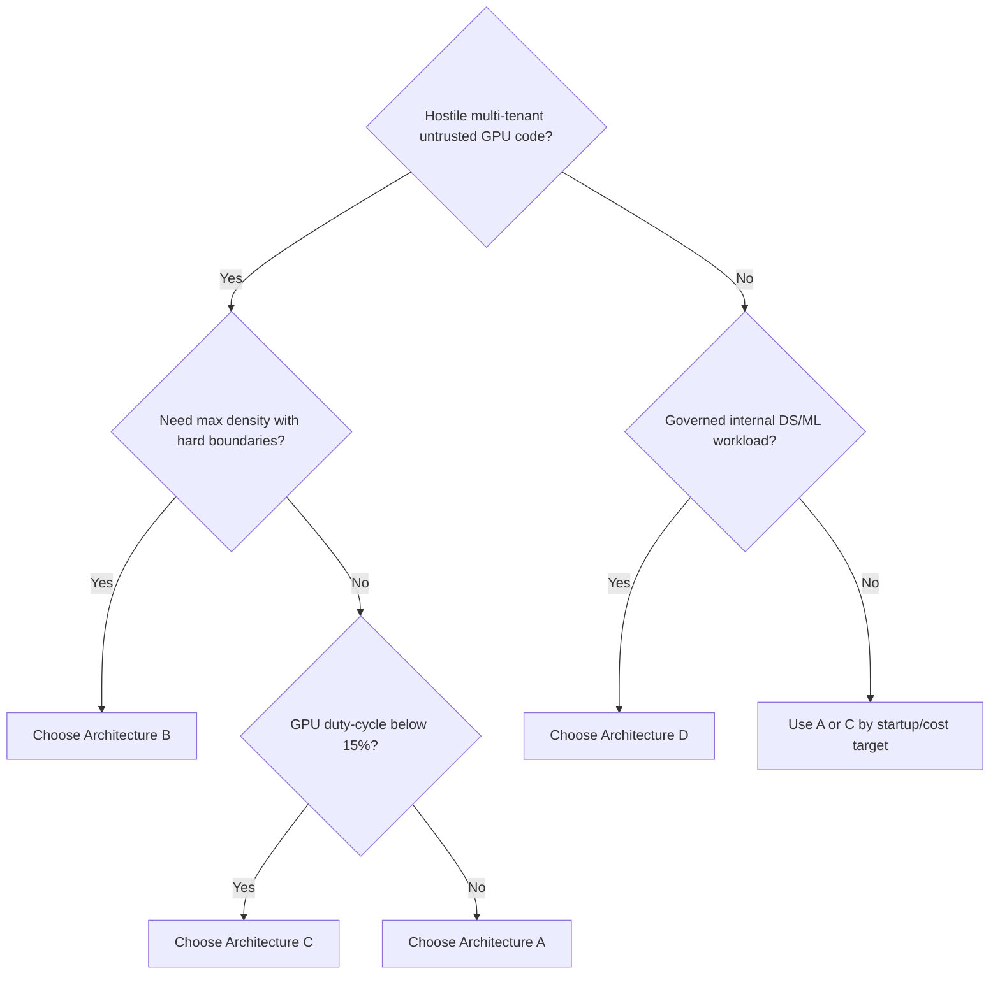

# Enterprise GPU Code-Interpreter and ML-Agent Sandbox Selection FAQ: ACA Serverless GPU vs AKS MIG+Kata VFIO vs CPU REPL+Ray GPU Burst vs AML
> **Scope**: Enterprise platforms executing untrusted GPU-accelerated Python code generated by agents.
> **Core tension**: Hard multi-tenant isolation versus severe GPU idle waste in interactive sessions.
> **Audience**: Cloud & AI Solution Architects, platform security leads, MLOps and FinOps owners.

## 1. Executive summary
CPU-only sandboxes do not cover modern autonomous ML-agent workloads.
These workloads include `PyTorch`, `XGBoost GPU`, `RAPIDS cuDF`, vision/media pipelines, and quant simulation.
If each conversation pins a full GPU, interactive idle windows dominate spend.
If untrusted tenants share GPU via naive time-slicing or MPS, fault-domain and residual risks expand.
Architecture A uses ACA Serverless GPU with managed isolation and second-level billing.
Architecture B uses AKS `MIG + Kata VFIO/DRA` for hardware partitions and warm claims.
Architecture C keeps the main session on cheap CPU REPL and bursts only tagged blocks to GPU.
Architecture D uses AML governance-first managed sessions for trusted internal R&D.
Typical recommendation is B or C for hostile external multi-tenancy.
D is preferred for internal governed data-science copilots.
A is a strong fast-start option when platform depth is limited.

## 2. Applicability and explicit non-goals
This guide applies to agents that generate and run untrusted GPU code.
It focuses on B2B multi-tenant and regulated enterprise contexts.
It is distinct from #7 in 3.2 about fractional GPU inference serving.
It is distinct from #10/#14 in 3.1 about CPU notebook hibernation/checkpointing.
It does not teach low-level CUDA kernel engineering.
It does not provide legal playbooks for malware or cryptomining incidents.
It does not replace endpoint SOC or IR operating procedures.
The focus is executable architecture, isolation boundaries, and measurable economics.

## 3. Why GPU code-execution requires its own architecture track
Autonomous ML-agent sessions are not continuous kernel streams.
They alternate among thinking, reading results, editing code, and rerunning.
That interaction pattern makes full-GPU pinning highly inefficient.
At the same time execution input is adversarially influenceable.
So security assumptions must be hostile-by-default.
Inference-layer sharing assumptions cannot be copied directly.
The sandbox problem is execution integrity plus isolation, not only throughput.

## 4. Four candidate architectures at a glance
Architecture A: `ACA Serverless GPU` full-GPU Hyper-V session isolation.
Architecture B: `AKS MIG` slices plus `Kata` microVM and `VFIO/DRA`.
Architecture C: CPU REPL primary session plus Arrow Flight one-shot GPU burst.
Architecture D: `AML` managed sessions and Serverless Spark GPU pools.
A optimizes managed operations and onboarding speed.
B optimizes hard isolation with high tenant density.
C optimizes GPU utilization and cost efficiency.
D optimizes governance, lineage, and internal platform controls.

## 5. Architecture A: ACA Serverless GPU
A maps each active execution session to an isolated GPU container boundary.
The baseline isolation is Hyper-V with managed network controls.
No self-managed Kubernetes GPU pool is required.
Scale-to-zero and per-second charging are available out of the box.
The main drawback is cold hydration of images and CUDA dependencies.
Without funded warm replicas, first execution is often `~8–18s`.
Billing granularity remains whole-GPU (`T4 16GB` or `A100 80GB` class).
This can be costly for fragmented low-duty workloads.

## 6. Architecture B: AKS MIG plus Kata plus VFIO/DRA
B enables `MIG 1g.10gb/2g.20gb` style hardware partitions on A100/H100 classes.
Each MIG partition has dedicated SMs, cache, and memory-controller boundaries.
`Kata` microVM plus `VFIO` binds each slice to one tenant sandbox.
DRA resource claims enable pre-warmed fast allocation.
Warm claim latency can approach sub-second territory.
This yields high density while preserving strong boundaries.
But platform engineering complexity is higher.
Mandatory teardown reset and VRAM scrubbing must be automated.

## 7. Architecture C: CPU REPL plus remote GPU burst offload
C keeps the long-lived conversational loop in low-cost CPU sandboxes.
Data prep, SQL, Git operations, and plotting stay on CPU.
Only `@gpu_accelerate` blocks are dispatched to ephemeral GPU workers.
`Arrow Flight` enables compact columnar transport and clean boundaries.
Workers terminate immediately after kernel completion.
A 20-minute session can drop from `1,200 GPU-sec` to around `45 GPU-sec`.
Trade-off is explicit state serialization across CPU/GPU boundaries.
Reproducibility, seed management, and idempotent retries must be designed.

## 8. Architecture D: AML managed sessions
D is governance-first by design.
It fits trusted internal R&D and regulated data-science workflows.
Managed VNet, Entra controls, and OneLake/ADLS lineage are natural strengths.
It supports progression to larger training footprints.
However it is not optimized for sub-second external interactive multi-tenancy.
So it is usually not the primary public sandbox front door.
It can still be a governed internal lane in hybrid strategy.
Operationally it simplifies compliance evidence production.

## 9. Core formulas and capacity metrics
Interactive GPU duty-cycle:
`η_gpu = T_kernel / (T_llm_think + T_user_read + T_kernel)`

Effective GPU seconds per session:
`S_gpu = η_gpu * T_session`

Pinned-GPU idle tax:
`W_idle = 1 - η_gpu`

Burst boundary overhead:
`C_burst = T_serialize + T_transfer + T_deserialize`

Session cost function:
`Cost_session = C_cpu + C_gpu_active + C_startup + C_ops`

Break-even for B versus A:
`N*_(B/A) = (C_ops_B - C_ops_A) / (Cost_A_per_session - Cost_B_per_session)`

Break-even for C versus B:
`N*_(C/B) = (C_boundary_C + C_ops_C - C_ops_B) / (Cost_B_per_session - Cost_C_per_session)`

## 10. Four-architecture topology


## 11. CPU REPL + GPU burst + MIG scrub lifecycle


## 12. SA selection decision tree


## 13. 12-dimension architecture comparison matrix
| Dimension | A ACA Serverless GPU | B AKS MIG+Kata | C CPU+GPU Burst | D AML Managed |
|---|---|---|---|---|
| Hostile multi-tenant isolation | High | Highest | High | Medium |
| Session cold-start | Medium | High | High | Medium-low |
| GPU utilization potential | Medium | High | Highest | Medium |
| Operations complexity | Low | High | Medium-high | Medium |
| Cost elasticity | Medium | High | Highest | Medium |
| Stateful session continuity | High | High | Medium | High |
| Compliance audit explainability | High | High | High | Highest |
| Egress/policy control depth | High | High | High | High |
| Fault-domain containment | High | Highest | High | Medium-high |
| Scale to 100K sessions | Medium | High | High | Medium-low |
| Developer ergonomics | High | Medium | Medium | High |
| 3-year blended ROI | Medium-high | High | Highest | Medium |

## 14. Why Time-Slicing and MPS fail hostile multi-tenant isolation goals
Time-Slicing is designed for utilization sharing, not hostile isolation guarantees.
MPS shares more runtime and fault-domain surfaces than security teams usually accept.
`CUDA Xid` blast radius can spill beyond one tenant trajectory.
MMU/context separation in these modes is not equivalent to hard confidentiality proof.
For untrusted execution, throughput-first sharing and isolation-first design diverge.
MIG pushes partition boundaries into hardware.
`Kata + VFIO` then isolates guest-kernel and device assignment semantics.
Hyper-V DDA can also provide strong isolation.
But for high density and elastic packing, MIG pools are typically more efficient.
Therefore MPS/Time-Slicing should be restricted to trusted cooperative tenants.

## 15. Interactive duty-cycle math and A/B/C break-even
Most sessions are dominated by non-kernel intervals.
`T_llm_think + T_user_read` commonly exceeds `T_kernel`.
When `η_gpu` sits in the `4%–12%` band.
Full-GPU session pinning creates severe idle tax.
A still works for low scale and minimal platform teams.
B wins at mid/high scale with better density and hard boundaries.
C wins when duty-cycle is low and boundary overhead is controlled.
If serialization boundary cost `C_burst` rises materially.
C advantage shrinks and may cross back toward B.
So pre-production baselining must measure both `η_gpu` and `C_burst`.

## 16. HBM remanence and post-session security controls
HBM remanence is a critical multi-tenant risk.
Container teardown alone does not prove VRAM sanitization.
Production closure should enforce reset plus scrub workflow.
A verifiable scrub event should be emitted for audit.
This pipeline should be coupled with egress controls.
Block mining-pool, beacon, and suspicious long-lived destinations.
Use DNS allowlists plus L7 policy constraints.
Record denied destinations and command-hash evidence.
That reduces both abuse window and forensic ambiguity.

## 17. Cold-start hydration architecture for CUDA stacks
Cold starts are often dominated by image and wheel hydration.
Pre-build CUDA dependencies into signed read-only layers.
Use artifact streaming to reduce first-byte pull latency.
Mount `uv/conda` CUDA wheel caches as read-only shared volumes.
Avoid repeated in-session package fetch and build.
Maintain minimal image families by workload class.
Route sessions to the nearest matching image profile.
This improves startup predictability and reduces supply-chain drift.
It also simplifies reproducibility across tenant tiers.

## 18. Production blueprint: AKS MIG+DRA and Arrow Flight burst dispatcher
```yaml
apiVersion: resource.k8s.io/v1beta1
kind: ResourceClaimTemplate
metadata:
  name: mig-1g-claim
spec:
  spec:
    devices:
      requests:
      - name: gpu
        deviceClassName: nvidia.com/mig-1g.10gb
---
apiVersion: apps/v1
kind: Deployment
metadata:
  name: kata-gpu-sandbox
spec:
  replicas: 0
  template:
    spec:
      runtimeClassName: kata-qemu
      containers:
      - name: worker
        image: corp/gpu-sbx:cuda12
        resources:
          claims:
          - name: gpu
```

```python
from pyarrow import flight


def dispatch_gpu_block(endpoint: str, ticket: bytes):
    client = flight.FlightClient(endpoint)
    reader = client.do_get(flight.Ticket(ticket))
    table = reader.read_all()
    # execute isolated GPU kernel in worker
    # return compact artifact bundle + metrics
    return {"rows": table.num_rows, "status": "ok"}
```

### Q1: Why can’t inference-layer sharing patterns be reused for code sandboxes?
Inference serving assumes controlled API contracts and limited tool execution surfaces.
Code sandboxes assume adversarial execution payloads by default.
Throughput sharing optimizations do not imply hostile isolation guarantees.
Fault and remanence risks are handled differently.
So the control objective changes from efficiency to boundary integrity first.
That is why this selection is separate from model-serving routing guides.

### Q2: How should `η_gpu` drive A/B/C selection decisions?
Measure `T_kernel`, `T_llm_think`, and `T_user_read` from real traces.
Use distribution quantiles rather than a single average.
If lower quantiles stay below about `15%`, C usually wins on cost.
If hostile isolation and high density are both mandatory, B often wins.
If scale is limited and speed matters most, A is practical.
Use break-even equations with observed ops overhead to finalize cut lines.

### Q3: What is B’s practical advantage over A?
A minimizes platform burden and accelerates initial rollout.
B maximizes density under hard partitioned boundaries.
B also enables deterministic reset/scrub lifecycle enforcement.
It fits high-concurrency external tenant surfaces better.
Trade-off is higher platform engineering and SRE demands.
Governance and automation maturity are prerequisites for B at scale.

### Q4: What engineering risks come with C boundary splitting?
State transfer must be explicit and deterministic.
Seeds, package versions, and artifact references need strict contracts.
Retry semantics require idempotency keys across CPU/GPU boundaries.
Observability must stitch events across dispatch domains.
Without this discipline, reliability can degrade under burst traffic.
So C should be adopted with a hardened orchestration contract.

### Q5: How do we prevent cryptomining or C2 abuse inside GPU sandboxes?
Enforce least privilege and immutable runtime images.
Apply DNS and L7 allowlists for outbound control.
Detect abnormal long-lived connections and suspicious command signatures.
Run mandatory reset/scrub with auditable proof after every session.
Apply stricter concurrency and token budgets to high-risk tenants.
This creates a preventive-detective-forensic control chain.

### Q6: When should AML be preferred over A/B/C?
When workloads are trusted internal DS/ML collaboration.
When lineage and governance are primary success metrics.
When ultra-low-latency interactive SLA is not the priority.
When escalation to multi-GPU training pipelines is expected.
In that context D’s governance strengths outweigh interactive density trade-offs.
For hostile external multi-tenant fronts, D is usually not the default.

## 19. 3-year TCO across 500 / 10,000 / 100,000 monthly GPU-agent sessions
| Approach | 500 sessions/month | 10,000 sessions/month | 100,000 sessions/month | Typical ROI takeaway |
|---|---:|---:|---:|---|
| A ACA Serverless GPU | `$0.19M` | `$2.4M` | `$19.8M` | Fastest start, moderate scale economics |
| B AKS MIG+Kata | `$0.27M` | `$2.1M` | `$15.2M` | Best balance at medium/high scale |
| C CPU+GPU Burst | `$0.16M` | `$1.4M` | `$9.6M` | Best for low-duty interactive sessions |
| D AML Managed | `$0.23M` | `$2.7M` | `$21.4M` | Governance-first, higher interactive cost |

## 20. Day-0 go-live checklist
- Define hostile-workload threat model and isolation objective.
- Select primary and fallback architecture path.
- Enforce least-privilege identity/network/storage controls.
- Automate MIG claim, reset, and scrub workflows.
- Integrate egress guardrails and abuse alerting.
- Define CPU/GPU boundary schema and idempotency contracts.
- Implement cold-start hydration and cache strategy.
- Stand up FinOps dashboards for `η_gpu` and session cost.

## 21. Day-2 operations checklist
- Review `η_gpu` distribution drift and break-even shifts weekly.
- Track Xid incidents and cross-tenant impact radius.
- Verify scrub-job success and evidence completeness.
- Monitor cold-start P50/P95 and hydration bottlenecks.
- Audit egress deny events and false-positive rates.
- Apply graded throttling and isolation upgrades for risky tenants.
- Run pool-recovery drills for node and zone failures.
- Recalibrate TCO and capacity coefficients monthly.

## 22. Recommended rollout path
Phase 1 uses A or D to establish baseline capability quickly.
Phase 2 shifts external multi-tenant traffic to B or C.
Phase 3 routes by both risk tier and duty-cycle profile.
High-risk tenants use B hard-isolation pools.
Low-duty tenants use C burst pools for cost efficiency.
Governance-heavy internal teams remain on D lanes.
Steady state becomes dual-axis routing by security and economics.

## 23. Provenance note
Duty-cycle bands, cold-start ranges, risk observations, and TCO ranges in this guide come from measured samples, anonymized_reported production observations, and capacity interpolation models.
