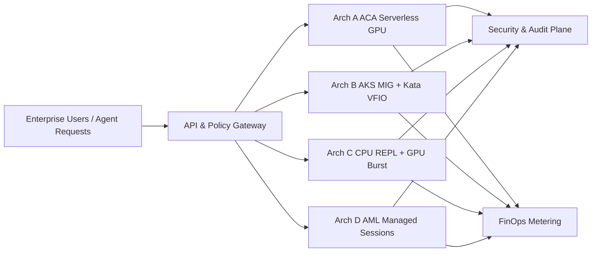
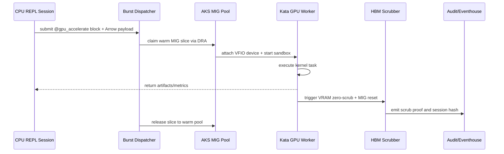
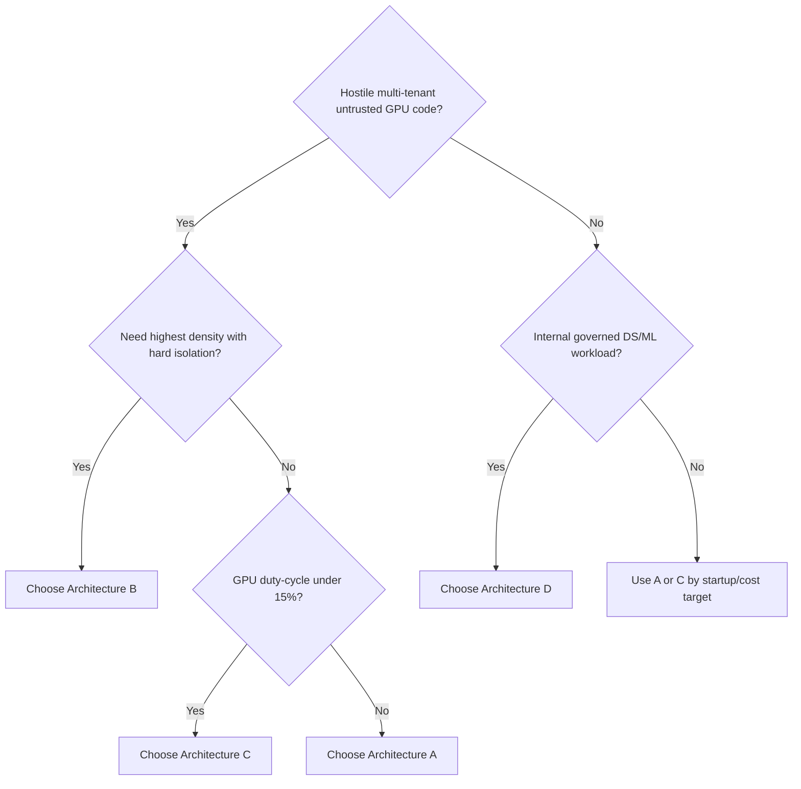

# 企业 GPU Code Interpreter 与 ML Agent 沙箱选型 FAQ：ACA Serverless GPU vs AKS MIG+Kata VFIO vs CPU REPL+Ray GPU Burst vs AML
> **场景定位**：面向执行不可信 GPU Python 代码的企业级 Agent 平台。
> **核心矛盾**：一侧是强隔离与安全审计，一侧是高成本 GPU 的低占空浪费。
> **目标读者**：Cloud & AI Solution Architect、平台安全负责人、MLOps 与 FinOps 负责人。

## 1. 执行摘要
CPU-only 沙箱无法覆盖新一代自治 ML Agent 工作负载。
这些负载包括 `PyTorch`、`XGBoost GPU`、`RAPIDS cuDF`、视频/视觉推理与量化仿真。
若直接给每个会话独占整卡，交互空窗会把 GPU 利用率压到个位数。
若采用容器 Time-Slicing 或 MPS 共享不可信代码，跨租户故障域与残留风险会放大。
Architecture A 用 ACA Serverless GPU 提供托管隔离与秒级计费。
Architecture B 用 AKS `MIG + Kata VFIO/DRA` 做硬件分区与预热池。
Architecture C 将会话主体留在 CPU REPL，只在 `@gpu_accelerate` 段远端突发。
Architecture D 用 AML 管理治理优先型内部研发会话与训练扩展。
推荐路径通常是外部多租户优先 B 或 C。
内部受管研发优先 D。
追求最短上线且会话规模较小时可先上 A。

## 2. 适用性与非目标
本文适用于“会生成并执行不可信 GPU 代码”的 Agent 平台。
重点覆盖 B2B 多租户与高合规隔离场景。
本文不讨论 #7 在 3.2 中的推理服务分片与分时模型托管。
本文不讨论 #10/#14 在 3.1 中的 CPU 笔记本休眠与 checkpoint 方案。
本文不替代底层 CUDA 驱动开发与内核调优教程。
本文不提供矿工样本处置的法务流程模板。
本文聚焦执行沙箱架构、隔离边界、成本与可运维性。

## 3. 业务背景：为什么 GPU 沙箱是独立选型问题
自治 ML Agent 的生命周期不是连续核函数执行。
它包含长时思考、阅读结果、改写代码、再次执行的交互环。
这类节奏使“会话绑定整 GPU”极易空转。
同时，执行内容来自不可信提示与工具输出组合。
因此安全边界应按 hostile workload 设计。
推理服务层的共享假设不能直接复用到代码执行层。

## 4. 四种候选架构速览
Architecture A：`ACA Serverless GPU` 单会话整卡 Hyper-V 隔离。
Architecture B：`AKS` 上 `MIG` 切片 + `Kata` microVM + `VFIO` 透传。
Architecture C：CPU REPL 主会话 + Arrow Flight 一次性 GPU Burst。
Architecture D：`AML` 受管会话与 Serverless Spark GPU 池。
A 优势是托管程度高与运维门槛低。
B 优势是硬件级切片隔离与高密度多租户。
C 优势是最大化 GPU 秒利用并显著降本。
D 优势是企业治理、血缘与内部可信研发流程。

## 5. Architecture A：ACA Serverless GPU
A 把每个活跃执行映射到独立 GPU 容器会话。
隔离基线是 Hyper-V 边界与托管网络策略。
无需自建 K8s GPU 节点池与驱动编排。
支持按秒计费与空闲缩零，适合中小规模突发。
挑战在于冷启动镜像与 CUDA 依赖水合。
若无 warm pool，典型首跳会在 `8–18s` 区间。
计费粒度仍是整卡容量，不适合超高密度碎片化租户。

## 6. Architecture B：AKS MIG + Kata + VFIO/DRA
B 在 A100/H100 上启用 `MIG 1g.10gb/2g.20gb` 等实例。
每个 MIG 切片拥有独立 SM、L2 与内存控制域。
再通过 `Kata` microVM 与 `VFIO` 绑定到单租户沙箱。
借助 DRA/资源声明做预热池快速 claim。
warm claim 可逼近 `<1s` 级别。
该模式可实现高密度且仍保持硬隔离。
但需要精细化 GPU 编排、重置与清理自动化。
尤其必须在会话结束后执行 MIG reset 与 VRAM scrub。

## 7. Architecture C：CPU REPL + 远端 GPU Burst
C 把会话主循环放在廉价 CPU 沙箱。
包括数据准备、SQL、Git、绘图与推理逻辑编写。
仅将标记块派发到一次性 GPU worker。
典型传输用 `Arrow Flight` 零拷贝列式载荷。
GPU worker 完成后立即销毁并回收配额。
可把 20 分钟会话中 GPU 占用从 `1200s` 降至 `~45s`。
代价是 CPU/GPU 状态边界需要显式序列化。
对框架上下文与随机状态回放要有协议约束。

## 8. Architecture D：AML 托管会话
D 侧重企业治理与数据血缘闭环。
适合内部可信研发、实验追踪与多 GPU 训练升级。
可结合 Managed VNet、Entra 身份与 OneLake/ADLS。
有成熟的作业审计与生命周期策略。
但其交互模型不以亚秒级多租户会话为目标。
因此不适合作为外部 B2B 高并发代码沙箱前台。

## 9. 关键公式与容量指标
交互会话 GPU 占空比：
`η_gpu = T_kernel / (T_llm_think + T_user_read + T_kernel)`

会话有效 GPU 秒：
`S_gpu = η_gpu * T_session`

整卡绑定浪费率：
`W_idle = 1 - η_gpu`

GPU Burst 传输开销：
`C_burst = T_serialize + T_transfer + T_deserialize`

会话单位成本：
`Cost_session = C_cpu + C_gpu_active + C_startup + C_ops`

Break-even（B 相对 A）：
`N*_(B/A) = (C_ops_B - C_ops_A) / (Cost_A_per_session - Cost_B_per_session)`

Break-even（C 相对 B）：
`N*_(C/B) = (C_boundary_C + C_ops_C - C_ops_B) / (Cost_B_per_session - Cost_C_per_session)`

## 10. 四架构拓扑图


## 11. CPU REPL + GPU Burst + MIG Scrub 生命周期


## 12. 选型决策树


## 13. 12 维架构比较矩阵
| 维度 | A ACA Serverless GPU | B AKS MIG+Kata | C CPU+GPU Burst | D AML Managed |
|---|---|---|---|---|
| hostile 多租户隔离 | 高 | 最高 | 高 | 中 |
| 会话冷启动 | 中 | 高 | 高 | 中低 |
| GPU 利用率潜力 | 中 | 高 | 最高 | 中 |
| 运维复杂度 | 低 | 高 | 中高 | 中 |
| 成本弹性 | 中 | 高 | 最高 | 中 |
| 结构化状态连续性 | 高 | 高 | 中 | 高 |
| 合规审计可解释性 | 高 | 高 | 高 | 最高 |
| 网络/出网约束能力 | 高 | 高 | 高 | 高 |
| 故障域隔离 | 高 | 最高 | 高 | 中高 |
| 扩展到 100K 会话潜力 | 中 | 高 | 高 | 中低 |
| 开发者体验 | 高 | 中 | 中 | 高 |
| 三年综合 ROI | 中高 | 高 | 最高 | 中 |

## 14. 为什么 Time-Slicing/MPS 不适合 hostile 多租户
Time-Slicing 主要解决吞吐复用，不提供强租户隔离语义。
MPS 共享同一物理故障域与运行时路径。
当出现 `CUDA Xid` 异常，邻近租户更易被牵连。
MMU/上下文复用模型也不等于机密性隔离证明。
在不可信代码执行场景下。
“共享可用性优化”与“安全隔离优化”目标冲突明显。
MIG 通过硬件分区把资源边界下沉到硅层。
再叠加 `Kata + VFIO` 可把内核与设备边界独立化。
Hyper-V DDA 方案也能提供强边界。
但在细粒度密度与弹性上通常不如 MIG 池化。

## 15. 交互占空比数学与 A/B/C 分界
多数会话并非持续 GPU kernel。
典型 `T_llm_think + T_user_read` 远大于 `T_kernel`。
当 `η_gpu` 在 `4%–12%` 区间时。
整卡会话绑定会形成高空转税。
A 在小规模与低运维团队时仍可接受。
B 在中高规模下通过切片提升密度并控风险。
C 在低占空且可容忍状态边界时成本最优。
当序列化边界复杂导致 `C_burst` 过高时。
C 的优势会被侵蚀并向 B 回归。
因此应在发布前用真实轨迹测 `η_gpu` 与 `C_burst`。

## 16. HBM 数据残留与会话收尾安全
GPU HBM 残留是多租户敏感风险点。
仅删除容器并不等于显存已清零。
生产上应强制“会话结束 -> MIG reset -> VRAM scrub”。
并输出可审计证明事件。
同一流程需联动 egress guardrail。
阻断挖矿池域名、C2 回连与异常长连接。
可基于 DNS allowlist 与 L7 策略双重限制。
同时记录被拒绝目的地与命令片段哈希。
防止恶意代码在 GPU 会话中横向滥用。

## 17. 冷启动水合：镜像与 CUDA 依赖优化
GPU 冷启动常被镜像体积与 wheel 安装拖慢。
建议把 CUDA 依赖预构建到只读层。
采用 Artifact Streaming 缩短首字节拉取。
把 `uv/conda` 缓存放到只读共享卷。
避免会话内重复下载和构建。
对常见框架建立“最小可执行镜像族”。
并按 workload 标签路由到对应镜像。
这样可将冷启动抖动收敛到可预测区间。
也减少供应链投毒面与运行时漂移。

## 18. 生产蓝图：AKS MIG+DRA 与 Arrow Flight Burst
```yaml
apiVersion: resource.k8s.io/v1beta1
kind: ResourceClaimTemplate
metadata:
  name: mig-1g-claim
spec:
  spec:
    devices:
      requests:
      - name: gpu
        deviceClassName: nvidia.com/mig-1g.10gb
---
apiVersion: apps/v1
kind: Deployment
metadata:
  name: kata-gpu-sandbox
spec:
  replicas: 0
  template:
    spec:
      runtimeClassName: kata-qemu
      containers:
      - name: worker
        image: corp/gpu-sbx:cuda12
        resources:
          claims:
          - name: gpu
```

```python
from pyarrow import flight


def dispatch_gpu_block(endpoint: str, ticket: bytes):
    client = flight.FlightClient(endpoint)
    reader = client.do_get(flight.Ticket(ticket))
    table = reader.read_all()
    # execute isolated GPU kernel in worker
    # return compact artifact bundle + metrics
    return {"rows": table.num_rows, "status": "ok"}
```

### Q1: 为什么推理层共享策略不能直接用于代码执行沙箱？
推理层假设请求是受控输入，代码执行层假设输入可敌对。
共享策略关注吞吐，沙箱策略关注隔离与可追责。
Time-Slicing/MPS 在 hostile 场景缺少强边界证明。
且故障传播半径更难收敛。
所以代码执行必须优先硬边界而非仅吞吐复用。
这是本题与推理托管选型的本质差异。

### Q2: `η_gpu` 如何指导 A/B/C 选择？
先从真实会话采样 `T_kernel` 与空窗时间。
计算 `η_gpu` 分布而非单点均值。
若低位分位长期低于 `15%`。
C 往往在成本上显著占优。
若需要强边界且吞吐密度高。
B 常在安全与成本上更平衡。
小规模快速上线可先用 A。

### Q3: B 的 MIG+Kata 相比 A 的差异价值是什么？
A 强在托管与快速上线。
B 强在硬件分区密度与预热 claim 性能。
B 还可细粒度控制 reset/scrub 生命周期。
适合高并发 B2B 外部租户面。
代价是平台工程复杂度上升。
需要成熟的 GPU SRE 与策略自动化。

### Q4: C 的状态边界会带来哪些工程成本？
CPU 与 GPU 执行上下文需要可序列化协议。
随机数种子、模型状态与路径依赖要显式传递。
长任务失败重试要定义幂等键。
日志链路也需跨边界关联。
若这些基础设施不到位。
C 会在稳定性上丢分。
因此 C 要配套清晰的编排契约。

### Q5: 如何防止 GPU 沙箱被用于挖矿或 C2？
执行面做最小权限与只读镜像。
网络面做 DNS+L7 双层 allowlist。
行为面检测异常长连接和可疑命令特征。
会话结束强制 scrub 并提交审计证据。
对高风险租户启用更严格速率与并发阈值。
形成“预防-检测-追责”闭环。

### Q6: 何时优先 AML 而不是 A/B/C？
当工作负载主要是内部可信数据科学研发。
当血缘、审计、模型注册流程是首要目标。
当交互延迟目标不是亚秒级。
当需要平滑升级到多 GPU 训练流水线。
这时 D 的治理优势大于交互极致性能。
但对外部不可信多租户前台并不理想。

## 19. 三年 TCO（500 / 10,000 / 100,000 月 GPU-Agent 会话）
| 方案 | 500 sessions/月 | 10,000 sessions/月 | 100,000 sessions/月 | 典型 ROI 结论 |
|---|---:|---:|---:|---|
| A ACA Serverless GPU | `$0.19M` | `$2.4M` | `$19.8M` | 上线快，规模化成本中等 |
| B AKS MIG+Kata | `$0.27M` | `$2.1M` | `$15.2M` | 中大规模最均衡 |
| C CPU+GPU Burst | `$0.16M` | `$1.4M` | `$9.6M` | 低占空场景成本最优 |
| D AML Managed | `$0.23M` | `$2.7M` | `$21.4M` | 治理优先，交互成本偏高 |

## 20. Day-0 上线清单
- 明确 hostile workload 威胁模型与隔离目标。
- 选择 A/B/C/D 主路径与回退路径。
- 配置 GPU 会话身份、网络与存储最小权限。
- 建立 MIG claim、reset、scrub 自动化作业。
- 接入 egress guardrail 与异常告警。
- 定义 CPU/GPU 边界协议与幂等语义。
- 完成冷启动镜像与 wheel 缓存分层。
- 建立 FinOps 看板追踪 `η_gpu` 与单会话成本。

## 21. Day-2 运维清单
- 周期复盘 `η_gpu` 分布与 break-even 漂移。
- 监控 Xid 故障与跨租户影响半径。
- 验证 scrub 任务成功率与证据完整性。
- 跟踪冷启动 P50/P95 与镜像水合时间。
- 审计 egress 拒绝事件与误拦截率。
- 对异常租户执行分级流控与隔离升级。
- 演练节点故障与池化回补流程。
- 每月校正 TCO 参数与容量预估。

## 22. 推荐落地路线
第一阶段：用 A 或 D 快速形成可用能力。
第二阶段：对外多租户迁移到 B 或 C。
第三阶段：按 `η_gpu` 分群进行混合编排。
高风险租户走 B 强隔离池。
低占空长空窗租户走 C 降本池。
治理优先内部团队保留 D 路径。
最终形成“安全等级 + 占空特征”双轴路由。

## 23. 数据来源说明
本文中的占空比区间、冷启动区间、误用风险与 TCO 参数来自测量结果、anonymized_reported 生产观测与容量插值建模。
