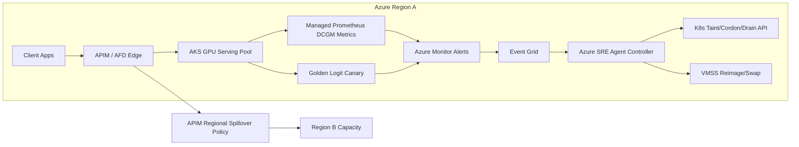
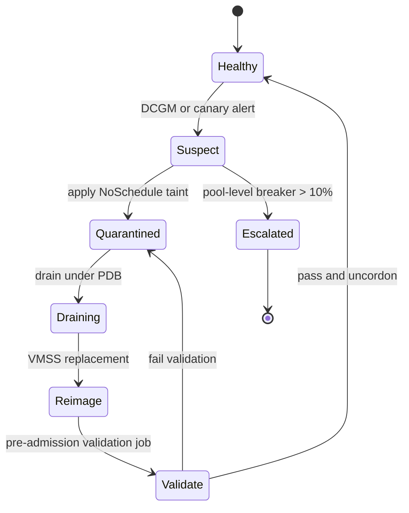

# Enterprise AI GPU Fleet Health, Silent-Degradation Detection, and Closed-Loop Remediation Selection FAQ (Azure)

> Topic ID: #449 · Domain: 3.8 AIOps / Multi-Region Resilience / Landing Zone
> Scope: Cloud & AI Solution Architect perspective focused on control-plane governance, AIOps orchestration, SLA, and FinOps trade-offs. No kernel or driver internals.

## 1. Executive summary
- At 16/64/256 GPU scale, the biggest risk is not replacement speed alone, but failing to stop bad nodes from receiving traffic within the first minute.
- Pattern A fits mature platform teams, Pattern B fits high-value quality-sensitive inference, Pattern C fits lean teams, and Pattern D should be prohibited.
- The strongest posture is infrastructure health plus application-layer golden-logit checks plus blast-radius circuit breakers.

## 2. Scope and assumptions
- GPU pools: AKS ND H100 v5 / NC H100 / mixed pools with multi-tenant serving and replay workloads.
- Business goals: stable p95 latency, minimized silent corruption, controlled MTTR, deterministic regional spillover.
- Constraints: security boundaries, auditability, on-call staffing, budget caps, contractual SLA penalties.

## 3. Four architecture patterns
- Pattern A: AKS + Managed Prometheus DCGM + taint/cordon/drain + VMSS reimage with warm spares.
- Pattern B: golden-logit checks and straggler canaries + Azure Monitor/Event Grid to Azure SRE Agent remediation.
- Pattern C: managed offload through Foundry Managed Endpoints / AML Managed Compute / ACA Serverless GPU.
- Pattern D (anti-pattern): crash-only restart behavior on untainted pools that repeatedly schedule onto bad nodes.

## 4. 12-dimension comparison matrix
| Dimension | Pattern A | Pattern B | Pattern C | Pattern D |
|---|---|---|---|---|
| Isolation and fault fencing | Node taint plus PDB drain | Node plus replica-level controls | Platform-managed boundary | No robust fence |
| Silent degradation detection | Medium | High with logit checks | Medium due to black-box layers | Low |
| Recovery MTTR | 5-8 min typical | 6-10 min including verification | Platform-dependent | Unbounded |
| Ops complexity | Medium-high | High | Low | Low but unsafe |
| Capacity efficiency | High | Medium-high | Medium | Low |
| Cost controllability | High | Medium-high | Medium | Low |
| Regional failover | Good with APIM/AFD | Strong with guardrails | Medium | Weak |
| Audit readiness | High | Very high | Medium | Low |
| Time to adopt | Medium | Medium | Fast | Superficially fast |
| Team requirement | Platform plus SRE | Platform plus model quality | Lean teams | Not recommended |
| SLA fit | High | Very high | Medium-high | Low |
| Recommendation | Recommended | Strongly recommended for critical workloads | Recommended for lean teams | Do not use |

## 5. Closed-loop architecture diagram


## 6. State machine (taint-drain-validate-swap)


## 7. Q1-Q6 quantitative answers
- Q1: How to size N+k warm spares at 32/128/512 GPUs?
 - Use node failure rate p and target availability A with P(failures<=k)=sum(C(n,i)p^i(1-p)^(n-i)). With 1.2% monthly node failure, k=2 is commonly justified at 256 GPUs, k=1 at 64 GPUs, and shared pools at 16 GPUs.
- Q2: What is straggler amplification under synchronous TP=8?
 - Collectives are gated by the slowest shard. A persistent 18% lag can inflate synchronization wait near 1/(1-s), giving a practical wait factor around 1.22.
- Q3: Why cap automatic cordon at <=10% of a pool?
 - It constrains blast radius during rack or TOR incidents. Beyond the cap, policy should shift to regional spillover plus operator approval.
- Q4: How to budget graceful drain before replacement?
 - Estimate from active sessions, remaining token depth, and decode throughput. A 30-90 second budget is typical; timeout paths must preserve replay checkpoints.
- Q5: When is managed PaaS cheaper than AKS self-management?
 - If the platform team is below 3-4 engineers and total footprint is under 32-64 GPUs, managed uplift can be cheaper than staffing and incident risk.
- Q6: How to quantify silent-degradation protection value?
 - Golden-logit checks shift detection from customer complaints to minute-level alerts. For high-value requests, avoided business loss often exceeds a 3-8% observability overhead.

## 8. Production snippets (Kubernetes and Bicep alerts)
```yaml
apiVersion: policy/v1
kind: PodDisruptionBudget
metadata:
  name: llm-serving-pdb
spec:
  minAvailable: 80%
  selector:
    matchLabels:
      app: llm-serving
---
apiVersion: batch/v1
kind: Job
metadata:
  name: pre-uncordon-gpu-validation
spec:
  template:
    spec:
      restartPolicy: Never
      containers:
      - name: validator
        image: mcr.microsoft.com/azurelinux/base:latest
        command: ["/bin/sh","-c","python validate_gpu_health.py --golden-logit --tp-latency-check"]
```

```bicep
resource alertRule "Microsoft.Insights/metricAlerts@2018-03-01" = {
  name: "gpu-fleet-straggler-alert"
  location: "global"
  properties: {
    severity: 2
    enabled: true
    scopes: [aks.id]
    evaluationFrequency: "PT1M"
    windowSize: "PT5M"
  }
}
```

## 9. Scenario 1: global tier-1 finance with 128 GPUs
- Goal: support low-latency inference for research and assisted decisioning, p95 under 180 ms, RTO under 10 minutes.
- Choice: Pattern A plus Pattern B with APIM spillover and dual-region capacity.
- Outcome: failure-injection drills preserved over 90% baseline throughput while containing affected nodes.

## 10. Scenario 2: healthcare SaaS managed-to-AKS breakeven
- Early stage: Pattern C for speed with a small ops team.
- Growth stage: migrate to Pattern A/B beyond 64 GPUs and strict tenant-isolation requirements.
- Transition: phased cutover with audited replay checkpoints and policy parity checks.

## 11. Three-year TCO (16 / 64 / 256 GPUs)
| Scale | Pattern A (with warm spares) | Pattern B (with canary) | Pattern C (managed uplift) | Downtime exposure reference |
|---|---:|---:|---:|---:|
| 16 GPUs | $1.25M | $1.34M | $1.42M | $0.18M |
| 64 GPUs | $4.68M | $4.95M | $5.62M | $0.71M |
| 256 GPUs | $17.9M | $18.8M | $22.4M | $2.95M |

## 12. Day-0 / Day-1 / Day-2 rollout checklist
### Day-0: governance baseline
1. Define SLO/SLA and downtime impact model
2. Standardize node taints and health labels
3. Connect Managed Prometheus and Azure Monitor
4. Define APIM and Front Door regional spill policies
5. Set incident severities and on-call routing
### Day-1: automation loop
1. Enable cordon-drain-reimage controller flow
2. Deploy pre-uncordon active validation jobs
3. Enable golden-logit and TP straggler canaries
4. Configure <=10% automatic cordon breaker
5. Wire Event Grid to Azure SRE Agent actions
### Day-2: optimization
1. Tune N+k warm spares from weekly data
2. Review managed versus self-managed split
3. Gate releases on resilience drill evidence
4. Harden canary thresholds for high-risk models
5. Reconcile spillover cost versus SLA outcomes

## 13. Good fit vs Not for
- Good fit: multi-tenant, high-value inference where output integrity and rapid remediation are first-class requirements.
- Not for: very small prototypes with unstable demand and no budget for governance operations.

## 14. Risks and mitigations
- Risk: False positives triggering unnecessary drains
 - Mitigation: use multi-signal confirmation, cooldown windows, and approval gates for high-impact actions.
- Risk: Alert storms saturating control planes
- Risk: Cost spikes during regional spillover
- Risk: Canary drift biasing decisions
- Risk: Mixed managed and self-managed policy mismatch

## 15. References with timestamps
- Source: Azure Monitor and Managed Prometheus documentation · https://learn.microsoft.com/azure/azure-monitor/ · Retrieved: 2026-11-26 (UTC+8)
- Source: AKS reliability and node operations documentation · https://learn.microsoft.com/azure/aks/ · Retrieved: 2026-11-26 (UTC+8)
- Source: Azure AI Foundry managed endpoints documentation · https://learn.microsoft.com/azure/ai-foundry/ · Retrieved: 2026-11-26 (UTC+8)
- Source: Azure Container Apps Serverless GPU documentation · https://learn.microsoft.com/azure/container-apps/ · Retrieved: 2026-11-26 (UTC+8)
- Source: Azure Well-Architected Framework · https://learn.microsoft.com/azure/well-architected/ · Retrieved: 2026-11-26 (UTC+8)

---

### Appendix A: operational metric dictionary
- `NodeQuarantineRate`: version the definition, threshold, severity, and remediation playbook action.
- `CanaryLogitDeviation`: version the definition, threshold, severity, and remediation playbook action.
- `TPStepP95Skew`: version the definition, threshold, severity, and remediation playbook action.
- `ReimageSuccessRate`: version the definition, threshold, severity, and remediation playbook action.
- `DrainBudgetTimeout`: version the definition, threshold, severity, and remediation playbook action.
- `RegionalSpilloverRatio`: version the definition, threshold, severity, and remediation playbook action.

- Audit item 01: retain timeline evidence, automation actions, approvals, and rollback artifacts.

- verify tenant isolation, capacity watermarks, retry policies, logging chain integrity, and FinOps tagging.

