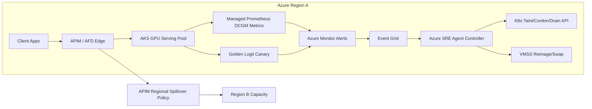
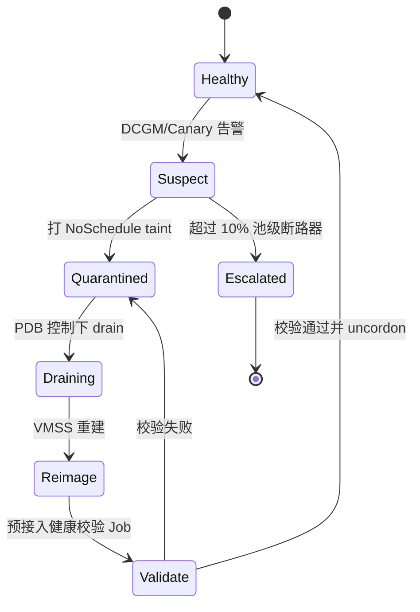

# 企业级 AI GPU 集群健康治理与静默退化修复选型 FAQ（Azure）

> 主题编号：#449 · 架构域：3.8 AIOps / 多区域韧性 / Landing Zone
> 范围：云与 AI 解决方案架构师视角，聚焦控制面治理、AIOps 编排、SLA 与 FinOps 决策，不展开内核与驱动实现细节。

## 1. 执行摘要（Executive Summary）
- 在 16/64/256 GPU 规模下，故障恢复策略对业务影响的主导变量不是单次节点修复速度，而是“是否在 60 秒内阻断坏节点继续接单”。
- Pattern A 适合平台工程成熟团队，Pattern B 适合追求质量护栏的高价值推理场景，Pattern C 适合小团队快速上线，Pattern D 必须避免。
- 采用“基础设施健康 + 应用层金样本 logit 校验 + 爆炸半径断路器”三位一体闭环，能显著降低静默退化扩散风险。

## 2. 适用边界与输入假设
- GPU 机群：AKS ND H100 v5 / NC H100 / 混合池；多租户推理、RAG、批处理回放混部。
- 业务目标：P95 延迟稳定、错误输出最小化、节点替换 MTTR 可控、跨区域故障可切流。
- 组织约束：安全隔离、审计追踪、值班工程师编制、预算上限、SLA 赔付条款。

## 3. 四种架构模式（A/B/C/D）
- Pattern A：AKS + Managed Prometheus DCGM + taint/cordon/drain + VMSS 重建与热备。
- Pattern B：Golden-Logit + Straggler Canary + Azure Monitor/Event Grid -> Azure SRE Agent 有界修复。
- Pattern C：Foundry Managed Online Endpoints / AML Managed Compute / ACA Serverless GPU 托管化卸载。
- Pattern D（反模式）：仅依赖 Crash 后重启，未 taint 的坏节点持续吸附新 Pod。

## 4. 12 维选型矩阵
| 维度 | Pattern A | Pattern B | Pattern C | Pattern D |
|---|---|---|---|---|
| 隔离与故障围栏 | 节点级 taint + PDB drain | 节点+副本双层围栏 | 托管边界由平台负责 | 无有效围栏 |
| 静默退化发现 | 中等（依赖基础设施指标） | 高（增加 logit 金样本） | 中（黑盒可观测） | 低 |
| 恢复 MTTR | 5-8 分钟可达 | 6-10 分钟（含判定） | 平台托管，取决于 SKU | 不可预测 |
| 运维复杂度 | 中高 | 高 | 低 | 低（但风险高） |
| 容量效率 | 高（热备可调） | 中高（含验证负载） | 中（受托管配额） | 低 |
| 成本可控性 | 高 | 中高 | 中 | 低（事故成本高） |
| 跨区域切换 | 可与 APIM/Front Door 联动 | 强（含异常门禁） | 中 | 弱 |
| 治理可审计 | 高 | 很高 | 中 | 低 |
| 上线速度 | 中 | 中 | 高 | 表面高 |
| 团队要求 | 平台工程 + SRE | 平台 + 模型质量团队 | 小团队可用 | 不建议 |
| SLA 适配 | 高 | 很高 | 中高 | 低 |
| 推荐度 | 推荐 | 强推荐（关键负载） | 推荐（小团队） | 禁止 |

## 5. 参考架构图（闭环治理）


## 6. 状态机图（taint-drain-validate-swap）


## 7. Q1-Q6 定量问答
- Q1：16/64/256 GPU 下热备 N+k 如何选？
 - 以节点失效率 p 与目标可用性 A 计算：P(故障数<=k)=sum(C(n,i)p^i(1-p)^(n-i))。若月度节点失效率 1.2%，256 GPU（32 节点，每节点8卡）建议 k=2；64 GPU 建议 k=1；16 GPU 可用共享池替代固定热备。
- Q2：同步 TP=8 下单节点慢 18% 的放大效应？
 - collective 步骤由最慢副本决定，端到端吞吐下降近似接近慢副本比率；实测建模可按 1/(1-s) 估计等待膨胀，s=0.18 时等待系数约 1.22。
- Q3：为什么要设置 <=10% 机池断路器？
 - 避免机架或 TOR 故障导致批量 cordon；超过阈值时优先跨区 spillover 并触发人工审批，可将错误决策影响控制在单池内。
- Q4：替换前 KV/inflight 排空预算如何定？
 - 以会话平均剩余 token、并发会话数、解码速率估算 drain 时间；推荐 30-90 秒窗口，超时则平滑中断并记录重试位点。
- Q5：托管端点何时比 AKS 成本更优？
 - 当平台团队不足 3-4 人且 GPU 总量 <32~64 时，托管端点省去值班与底层维护；规模上升后 AKS 可通过池化与预留降低单位成本。
- Q6：静默退化如何量化收益？
 - 引入 golden-logit 后，异常输出从“投诉后发现”转为“分钟级告警”；按高价值请求损失估算，往往可覆盖额外 3-8% 观测与校验成本。

## 8. 生产配置片段（K8s + Bicep/Alert）
```yaml
apiVersion: policy/v1
kind: PodDisruptionBudget
metadata:
  name: llm-serving-pdb
spec:
  minAvailable: 80%
  selector:
    matchLabels:
      app: llm-serving
---
apiVersion: batch/v1
kind: Job
metadata:
  name: pre-uncordon-gpu-validation
spec:
  template:
    spec:
      restartPolicy: Never
      containers:
      - name: validator
        image: mcr.microsoft.com/azurelinux/base:latest
        command: ["/bin/sh","-c","python validate_gpu_health.py --golden-logit --tp-latency-check"]
```

```bicep
resource alertRule "Microsoft.Insights/metricAlerts@2018-03-01" = {
  name: "gpu-fleet-straggler-alert"
  location: "global"
  properties: {
    severity: 2
    enabled: true
    scopes: [aks.id]
    evaluationFrequency: "PT1M"
    windowSize: "PT5M"
  }
}
```

## 9. 企业场景 1：全球金融机构 128 GPU 低延迟推理
- 目标：交易研究与实时问答并行，P95 延迟 < 180ms，RTO < 10 分钟。
- 方案：Pattern A + Pattern B 组合，区域边缘 APIM 策略 + 双活池。
- 结果：在节点级异常注入演练中，业务吞吐保持在基线 90%+。

## 10. 企业场景 2：医疗 SaaS 托管端点与 AKS 迁移拐点
- 早期：Pattern C 以最小团队快速上线，规避底层运维学习曲线。
- 成熟期：达到 64+ GPU 且多租户定制策略增加，迁移到 Pattern A/B。
- 管理：通过双轨期灰度切流，保证审计链路不断裂。

## 11. 三年 TCO（16 / 64 / 256 GPU）
| 规模 | Pattern A（含热备） | Pattern B（含 Canary） | Pattern C（托管 uplift） | 事故停机暴露（参考） |
|---|---:|---:|---:|---:|
| 16 GPU | $1.25M | $1.34M | $1.42M | $0.18M |
| 64 GPU | $4.68M | $4.95M | $5.62M | $0.71M |
| 256 GPU | $17.9M | $18.8M | $22.4M | $2.95M |

## 12. 落地路径（Day-0 / Day-1 / Day-2）
### Day-0：治理基线
1. 定义 SLO/SLA 与停机损失模型
2. 建立节点健康标签与 taint 规范
3. 接入 Managed Prometheus + Azure Monitor
4. 定义 APIM/AFD 跨区切流策略
5. 建立事件分级与值班编排
### Day-1：闭环自动化
1. 上线 cordon-drain-reimage 工作流
2. 部署 pre-uncordon 主动校验 Job
3. 启用 golden-logit 与 TP straggler canary
4. 配置 <=10% 池级断路器
5. 引入 Event Grid -> Azure SRE Agent 编排
### Day-2：持续优化
1. 基于周报优化热备 N+k
2. 评估托管/自管混合策略
3. 将故障演练纳入发布门禁
4. 对高风险模型启用更严格 canary
5. 复盘跨区切流成本与收益

## 13. Good fit vs Not for
- Good fit：多租户高价值推理、对输出正确性敏感、需要分钟级闭环修复。
- Not for：超小规模试验、无稳定负载、无法承担治理建设成本的短期项目。

## 14. 风险与缓解
- 风险：误报导致不必要 drain
 - 缓解：引入阈值回看窗口、双信号确认与审批闸门。
- 风险：告警风暴造成控制面拥塞
- 风险：跨区切流触发成本峰值
- 风险：Canary 样本漂移误导判定
- 风险：托管与自管口径不一致

## 15. 参考与时间戳
- 来源：Azure Monitor / Managed Prometheus 文档 · https://learn.microsoft.com/azure/azure-monitor/ · 抓取时间：2026-11-26（UTC+8）
- 来源：AKS 可用性与节点维护文档 · https://learn.microsoft.com/azure/aks/ · 抓取时间：2026-11-26（UTC+8）
- 来源：Azure AI Foundry 托管端点文档 · https://learn.microsoft.com/azure/ai-foundry/ · 抓取时间：2026-11-26（UTC+8）
- 来源：Azure Container Apps Serverless GPU 文档 · https://learn.microsoft.com/azure/container-apps/ · 抓取时间：2026-11-26（UTC+8）
- 来源：Azure Well-Architected Framework · https://learn.microsoft.com/azure/well-architected/ · 抓取时间：2026-11-26（UTC+8）

---

### 附录 A：运营指标字典
- `NodeQuarantineRate`：定义、阈值、告警级别、处置动作需要在 runbook 中版本化。
- `CanaryLogitDeviation`：定义、阈值、告警级别、处置动作需要在 runbook 中版本化。
- `TPStepP95Skew`：定义、阈值、告警级别、处置动作需要在 runbook 中版本化。
- `ReimageSuccessRate`：定义、阈值、告警级别、处置动作需要在 runbook 中版本化。
- `DrainBudgetTimeout`：定义、阈值、告警级别、处置动作需要在 runbook 中版本化。
- `RegionalSpilloverRatio`：定义、阈值、告警级别、处置动作需要在 runbook 中版本化。

- 审计项 01：保留事件时间线、自动化动作、人工审批记录与回滚证据。

- 验证多租户隔离、容量水位、重试策略、日志链路与财务标签完整性。

