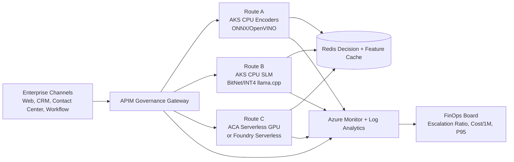
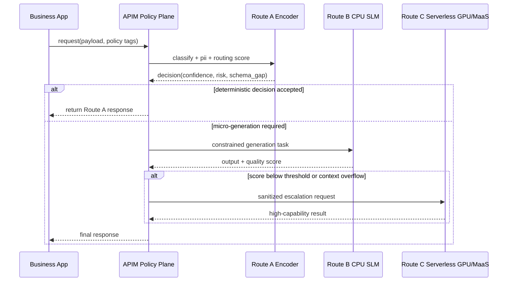

# Enterprise GPU-Free Auxiliary Model Serving Selection FAQ: Route A (AKS CPU Encoders with ONNX/OpenVINO) vs Route B (BitNet/INT4 `llama.cpp` CPU SLM) vs Route C (Serverless GPU / Managed SLM Escalation) vs Route D (BF16 dense CPU serving or 24x7 low-RPS dedicated GPU anti-pattern)

> Audience: Cloud & AI Solution Architects, platform engineering, FinOps, governance, and sovereign-data program owners.
> Scope: practical architecture decisions for low-latency auxiliary agent workloads in GPU-constrained regions and low-duty-cycle enterprise stamps.

## 1. Executive Summary

Many enterprise agent workloads are **not** dominated by frontier generative reasoning.

High-volume request classes are often:

- intent routing,
- risk scoring,
- PII/entity tagging,
- output-policy checks,
- JSON schema repair,
- short rewrite and snippet extraction.

In sovereign or quota-constrained regions such as Qatar Central, UAE North, Brazil South, and Poland Central, waiting for large GPU quota approval can stall delivery for weeks while business demand is immediate.

A production architecture should therefore apply a **three-lane control plane**:

1. **Route A (CPU encoder lane):** deterministic, low-latency classification and tagging (`P95 < 12 ms`) on widely available CPU quotas.
2. **Route B (CPU generative SLM lane):** compact `1B–3B` INT4 / 1.58-bit models for structured repair and micro-generation at practical throughput.
3. **Route C (elastic GPU / managed serverless lane):** selective escalation for requests that exceed Route A/B capability boundaries.

Route D, where teams run BF16 `7B–14B` dense models on commodity CPU or keep dedicated GPUs alive for `<2 RPS` auxiliary calls, usually produces the worst combined outcome for latency, cost, and operations.

## 2. Problem Statement and Constraints

We need an architecture that satisfies all of the following at the same time:

- low and predictable user-facing latency,
- sovereign data residency constraints,
- stable delivery under GPU quota scarcity,
- sustainable `$/1M requests` economics,
- scalable operations across multiple subsidiaries and regions.

The key design mistake is treating all auxiliary calls as “LLM calls.”

In reality, enterprise auxiliary traffic is mixed:

- high-volume binary/multi-class decisions,
- policy/PII checks,
- moderate-volume schema fixes,
- only a minority of truly complex generation.

The architecture should optimize for this distribution, not for rare heavy cases.

## 3. Route Definitions

### Route A — AKS CPU Encoder Serving (`Ddsv6` / `Dpsv6`)

- Runtime: ONNX Runtime / OpenVINO Model Server.
- Typical models: ModernBERT, DeBERTa-v3, GLiNER variants, enterprise PII taggers.
- Outcome: high-RPS, low-latency deterministic decisions with broad regional availability.

### Route B — CPU Generative SLM (`llama.cpp` with INT4 / 1.58-bit)

- Runtime: continuous-batching HTTP serving on AKS CPU reserved/spot pools.
- Typical tasks: JSON repair, query rewrite, constrained short summaries.
- Outcome: meaningful generation without GPU dependency.

### Route C — Elastic Serverless GPU or Managed Serverless SLM

- Runtime options: ACA Serverless GPU or Foundry Serverless Data Zone paths.
- Trigger: request complexity, context size, quality threshold, or policy escalation.
- Outcome: preserves quality for hard cases while keeping the expensive lane selective.

### Route D — Anti-Pattern

- BF16 dense `7B–14B` on CPU for interactive paths.
- Always-on dedicated GPU for tiny low-RPS classifier workloads.
- Outcome: timeout cascades, poor utilization, and cost lock-in.

## 4. 12-Dimension Comparison Matrix

| Dimension | Route A: CPU Encoders | Route B: CPU SLM | Route C: Serverless GPU / Managed | Route D: Anti-Pattern |
|---|---|---|---|---|
| Primary workload | Classification / NER / PII / routing | JSON repair / rewrite / short generation | Large-context or heavier generation | Mixed with no governance |
| P95 latency profile | `6–12 ms` class | `80–250 ms` class | warm/cold split; more variance | highly unstable |
| Throughput model | request-per-second optimized | token-throughput optimized | quota and cold-start bounded | low effective throughput |
| Cost base | vCPU hours | vCPU + optional Spot | per-second or per-token premium | high fixed + low utilization |
| Image size profile | often `< 600 MB` | `1–2 GB` typical | larger runtime footprint | usually heavy and brittle |
| Scale-out speed | fast (`~4 s` class) | moderate (`~6–12 s`) | often `90–180 s` class cold path | hard to control |
| Regional availability | very high | high | constrained by capacity/quota | constrained and expensive |
| Sovereignty fit | strong | strong | conditional (depends on lane design) | often policy-fragile |
| Operational complexity | low-to-medium | medium | medium-to-high | high |
| Cost elasticity | strong | strong | medium | weak |
| Upgrade path | deterministic to C | deterministic to C | fallback to A/B possible | no clear policy |
| Best-fit boundary | decision-heavy workloads | micro-generation workloads | hard-case escalation | not recommended |

## 5. Quantitative Q&A (Q1..Q6)

### Q1. Why can compact quantized SLMs work on CPU while BF16 dense models collapse?

A useful upper-bound approximation:

`TPS_max ≈ BW_mem / (N_params × Bytes_per_weight)`

Interpretation:

- memory bandwidth is finite per node,
- model size and weight precision directly control bytes moved per token,
- reducing precision and parameter count can shift feasibility dramatically.

For practical enterprise auxiliary tasks, INT4 / 1.58-bit `~2B` models can often sustain `45+ tok/s` class throughput on `Ddsv6/Dpsv6`, while BF16 `~8B` paths may collapse below interactive thresholds.

This is precisely why Route B is viable for bounded micro-generation and why Route D fails.

### Q2. How do we replace ~90% of “pseudo-generative” calls with sub-12ms encoder decisions?

Define a pre-LLM decision function:

`Need_Generation = f(intent, pii_risk, schema_gap, confidence, policy)`

Policy example:

- if `confidence >= τ_accept` and `schema_gap = 0`, return Route A result immediately;
- else send to Route B with strict output contracts;
- escalate to Route C only when quality or policy thresholds fail.

In many enterprise support, compliance, and workflow-assistant traces, this pre-filter can divert the majority of calls away from expensive generative lanes without reducing business outcomes.

### Q3. What is the `$/1M requests` break-even across A/B/C?

Let:

- `C_A`, `C_B`, `C_C` be cost per million requests for routes A/B/C,
- `w_A`, `w_B` be share within non-escalated traffic,
- `r` be escalation ratio to C.

Then:

`C_total = (1-r) × (w_A × C_A + w_B × C_B) + r × C_C`

Architecture objective:

- minimize `r` without violating quality/SLA,
- maximize Route A deterministic coverage,
- keep Route B bounded and contract-driven.

### Q4. Why do cold-start size and image footprint matter for business SLA?

Auxiliary pipelines are often attached to user-critical workflows.

If a lane requires large runtime images and longer pull/init times, temporary traffic bursts can translate into visible tail-latency spikes.

Typical engineering observations:

- compact CPU lanes can recover capacity quickly,
- heavy GPU lanes can have materially longer cold recovery windows.

Hence CPU-first for high-frequency auxiliary calls is an SLA decision, not only a cost decision.

### Q5. How should thread and topology settings be tuned on `16/32 vCPU` nodes?

Recommended approach:

- set `OMP_NUM_THREADS` aligned with physical core groups,
- avoid aggressive oversubscription,
- keep worker placement coherent with memory topology,
- tune batch size and concurrency together instead of independently.

Without this, cross-core contention can degrade effective token throughput and introduce variance spikes.

### Q6. How do we keep strict in-country residency while still using stronger hub-region capability?

A governance-safe pattern:

1. execute Route A + Route B inside-country,
2. perform PII redaction and policy minimization before escalation,
3. send only minimal sanitized payload to Route C in hub region,
4. retain auditable escalation reason codes and policy traces in APIM logs.

This preserves sovereign boundaries while retaining access to higher-capability lanes for rare hard cases.

## 6. Layered Reference Architecture (Mermaid #1)



## 7. Request Lifecycle and Escalation Logic (Mermaid #2)



## 8. Production Config Example #1 — AKS Deployment + KEDA for CPU SLM

```yaml
apiVersion: apps/v1
kind: Deployment
metadata:
  name: cpu-slm-llamacpp
  namespace: agent-infra
spec:
  replicas: 2
  selector:
    matchLabels:
      app: cpu-slm-llamacpp
  template:
    metadata:
      labels:
        app: cpu-slm-llamacpp
    spec:
      nodeSelector:
        agentpool: dpsv6-cpu
      containers:
        - name: server
          image: ghcr.io/ggerganov/llama.cpp:server
          args:
            - "--model"
            - "/models/aux-slm-int4.gguf"
            - "--ctx-size"
            - "4096"
            - "--parallel"
            - "8"
            - "--threads"
            - "16"
            - "--batch-size"
            - "1024"
          env:
            - name: OMP_NUM_THREADS
              value: "16"
            - name: LLAMA_MAX_PARALLEL
              value: "8"
          resources:
            requests:
              cpu: "8"
              memory: "16Gi"
            limits:
              cpu: "16"
              memory: "32Gi"
          ports:
            - containerPort: 8080
---
apiVersion: keda.sh/v1alpha1
kind: ScaledObject
metadata:
  name: cpu-slm-scale
  namespace: agent-infra
spec:
  scaleTargetRef:
    name: cpu-slm-llamacpp
  minReplicaCount: 2
  maxReplicaCount: 20
  cooldownPeriod: 30
  pollingInterval: 10
  triggers:
    - type: prometheus
      metadata:
        serverAddress: http://prometheus.monitoring:9090
        metricName: inflight_requests
        threshold: "120"
        query: sum(rate(http_requests_total{app="cpu-slm-llamacpp"}[1m])) * 5
```

## 9. Production Config Example #2 — APIM Two-Stage Policy (CPU Prefilter then Escalate)

```xml
<policies>
  <inbound>
    <base />
    <set-variable name="needGen" value="@((bool)context.Variables.GetValueOrDefault("need_generation", true))" />
    <set-variable name="routeAConf" value="@((double)context.Variables.GetValueOrDefault("routeA_conf", 0.0))" />
    <choose>
      <when condition="@(!(bool)context.Variables["needGen"] && (double)context.Variables["routeAConf"] >= 0.92)">
        <set-backend-service base-url="https://encoder-cpu.internal" />
      </when>
      <when condition="@((bool)context.Variables["needGen"])">
        <set-backend-service base-url="https://cpu-slm.internal" />
        <set-header name="x-quality-threshold" exists-action="override">
          <value>0.78</value>
        </set-header>
      </when>
      <otherwise>
        <set-backend-service base-url="https://foundry-serverless-hub.azure.com" />
      </otherwise>
    </choose>
  </inbound>
  <backend>
    <base />
  </backend>
  <outbound>
    <base />
  </outbound>
  <on-error>
    <base />
  </on-error>
</policies>
```

## 10. Enterprise Scenario A — Sovereign Retail Bank in GPU-Scarce Region

Context:

- regulated in-country processing requirement,
- no approved local GPU quota at launch window,
- urgent need for PII redaction and intent/risk routing in Arabic and Portuguese.

Architecture:

- Route A handles classification, NER, PII tagging, and policy labels.
- Route B handles JSON normalization and micro-summary tasks.
- Route C receives only sanitized, policy-approved escalation payloads.

Benefits:

- immediate launch without waiting for large GPU quota,
- audit-ready policy traces for each escalation decision,
- measurable reduction in expensive cross-region inference volume.

## 11. Enterprise Scenario B — Global SaaS Cost Rebalancing Program

Starting point:

- multiple regional GPU pools serving tiny auxiliary workloads,
- under-utilized dedicated accelerators with high monthly burn.

Transformation:

- migrate guardrail/router/entity tasks to CPU route A,
- migrate bounded micro-generation to route B,
- keep route C as selective quality lane.

Outcome:

- reduced idle accelerator spend,
- improved cost-per-request transparency,
- better capacity planning via explicit escalation ratio targets.

## 12. Three-Year TCO Comparison (Illustrative Range)

| Route | Annual Compute | Annual Ops | 3-Year TCO | Notes |
|---|---:|---:|---:|---|
| Route A | `$110k` | `$35k` | `$435k` | best for deterministic high-volume auxiliary tasks |
| Route B | `$150k` | `$45k` | `$585k` | generation capability without accelerator dependency |
| Route C | `$280k` | `$70k` | `$1,050k` | quality escalation lane, should remain selective |
| Route D | `$420k` | `$95k` | `$1,545k` | low utilization + high fixed spend anti-pattern |

Interpretation:

- If most traffic can be absorbed by A/B, total economics improve sharply.
- If escalation ratio remains uncontrolled, C dominates cost.
- D is usually expensive even before governance overhead is included.

## 13. Day-0 / Day-1 / Day-2 Checklist

### Day-0 (Design and Governance Baseline)

- define request taxonomy: deterministic vs micro-generation vs heavy generation,
- set explicit escalation criteria and confidence thresholds,
- define sovereign field policy and payload minimization contracts,
- align architecture owners for APIM policy, AKS serving, and observability.

### Day-1 (Go-Live Controls)

- deploy route A and B with APIM policy gating,
- enable route-level observability: P95, route hit-rate, escalation ratio, cost/1M,
- establish quality guardrails: false-negative rate, schema-repair pass rate, policy misses,
- validate rollback and fail-open/fail-closed behavior for each route.

### Day-2 (Optimization and FinOps)

- tune `OMP_NUM_THREADS`, batching, and autoscale thresholds,
- optimize reserved/spot split against seasonality and business hours,
- enforce escalation budget guardrails by tenant or business unit,
- perform weekly policy review for cross-region sanitized payload compliance.

## 14. Good Fit vs Not For

### Good Fit

- high-volume auxiliary calls where deterministic outcomes dominate,
- sovereign or quota-constrained regions with immediate business deadlines,
- organizations seeking explicit route economics and auditable escalation governance.

### Not For

- workloads where nearly all requests require frontier long-context reasoning,
- teams unwilling to operate policy-based routing and route-level telemetry,
- environments that cannot apply payload minimization before cross-region escalation.

## 15. Decision Guidance and Final Recommendation

For enterprise auxiliary agent workloads, architecture quality comes from **request-class separation**, not from placing every call on the most expensive model lane.

Recommended target state:

- Route A as default deterministic serving plane,
- Route B as bounded micro-generation plane,
- Route C as policy-driven escalation plane,
- Route D explicitly disallowed in production standards.

This pattern provides:

- faster delivery in GPU-scarce regions,
- lower and more stable cost envelopes,
- stronger sovereign compliance posture,
- clearer operations and architecture accountability.

In practice, this is the shortest path from pilot success to durable production operation in regions where accelerator supply is uncertain but business timelines are fixed.

