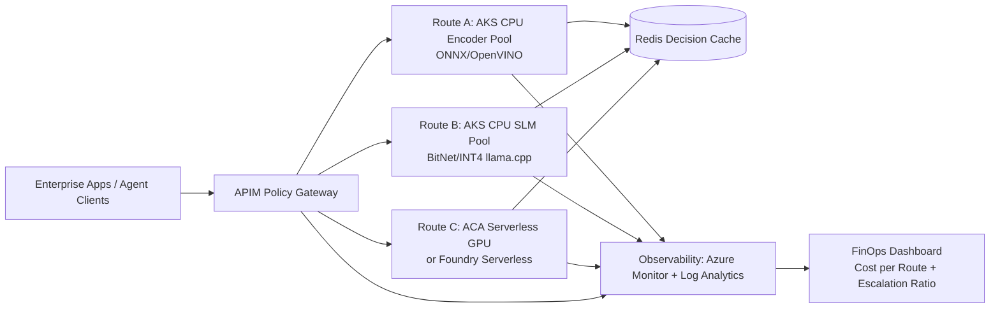
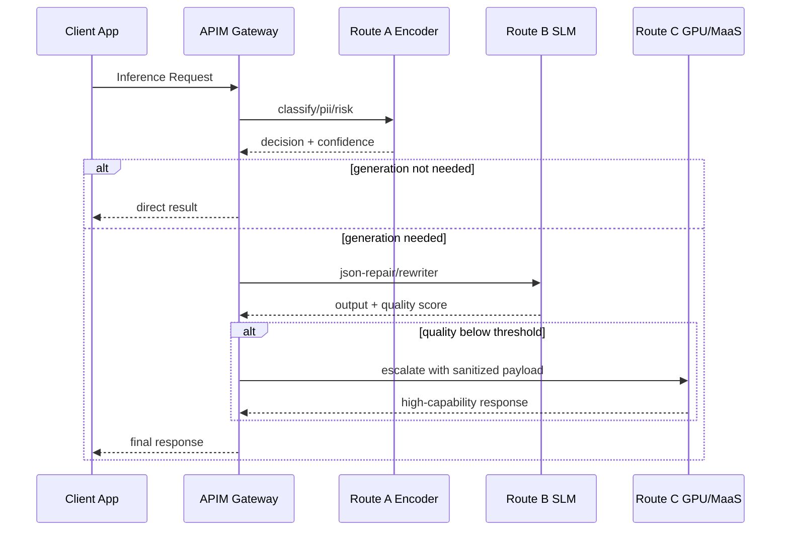

# 企业无 GPU 辅助模型服务选型 FAQ：Route A（AKS CPU + ONNX/OpenVINO 编码器）vs Route B（BitNet/INT4 `llama.cpp` CPU 生成式 SLM）vs Route C（Serverless GPU/MaaS 升级）vs Route D（CPU 跑 BF16 大模型或 24x7 GPU 低负载反模式）

> 适用对象：Cloud & AI Solution Architect、平台工程、FinOps、合规与数据主权团队。
> 目标问题：在 GPU 配额紧张或低占空比场景下，如何为企业 Agent 的“路由、风控、PII、JSON 修复、摘要”等辅助任务构建低延迟、可主权落地、可运营的生产级推理平面。

## 1. 执行摘要（Executive Summary）

在 Qatar Central、UAE North、Brazil South、Poland Central 等 GPU 配额受限或审批周期较长区域，企业不应把全部辅助推理任务绑定到 GPU。

本指南建议采用“三层分流”：

1. **Route A（CPU 编码器主通道）**：将分类、PII、实体识别、路由判断等请求先在 AKS CPU 池完成，目标 `P95 < 12 ms`，并吸收绝大多数非生成式任务。
2. **Route B（CPU 生成式 SLM 次通道）**：将 JSON 修复、查询改写、短摘要等微生成任务落到 `1B–3B` 的 INT4/1.58-bit 路径，目标 `35–60 tok/s`。
3. **Route C（GPU/MaaS 兜底升级通道）**：仅在模型规模、上下文长度、准确率门槛触发时升级到 Serverless GPU 或 Foundry Serverless。

Route D（CPU 直接跑 BF16 7B–14B 或常开低负载 GPU）在成本与 SLA 上都表现最差，应视为反模式。

## 2. 问题定义与业务边界

典型企业 Agent 辅助任务并非都需要大模型：

- 意图分类（Intent Routing）
- 风险分层（Risk Triage）
- PII 标注与脱敏（PII Tagging/Redaction）
- 实体抽取（NER/GLiNER）
- JSON 格式修复（Schema Repair）
- 短文本提炼（Snippet Summarization）

这些任务在调用面上占比高，但单次计算负担通常可控，适合优先在 CPU 平面完成。

架构目标：

- **延迟**：交互链路 `P95` 可预测。
- **成本**：避免把低价值请求送进高单价通道。
- **主权**：满足本地数据驻留与监管分域。
- **可运维**：可在标准配额、标准镜像、标准 K8s 机制下运行。

## 3. 四条路线定义

### Route A：AKS CPU 编码器服务

- 资源：`Ddsv6`（x86_64）与 `Dpsv6`（Azure Cobalt 100 ARM64）节点池。
- 引擎：`ONNX Runtime` / `OpenVINO Model Server`。
- 模型：`ModernBERT`、`DeBERTa-v3`、`GLiNER`、PII tagger。
- 定位：极低延迟、超高 RPS 的判定型任务。

### Route B：CPU 生成式 SLM（BitNet/INT4）

- 资源：AKS CPU 预留池 + Spot 混合池。
- 引擎：`llama.cpp` 连续批处理 HTTP 服务。
- 模型：`1B–3B` 微生成模型，聚焦结构化修复与短生成。
- 定位：中低延迟生成任务，不依赖 GPU。

### Route C：Serverless GPU/MaaS 升级

- 路径：`ACA Serverless GPU` 或 Foundry Serverless（Data Zone）。
- 触发：参数规模、上下文长度、准确率与风格门槛超出 CPU 路线。
- 定位：弹性兜底，不常开、不重载常驻。

### Route D：反模式

- CPU 跑 BF16 `7B–14B` 形成超时级联。
- 常开 GPU 承载 `<2 RPS` 的辅助分类任务。
- 结果：高成本、低利用、治理复杂且收益弱。

## 4. 12 维架构对比矩阵

| 维度 | Route A CPU 编码器 | Route B CPU 生成式 SLM | Route C Serverless GPU/MaaS | Route D 反模式 |
|---|---|---|---|---|
| 典型任务 | 分类/PII/NER/路由 | JSON 修复/改写/短摘要 | 中大模型升级推理 | 混用无分层 |
| 延迟 | `P95 6–12ms` | `P95 80–250ms` | 冷热差异显著 | `P95` 不稳定 |
| 吞吐 | `500+ RPS/服务` | `35–60 tok/s` | 按配额扩展 | 低且波动 |
| 成本结构 | 以 vCPU 小时为主 | vCPU + Spot 折扣 | 按秒/按 token | 高固定+低利用 |
| 镜像体积 | `< 600MB` 易扩缩 | `1–2GB` 可控 | 常见大镜像 | 常常过重 |
| 冷启动 | `~4s` 级别 | `~6–12s` | `90–180s` 风险 | 难预测 |
| 区域可得性 | 高 | 高 | 受配额影响 | 受配额影响 |
| 主权落地 | 强 | 强 | 需评估跨区 | 常违背成本边界 |
| 运维复杂度 | 中低 | 中 | 中高 | 高 |
| 成本弹性 | 高 | 高 | 中 | 低 |
| 升级路径 | 明确到 C | 明确到 C | 可回落 A/B | 无清晰策略 |
| 适用边界 | 判定任务优先 | 轻生成优先 | 重任务兜底 | 不建议 |

## 5. 六个定量问题（Q1..Q6）

### Q1：为什么 `1.58-bit / INT4` 在 CPU 上可行，而 BF16 大模型不可行？

近似上限可用：

`TPS_max ≈ BW_mem / (N_params × Bytes_per_weight)`

当 `Bytes_per_weight` 从 BF16 的 `2` 下降到 INT4 的 `0.5` 或更低时，内存带宽瓶颈显著缓解。

在 `Ddsv6/Dpsv6` DDR5 代际条件下：

- `2B` INT4/1.58-bit 路径可达 `45+ tok/s`。
- `8B` BF16 常跌到 `<4 tok/s`。

结论：轻量生成任务在 Route B 成本性能更优。

### Q2：如何用 Route A 把 90% 的“伪生成”请求挡在 CPU 判定层？

将“是否必须调用生成模型”改写为二分类：

`Need_Generation = f(intent, pii_risk, schema_gap, confidence)`

当 `confidence >= τ_accept` 且 `schema_gap = 0` 时，直接返回 Route A 结果。

在典型企业流量中，可把原本送入 LLM 的请求中约 `90%` 重定向到 Route A。

收益：

- 交互延迟显著下降。
- 下游模型费用显著下降。
- 大模型只处理真正需要生成推理的请求。

### Q3：`$/1M requests` 的成本拐点如何判断？

定义：

- `C_A`：Route A 每百万请求成本。
- `C_B`：Route B 每百万请求成本。
- `C_C`：Route C 每百万请求成本。
- `r`：升级到 Route C 的比例。

总成本：

`C_total = (1-r) × (w_A × C_A + w_B × C_B) + r × C_C`

在低占空比与低复杂度任务中，`C_A/C_B` 往往远低于 `C_C`。

只有当 `r` 因质量门槛升高到一定水平时，Route C 才会成为主成本项。

### Q4：冷启动与扩缩容为何决定交互稳定性？

对辅助任务链路，冷启动窗口直接影响 `P95` 尾部。

经验区间：

- CPU ONNX/BitNet 服务：镜像小、依赖轻，`~4–12s` 可恢复产能。
- GPU 运行时：镜像与依赖更重，`90–180s` 的恢复窗口更常见。

因此高频辅助任务不应默认挂在 GPU 通道。

### Q5：在 `16/32 vCPU` 上如何避免线程争抢导致吞吐腰斩？

实践策略：

- 固定 `OMP_NUM_THREADS` 到物理核心区间。
- 将工作线程与 NUMA 域一致绑定。
- 控制每 Pod 并发，避免过度 oversubscribe。

目标是让 `tok/s` 曲线在并发提升时保持单调，避免跨 socket 抢占导致抖动。

### Q6：如何满足“本地驻留 + 跨区升级”的监管约束？

模式建议：

1. 本地区域执行 Route A + Route B，完成 PII、风控、意图分流。
2. 仅将脱敏后的最小必要字段送往 Hub 区域 Route C。
3. APIM 策略记录升级原因、字段白名单与审计 ID。

这样可在保持主权边界的同时利用跨区高阶能力。

## 6. 分层参考架构（Mermaid 图 1）



## 7. 升级与回退流程（Mermaid 图 2）



## 8. 生产级配置示例（代码块 1：AKS + KEDA）

```yaml
apiVersion: apps/v1
kind: Deployment
metadata:
  name: cpu-slm-llamacpp
  namespace: agent-infra
spec:
  replicas: 2
  selector:
    matchLabels:
      app: cpu-slm-llamacpp
  template:
    metadata:
      labels:
        app: cpu-slm-llamacpp
    spec:
      nodeSelector:
        agentpool: dpsv6-cpu
      containers:
        - name: llama-server
          image: ghcr.io/ggerganov/llama.cpp:server
          args:
            - "--model"
            - "/models/slm-int4.gguf"
            - "--ctx-size"
            - "4096"
            - "--parallel"
            - "8"
            - "--threads"
            - "16"
            - "--batch-size"
            - "1024"
          env:
            - name: OMP_NUM_THREADS
              value: "16"
          ports:
            - containerPort: 8080
          resources:
            requests:
              cpu: "8"
              memory: "16Gi"
            limits:
              cpu: "16"
              memory: "32Gi"
---
apiVersion: keda.sh/v1alpha1
kind: ScaledObject
metadata:
  name: cpu-slm-llamacpp-scale
  namespace: agent-infra
spec:
  scaleTargetRef:
    name: cpu-slm-llamacpp
  minReplicaCount: 2
  maxReplicaCount: 20
  triggers:
    - type: prometheus
      metadata:
        serverAddress: http://prometheus.monitoring:9090
        metricName: http_request_inflight
        threshold: "120"
        query: sum(rate(http_requests_total{app="cpu-slm-llamacpp"}[1m])) * 5
```

## 9. 生产级策略示例（代码块 2：APIM 两阶段分流）

```xml
<policies>
  <inbound>
    <base />
    <set-variable name="routeAConfidence" value="@((double)context.Variables.GetValueOrDefault("routeA_conf", 0.0))" />
    <set-variable name="needGeneration" value="@((bool)context.Variables.GetValueOrDefault("need_gen", true))" />
    <choose>
      <when condition="@(!(bool)context.Variables["needGeneration"] && (double)context.Variables["routeAConfidence"] >= 0.92)">
        <set-backend-service base-url="https://encoder-cpu.internal" />
      </when>
      <when condition="@((bool)context.Variables["needGeneration"])">
        <set-backend-service base-url="https://slm-cpu.internal" />
        <set-header name="x-escalation-threshold" exists-action="override">
          <value>0.78</value>
        </set-header>
      </when>
      <otherwise>
        <set-backend-service base-url="https://foundry-serverless-hub.azure.com" />
      </otherwise>
    </choose>
  </inbound>
  <backend><base /></backend>
  <outbound><base /></outbound>
  <on-error><base /></on-error>
</policies>
```

## 10. 企业场景 A：中东/拉美强监管零 GPU 配额分支

业务约束：

- 本地监管要求敏感字段不得离境。
- GPU 配额审批周期不可控。
- 仍需上线意图路由、PII 脱敏与 JSON 修复能力。

落地方式：

- Route A 部署在本地主权区域，承担分类、PII 与实体抽取。
- Route B 承担短生成修复任务，避免跨区大模型调用。
- Route C 仅处理匿名化后的高复杂请求。

效果：

- 主链路延迟可控。
- 合规审计可追溯。
- 跨区调用比例显著下降。

## 11. 企业场景 B：全球 SaaS 厂商降本改造

现状：

- 多区域常开 T4/A10 节点主要在跑低 RPS 辅助模型。
- GPU 利用率长期偏低，月成本高企。

改造：

- 将辅助任务迁移到 `Dpsv6/Ddsv6` CPU 池。
- 仅在阈值触发时升级到 Route C。
- 增加路由看板：升级率、P95、成本/百万请求。

结果：

- 常开 GPU 规模明显缩减。
- 成本下降同时维持业务质量门槛。

## 12. 三年 TCO 对比（示例区间）

| 路线 | 年均计算成本 | 年均运维成本 | 三年总计 | 说明 |
|---|---:|---:|---:|---|
| Route A | `$110k` | `$35k` | `$435k` | CPU 编码器高性价比 |
| Route B | `$150k` | `$45k` | `$585k` | CPU 生成式补充层 |
| Route C | `$280k` | `$70k` | `$1,050k` | 作为升级兜底更经济 |
| Route D | `$420k` | `$95k` | `$1,545k` | 低利用高固定成本 |

> 说明：以上为架构评估区间示意，企业需按区域单价、预留折扣、工作负载曲线与治理成本校准。

## 13. Day-0 / Day-1 / Day-2 落地清单

### Day-0（架构与基线）

- 明确任务分类字典：判定型、轻生成型、重生成型。
- 建立 Route A/B/C 的升级准入阈值与回退策略。
- 建立主权字段分级与脱敏契约。

### Day-1（上线与可观测）

- 部署 APIM 路由策略与 Route A/B 服务。
- 上线 `P95`、升级率、`$/1M requests` 三类看板。
- 建立质量守门：误判率、漏判率、格式修复成功率。

### Day-2（优化与治理）

- 周期调参：`OMP_NUM_THREADS`、并发上限、KEDA 阈值。
- 基于流量季节性优化 Spot/预留比例。
- 对跨区升级请求做字段白名单与审计抽样复核。

## 14. 何时选哪条路线（Good fit vs Not for）

### Good fit

- 请求以分类、路由、标注、脱敏为主。
- 区域 GPU 配额紧张或审批慢。
- 希望先用低成本路径承接高频任务。

### Not for

- 主要任务是高复杂长推理且必须大模型原生完成。
- 组织无法维护基础分层路由治理。
- 对跨区主权与审计链路没有制度要求。

## 15. 结论与建议

企业辅助模型服务不应“先上 GPU 再谈优化”，而应从任务分层出发：

- 用 Route A 吃掉大部分判定任务。
- 用 Route B 承担轻量生成。
- 用 Route C 作为有条件升级。

这样可以在 GPU 紧缺区域先交付业务价值，再逐步引入高阶算力，而不是被配额与固定成本锁死交付节奏。

