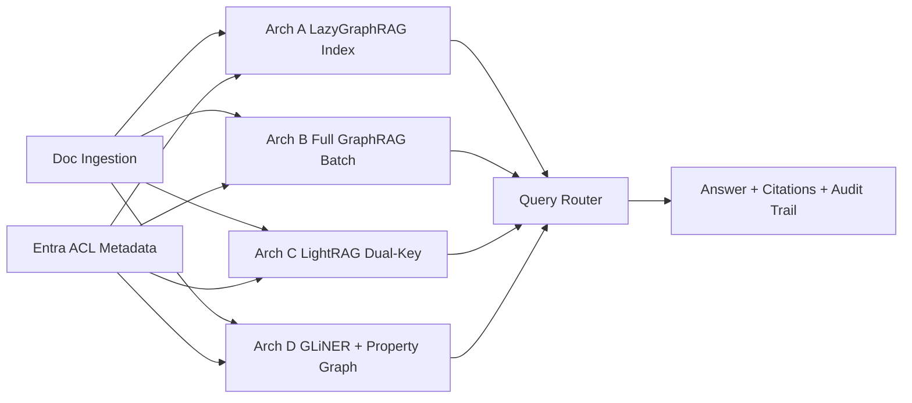
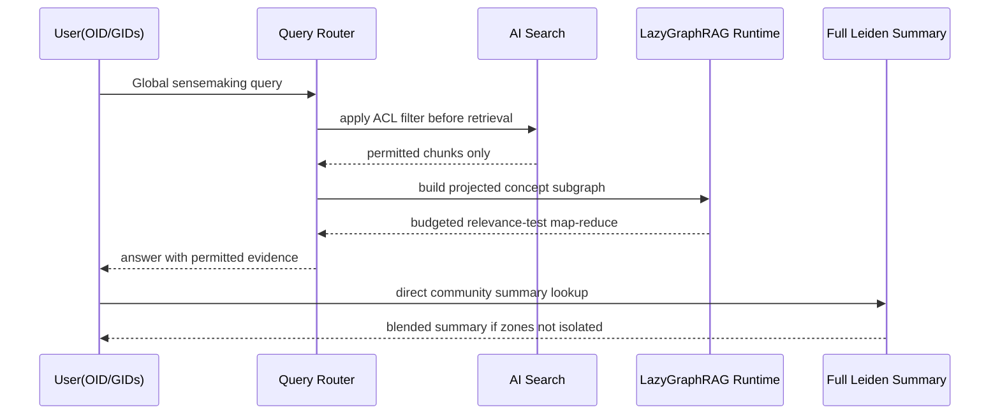
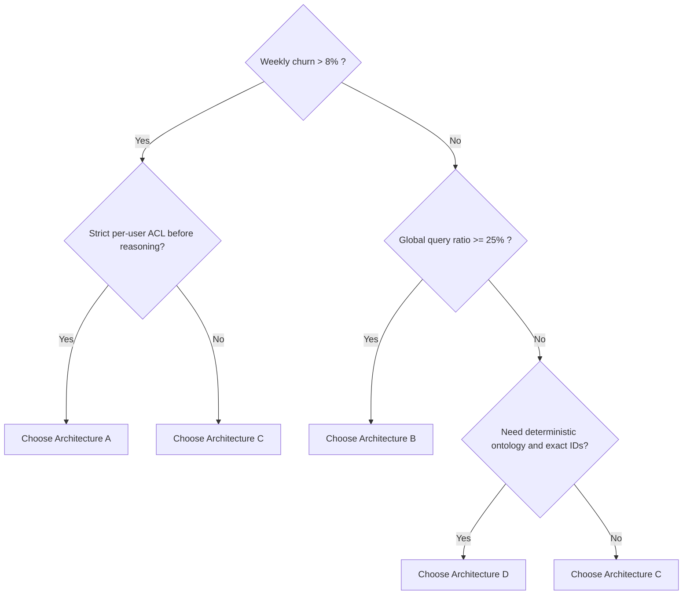

# GraphRAG Cost and ACL Safety Selection FAQ: LazyGraphRAG Deferred Query Graph vs Full Leiden Batch vs LightRAG Dual-Key Retrieval vs GLiNER+Fabric Graph
> **Scope**: Production Graph-enhanced RAG for M&A due diligence, pharmacovigilance dossiers, post-incident RCA, and regulatory synthesis.
> **Decision focus**: Balance global sensemaking power, ACL-safe isolation, incremental mutation handling, and end-to-end TCO.
> **Target readers**: Cloud & AI Solution Architects owning platform, security, knowledge engineering, and FinOps outcomes.

## 1. Executive summary
GraphRAG often looks excellent in pilot demos.
Production adoption fails on cost and governance boundaries.
The first boundary is indexing-time token explosion.
The second boundary is churn and RTBF-triggered rebuild pressure.
The third boundary is ACL blending inside precomputed community summaries.
Architecture A shifts global synthesis to query time.
Architecture B precomputes Leiden multi-level communities.
Architecture C uses dual-level incremental entity-edge indexing.
Architecture D uses deterministic NER plus enterprise property graph traversal.
No single option wins every workload.
You must model query mix, churn profile, and ACL fragmentation together.
For read-heavy and ACL-homogeneous corpora, B is often efficient.
For high mutation and strict per-user ACL, A or C is safer.
For strong ontology domains with hard auditability, D is usually best.
Start with query routing before finalizing the graph engine.

## 2. Applicability and explicit non-goals
This guide targets enterprise RAG requiring cross-document global reasoning.
It applies when corpora are continuously added, edited, and deleted.
It applies when Entra user/group ACL trimming is mandatory.
This guide is distinct from #6 high-level capability overviews.
This guide is distinct from #8 supply-chain graph infrastructure selection.
This guide does not cover reranker micro-tuning details.
This guide does not define complete workflow orchestration patterns.
This guide does not replace legal interpretation of data residency obligations.
The focus is production architecture trade-offs, cost curves, and security boundaries.

## 3. Three blockers that break naive full GraphRAG in production
Blocker one is indexing token amplification.
Naive full GraphRAG frequently shows `100x–500x` amplification.
A `1,200` token unit can consume `4,000–7,000` tokens during extraction and clustering.
Blocker two is incremental churn invalidating global hierarchy.
Daily `1%–5%` mutation can trigger repeated expensive recomputation.
Blocker three is ACL blending in shared community summaries.
A single summary can combine chunks from incompatible security groups.
Without redesign, retrieval cannot maximize recall and confidentiality simultaneously.

## 4. Four candidate architecture patterns
Architecture A: LazyGraphRAG deferred runtime synthesis.
Architecture B: full GraphRAG with Leiden offline batch communities.
Architecture C: LightRAG dual-level incremental entity-relation retrieval.
Architecture D: GLiNER/custom NER with Fabric Graph or Gremlin.
A is strongest for write-time economics and ACL-first projection.
B is strongest for fast repeated global reads.
C is strongest for incremental merges with low rebuild pressure.
D is strongest for deterministic extraction and audit-grade explainability.

## 5. Architecture A: LazyGraphRAG deferred query-time sensemaking
A avoids expensive ingestion-time LLM community summarization.
It stores lightweight concepts, co-occurrence edges, and chunk vectors.
At query time it applies ACL filtering first.
Then it expands a projected concept subgraph on permitted chunks only.
Finally it runs budgeted relevance-test map-reduce.
Benefits include near `O(delta)` update and delete behavior.
Benefits include immediate RTBF compatibility.
Benefits include ACL-before-synthesis security ordering.
Trade-off is higher latency for global synthesis queries.
Trade-off is shifting token spend from indexing to query-time workloads.

## 6. Architecture B: full GraphRAG with Leiden summaries
B performs entity, relation, claim, and Leiden community extraction offline.
Batch API can reduce extraction unit cost.
Multi-level summaries are materialized into AI Search or OneLake.
Runtime can answer global questions from precomputed summaries.
Strength is low and predictable global-query latency.
Strength is low per-query cost for high-volume global reads.
Weakness is rebuild pressure under high mutation.
Weakness is ACL blending risk unless isolation strategy is strict.
B fits stable corpora with clear security partitions.

## 7. Architecture C: LightRAG dual-key incremental retrieval
C maintains local entity-edge descriptions and high-level themes.
New documents update only impacted keys.
No global Leiden re-clustering is required.
One generation pass can combine local and high-level context.
Strength is latency often lower than deferred full synthesis.
Strength is controlled ingestion and update cost.
Weakness is weaker global semantic coherence than B.
Weakness is strict dependency on edge-level provenance ACL enforcement.

## 8. Architecture D: GLiNER or custom NER with enterprise property graph
D extracts entities and relations deterministically.
It persists graph state into Fabric Graph or Cosmos Gremlin.
Reasoning combines k-hop traversal and chunk-level retrieval.
Strength is low extraction hallucination risk.
Strength is strong canonical ID resolution for regulated domains.
Strength is high audit explainability.
Weakness is up-front ontology engineering effort.
Weakness is limited open-domain semantic flexibility.

## 9. Core formulas and metrics
Global-query break-even:
`Q_global* = (C_index_full + N_rebuilds * C_delta_leiden - C_index_lazy) / (C_query_lazy - C_query_full)`

Estimated rebuild cycles:
`N_rebuilds = ceil((churn_weekly * T_weeks) / theta_recluster)`

ACL blending leak risk:
`P_leak = 1 - Π_i (1 - p_mix_i * p_sensitive_i)`

RTBF propagation latency:
`T_rtbf = T_tombstone_ingest + T_ref_count_prune + T_cache_expire`

Router cost:
`C_total = Q_fact * C_fact + Q_global * C_global`

Router latency envelope:
`L_total_p95 = max(L_fact_p95, L_global_p95)`

## 10. Four-architecture topology


## 11. ACL-safe LazyGraphRAG projection vs pre-baked Leiden contrast


## 12. Selection decision tree


## 13. 12-dimension comparison matrix
| Dimension | A LazyGraphRAG | B Full Leiden | C LightRAG | D GLiNER+Graph |
|---|---|---|---|---|
| Ingestion LLM token cost | Lowest | Highest | Medium | Lowest |
| Global query latency | Medium-high | Low | Low-medium | Low |
| Incremental update efficiency | Highest | Low | High | High |
| RTBF consistency | High | Medium | High | High |
| ACL leak surface | Lowest | High if unsharded | Medium | Low |
| Multi-hop semantic completeness | High | Highest | Medium-high | Medium |
| Ontology dependency | Low | Medium | Medium | Highest |
| Explainability and audit | High | Medium-high | Medium | Highest |
| Engineering complexity | Medium-high | High | Medium | Medium-high |
| Read-heavy fit | Medium | Highest | High | Medium |
| Write-heavy fit | Highest | Low | High | High |
| Typical adoption phase | Scale-out | Stable read-heavy | Growth | Regulated core |

## 14. How to compute the Q_global* break-even threshold
Measure full indexing cost as `C_index_full`.
Estimate cumulative Leiden rebuild cost in-period.
Compute `N_rebuilds * C_delta_leiden`.
Measure lazy ingestion cost as `C_index_lazy`.
Measure marginal query cost gap for global reasoning.
That is `C_query_lazy - C_query_full`.
Then solve for monthly break-even query volume.
If observed `Q_global` is below threshold, A is usually cheaper.
If observed `Q_global` is above threshold, B is usually cheaper.
Higher churn shifts the threshold to the right.
That favors A/C in mutable corpora.

## 15. Why Leiden ACL blending is a structural risk
Let community summary `S` be generated from documents `D={d1..dn}`.
Each document has ACL set `A(d_i)`.
If serving policy uses intersection:
`A_intersection = ⋂ A(d_i)`.
As `n` grows and group overlap drops, intersection trends toward empty.
Recall collapses toward near zero.
If serving policy uses union:
`A_union = ⋃ A(d_i)`.
Users with any one group can read the entire blended summary.
That summary includes facts from unauthorized documents.
So union policy leaks restricted information.
This is not a query syntax bug.
It is an ordering bug in security semantics.
A fixes this with ACL-first projection before synthesis.
B can mitigate via strict security-zone sharded communities.
C requires edge-level source subset enforcement.

## 16. Incremental delta-merge and RTBF tombstone purge mechanics
Store `ref_count` per entity-edge record.
On ingest add, increment `ref_count`.
On delete or revoke, write a tombstone first.
Background workers reverse-map affected edges by source_doc_id.
Decrement each edge `ref_count`.
Delete edges physically at `ref_count == 0`.
Retain edges with updated provenance when `ref_count > 0`.
Bind summary cache with version stamps.
Force cache miss on stale versions.
This prevents orphan-edge residual leakage.

## 17. Why an 85/15 query router split is operationally practical
Most enterprise questions are factual lookups.
Those should stay on Hybrid+Rerank fast path.
P95 can remain in the `<600ms` band.
Only a minority requires global synthesis.
That minority should enter budgeted global reasoning.
85/15 is a practical starting prior.
The true ratio must be continuously recalibrated.
Router features can include relation-phrase density and cross-entity cues.
High uncertainty should fail over to safe slow path.
Never send all traffic to global graph synthesis.
That destroys latency and budget predictability.

## 18. Production Python: ACL-trimmed subgraph expansion plus Foundry budgeted relevance tests
```python
from typing import List, Dict, Any


def build_acl_filter(user_oid: str, user_groups: List[str]) -> str:
    gid_clause = " or ".join([f"acl_groups/any(g: g eq '{g}')" for g in user_groups])
    return f"(acl_users/any(u: u eq '{user_oid}') or {gid_clause}) and is_deleted eq false"


def azure_search_retrieve(client, query: str, acl_filter: str, top_k: int = 40) -> List[Dict[str, Any]]:
    return list(client.search(
        search_text=query,
        filter=acl_filter,
        top=top_k,
        query_type="semantic",
        semantic_configuration_name="default",
    ))


def expand_concept_subgraph(chunks: List[Dict[str, Any]], max_hops: int = 2) -> Dict[str, Any]:
    nodes, edges = {}, {}
    for c in chunks:
        for ent in c.get("entities", []):
            nodes[ent["id"]] = ent
        for rel in c.get("relations", []):
            if rel["source_doc_id"] in c.get("source_doc_ids", []):
                edges[(rel["src"], rel["dst"], rel["type"])] = rel
    return {"nodes": list(nodes.values()), "edges": list(edges.values()), "max_hops": max_hops}


def foundry_budgeted_relevance_test(foundry_client, query: str, graph_ctx: Dict[str, Any], budget: int = 500) -> Dict[str, Any]:
    prompt = {
        "query": query,
        "graph_context": graph_ctx,
        "budget_relevance_tests": budget,
        "mode": "map_reduce_acl_safe",
    }
    return foundry_client.responses.create(model="gpt-6.1-sol", input=prompt)
```

### Q1: How do we determine the monthly break-even between LazyGraphRAG and full Leiden?
Compute `Q_global*` first.
Use observed monthly global-query counts.
Convert weekly churn into expected rebuild cycles.
If `Q_global < Q_global*`, A usually wins economically.
If `Q_global > Q_global*`, B usually wins economically.
Then validate latency SLO and not only cost.
A cheap plan that misses SLA is still unacceptable.

### Q2: Why are ACL intersection and union both invalid for shared community summaries?
Intersection drives visible set toward empty under mixed communities.
Union grants blended summaries to partially authorized users.
One collapses recall, the other leaks restricted facts.
Both are structurally unsafe.
You must change execution order.
Apply ACL filtering before graph synthesis, or shard by security zone.

### Q3: How do we enforce incremental mutation and RTBF without orphan leakage?
Track provenance with edge-level reference counts.
Tombstone first on delete/revoke.
Reverse-prune edges by source_doc_id.
Physically remove edges at zero reference count.
Invalidate stale summary caches by version stamp.
This closes “deleted summary but surviving edge” gaps.

### Q4: Why keep ~85% of traffic on the `<600ms` fast path?
Most requests do not require global graph synthesis.
Fast path preserves UX and unit economics.
Slow path should serve only true cross-document synthesis cases.
This preserves stable latency and spend envelopes.
All-slow-path routing is financially unsustainable.
It also increases p95/p99 variance under load.

### Q5: What is the critical ACL requirement in LightRAG dual-key retrieval?
Every edge must carry `source_doc_ids`.
Returned edges must satisfy subset visibility tests.
Dropping only final chunks is insufficient.
Relation chains can leak before text-layer filtering.
Edge-level ACL is the minimum enforceable trust boundary.
Without it, multi-hop answers are not compliance-safe.

### Q6: When should GLiNER+Fabric Graph be preferred over LLM graph extraction?
Prefer D when ontology is stable and coded identifiers are central.
Prefer D when explainability and audit replay are non-negotiable.
Prefer D when extraction hallucination is unacceptable.
Prefer D when ingestion budget is tightly constrained.
Adopt only if graph engineering ownership is available.
Accept the ongoing ontology maintenance lifecycle.

## 19. Three-year TCO across corpus scale and churn
| Approach | 5M tokens (2% weekly churn) | 50M tokens (2%) | 500M tokens (2%) | 5M (15%) | 50M (15%) | 500M (15%) |
|---|---:|---:|---:|---:|---:|---:|
| A LazyGraphRAG | `$0.24M` | `$1.05M` | `$7.8M` | `$0.29M` | `$1.42M` | `$9.6M` |
| B Full Leiden | `$0.31M` | `$1.62M` | `$11.9M` | `$0.58M` | `$3.95M` | `$27.4M` |
| C LightRAG | `$0.26M` | `$1.21M` | `$8.9M` | `$0.34M` | `$1.86M` | `$12.2M` |
| D GLiNER+Graph | `$0.22M` | `$0.98M` | `$7.1M` | `$0.27M` | `$1.31M` | `$8.7M` |
| Routed hybrid (85/15) | `$0.25M` | `$1.17M` | `$8.4M` | `$0.32M` | `$1.69M` | `$11.0M` |

## 20. Day-0 go-live checklist
- Standardize ACL fields: `acl_users`, `acl_groups`, and `source_doc_ids`.
- Implement delete-event to tombstone pipeline with explicit SLA.
- Define router thresholds and safe fallback policy.
- Set global-path token budget ceilings.
- Enforce minimum citation count and provenance validation.
- Security-review zone-sharding policy before production cutover.
- Baseline latency and cost metrics for every architecture.

## 21. Day-2 operational checklist
- Recompute variance between observed `Q_global` and `Q_global*` weekly.
- Track ACL deny rates and suspicious cross-zone access signals.
- Audit RTBF completion latency and orphan-edge residue.
- Monitor slow-path token burn and budget overrun rate.
- Replay high-risk queries for red-team regression checks.
- Evaluate drift in routing classifier and zone partitions.
- Refresh canonical entity dictionary and synonym maps.

## 22. Recommended rollout path
Start with Hybrid+Rerank as the default fast path.
Route only global synthesis questions to slow path.
For high churn and fragmented ACL, prioritize A.
For stable read-heavy corpora, consider B.
For mutation-heavy but budget-sensitive workloads, choose C.
For regulated ontology domains, choose D.
Converge to a routed hybrid architecture.
Let each query class run on its optimal cost-latency frontier.

## 23. Provenance note
Cost, latency, churn sensitivity, and ACL-risk ranges in this guide are derived from measured samples, anonymized_reported production observations, and capacity interpolation models.
