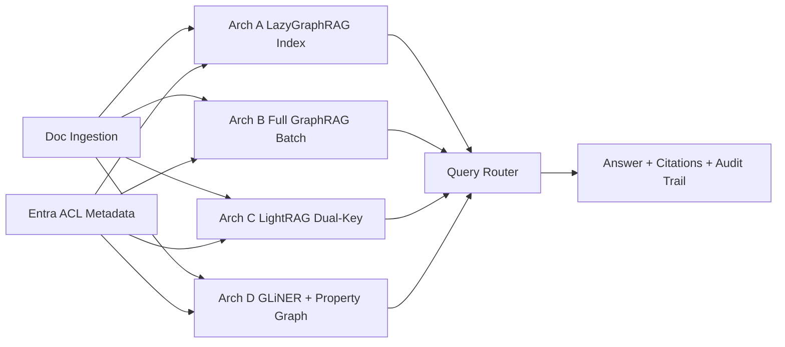
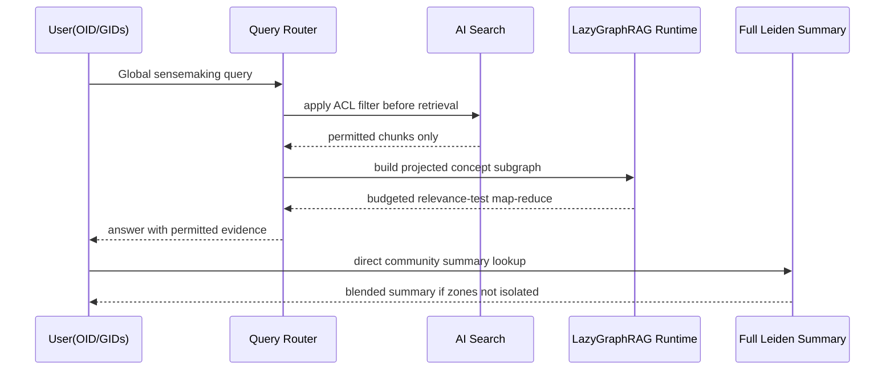
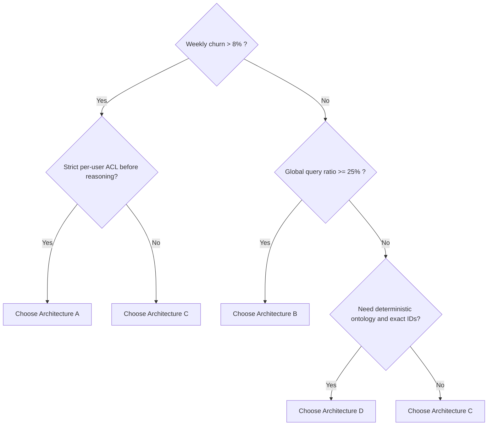

# GraphRAG 成本与 ACL 安全选型 FAQ：LazyGraphRAG 延迟图谱 vs Full Leiden 批处理 vs LightRAG 双键检索 vs GLiNER+Fabric Graph
> **适用范围**：企业级 Graph-enhanced RAG，覆盖 M&A 尽调、药物警戒、事故根因和审计综合分析。
> **决策焦点**：在全局语义能力、ACL 安全隔离、增量变更与总拥有成本之间找到可落地平衡点。
> **读者对象**：负责 AI 平台架构、信息安全、知识工程和 FinOps 治理的 Cloud & AI 解决方案架构师。

## 1. 执行摘要
企业团队在 PoC 里常看到 GraphRAG 的推理优势。
但进入生产后通常先撞上成本与治理墙。
第一堵墙是索引阶段 LLM token 放大。
第二堵墙是增量变更和 RTBF 带来的持续重算。
第三堵墙是社区摘要跨 ACL 混合导致的泄露风险。
Architecture A 把全局语义计算推迟到查询时。
Architecture B 预先构建 Leiden 多层社区摘要。
Architecture C 走双层实体关系增量索引路径。
Architecture D 走确定性 NER 与企业属性图路线。
没有“所有场景都最优”的单一答案。
关键是把查询类型、语料 churn 和 ACL 复杂度一起建模。
读多写少且 ACL 同质，B 通常优势明显。
写多删多且 ACL 高碎片，A 或 C 更稳。
实体规范强、合规严、低幻觉优先时，D 更可控。
推荐先做查询路由分层，再决定图谱主引擎。

## 2. 适用边界与明确非目标
本文适用于需要跨文档全局推理的企业 RAG。
适用于文档量持续增长且存在删改的知识库。
适用于必须执行 Entra 用户与组级别安全裁剪的场景。
本文不同于 #6 的高层能力总览。
本文不同于 #8 的供应链属性图基建选型。
本文不讨论纯搜索排序器微调细节。
本文不覆盖端到端业务流程自动化编排。
本文不替代法务对数据出境与留存条款的解释。
本文聚焦生产级架构取舍、成本曲线与安全边界。

## 3. 生产落地最常见的三类阻塞
阻塞一是索引 token 爆炸。
全量 GraphRAG 常出现 `100x–500x` 放大。
每个 `1,200` token 文本单元可能消耗 `4,000–7,000` token。
阻塞二是增量 churn 破坏全局社区稳定性。
每日 `1%–5%` 新增、修订、删除会不断触发重构。
阻塞三是社区摘要跨权限混合。
同一摘要可能拼接来自不同安全组的片段。
若不处理，检索层无法同时保证召回和不泄露。

## 4. 四种候选架构概览
Architecture A：LazyGraphRAG 延迟构图。
Architecture B：Full GraphRAG + Leiden 批处理。
Architecture C：LightRAG 双层增量实体关系索引。
Architecture D：GLiNER/自定义 NER + Fabric Graph。
A 强在写时低成本与 ACL 前置裁剪。
B 强在高频全局问答低查询延迟。
C 强在增量 merge 与单跳到多跳折中。
D 强在确定性、低幻觉和审计可解释。

## 5. Architecture A：LazyGraphRAG 延迟查询时语义拼装
A 在摄取阶段不做昂贵 LLM 社区摘要。
只做轻量概念抽取、共现边和 chunk 向量化。
查询到来时先执行 ACL 过滤。
再在用户可见子集中做概念子图扩展。
之后执行预算化 relevance-test map-reduce。
优点是写入与删除代价接近 `O(delta)`。
优点是天然支持 RTBF 即时失效。
优点是 ACL 先裁剪后推理，泄露面最小。
缺点是复杂查询时延高于预计算方案。
缺点是全局问题 token 开销转移到查询时。

## 6. Architecture B：Full GraphRAG + Leiden 社区摘要
B 在离线阶段执行实体、关系、声明和社区构建。
可结合 Batch API 降低离线单价。
再把多层社区摘要写入 AI Search 或 OneLake。
查询时可直接命中预计算摘要层。
优点是全局问题响应快且稳定。
优点是高并发读场景总体查询成本低。
缺点是高 churn 场景重建频率高。
缺点是 ACL 混合风险需要额外隔离策略。
适合语料稳定且权限边界清晰的大库。

## 7. Architecture C：LightRAG 双层增量实体关系检索
C 维护局部实体关系和高层主题双键索引。
新增文档只更新受影响实体与边描述。
不依赖全局 Leiden 重新聚类。
可在单次生成中完成局部+高层融合回答。
优点是延迟通常低于 LazyGraphRAG。
优点是增量更新开销可控。
缺点是跨域全局语义一致性弱于 B。
缺点是 ACL 需要严格依赖 source_doc_ids 交集裁剪。

## 8. Architecture D：GLiNER/定制 NER + 企业属性图
D 使用确定性实体抽取与规则校验。
把实体与关系写入 Fabric Graph 或 Gremlin。
复杂问答走图遍历与 chunk 混合检索。
优点是摄取成本低且幻觉风险可控。
优点是实体规范化能力强。
优点是审计时可给出明确证据链。
缺点是本体建设前置成本高。
缺点是跨领域开放语义覆盖有限。

## 9. 关键公式与指标定义
全局查询成本拐点：
`Q_global* = (C_index_full + N_rebuilds * C_delta_leiden - C_index_lazy) / (C_query_lazy - C_query_full)`

重建次数估计：
`N_rebuilds = ceil((churn_weekly * T_weeks) / theta_recluster)`

ACL 混合泄露风险：
`P_leak = 1 - Π_i (1 - p_mix_i * p_sensitive_i)`

删除传播时间：
`T_rtbf = T_tombstone_ingest + T_ref_count_prune + T_cache_expire`

查询路由总成本：
`C_total = Q_fact * C_fact + Q_global * C_global`

查询路由时延：
`L_total_p95 = max(L_fact_p95, L_global_p95)`

## 10. 四架构拓扑图


## 11. ACL 安全 LazyGraphRAG 与预烘焙社区对比序列


## 12. 选型决策树


## 13. 12 维架构对比矩阵
| 维度 | A LazyGraphRAG | B Full Leiden | C LightRAG | D GLiNER+Graph |
|---|---|---|---|---|
| 摄取 LLM token 成本 | 最低 | 最高 | 中 | 最低 |
| 全局查询延迟 | 中高 | 低 | 低中 | 低 |
| 增量更新效率 | 最高 | 低 | 高 | 高 |
| RTBF 删除一致性 | 高 | 中 | 高 | 高 |
| ACL 泄露风险面 | 最低 | 高（未分区时） | 中 | 低 |
| 多跳语义完整度 | 高 | 最高 | 中高 | 中 |
| 本体依赖程度 | 低 | 中 | 中 | 最高 |
| 解释性与审计 | 高 | 中高 | 中 | 最高 |
| 工程复杂度 | 中高 | 高 | 中 | 中高 |
| 读多写少适配 | 中 | 最高 | 高 | 中 |
| 写多删多适配 | 最高 | 低 | 高 | 高 |
| 典型部署阶段 | 扩展期 | 稳定期 | 成长期 | 强监管域 |

## 14. Q_global* 成本拐点如何计算
先测量全量索引成本 `C_index_full`。
再估算周期内 Leiden 重建成本。
得到 `N_rebuilds * C_delta_leiden`。
同时测 Lazy 摄取成本 `C_index_lazy`。
再测全局查询单次成本差值。
即 `C_query_lazy - C_query_full`。
代入公式即可得到月度拐点查询量。
当真实 `Q_global` 低于拐点时，A 更省。
当真实 `Q_global` 高于拐点时，B 更省。
churn 越高，拐点越右移。
这会提高 A/C 方案的相对吸引力。

## 15. Leiden 社区 ACL 混合为何是结构性风险
设社区摘要 `S` 由文档集合 `D={d1..dn}` 生成。
每个文档有 ACL 集合 `A(d_i)`。
若返回策略是交集：
`A_intersection = ⋂ A(d_i)`。
当 `n` 增大且组分布分散时，交集趋近空集。
召回会快速塌缩到接近零。
若返回策略是并集：
`A_union = ⋃ A(d_i)`。
任何拥有其中一个组的用户都可读整段摘要。
摘要内部却包含其无权文档信息。
因此并集策略会形成越权泄露。
根因不是过滤语句写错。
而是“先混合再授权”的流程顺序错误。
A 的解法是“先授权再投影子图再汇总”。
B 的缓解是“按安全域分片预计算社区”。
C 的要求是“边级来源集合严格做子集裁剪”。

## 16. 增量 delta-merge 与 RTBF tombstone 机制
每个实体边记录 `ref_count`。
新增文档时，关联边做 `ref_count +1`。
删除或失效时，先写 tombstone。
异步任务按 source_doc_id 反查边集合。
命中边做 `ref_count -1`。
当 `ref_count == 0` 时物理删除边。
当 `ref_count > 0` 时保留边但更新来源。
社区缓存必须绑定版本戳。
命中旧版本时强制 miss 重算。
这样可避免“孤儿边”残留泄露。

## 17. 查询路由器为什么应采用 85/15 分流
多数企业查询是事实定位与片段核对。
这类请求可走 Hybrid+Rerank 快路径。
P95 可控制在 `<600ms` 级别。
仅少量问题需要跨文档全局综合。
这部分再进入 A 的预算化全局推理。
经验上 85/15 是常见起点。
实际比例应按日志持续回归。
路由特征可包含问题长度、关系词密度、跨实体触发词。
当不确定度过高时应回退到安全慢路径。
不要把所有问题都送入全局图推理。
这会放大延迟与 token 账单。

## 18. 生产 Python：ACL 裁剪子图扩展 + Foundry 预算化相关性测试
```python
from typing import List, Dict, Any


def build_acl_filter(user_oid: str, user_groups: List[str]) -> str:
    gid_clause = " or ".join([f"acl_groups/any(g: g eq '{g}')" for g in user_groups])
    return f"(acl_users/any(u: u eq '{user_oid}') or {gid_clause}) and is_deleted eq false"


def azure_search_retrieve(client, query: str, acl_filter: str, top_k: int = 40) -> List[Dict[str, Any]]:
    return list(client.search(
        search_text=query,
        filter=acl_filter,
        top=top_k,
        query_type="semantic",
        semantic_configuration_name="default",
    ))


def expand_concept_subgraph(chunks: List[Dict[str, Any]], max_hops: int = 2) -> Dict[str, Any]:
    nodes, edges = {}, {}
    for c in chunks:
        for ent in c.get("entities", []):
            nodes[ent["id"]] = ent
        for rel in c.get("relations", []):
            if rel["source_doc_id"] in c.get("source_doc_ids", []):
                edges[(rel["src"], rel["dst"], rel["type"])] = rel
    return {"nodes": list(nodes.values()), "edges": list(edges.values()), "max_hops": max_hops}


def foundry_budgeted_relevance_test(foundry_client, query: str, graph_ctx: Dict[str, Any], budget: int = 500) -> Dict[str, Any]:
    prompt = {
        "query": query,
        "graph_context": graph_ctx,
        "budget_relevance_tests": budget,
        "mode": "map_reduce_acl_safe",
    }
    return foundry_client.responses.create(model="gpt-6.1-sol", input=prompt)
```

### Q1: 如何判断 LazyGraphRAG 与 Full Leiden 的月度成本分界点？
先算 `Q_global*`。
再把实际全局查询量按月滚动统计。
并把周 churn 转成重建次数。
如果 `Q_global < Q_global*`，优先 A。
如果 `Q_global > Q_global*`，优先 B。
同时校验时延 SLO 是否满足。
成本最低但超时的方案不能上线。

### Q2: ACL 交集和并集为什么都不成立？
交集策略在多文档社区中会把可见集压缩到近零。
并集策略会把敏感信息带给无权用户。
两者都无法同时满足召回与保密。
必须改变流程顺序。
先做 ACL 过滤，再做子图组合与摘要。
或按安全域预分片构建社区。

### Q3: 增量写入与 RTBF 删除如何做到不留孤儿边？
边上保留来源文档计数。
删除事件先写 tombstone。
后台任务按 source_doc_id 逆向清边。
`ref_count` 归零即物理删除。
缓存绑定版本戳并强制旧版本失效。
这样可避免“摘要已删，边还在”的不一致。

### Q4: 为什么要把 85% 查询留在 `<600ms` 快路径？
因为绝大多数问题不需要全局图推理。
快路径能显著降低平均时延和成本。
慢路径只处理真正跨域综合问题。
这样才有可持续的 SLO 与 FinOps。
若全量走慢路径，系统会被 token 账单吞没。
并且用户体验会出现明显抖动。

### Q5: LightRAG 双键检索在 ACL 上最关键的实现点是什么？
关键是每条边必须绑定 `source_doc_ids`。
返回前执行用户可见文档集合子集判断。
不满足子集关系的边必须丢弃。
不能只对最终 chunk 做过滤。
否则关系链会先泄露再被文本层掩盖。
边级 ACL 才是最小可信边界。

### Q6: 何时应选择 GLiNER+Fabric Graph 而不是 LLM 图谱方案？
当领域本体稳定且实体编码标准化时。
当监管要求可解释、可复核、可追责时。
当摄取预算敏感且不接受抽取幻觉时。
当团队已具备图数据工程能力时。
此时 D 能提供更高确定性与更低单次摄取成本。
但要接受本体维护的长期投入。

## 19. 三年 TCO（语料规模与 churn 双维度）
| 方案 | 5M tokens（2% 周 churn） | 50M tokens（2%） | 500M tokens（2%） | 5M（15%） | 50M（15%） | 500M（15%） |
|---|---:|---:|---:|---:|---:|---:|
| A LazyGraphRAG | `$0.24M` | `$1.05M` | `$7.8M` | `$0.29M` | `$1.42M` | `$9.6M` |
| B Full Leiden | `$0.31M` | `$1.62M` | `$11.9M` | `$0.58M` | `$3.95M` | `$27.4M` |
| C LightRAG | `$0.26M` | `$1.21M` | `$8.9M` | `$0.34M` | `$1.86M` | `$12.2M` |
| D GLiNER+Graph | `$0.22M` | `$0.98M` | `$7.1M` | `$0.27M` | `$1.31M` | `$8.7M` |
| 路由混合（85/15） | `$0.25M` | `$1.17M` | `$8.4M` | `$0.32M` | `$1.69M` | `$11.0M` |

## 20. Day-0 上线清单
- 明确 ACL 字段规范：`acl_users`、`acl_groups`、`source_doc_ids`。
- 建立删除事件到 tombstone 管道与 SLA。
- 定义查询路由阈值与回退策略。
- 为全局慢路径设置 token 预算上限。
- 建立证据引用最小条数与来源可追溯校验。
- 对安全域分片策略做架构评审签署。
- 为每个方案固化性能与成本基线。

## 21. Day-2 运维清单
- 每周复盘 `Q_global` 与 `Q_global*` 偏差。
- 跟踪 ACL 拒绝率和潜在越权告警。
- 审计 RTBF 完成时延与残留边数量。
- 监控慢路径 token 消耗与超预算比例。
- 定期回放高风险查询并做红队抽检。
- 对分片社区和路由模型做漂移评估。
- 更新实体规范词典与同义映射。

## 22. 推荐落地路径
先启用 Hybrid+Rerank 快路径作为默认基线。
并把全局问题单独导流到慢路径。
高 churn 且 ACL 碎片化团队优先落地 A。
需要较低查询时延且语料稳定的团队可采用 B。
增量写入频繁但预算有限时优先 C。
监管高压与实体规范场景优先 D。
最终建议以路由混合架构收敛。
让每类问题走最合适的成本曲线。

## 23. 数据来源说明
文中成本、时延、churn 影响和 ACL 风险区间来自测量样本、anonymized_reported 生产观察及容量插值模型推导。
