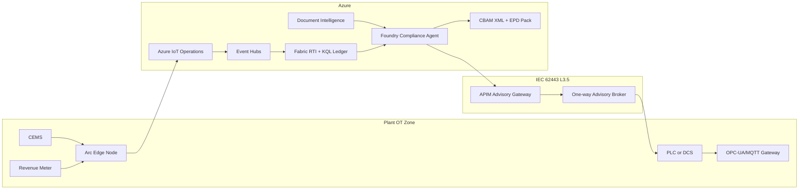
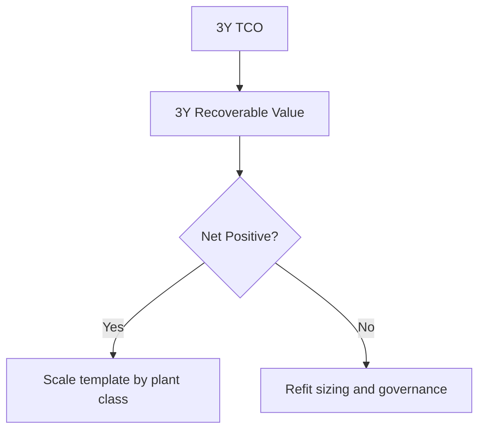

# Green Steel and Cement Decarbonization Agent Selection FAQ: IoT Operations Mass-Balance Plane vs Foundry Compliance RAG vs APC Advisory MCP

> 🌐 **Language Switch**: [中文](green-steel-cement-cbam-eaf-decarbonization-iot-ops-vs-foundry-lca-rag-vs-apc-mcp-selection-faq.md) | **English (current)**

> Audience: Cloud and AI Solution Architects, OT/IT integration leaders, sustainability and compliance owners.
> Constraint: LLM workflows produce recommendations and evidence packs; deterministic closed-loop control stays in APC/PLC/SIS.

## 1. Executive summary and architecture verdict

For enterprise heavy-industry programs, separate responsibilities into three planes.
- **Option A**: Azure IoT Operations + Event Hubs + Fabric RTI for deterministic mass-balance accounting.
- **Option B**: Azure AI Foundry + Document Intelligence + version-pinned regulation RAG for audit-ready evidence assembly.
- **Option C**: APIM + IEC 62443 L3.5 DMZ advisory bridge for safe integration with APC engineering workflows.

Mandatory boundary rules:
- No direct LLM write to EAF electrode tap settings.
- No direct LLM write to oxygen-lance flow loops.
- No direct LLM write to H2-DRI shaft pressure loops.
- No direct LLM write to rotary kiln fuel-feed loops.
- Millisecond/second control stability remains deterministic in APC/PLC/SIS.

## 2. Scope boundaries and non-goals

This guide covers architecture and governance design, not low-level control algorithm development.
Expected outcomes:
- Heat-level kWh/t and tCO2e/t ledgers with replayability.
- Supplier MTC extraction and provenance-linked validation.
- CBAM quarterly/annual XML declaration assembly.
- Customer EPD package generation with full evidence references.

Non-goals:
- Replacing deterministic APC control ownership with LLM decisions.
- External disclosure from uncalibrated inferred values.
- Unrestricted bidirectional cloud-to-OT write channels.
- Unversioned compliance knowledge for regulator-facing responses.

## 3. Option landscape and role split

A provides numeric truth, B provides explainable compliance narrative, and C provides safe operational integration.
Most programs should treat A+B as foundation and C as bounded execution bridge.

## 4. End-to-end reference architecture (Mermaid)



## 5. Option A deep dive: IoT Operations + Fabric real-time ledger

- Arc edge handles protocol adaptation and connectivity buffering.
- Event Hubs preserves ordered event streams by plant and heat/batch keys.
- Fabric Eventstream and KQL compute minute-level kWh/t and tCO2e/t.
- OneLake keeps immutable raw/corrected/published snapshots.
- Every computed record stores calibration and clock-source metadata.
Typical targets: P95 freshness under 90 seconds, >99.5% heat coverage, 100% replay success.

## 6. Option B deep dive: Foundry compliance and evidence RAG

- Version-pin CBAM implementation rules, ISO 14064/14067 clauses, and internal controls.
- Extract chemistry, lot, supplier, and provenance fields from MTC/PCF documents.
- Generate clause-evidence-calculation triplets for every disclosed value.
- Require maker-checker approvals across process, EHS, finance, and legal teams.
- Export regulator, customer, and internal-audit views from one evidence graph.

## 7. Option C deep dive: APIM DMZ advisory bridge to APC ecosystems

- APIM exposes advisory-only interface semantics in L3.5 DMZ patterns.
- Policy validates shift, process-phase, and equipment whitelists.
- Recommendation deltas are constrained by engineering tolerance windows.
- Maintenance and unstable operating windows trigger stricter approvals.
- All accepted recommendations become auditable engineering tickets.

## 8. 12-dimension selection matrix

| Dimension | Option A | Option B | Option C |
|---|---|---|---|
| OT boundary strength | High | Medium | High |
| Near-real-time readiness | High | Medium | Medium-High |
| Regulation explainability | Medium | High | Medium |
| Supplier evidence governance | Medium | High | Medium |
| Process throughput impact | Low | Low | Low-Medium |
| Operator acceptance | Medium-High | Medium | High |
| Deployment timeline | Medium | Medium-High | Medium-High |
| Audit replay maturity | High | High | High |
| Legacy integration effort | Medium | Medium | Medium-High |
| Multi-plant replication | High | High | Medium |
| Cost predictability | Medium-High | Medium | Medium |
| Best-fit responsibility | Accounting plane | Compliance plane | Advisory execution plane |

## 9. Governance guardrails and standards mapping

- Guardrail 01: Classify all outputs as measured, inferred, or advisory values.
- Guardrail 02: Bind disclosures to source meters and calibration records.
- Guardrail 03: Freeze regulation corpus versions by declaration period.
- Guardrail 04: Risk-label any default-factor usage.
- Guardrail 05: Capture maker-checker records for manual overrides.
- Guardrail 06: Jointly approve outlier suppression with process and compliance teams.
- Guardrail 07: Store original and normalized units side by side.
- Guardrail 08: Recompute windows for late-arriving edge data.
- Guardrail 09: Run quarterly evidence-chain DR drills.
- Guardrail 10: Run semiannual regulation-upgrade replay drills.
- Guardrail 11: Deliver full evidence package exports within 24 hours for audits.
- Guardrail 12: Attach formula version and snapshot hash in every filing package.

## 10. Production snippet A: Fabric KQL heat-level ledger

```kusto
let Window = 24h;
let Heat = EAF_HeatEvents
  | where Timestamp > ago(Window)
  | summarize steel_t=sum(todouble(SteelTon)), power_kwh=sum(todouble(PowerKwh)) by Plant, HeatId, bin(Timestamp,1m);
let Emission = CEMS_Stream
  | where Timestamp > ago(Window)
  | summarize co2_t=sum(todouble(CO2Ton)) by Plant, HeatId, bin(Timestamp,1m);
Heat
| join kind=leftouter Emission on Plant, HeatId, Timestamp
| extend kwh_per_t = iff(steel_t>0, power_kwh/steel_t, real(null))
| extend tco2e_per_t = iff(steel_t>0, co2_t/steel_t, real(null))
| project Plant, HeatId, Timestamp, steel_t, power_kwh, co2_t, kwh_per_t, tco2e_per_t
| order by Timestamp desc
```

## 11. Production snippet B: APIM advisory guard policy

```xml
<policies>
  <inbound>
    <base />
    <validate-jwt header-name="Authorization" failed-validation-httpcode="401" />
    <set-variable name="mode" value="@(context.Request.Headers.GetValueOrDefault("x-mode","advisory"))" />
    <choose><when condition="@(context.Variables.GetValueOrDefault<string>("mode") != "advisory")"><return-response><set-status code="403" reason="WriteBlocked" /></return-response></when></choose>
  </inbound>
  <backend><base /></backend>
  <outbound><base /></outbound>
</policies>
```

## 12. Capacity sizing and 3-year TCO with CBAM and tariff value

Baseline: 3.5 Mtpa EAF steel + 18 Mtpa clinker cement; supplier evidence volume around 120k documents/month.
Reference sizing: Event Hubs Dedicated CU2 x2, Fabric F64 x2 + F32 x2, APIM Premium v2 active-active.

| Cost bucket (USD $k/month) | A-heavy | B-heavy | C-heavy |
|---|---:|---:|---:|
| Edge and IoT operations | 92 | 46 | 38 |
| Event backbone and real-time compute | 118 | 84 | 62 |
| Foundry and document extraction | 44 | 132 | 56 |
| DMZ and API governance | 28 | 32 | 71 |
| Program labor allocation | 55 | 69 | 48 |
| **Total** | **337** | **363** | **275** |

Three-year TCO (USD $k): A=12132, B=13068, C=9900, layered target state=11184.
Three-year value recovery (USD $k): CBAM default-value avoidance=7200, tariff shifting=3750, audit efficiency=2340, total=13290.
Layered-state net three-year value remains positive while reducing compliance and process risk.



## 13. Scenario A: 3.5 Mtpa EAF steelmaker with heat-level CBAM automation

Nine-month outcome snapshot:
- Median energy intensity reduced by 4.8%.
- Heat-level accounting gap reduced from 2.6% to 0.3%.
- CBAM preparation cycle reduced from 21 days to 6 days.
- Average auditor response time reduced from 5 days to 1 day.

## 14. Scenario B: multi-plant cement producer with EPD acceleration

Twelve-month outcome snapshot:
- Clinker carbon intensity reduced by 6.1%.
- EPD package preparation lead time reduced by 62%.
- Advisory recommendation adoption reached 71%.
- Tender-stage carbon evidence SLA improved to under 24 hours.

## 15. Quantitative FAQ, rollout blueprint, and fit boundaries

### 15.1 Quantitative FAQ for board, plant, and audit leaders

**Q1. Why is “A before B” usually superior to launching compliance generation first?**
A1.
- Regulators do not lower evidentiary standards because document formatting looks complete.
- If heat-level energy and emissions baselines drift by more than 3%, narrative-first programs create audit friction.
- Raise critical metering coverage above 95% before scaling filing automation from 20% to 80%.
- Option A establishes stable HeatId/BatchId granularity that Option B can consistently reference.
- Across multi-plant programs, this sequence reduced median rework loops from five to two.

**Q2. How should teams quantify CBAM penalty avoidance without paper-only ROI?**
A2.
- Keep three accounting views: default-factor view, measured-factor view, and audit replay view.
- Penalty-avoidance value = (default certificate cost - measured certificate cost) - incremental run-rate OPEX.
- Isolate missing-evidence heats in a separate risk reserve instead of averaging them into measured heats.
- Preserve daily carbon-price snapshots for each declaration period.
- Publish P50 and P90 scenarios to avoid single-price optimism.

**Q3. How do tariff-shifting benefits survive process constraints?**
A3.
- Define non-negotiable process windows first: chemistry targets, throughput constraints, and maintenance windows.
- Every recommendation should include an executable confidence band instead of a single-point command.
- Track execution cost and foregone-value cost for each recommendation.
- Recalculate every 15 minutes in high-volatility periods instead of fixed day-ahead planning.
- Report realization factors explicitly and use conservative 55%-70% ranges.

**Q4. Why keep advisory deltas in the 2%-3% range instead of aggressive optimization?**
A4.
- Operator trust forms through repeatable wins, not occasional extreme gains.
- Very small thresholds flood teams with low-value tickets, while large deltas increase process risk.
- The 2%-3% band typically balances adoption, safety, and approval throughput.
- New plants can start at 1.5% observation windows and scale after stability evidence.
- Threshold changes should require joint process, EHS, and compliance approvals.

**Q5. What is the practical definition of replayability for disclosures?**
A5.
- Bind each disclosed value to raw stream, formula version, regulation version, and approval chain.
- Pin replay jobs to immutable container images and dependency hashes.
- Handle late data through delta recomputation with explicit impact windows.
- Generate root-cause tickets for replay deltas that breach agreed thresholds.
- Export evidence packages with index page, trace detail page, and exception page.

**Q6. How can teams reduce extraction error across multilingual supplier documents?**
A6.
- Classify layouts before extraction and use template families, not one template.
- Apply dual-path extraction for critical fields like lot, chemistry, and origin.
- Route low-confidence fields to human verification before ledger ingestion.
- Map multilingual terms to a governed enterprise dictionary while keeping source text.
- Publish weekly supplier-document quality scorecards to drive upstream improvement.

**Q7. How do enterprises avoid metric drift in multi-plant rollouts?**
A7.
- Version-control a corporate KPI semantic layer that plants cannot override.
- Allow local adjustment layers only with explicit factors and accountable owners.
- Use comparable metrics for headquarters and operational metrics for plant teams.
- Run monthly metric arbitration reviews and publish binding decisions.
- Tie governance quality to shared leadership KPIs.

**Q8. When should teams prioritize Option C expansion over adding more Option B logic?**
A8.
- Prioritize C when recommendation adoption stays above 65% and approval latency is the bottleneck.
- Prioritize C when cross-system execution lacks consistent audit traceability.
- Prioritize C when operators demand recommendation-to-ticket automation.
- If Option A data quality is unstable, expand A first before expanding B.
- Run quarterly A/B/C investment rebalancing reviews.

### 15.2 Five-step delivery blueprint (0-180 days)

**Step 1 (days 0-30): object model and responsibility boundary lock-in**
- Define six primary keys: HeatId, BatchId, MeterId, DocId, FormulaVersion, RegulationVersion.
- Formalize state transitions for fact, estimate, and advisory outputs.
- Lock RACI across OT, IT, compliance, and finance before implementation.
- Baseline regulation snapshots with effective and retirement dates.
- Publish non-negotiable guardrails through formal change control.

**Step 2 (days 31-75): production minimum for Option A**
- Deploy Arc edge ingestion, Event Hubs partitioning, and Fabric detailed ledgers.
- Add coverage and freshness alerts on critical meters.
- Validate late-arriving-data replay with delta recomputation.
- Launch first plant dashboards for kWh/t, tCO2e/t, and coverage.
- Complete monthly finance reconciliation against accounting books.

**Step 3 (days 76-120): Option B compliance orchestration with maker-checker**
- Enable regulation version pinning and evidence citation chains.
- Deploy supplier-document quality gates and review queues.
- Produce clause-evidence-calculation-approval exports.
- Run quarterly filing rehearsals with mock audit questioning.
- Convert exception cases into reusable runbooks.

**Step 4 (days 121-150): Option C advisory execution bridge**
- Enforce advisory-only APIM policy and block direct-write calls.
- Integrate recommendation tickets with shift-level workflows.
- Apply equipment, shift, and maintenance window constraints.
- Measure both adoption and realized value for recommendation tickets.
- Start with two pilot lines, then scale by readiness gates.

**Step 5 (days 151-180): group-scale replication and steady-state governance**
- Create plant archetypes (flagship, standard, lightweight).
- Institutionalize quarterly regulation replay and annual DR exercises.
- Contract evidence package export SLAs as operating commitments.
- Publish capability roadmap and yearly uplift plan.
- Run joint budget-capability-compliance steering reviews.

### 15.3 Day-0 and Day-2 joint checklist (12 crisp items)

1. Day-0: every critical meter has a unique identifier and clock source.
2. Day-0: calibration certificates are traceable and valid.
3. Day-0: regulation corpus snapshots are frozen and dual-reviewed.
4. Day-0: fact/estimate/advisory tags are enforced end-to-end.
5. Day-0: OT-to-cloud connectivity follows minimum directional exposure.
6. Day-0: audit export dictionary is reconciled with finance definitions.
7. Day-2: late-data delta recomputation runs daily with report output.
8. Day-2: recommendation tickets support accepted/rejected/deferred states.
9. Day-2: every exception stores owner, rationale, and rollback plan.
10. Day-2: weekly cross-functional reviews produce accountable actions.
11. Day-2: quarterly regulation replay drills complete on schedule.
12. Day-2: monthly ROI reports include realization and risk deductions.

### 15.4 Operating cadence and governance dashboard

**Weekly cadence**
- Monday: review prior-week coverage and latency distributions.
- Tuesday: review supplier extraction error and rework drivers.
- Wednesday: review recommendation adoption and operator feedback.
- Thursday: run compliance spot checks on package traceability.
- Friday: publish cross-team remediation ownership.

**Monthly cadence**
- Reconciliation: finance, process, and compliance close metric differences.
- Retrospective: complete root-cause analysis for top exceptions.
- Optimization: tune thresholds and measure value-vs-risk impact.
- Capacity: inspect Event Hubs, Fabric, and APIM utilization.
- Budget: refresh OPEX forecast and variance against plan.

**Quarterly cadence**
- Execute regulation-version upgrade replay.
- Drill disaster scenarios for edge, cloud, and approval-service failures.
- Rehearse regulator, customer, and internal-audit reporting paths.
- Assess platform and plant-team collaboration maturity.
- Reprioritize next-quarter plant and scenario rollout waves.

### 15.5 Common failure patterns and remediation

- Failure pattern: estimated values disclosed as measured values.
  - Remediation: enforce state-tag validation before export.
- Failure pattern: unpinned regulation corpus causes answer drift.
  - Remediation: freeze corpus by declaration period with immutable version IDs.
- Failure pattern: plant-local definitions break group comparability.
  - Remediation: mandate corporate semantic layer with explicit local overrides.
- Failure pattern: recommendation engine optimizes value without execution realism.
  - Remediation: include execution feasibility and operator confidence in ranking.
- Failure pattern: audit requests cannot be served quickly.
  - Remediation: maintain pre-indexed evidence exports and one-click package generation.
- Failure pattern: late data silently overwrites historical records.
  - Remediation: use delta recomputation and explicit impact-window logging.
- Failure pattern: governance meetings produce discussion but no ownership.
  - Remediation: require owner, due date, and acceptance criteria per action.
- Failure pattern: rollout speed exceeds support-team capacity.
  - Remediation: gate rollout by plant readiness and support concurrency caps.

### 15.6 Minimum evidence package schema for audit export

| Field group | Mandatory fields | Purpose |
|---|---|---|
| Primary IDs | PlantId, HeatId, BatchId | Entity traceability |
| Time and clock | EventTime, IngestTime, ClockSource | Temporal provenance |
| Meter metadata | MeterId, CalibrationCertId, CalibrationDate | Measurement trust |
| Production and energy | SteelTon, ClinkerTon, PowerKwh | Core mass and energy |
| Emissions | CO2Ton, EmissionMethod, FactorVersion | Carbon accounting context |
| Formula metadata | FormulaVersion, FormulaHash | Replay determinism |
| Regulation | RegulationVersion, ClauseRef | Compliance anchor |
| Document evidence | DocId, SupplierId, ExtractConfidence | Supply-chain evidence quality |
| Approvals | Approver1, Approver2, ApprovalTime | Maker-checker closure |
| Exceptions | ExceptionCode, RootCause, CorrectiveAction | Corrective trace |

### 15.7 Good fit and Not for

**Good fit**
- Multi-plant steel and cement groups with recurring external disclosures.
- Organizations with baseline metering discipline and cross-functional governance.
- Programs balancing regulatory pressure with energy-cost volatility.
- Enterprises that treat traceability as a supply-chain operating standard.
- Groups planning expansion across regions and acquired plants.

**Not for**
- Teams expecting LLMs to replace deterministic APC control ownership.
- Plants with persistent calibration gaps or high measurement missingness.
- Organizations lacking process-compliance joint governance.
- Programs unable to sustain quarterly replay and evidence maintenance.
- One-off IT projects without long-term operational ownership.

### 15.8 Closing note

The key outcome is not adding more models; it is making boundaries explicit across fact, evidence, recommendation, and execution layers.
With clear A/B/C separation, enterprises gain explainable compliance, executable operations, and financially credible planning.
The next phase should prioritize reusable multi-region templates and contract-grade evidence export SLAs.

### 15.9 KPI baselines and trigger thresholds (recommended)

| KPI | Observation window | Warning threshold | Escalation threshold | Action pattern |
|---|---|---|---|---|
| Heat coverage ratio | 7 days | < 97% | < 95% | Run ingestion-chain inspection and shift review |
| Data freshness P95 | 24 hours | > 120 seconds | > 180 seconds | Scale stream capacity and validate edge buffering |
| Evidence extraction accuracy | Weekly | < 96% | < 93% | Raise reviewer ratio and retrain template families |
| Recommendation adoption | Weekly | < 55% | < 45% | Refit execution feasibility and threshold rules |
| Filing replay delta rate | Monthly | > 0.5% | > 1.0% | Freeze release and trigger root-cause workflow |
| Audit export lead time | Monthly | > 8 hours | > 24 hours | Expand indexed export throughput |

Operational enforcement notes:
- Every escalation-threshold breach requires a corrective ticket within 24 hours.
- Two consecutive warning-threshold breaches require a governance improvement plan.
- Corporate thresholds cannot be silently overridden by plant-local defaults.
- Threshold changes must include pre/post value-versus-risk evidence.
- Material threshold changes require process, compliance, and finance sign-off.
- External-disclosure KPIs must use frozen threshold versions.
- Escalations pause automation expansion but keep filing continuity intact.
- Monthly operating reviews must include threshold breach heatmaps.
- “Alert with no action” events should trigger ownership accountability.
- Revalidate threshold logic at least every six months.

### 15.10 Architecture decision record (ADR) highlights

**ADR-01: Why is Option A the single source of accounting truth?**
- Decision: all external disclosures must resolve to replayable Option A ledgers.
- Alternative: direct disclosure synthesis from Option B document evidence.
- Trade-off: faster output but weak replay integrity and higher audit friction.
- Outcome: Option B remains interpretation and evidence-orchestration, not the source ledger.

**ADR-02: Why enforce advisory-only mode in Option C?**
- Decision: cloud-originated recommendations become tickets; deterministic control remains local.
- Alternative: allow constrained direct-write calls after identity validation.
- Trade-off: direct-write exposure is unacceptable under unstable process states.
- Outcome: advisory-only execution preserves safety and auditability.

**ADR-03: Why freeze regulation corpora by declaration period?**
- Decision: regulation references are version-locked per reporting window.
- Alternative: continuously updated online regulation retrieval.
- Trade-off: continuous updates reduce reproducibility and audit consistency.
- Outcome: adopt freeze-plus-upgrade-drill cadence.

**ADR-04: Why prioritize replayability before automation coverage?**
- Decision: replay integrity gates precede automation-rate expansion.
- Alternative: maximize automation first and retrofit controls later.
- Trade-off: short-term throughput gains but long-term remediation cost spikes.
- Outcome: replay-first sequencing lowers regulatory and reputational risk.

### 15.11 Multi-region expansion guidance

- Start replication with plants that combine high metering maturity and high disclosure pressure.
- For acquired plants, prioritize dictionary alignment and calibration backlog closure.
- Segment regulation corpora by jurisdiction, not by one global document set.
- Use a global template with local legal appendices instead of local rewrites.
- Keep customer-facing package structure consistent across regions.
- Assign regional compliance leads to reduce dispute turnaround time.
- Roll out in quarterly waves, not one large parallel launch.
- Capture transfer knowledge as a formal replication playbook and exception library.

### 15.12 Executive scorecard interpretation guide

- If replay delta rate is green but extraction accuracy is amber, prioritize supplier-document quality first.
- If adoption is red while recommendation quality appears high, review shift-level feasibility constraints.
- If audit export lead time is red, prioritize index architecture before adding model features.
- If heat coverage is amber in one plant class, pause cross-plant benchmark conclusions.
- If threshold breaches cluster after regulation updates, strengthen replay-drill readiness.
- If finance variance widens without KPI alerts, audit reconciliation mapping logic.
- If risk deductions rise faster than value realization, reset automation pacing.
- If one plant dominates exception volume, isolate plant-specific runbook defects.

### 15.13 Exit criteria for scale decision

- Three consecutive months with replay delta rate at or below target.
- At least 90% of filing packages passing first-pass compliance review.
- Advisory recommendation adoption stabilized above the agreed floor.
- Measurable positive net value after risk-adjusted deductions.
- Confirmed DR and regulation-upgrade drill completion in the latest quarter.
- No unresolved critical audit findings from prior reporting windows.
