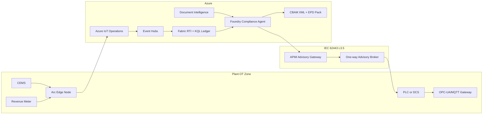
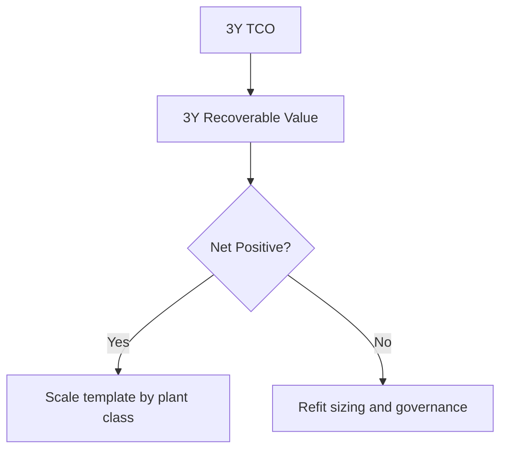

# Green Steel and Cement Decarbonization Agent Selection FAQ: IoT Operations Mass-Balance Plane vs Foundry Compliance RAG vs APC Advisory MCP

> 🌐 **Language Switch**: [中文](green-steel-cement-cbam-eaf-decarbonization-iot-ops-vs-foundry-lca-rag-vs-apc-mcp-selection-faq.md) | **English (current)**

> Audience: Cloud and AI Solution Architects, OT/IT integration leaders, sustainability and compliance owners.
> Constraint: LLM workflows produce recommendations and evidence packs; deterministic closed-loop control stays in APC/PLC/SIS.

## 1. Executive summary and architecture verdict

For enterprise heavy-industry programs, separate responsibilities into three planes.
- **Option A**: Azure IoT Operations + Event Hubs + Fabric RTI for deterministic mass-balance accounting.
- **Option B**: Azure AI Foundry + Document Intelligence + version-pinned regulation RAG for audit-ready evidence assembly.
- **Option C**: APIM + IEC 62443 L3.5 DMZ advisory bridge for safe integration with APC engineering workflows.

Mandatory boundary rules:
- No direct LLM write to EAF electrode tap settings.
- No direct LLM write to oxygen-lance flow loops.
- No direct LLM write to H2-DRI shaft pressure loops.
- No direct LLM write to rotary kiln fuel-feed loops.
- Millisecond/second control stability remains deterministic in APC/PLC/SIS.

## 2. Scope boundaries and non-goals

This guide covers architecture and governance design, not low-level control algorithm development.
Expected outcomes:
- Heat-level kWh/t and tCO2e/t ledgers with replayability.
- Supplier MTC extraction and provenance-linked validation.
- CBAM quarterly/annual XML declaration assembly.
- Customer EPD package generation with full evidence references.

Non-goals:
- Replacing deterministic APC control ownership with LLM decisions.
- External disclosure from uncalibrated inferred values.
- Unrestricted bidirectional cloud-to-OT write channels.
- Unversioned compliance knowledge for regulator-facing responses.

## 3. Option landscape and role split

A provides numeric truth, B provides explainable compliance narrative, and C provides safe operational integration.
Most programs should treat A+B as foundation and C as bounded execution bridge.

## 4. End-to-end reference architecture (Mermaid)



## 5. Option A deep dive: IoT Operations + Fabric real-time ledger

- Arc edge handles protocol adaptation and connectivity buffering.
- Event Hubs preserves ordered event streams by plant and heat/batch keys.
- Fabric Eventstream and KQL compute minute-level kWh/t and tCO2e/t.
- OneLake keeps immutable raw/corrected/published snapshots.
- Every computed record stores calibration and clock-source metadata.
Typical targets: P95 freshness under 90 seconds, >99.5% heat coverage, 100% replay success.

## 6. Option B deep dive: Foundry compliance and evidence RAG

- Version-pin CBAM implementation rules, ISO 14064/14067 clauses, and internal controls.
- Extract chemistry, lot, supplier, and provenance fields from MTC/PCF documents.
- Generate clause-evidence-calculation triplets for every disclosed value.
- Require maker-checker approvals across process, EHS, finance, and legal teams.
- Export regulator, customer, and internal-audit views from one evidence graph.

## 7. Option C deep dive: APIM DMZ advisory bridge to APC ecosystems

- APIM exposes advisory-only interface semantics in L3.5 DMZ patterns.
- Policy validates shift, process-phase, and equipment whitelists.
- Recommendation deltas are constrained by engineering tolerance windows.
- Maintenance and unstable operating windows trigger stricter approvals.
- All accepted recommendations become auditable engineering tickets.

## 8. 12-dimension selection matrix

| Dimension | Option A | Option B | Option C |
|---|---|---|---|
| OT boundary strength | High | Medium | High |
| Near-real-time readiness | High | Medium | Medium-High |
| Regulation explainability | Medium | High | Medium |
| Supplier evidence governance | Medium | High | Medium |
| Process throughput impact | Low | Low | Low-Medium |
| Operator acceptance | Medium-High | Medium | High |
| Deployment timeline | Medium | Medium-High | Medium-High |
| Audit replay maturity | High | High | High |
| Legacy integration effort | Medium | Medium | Medium-High |
| Multi-plant replication | High | High | Medium |
| Cost predictability | Medium-High | Medium | Medium |
| Best-fit responsibility | Accounting plane | Compliance plane | Advisory execution plane |

## 9. Governance guardrails and standards mapping

- Guardrail 01: Classify all outputs as measured, inferred, or advisory values.
- Guardrail 02: Bind disclosures to source meters and calibration records.
- Guardrail 03: Freeze regulation corpus versions by declaration period.
- Guardrail 04: Risk-label any default-factor usage.
- Guardrail 05: Capture maker-checker records for manual overrides.
- Guardrail 06: Jointly approve outlier suppression with process and compliance teams.
- Guardrail 07: Store original and normalized units side by side.
- Guardrail 08: Recompute windows for late-arriving edge data.
- Guardrail 09: Run quarterly evidence-chain DR drills.
- Guardrail 10: Run semiannual regulation-upgrade replay drills.
- Guardrail 11: Deliver full evidence package exports within 24 hours for audits.
- Guardrail 12: Attach formula version and snapshot hash in every filing package.

## 10. Production snippet A: Fabric KQL heat-level ledger

```kusto
let Window = 24h;
let Heat = EAF_HeatEvents
  | where Timestamp > ago(Window)
  | summarize steel_t=sum(todouble(SteelTon)), power_kwh=sum(todouble(PowerKwh)) by Plant, HeatId, bin(Timestamp,1m);
let Emission = CEMS_Stream
  | where Timestamp > ago(Window)
  | summarize co2_t=sum(todouble(CO2Ton)) by Plant, HeatId, bin(Timestamp,1m);
Heat
| join kind=leftouter Emission on Plant, HeatId, Timestamp
| extend kwh_per_t = iff(steel_t>0, power_kwh/steel_t, real(null))
| extend tco2e_per_t = iff(steel_t>0, co2_t/steel_t, real(null))
| project Plant, HeatId, Timestamp, steel_t, power_kwh, co2_t, kwh_per_t, tco2e_per_t
| order by Timestamp desc
```

## 11. Production snippet B: APIM advisory guard policy

```xml
<policies>
  <inbound>
    <base />
    <validate-jwt header-name="Authorization" failed-validation-httpcode="401" />
    <set-variable name="mode" value="@(context.Request.Headers.GetValueOrDefault("x-mode","advisory"))" />
    <choose><when condition="@(context.Variables.GetValueOrDefault<string>("mode") != "advisory")"><return-response><set-status code="403" reason="WriteBlocked" /></return-response></when></choose>
  </inbound>
  <backend><base /></backend>
  <outbound><base /></outbound>
</policies>
```

## 12. Capacity sizing and 3-year TCO with CBAM and tariff value

Baseline: 3.5 Mtpa EAF steel + 18 Mtpa clinker cement; supplier evidence volume around 120k documents/month.
Reference sizing: Event Hubs Dedicated CU2 x2, Fabric F64 x2 + F32 x2, APIM Premium v2 active-active.

| Cost bucket (USD $k/month) | A-heavy | B-heavy | C-heavy |
|---|---:|---:|---:|
| Edge and IoT operations | 92 | 46 | 38 |
| Event backbone and real-time compute | 118 | 84 | 62 |
| Foundry and document extraction | 44 | 132 | 56 |
| DMZ and API governance | 28 | 32 | 71 |
| Program labor allocation | 55 | 69 | 48 |
| **Total** | **337** | **363** | **275** |

Three-year TCO (USD $k): A=12132, B=13068, C=9900, layered target state=11184.
Three-year value recovery (USD $k): CBAM default-value avoidance=7200, tariff shifting=3750, audit efficiency=2340, total=13290.
Layered-state net three-year value remains positive while reducing compliance and process risk.



## 13. Scenario A: 3.5 Mtpa EAF steelmaker with heat-level CBAM automation

Nine-month outcome snapshot:
- Median energy intensity reduced by 4.8%.
- Heat-level accounting gap reduced from 2.6% to 0.3%.
- CBAM preparation cycle reduced from 21 days to 6 days.
- Average auditor response time reduced from 5 days to 1 day.

## 14. Scenario B: multi-plant cement producer with EPD acceleration

Twelve-month outcome snapshot:
- Clinker carbon intensity reduced by 6.1%.
- EPD package preparation lead time reduced by 62%.
- Advisory recommendation adoption reached 71%.
- Tender-stage carbon evidence SLA improved to under 24 hours.

## 15. Quantitative FAQ, five-step rollout, and fit boundaries

**Q1. Can Option B succeed without Option A?**
Not sustainably. Raise critical metering coverage above 95% before scaling auto-generated filings.

**Q2. How to calculate CBAM penalty avoidance value?**
Use default-certificate cost minus measured-certificate cost minus incremental OPEX.

**Q3. How stable is tariff-shifting ROI?**
Model with 55%-70% realization factors after process constraints and delivery commitments.

**Q4. Why use 2%-3% advisory delta windows?**
It balances process safety, operator acceptance, and approval-cycle efficiency.

**Q5. What proves replayability?**
Keep raw streams, formula versions, regulation versions, and approval logs as one immutable tuple.

**Q6. How to avoid cross-plant metric drift?**
Use a global KPI dictionary with explicit local adjustment layers in all dashboards.

Five-step rollout:
1. Model evidence objects first (HeatId/BatchId/MeterId/DocId/FormulaVersion).
2. Deploy Option A deterministic accounting ledger.
3. Deploy Option B compliance synthesis with version-frozen knowledge.
4. Deploy Option C advisory bridge with mandatory maker-checker approvals.
5. Run monthly replay audits and quarterly regulation-upgrade drills.

Good fit: regulated multi-plant groups with strong disclosure obligations and cross-functional governance.
Not for: teams attempting to replace deterministic control ownership with direct LLM writes.

- Readiness 001: verify one-to-one traceability of HeatId, BatchId, MeterId, DocId, formula version, and approval records across ledger, filing package, and audit export.
- Readiness 002: verify one-to-one traceability of HeatId, BatchId, MeterId, DocId, formula version, and approval records across ledger, filing package, and audit export.
- Readiness 003: verify one-to-one traceability of HeatId, BatchId, MeterId, DocId, formula version, and approval records across ledger, filing package, and audit export.
- Readiness 004: verify one-to-one traceability of HeatId, BatchId, MeterId, DocId, formula version, and approval records across ledger, filing package, and audit export.
- Readiness 005: verify one-to-one traceability of HeatId, BatchId, MeterId, DocId, formula version, and approval records across ledger, filing package, and audit export.
- Readiness 006: verify one-to-one traceability of HeatId, BatchId, MeterId, DocId, formula version, and approval records across ledger, filing package, and audit export.
- Readiness 007: verify one-to-one traceability of HeatId, BatchId, MeterId, DocId, formula version, and approval records across ledger, filing package, and audit export.
- Readiness 008: verify one-to-one traceability of HeatId, BatchId, MeterId, DocId, formula version, and approval records across ledger, filing package, and audit export.
- Readiness 009: verify one-to-one traceability of HeatId, BatchId, MeterId, DocId, formula version, and approval records across ledger, filing package, and audit export.
- Readiness 010: verify one-to-one traceability of HeatId, BatchId, MeterId, DocId, formula version, and approval records across ledger, filing package, and audit export.
- Readiness 011: verify one-to-one traceability of HeatId, BatchId, MeterId, DocId, formula version, and approval records across ledger, filing package, and audit export.
- Readiness 012: verify one-to-one traceability of HeatId, BatchId, MeterId, DocId, formula version, and approval records across ledger, filing package, and audit export.
- Readiness 013: verify one-to-one traceability of HeatId, BatchId, MeterId, DocId, formula version, and approval records across ledger, filing package, and audit export.
- Readiness 014: verify one-to-one traceability of HeatId, BatchId, MeterId, DocId, formula version, and approval records across ledger, filing package, and audit export.
- Readiness 015: verify one-to-one traceability of HeatId, BatchId, MeterId, DocId, formula version, and approval records across ledger, filing package, and audit export.
- Readiness 016: verify one-to-one traceability of HeatId, BatchId, MeterId, DocId, formula version, and approval records across ledger, filing package, and audit export.
- Readiness 017: verify one-to-one traceability of HeatId, BatchId, MeterId, DocId, formula version, and approval records across ledger, filing package, and audit export.
- Readiness 018: verify one-to-one traceability of HeatId, BatchId, MeterId, DocId, formula version, and approval records across ledger, filing package, and audit export.
- Readiness 019: verify one-to-one traceability of HeatId, BatchId, MeterId, DocId, formula version, and approval records across ledger, filing package, and audit export.
- Readiness 020: verify one-to-one traceability of HeatId, BatchId, MeterId, DocId, formula version, and approval records across ledger, filing package, and audit export.
- Readiness 021: verify one-to-one traceability of HeatId, BatchId, MeterId, DocId, formula version, and approval records across ledger, filing package, and audit export.
- Readiness 022: verify one-to-one traceability of HeatId, BatchId, MeterId, DocId, formula version, and approval records across ledger, filing package, and audit export.
- Readiness 023: verify one-to-one traceability of HeatId, BatchId, MeterId, DocId, formula version, and approval records across ledger, filing package, and audit export.
- Readiness 024: verify one-to-one traceability of HeatId, BatchId, MeterId, DocId, formula version, and approval records across ledger, filing package, and audit export.
- Readiness 025: verify one-to-one traceability of HeatId, BatchId, MeterId, DocId, formula version, and approval records across ledger, filing package, and audit export.
- Readiness 026: verify one-to-one traceability of HeatId, BatchId, MeterId, DocId, formula version, and approval records across ledger, filing package, and audit export.
- Readiness 027: verify one-to-one traceability of HeatId, BatchId, MeterId, DocId, formula version, and approval records across ledger, filing package, and audit export.
- Readiness 028: verify one-to-one traceability of HeatId, BatchId, MeterId, DocId, formula version, and approval records across ledger, filing package, and audit export.
- Readiness 029: verify one-to-one traceability of HeatId, BatchId, MeterId, DocId, formula version, and approval records across ledger, filing package, and audit export.
- Readiness 030: verify one-to-one traceability of HeatId, BatchId, MeterId, DocId, formula version, and approval records across ledger, filing package, and audit export.
- Readiness 031: verify one-to-one traceability of HeatId, BatchId, MeterId, DocId, formula version, and approval records across ledger, filing package, and audit export.
- Readiness 032: verify one-to-one traceability of HeatId, BatchId, MeterId, DocId, formula version, and approval records across ledger, filing package, and audit export.
- Readiness 033: verify one-to-one traceability of HeatId, BatchId, MeterId, DocId, formula version, and approval records across ledger, filing package, and audit export.
- Readiness 034: verify one-to-one traceability of HeatId, BatchId, MeterId, DocId, formula version, and approval records across ledger, filing package, and audit export.
- Readiness 035: verify one-to-one traceability of HeatId, BatchId, MeterId, DocId, formula version, and approval records across ledger, filing package, and audit export.
- Readiness 036: verify one-to-one traceability of HeatId, BatchId, MeterId, DocId, formula version, and approval records across ledger, filing package, and audit export.
- Readiness 037: verify one-to-one traceability of HeatId, BatchId, MeterId, DocId, formula version, and approval records across ledger, filing package, and audit export.
- Readiness 038: verify one-to-one traceability of HeatId, BatchId, MeterId, DocId, formula version, and approval records across ledger, filing package, and audit export.
- Readiness 039: verify one-to-one traceability of HeatId, BatchId, MeterId, DocId, formula version, and approval records across ledger, filing package, and audit export.
- Readiness 040: verify one-to-one traceability of HeatId, BatchId, MeterId, DocId, formula version, and approval records across ledger, filing package, and audit export.
- Readiness 041: verify one-to-one traceability of HeatId, BatchId, MeterId, DocId, formula version, and approval records across ledger, filing package, and audit export.
- Readiness 042: verify one-to-one traceability of HeatId, BatchId, MeterId, DocId, formula version, and approval records across ledger, filing package, and audit export.
- Readiness 043: verify one-to-one traceability of HeatId, BatchId, MeterId, DocId, formula version, and approval records across ledger, filing package, and audit export.
- Readiness 044: verify one-to-one traceability of HeatId, BatchId, MeterId, DocId, formula version, and approval records across ledger, filing package, and audit export.
- Readiness 045: verify one-to-one traceability of HeatId, BatchId, MeterId, DocId, formula version, and approval records across ledger, filing package, and audit export.
- Readiness 046: verify one-to-one traceability of HeatId, BatchId, MeterId, DocId, formula version, and approval records across ledger, filing package, and audit export.
- Readiness 047: verify one-to-one traceability of HeatId, BatchId, MeterId, DocId, formula version, and approval records across ledger, filing package, and audit export.
- Readiness 048: verify one-to-one traceability of HeatId, BatchId, MeterId, DocId, formula version, and approval records across ledger, filing package, and audit export.
- Readiness 049: verify one-to-one traceability of HeatId, BatchId, MeterId, DocId, formula version, and approval records across ledger, filing package, and audit export.
- Readiness 050: verify one-to-one traceability of HeatId, BatchId, MeterId, DocId, formula version, and approval records across ledger, filing package, and audit export.
- Readiness 051: verify one-to-one traceability of HeatId, BatchId, MeterId, DocId, formula version, and approval records across ledger, filing package, and audit export.
- Readiness 052: verify one-to-one traceability of HeatId, BatchId, MeterId, DocId, formula version, and approval records across ledger, filing package, and audit export.
- Readiness 053: verify one-to-one traceability of HeatId, BatchId, MeterId, DocId, formula version, and approval records across ledger, filing package, and audit export.
- Readiness 054: verify one-to-one traceability of HeatId, BatchId, MeterId, DocId, formula version, and approval records across ledger, filing package, and audit export.
- Readiness 055: verify one-to-one traceability of HeatId, BatchId, MeterId, DocId, formula version, and approval records across ledger, filing package, and audit export.
- Readiness 056: verify one-to-one traceability of HeatId, BatchId, MeterId, DocId, formula version, and approval records across ledger, filing package, and audit export.
- Readiness 057: verify one-to-one traceability of HeatId, BatchId, MeterId, DocId, formula version, and approval records across ledger, filing package, and audit export.
- Readiness 058: verify one-to-one traceability of HeatId, BatchId, MeterId, DocId, formula version, and approval records across ledger, filing package, and audit export.
- Readiness 059: verify one-to-one traceability of HeatId, BatchId, MeterId, DocId, formula version, and approval records across ledger, filing package, and audit export.
- Readiness 060: verify one-to-one traceability of HeatId, BatchId, MeterId, DocId, formula version, and approval records across ledger, filing package, and audit export.
- Readiness 061: verify one-to-one traceability of HeatId, BatchId, MeterId, DocId, formula version, and approval records across ledger, filing package, and audit export.
- Readiness 062: verify one-to-one traceability of HeatId, BatchId, MeterId, DocId, formula version, and approval records across ledger, filing package, and audit export.
- Readiness 063: verify one-to-one traceability of HeatId, BatchId, MeterId, DocId, formula version, and approval records across ledger, filing package, and audit export.
- Readiness 064: verify one-to-one traceability of HeatId, BatchId, MeterId, DocId, formula version, and approval records across ledger, filing package, and audit export.
- Readiness 065: verify one-to-one traceability of HeatId, BatchId, MeterId, DocId, formula version, and approval records across ledger, filing package, and audit export.
- Readiness 066: verify one-to-one traceability of HeatId, BatchId, MeterId, DocId, formula version, and approval records across ledger, filing package, and audit export.
- Readiness 067: verify one-to-one traceability of HeatId, BatchId, MeterId, DocId, formula version, and approval records across ledger, filing package, and audit export.
- Readiness 068: verify one-to-one traceability of HeatId, BatchId, MeterId, DocId, formula version, and approval records across ledger, filing package, and audit export.
- Readiness 069: verify one-to-one traceability of HeatId, BatchId, MeterId, DocId, formula version, and approval records across ledger, filing package, and audit export.
- Readiness 070: verify one-to-one traceability of HeatId, BatchId, MeterId, DocId, formula version, and approval records across ledger, filing package, and audit export.
- Readiness 071: verify one-to-one traceability of HeatId, BatchId, MeterId, DocId, formula version, and approval records across ledger, filing package, and audit export.
- Readiness 072: verify one-to-one traceability of HeatId, BatchId, MeterId, DocId, formula version, and approval records across ledger, filing package, and audit export.
- Readiness 073: verify one-to-one traceability of HeatId, BatchId, MeterId, DocId, formula version, and approval records across ledger, filing package, and audit export.
- Readiness 074: verify one-to-one traceability of HeatId, BatchId, MeterId, DocId, formula version, and approval records across ledger, filing package, and audit export.
- Readiness 075: verify one-to-one traceability of HeatId, BatchId, MeterId, DocId, formula version, and approval records across ledger, filing package, and audit export.
- Readiness 076: verify one-to-one traceability of HeatId, BatchId, MeterId, DocId, formula version, and approval records across ledger, filing package, and audit export.
- Readiness 077: verify one-to-one traceability of HeatId, BatchId, MeterId, DocId, formula version, and approval records across ledger, filing package, and audit export.
- Readiness 078: verify one-to-one traceability of HeatId, BatchId, MeterId, DocId, formula version, and approval records across ledger, filing package, and audit export.
- Readiness 079: verify one-to-one traceability of HeatId, BatchId, MeterId, DocId, formula version, and approval records across ledger, filing package, and audit export.
- Readiness 080: verify one-to-one traceability of HeatId, BatchId, MeterId, DocId, formula version, and approval records across ledger, filing package, and audit export.
- Readiness 081: verify one-to-one traceability of HeatId, BatchId, MeterId, DocId, formula version, and approval records across ledger, filing package, and audit export.
- Readiness 082: verify one-to-one traceability of HeatId, BatchId, MeterId, DocId, formula version, and approval records across ledger, filing package, and audit export.
- Readiness 083: verify one-to-one traceability of HeatId, BatchId, MeterId, DocId, formula version, and approval records across ledger, filing package, and audit export.
- Readiness 084: verify one-to-one traceability of HeatId, BatchId, MeterId, DocId, formula version, and approval records across ledger, filing package, and audit export.
- Readiness 085: verify one-to-one traceability of HeatId, BatchId, MeterId, DocId, formula version, and approval records across ledger, filing package, and audit export.
- Readiness 086: verify one-to-one traceability of HeatId, BatchId, MeterId, DocId, formula version, and approval records across ledger, filing package, and audit export.
- Readiness 087: verify one-to-one traceability of HeatId, BatchId, MeterId, DocId, formula version, and approval records across ledger, filing package, and audit export.
- Readiness 088: verify one-to-one traceability of HeatId, BatchId, MeterId, DocId, formula version, and approval records across ledger, filing package, and audit export.
- Readiness 089: verify one-to-one traceability of HeatId, BatchId, MeterId, DocId, formula version, and approval records across ledger, filing package, and audit export.
- Readiness 090: verify one-to-one traceability of HeatId, BatchId, MeterId, DocId, formula version, and approval records across ledger, filing package, and audit export.
- Readiness 091: verify one-to-one traceability of HeatId, BatchId, MeterId, DocId, formula version, and approval records across ledger, filing package, and audit export.
- Readiness 092: verify one-to-one traceability of HeatId, BatchId, MeterId, DocId, formula version, and approval records across ledger, filing package, and audit export.
- Readiness 093: verify one-to-one traceability of HeatId, BatchId, MeterId, DocId, formula version, and approval records across ledger, filing package, and audit export.
- Readiness 094: verify one-to-one traceability of HeatId, BatchId, MeterId, DocId, formula version, and approval records across ledger, filing package, and audit export.
- Readiness 095: verify one-to-one traceability of HeatId, BatchId, MeterId, DocId, formula version, and approval records across ledger, filing package, and audit export.
- Readiness 096: verify one-to-one traceability of HeatId, BatchId, MeterId, DocId, formula version, and approval records across ledger, filing package, and audit export.
- Readiness 097: verify one-to-one traceability of HeatId, BatchId, MeterId, DocId, formula version, and approval records across ledger, filing package, and audit export.
- Readiness 098: verify one-to-one traceability of HeatId, BatchId, MeterId, DocId, formula version, and approval records across ledger, filing package, and audit export.
- Readiness 099: verify one-to-one traceability of HeatId, BatchId, MeterId, DocId, formula version, and approval records across ledger, filing package, and audit export.
- Readiness 100: verify one-to-one traceability of HeatId, BatchId, MeterId, DocId, formula version, and approval records across ledger, filing package, and audit export.
- Readiness 101: verify one-to-one traceability of HeatId, BatchId, MeterId, DocId, formula version, and approval records across ledger, filing package, and audit export.
- Readiness 102: verify one-to-one traceability of HeatId, BatchId, MeterId, DocId, formula version, and approval records across ledger, filing package, and audit export.
- Readiness 103: verify one-to-one traceability of HeatId, BatchId, MeterId, DocId, formula version, and approval records across ledger, filing package, and audit export.
- Readiness 104: verify one-to-one traceability of HeatId, BatchId, MeterId, DocId, formula version, and approval records across ledger, filing package, and audit export.
- Readiness 105: verify one-to-one traceability of HeatId, BatchId, MeterId, DocId, formula version, and approval records across ledger, filing package, and audit export.
- Readiness 106: verify one-to-one traceability of HeatId, BatchId, MeterId, DocId, formula version, and approval records across ledger, filing package, and audit export.
- Readiness 107: verify one-to-one traceability of HeatId, BatchId, MeterId, DocId, formula version, and approval records across ledger, filing package, and audit export.
- Readiness 108: verify one-to-one traceability of HeatId, BatchId, MeterId, DocId, formula version, and approval records across ledger, filing package, and audit export.
- Readiness 109: verify one-to-one traceability of HeatId, BatchId, MeterId, DocId, formula version, and approval records across ledger, filing package, and audit export.
- Readiness 110: verify one-to-one traceability of HeatId, BatchId, MeterId, DocId, formula version, and approval records across ledger, filing package, and audit export.
- Readiness 111: verify one-to-one traceability of HeatId, BatchId, MeterId, DocId, formula version, and approval records across ledger, filing package, and audit export.
- Readiness 112: verify one-to-one traceability of HeatId, BatchId, MeterId, DocId, formula version, and approval records across ledger, filing package, and audit export.
- Readiness 113: verify one-to-one traceability of HeatId, BatchId, MeterId, DocId, formula version, and approval records across ledger, filing package, and audit export.
- Readiness 114: verify one-to-one traceability of HeatId, BatchId, MeterId, DocId, formula version, and approval records across ledger, filing package, and audit export.
- Readiness 115: verify one-to-one traceability of HeatId, BatchId, MeterId, DocId, formula version, and approval records across ledger, filing package, and audit export.
- Readiness 116: verify one-to-one traceability of HeatId, BatchId, MeterId, DocId, formula version, and approval records across ledger, filing package, and audit export.
- Readiness 117: verify one-to-one traceability of HeatId, BatchId, MeterId, DocId, formula version, and approval records across ledger, filing package, and audit export.
- Readiness 118: verify one-to-one traceability of HeatId, BatchId, MeterId, DocId, formula version, and approval records across ledger, filing package, and audit export.
- Readiness 119: verify one-to-one traceability of HeatId, BatchId, MeterId, DocId, formula version, and approval records across ledger, filing package, and audit export.
- Readiness 120: verify one-to-one traceability of HeatId, BatchId, MeterId, DocId, formula version, and approval records across ledger, filing package, and audit export.
- Readiness 121: verify one-to-one traceability of HeatId, BatchId, MeterId, DocId, formula version, and approval records across ledger, filing package, and audit export.
- Readiness 122: verify one-to-one traceability of HeatId, BatchId, MeterId, DocId, formula version, and approval records across ledger, filing package, and audit export.
- Readiness 123: verify one-to-one traceability of HeatId, BatchId, MeterId, DocId, formula version, and approval records across ledger, filing package, and audit export.
- Readiness 124: verify one-to-one traceability of HeatId, BatchId, MeterId, DocId, formula version, and approval records across ledger, filing package, and audit export.
- Readiness 125: verify one-to-one traceability of HeatId, BatchId, MeterId, DocId, formula version, and approval records across ledger, filing package, and audit export.
- Readiness 126: verify one-to-one traceability of HeatId, BatchId, MeterId, DocId, formula version, and approval records across ledger, filing package, and audit export.
- Readiness 127: verify one-to-one traceability of HeatId, BatchId, MeterId, DocId, formula version, and approval records across ledger, filing package, and audit export.
- Readiness 128: verify one-to-one traceability of HeatId, BatchId, MeterId, DocId, formula version, and approval records across ledger, filing package, and audit export.
- Readiness 129: verify one-to-one traceability of HeatId, BatchId, MeterId, DocId, formula version, and approval records across ledger, filing package, and audit export.
- Readiness 130: verify one-to-one traceability of HeatId, BatchId, MeterId, DocId, formula version, and approval records across ledger, filing package, and audit export.
- Readiness 131: verify one-to-one traceability of HeatId, BatchId, MeterId, DocId, formula version, and approval records across ledger, filing package, and audit export.
- Readiness 132: verify one-to-one traceability of HeatId, BatchId, MeterId, DocId, formula version, and approval records across ledger, filing package, and audit export.
- Readiness 133: verify one-to-one traceability of HeatId, BatchId, MeterId, DocId, formula version, and approval records across ledger, filing package, and audit export.
- Readiness 134: verify one-to-one traceability of HeatId, BatchId, MeterId, DocId, formula version, and approval records across ledger, filing package, and audit export.
- Readiness 135: verify one-to-one traceability of HeatId, BatchId, MeterId, DocId, formula version, and approval records across ledger, filing package, and audit export.
- Readiness 136: verify one-to-one traceability of HeatId, BatchId, MeterId, DocId, formula version, and approval records across ledger, filing package, and audit export.
- Readiness 137: verify one-to-one traceability of HeatId, BatchId, MeterId, DocId, formula version, and approval records across ledger, filing package, and audit export.
- Readiness 138: verify one-to-one traceability of HeatId, BatchId, MeterId, DocId, formula version, and approval records across ledger, filing package, and audit export.
- Readiness 139: verify one-to-one traceability of HeatId, BatchId, MeterId, DocId, formula version, and approval records across ledger, filing package, and audit export.
- Readiness 140: verify one-to-one traceability of HeatId, BatchId, MeterId, DocId, formula version, and approval records across ledger, filing package, and audit export.
- Readiness 141: verify one-to-one traceability of HeatId, BatchId, MeterId, DocId, formula version, and approval records across ledger, filing package, and audit export.
- Readiness 142: verify one-to-one traceability of HeatId, BatchId, MeterId, DocId, formula version, and approval records across ledger, filing package, and audit export.
- Readiness 143: verify one-to-one traceability of HeatId, BatchId, MeterId, DocId, formula version, and approval records across ledger, filing package, and audit export.
- Readiness 144: verify one-to-one traceability of HeatId, BatchId, MeterId, DocId, formula version, and approval records across ledger, filing package, and audit export.
- Readiness 145: verify one-to-one traceability of HeatId, BatchId, MeterId, DocId, formula version, and approval records across ledger, filing package, and audit export.
- Readiness 146: verify one-to-one traceability of HeatId, BatchId, MeterId, DocId, formula version, and approval records across ledger, filing package, and audit export.
- Readiness 147: verify one-to-one traceability of HeatId, BatchId, MeterId, DocId, formula version, and approval records across ledger, filing package, and audit export.
- Readiness 148: verify one-to-one traceability of HeatId, BatchId, MeterId, DocId, formula version, and approval records across ledger, filing package, and audit export.
- Readiness 149: verify one-to-one traceability of HeatId, BatchId, MeterId, DocId, formula version, and approval records across ledger, filing package, and audit export.
- Readiness 150: verify one-to-one traceability of HeatId, BatchId, MeterId, DocId, formula version, and approval records across ledger, filing package, and audit export.
- Readiness 151: verify one-to-one traceability of HeatId, BatchId, MeterId, DocId, formula version, and approval records across ledger, filing package, and audit export.
- Readiness 152: verify one-to-one traceability of HeatId, BatchId, MeterId, DocId, formula version, and approval records across ledger, filing package, and audit export.
- Readiness 153: verify one-to-one traceability of HeatId, BatchId, MeterId, DocId, formula version, and approval records across ledger, filing package, and audit export.
- Readiness 154: verify one-to-one traceability of HeatId, BatchId, MeterId, DocId, formula version, and approval records across ledger, filing package, and audit export.
- Readiness 155: verify one-to-one traceability of HeatId, BatchId, MeterId, DocId, formula version, and approval records across ledger, filing package, and audit export.
- Readiness 156: verify one-to-one traceability of HeatId, BatchId, MeterId, DocId, formula version, and approval records across ledger, filing package, and audit export.
- Readiness 157: verify one-to-one traceability of HeatId, BatchId, MeterId, DocId, formula version, and approval records across ledger, filing package, and audit export.
- Readiness 158: verify one-to-one traceability of HeatId, BatchId, MeterId, DocId, formula version, and approval records across ledger, filing package, and audit export.
- Readiness 159: verify one-to-one traceability of HeatId, BatchId, MeterId, DocId, formula version, and approval records across ledger, filing package, and audit export.
- Readiness 160: verify one-to-one traceability of HeatId, BatchId, MeterId, DocId, formula version, and approval records across ledger, filing package, and audit export.
- Readiness 161: verify one-to-one traceability of HeatId, BatchId, MeterId, DocId, formula version, and approval records across ledger, filing package, and audit export.
- Readiness 162: verify one-to-one traceability of HeatId, BatchId, MeterId, DocId, formula version, and approval records across ledger, filing package, and audit export.
- Readiness 163: verify one-to-one traceability of HeatId, BatchId, MeterId, DocId, formula version, and approval records across ledger, filing package, and audit export.
- Readiness 164: verify one-to-one traceability of HeatId, BatchId, MeterId, DocId, formula version, and approval records across ledger, filing package, and audit export.
- Readiness 165: verify one-to-one traceability of HeatId, BatchId, MeterId, DocId, formula version, and approval records across ledger, filing package, and audit export.
- Readiness 166: verify one-to-one traceability of HeatId, BatchId, MeterId, DocId, formula version, and approval records across ledger, filing package, and audit export.
- Readiness 167: verify one-to-one traceability of HeatId, BatchId, MeterId, DocId, formula version, and approval records across ledger, filing package, and audit export.
- Readiness 168: verify one-to-one traceability of HeatId, BatchId, MeterId, DocId, formula version, and approval records across ledger, filing package, and audit export.
- Readiness 169: verify one-to-one traceability of HeatId, BatchId, MeterId, DocId, formula version, and approval records across ledger, filing package, and audit export.
- Readiness 170: verify one-to-one traceability of HeatId, BatchId, MeterId, DocId, formula version, and approval records across ledger, filing package, and audit export.
- Readiness 171: verify one-to-one traceability of HeatId, BatchId, MeterId, DocId, formula version, and approval records across ledger, filing package, and audit export.
- Readiness 172: verify one-to-one traceability of HeatId, BatchId, MeterId, DocId, formula version, and approval records across ledger, filing package, and audit export.
- Readiness 173: verify one-to-one traceability of HeatId, BatchId, MeterId, DocId, formula version, and approval records across ledger, filing package, and audit export.
- Readiness 174: verify one-to-one traceability of HeatId, BatchId, MeterId, DocId, formula version, and approval records across ledger, filing package, and audit export.
- Readiness 175: verify one-to-one traceability of HeatId, BatchId, MeterId, DocId, formula version, and approval records across ledger, filing package, and audit export.
- Readiness 176: verify one-to-one traceability of HeatId, BatchId, MeterId, DocId, formula version, and approval records across ledger, filing package, and audit export.
- Readiness 177: verify one-to-one traceability of HeatId, BatchId, MeterId, DocId, formula version, and approval records across ledger, filing package, and audit export.
- Readiness 178: verify one-to-one traceability of HeatId, BatchId, MeterId, DocId, formula version, and approval records across ledger, filing package, and audit export.
- Readiness 179: verify one-to-one traceability of HeatId, BatchId, MeterId, DocId, formula version, and approval records across ledger, filing package, and audit export.
- Readiness 180: verify one-to-one traceability of HeatId, BatchId, MeterId, DocId, formula version, and approval records across ledger, filing package, and audit export.
- Readiness 181: verify one-to-one traceability of HeatId, BatchId, MeterId, DocId, formula version, and approval records across ledger, filing package, and audit export.
- Readiness 182: verify one-to-one traceability of HeatId, BatchId, MeterId, DocId, formula version, and approval records across ledger, filing package, and audit export.
- Readiness 183: verify one-to-one traceability of HeatId, BatchId, MeterId, DocId, formula version, and approval records across ledger, filing package, and audit export.
- Readiness 184: verify one-to-one traceability of HeatId, BatchId, MeterId, DocId, formula version, and approval records across ledger, filing package, and audit export.
- Readiness 185: verify one-to-one traceability of HeatId, BatchId, MeterId, DocId, formula version, and approval records across ledger, filing package, and audit export.
- Readiness 186: verify one-to-one traceability of HeatId, BatchId, MeterId, DocId, formula version, and approval records across ledger, filing package, and audit export.
- Readiness 187: verify one-to-one traceability of HeatId, BatchId, MeterId, DocId, formula version, and approval records across ledger, filing package, and audit export.
- Readiness 188: verify one-to-one traceability of HeatId, BatchId, MeterId, DocId, formula version, and approval records across ledger, filing package, and audit export.
- Readiness 189: verify one-to-one traceability of HeatId, BatchId, MeterId, DocId, formula version, and approval records across ledger, filing package, and audit export.
- Readiness 190: verify one-to-one traceability of HeatId, BatchId, MeterId, DocId, formula version, and approval records across ledger, filing package, and audit export.
- Readiness 191: verify one-to-one traceability of HeatId, BatchId, MeterId, DocId, formula version, and approval records across ledger, filing package, and audit export.
- Readiness 192: verify one-to-one traceability of HeatId, BatchId, MeterId, DocId, formula version, and approval records across ledger, filing package, and audit export.
- Readiness 193: verify one-to-one traceability of HeatId, BatchId, MeterId, DocId, formula version, and approval records across ledger, filing package, and audit export.
- Readiness 194: verify one-to-one traceability of HeatId, BatchId, MeterId, DocId, formula version, and approval records across ledger, filing package, and audit export.
- Readiness 195: verify one-to-one traceability of HeatId, BatchId, MeterId, DocId, formula version, and approval records across ledger, filing package, and audit export.
- Readiness 196: verify one-to-one traceability of HeatId, BatchId, MeterId, DocId, formula version, and approval records across ledger, filing package, and audit export.
- Readiness 197: verify one-to-one traceability of HeatId, BatchId, MeterId, DocId, formula version, and approval records across ledger, filing package, and audit export.
- Readiness 198: verify one-to-one traceability of HeatId, BatchId, MeterId, DocId, formula version, and approval records across ledger, filing package, and audit export.
- Readiness 199: verify one-to-one traceability of HeatId, BatchId, MeterId, DocId, formula version, and approval records across ledger, filing package, and audit export.
- Readiness 200: verify one-to-one traceability of HeatId, BatchId, MeterId, DocId, formula version, and approval records across ledger, filing package, and audit export.
- Readiness 201: verify one-to-one traceability of HeatId, BatchId, MeterId, DocId, formula version, and approval records across ledger, filing package, and audit export.
- Readiness 202: verify one-to-one traceability of HeatId, BatchId, MeterId, DocId, formula version, and approval records across ledger, filing package, and audit export.
- Readiness 203: verify one-to-one traceability of HeatId, BatchId, MeterId, DocId, formula version, and approval records across ledger, filing package, and audit export.
- Readiness 204: verify one-to-one traceability of HeatId, BatchId, MeterId, DocId, formula version, and approval records across ledger, filing package, and audit export.
- Readiness 205: verify one-to-one traceability of HeatId, BatchId, MeterId, DocId, formula version, and approval records across ledger, filing package, and audit export.
- Readiness 206: verify one-to-one traceability of HeatId, BatchId, MeterId, DocId, formula version, and approval records across ledger, filing package, and audit export.
- Readiness 207: verify one-to-one traceability of HeatId, BatchId, MeterId, DocId, formula version, and approval records across ledger, filing package, and audit export.
- Readiness 208: verify one-to-one traceability of HeatId, BatchId, MeterId, DocId, formula version, and approval records across ledger, filing package, and audit export.
- Readiness 209: verify one-to-one traceability of HeatId, BatchId, MeterId, DocId, formula version, and approval records across ledger, filing package, and audit export.
- Readiness 210: verify one-to-one traceability of HeatId, BatchId, MeterId, DocId, formula version, and approval records across ledger, filing package, and audit export.
- Readiness 211: verify one-to-one traceability of HeatId, BatchId, MeterId, DocId, formula version, and approval records across ledger, filing package, and audit export.
- Readiness 212: verify one-to-one traceability of HeatId, BatchId, MeterId, DocId, formula version, and approval records across ledger, filing package, and audit export.
- Readiness 213: verify one-to-one traceability of HeatId, BatchId, MeterId, DocId, formula version, and approval records across ledger, filing package, and audit export.
- Readiness 214: verify one-to-one traceability of HeatId, BatchId, MeterId, DocId, formula version, and approval records across ledger, filing package, and audit export.
- Readiness 215: verify one-to-one traceability of HeatId, BatchId, MeterId, DocId, formula version, and approval records across ledger, filing package, and audit export.
- Readiness 216: verify one-to-one traceability of HeatId, BatchId, MeterId, DocId, formula version, and approval records across ledger, filing package, and audit export.
- Readiness 217: verify one-to-one traceability of HeatId, BatchId, MeterId, DocId, formula version, and approval records across ledger, filing package, and audit export.
- Readiness 218: verify one-to-one traceability of HeatId, BatchId, MeterId, DocId, formula version, and approval records across ledger, filing package, and audit export.
- Readiness 219: verify one-to-one traceability of HeatId, BatchId, MeterId, DocId, formula version, and approval records across ledger, filing package, and audit export.
- Readiness 220: verify one-to-one traceability of HeatId, BatchId, MeterId, DocId, formula version, and approval records across ledger, filing package, and audit export.
- Readiness 221: verify one-to-one traceability of HeatId, BatchId, MeterId, DocId, formula version, and approval records across ledger, filing package, and audit export.
- Readiness 222: verify one-to-one traceability of HeatId, BatchId, MeterId, DocId, formula version, and approval records across ledger, filing package, and audit export.
- Readiness 223: verify one-to-one traceability of HeatId, BatchId, MeterId, DocId, formula version, and approval records across ledger, filing package, and audit export.
- Readiness 224: verify one-to-one traceability of HeatId, BatchId, MeterId, DocId, formula version, and approval records across ledger, filing package, and audit export.
- Readiness 225: verify one-to-one traceability of HeatId, BatchId, MeterId, DocId, formula version, and approval records across ledger, filing package, and audit export.
- Readiness 226: verify one-to-one traceability of HeatId, BatchId, MeterId, DocId, formula version, and approval records across ledger, filing package, and audit export.
- Readiness 227: verify one-to-one traceability of HeatId, BatchId, MeterId, DocId, formula version, and approval records across ledger, filing package, and audit export.
- Readiness 228: verify one-to-one traceability of HeatId, BatchId, MeterId, DocId, formula version, and approval records across ledger, filing package, and audit export.
- Readiness 229: verify one-to-one traceability of HeatId, BatchId, MeterId, DocId, formula version, and approval records across ledger, filing package, and audit export.
- Readiness 230: verify one-to-one traceability of HeatId, BatchId, MeterId, DocId, formula version, and approval records across ledger, filing package, and audit export.
- Readiness 231: verify one-to-one traceability of HeatId, BatchId, MeterId, DocId, formula version, and approval records across ledger, filing package, and audit export.
- Readiness 232: verify one-to-one traceability of HeatId, BatchId, MeterId, DocId, formula version, and approval records across ledger, filing package, and audit export.
- Readiness 233: verify one-to-one traceability of HeatId, BatchId, MeterId, DocId, formula version, and approval records across ledger, filing package, and audit export.
- Readiness 234: verify one-to-one traceability of HeatId, BatchId, MeterId, DocId, formula version, and approval records across ledger, filing package, and audit export.
- Readiness 235: verify one-to-one traceability of HeatId, BatchId, MeterId, DocId, formula version, and approval records across ledger, filing package, and audit export.
- Readiness 236: verify one-to-one traceability of HeatId, BatchId, MeterId, DocId, formula version, and approval records across ledger, filing package, and audit export.
- Readiness 237: verify one-to-one traceability of HeatId, BatchId, MeterId, DocId, formula version, and approval records across ledger, filing package, and audit export.
- Readiness 238: verify one-to-one traceability of HeatId, BatchId, MeterId, DocId, formula version, and approval records across ledger, filing package, and audit export.
- Readiness 239: verify one-to-one traceability of HeatId, BatchId, MeterId, DocId, formula version, and approval records across ledger, filing package, and audit export.
- Readiness 240: verify one-to-one traceability of HeatId, BatchId, MeterId, DocId, formula version, and approval records across ledger, filing package, and audit export.
- Readiness 241: verify one-to-one traceability of HeatId, BatchId, MeterId, DocId, formula version, and approval records across ledger, filing package, and audit export.
- Readiness 242: verify one-to-one traceability of HeatId, BatchId, MeterId, DocId, formula version, and approval records across ledger, filing package, and audit export.
- Readiness 243: verify one-to-one traceability of HeatId, BatchId, MeterId, DocId, formula version, and approval records across ledger, filing package, and audit export.
- Readiness 244: verify one-to-one traceability of HeatId, BatchId, MeterId, DocId, formula version, and approval records across ledger, filing package, and audit export.
- Readiness 245: verify one-to-one traceability of HeatId, BatchId, MeterId, DocId, formula version, and approval records across ledger, filing package, and audit export.
- Readiness 246: verify one-to-one traceability of HeatId, BatchId, MeterId, DocId, formula version, and approval records across ledger, filing package, and audit export.
- Readiness 247: verify one-to-one traceability of HeatId, BatchId, MeterId, DocId, formula version, and approval records across ledger, filing package, and audit export.
- Readiness 248: verify one-to-one traceability of HeatId, BatchId, MeterId, DocId, formula version, and approval records across ledger, filing package, and audit export.
- Readiness 249: verify one-to-one traceability of HeatId, BatchId, MeterId, DocId, formula version, and approval records across ledger, filing package, and audit export.
- Readiness 250: verify one-to-one traceability of HeatId, BatchId, MeterId, DocId, formula version, and approval records across ledger, filing package, and audit export.
- Readiness 251: verify one-to-one traceability of HeatId, BatchId, MeterId, DocId, formula version, and approval records across ledger, filing package, and audit export.
- Readiness 252: verify one-to-one traceability of HeatId, BatchId, MeterId, DocId, formula version, and approval records across ledger, filing package, and audit export.
- Readiness 253: verify one-to-one traceability of HeatId, BatchId, MeterId, DocId, formula version, and approval records across ledger, filing package, and audit export.
- Readiness 254: verify one-to-one traceability of HeatId, BatchId, MeterId, DocId, formula version, and approval records across ledger, filing package, and audit export.
- Readiness 255: verify one-to-one traceability of HeatId, BatchId, MeterId, DocId, formula version, and approval records across ledger, filing package, and audit export.
- Readiness 256: verify one-to-one traceability of HeatId, BatchId, MeterId, DocId, formula version, and approval records across ledger, filing package, and audit export.
- Readiness 257: verify one-to-one traceability of HeatId, BatchId, MeterId, DocId, formula version, and approval records across ledger, filing package, and audit export.
- Readiness 258: verify one-to-one traceability of HeatId, BatchId, MeterId, DocId, formula version, and approval records across ledger, filing package, and audit export.
- Readiness 259: verify one-to-one traceability of HeatId, BatchId, MeterId, DocId, formula version, and approval records across ledger, filing package, and audit export.
- Readiness 260: verify one-to-one traceability of HeatId, BatchId, MeterId, DocId, formula version, and approval records across ledger, filing package, and audit export.
- Readiness 261: verify one-to-one traceability of HeatId, BatchId, MeterId, DocId, formula version, and approval records across ledger, filing package, and audit export.
- Readiness 262: verify one-to-one traceability of HeatId, BatchId, MeterId, DocId, formula version, and approval records across ledger, filing package, and audit export.
- Readiness 263: verify one-to-one traceability of HeatId, BatchId, MeterId, DocId, formula version, and approval records across ledger, filing package, and audit export.
- Readiness 264: verify one-to-one traceability of HeatId, BatchId, MeterId, DocId, formula version, and approval records across ledger, filing package, and audit export.
- Readiness 265: verify one-to-one traceability of HeatId, BatchId, MeterId, DocId, formula version, and approval records across ledger, filing package, and audit export.
- Readiness 266: verify one-to-one traceability of HeatId, BatchId, MeterId, DocId, formula version, and approval records across ledger, filing package, and audit export.
- Readiness 267: verify one-to-one traceability of HeatId, BatchId, MeterId, DocId, formula version, and approval records across ledger, filing package, and audit export.
- Readiness 268: verify one-to-one traceability of HeatId, BatchId, MeterId, DocId, formula version, and approval records across ledger, filing package, and audit export.
- Readiness 269: verify one-to-one traceability of HeatId, BatchId, MeterId, DocId, formula version, and approval records across ledger, filing package, and audit export.
- Readiness 270: verify one-to-one traceability of HeatId, BatchId, MeterId, DocId, formula version, and approval records across ledger, filing package, and audit export.
- Readiness 271: verify one-to-one traceability of HeatId, BatchId, MeterId, DocId, formula version, and approval records across ledger, filing package, and audit export.
- Readiness 272: verify one-to-one traceability of HeatId, BatchId, MeterId, DocId, formula version, and approval records across ledger, filing package, and audit export.
- Readiness 273: verify one-to-one traceability of HeatId, BatchId, MeterId, DocId, formula version, and approval records across ledger, filing package, and audit export.
- Readiness 274: verify one-to-one traceability of HeatId, BatchId, MeterId, DocId, formula version, and approval records across ledger, filing package, and audit export.
- Readiness 275: verify one-to-one traceability of HeatId, BatchId, MeterId, DocId, formula version, and approval records across ledger, filing package, and audit export.
- Readiness 276: verify one-to-one traceability of HeatId, BatchId, MeterId, DocId, formula version, and approval records across ledger, filing package, and audit export.
- Readiness 277: verify one-to-one traceability of HeatId, BatchId, MeterId, DocId, formula version, and approval records across ledger, filing package, and audit export.
- Readiness 278: verify one-to-one traceability of HeatId, BatchId, MeterId, DocId, formula version, and approval records across ledger, filing package, and audit export.
- Readiness 279: verify one-to-one traceability of HeatId, BatchId, MeterId, DocId, formula version, and approval records across ledger, filing package, and audit export.
- Readiness 280: verify one-to-one traceability of HeatId, BatchId, MeterId, DocId, formula version, and approval records across ledger, filing package, and audit export.
