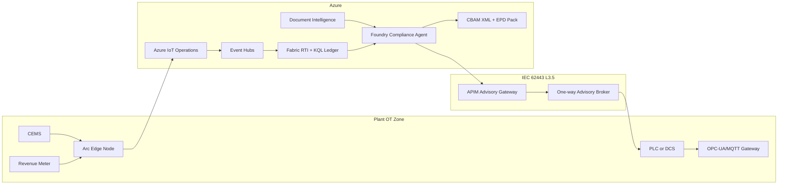
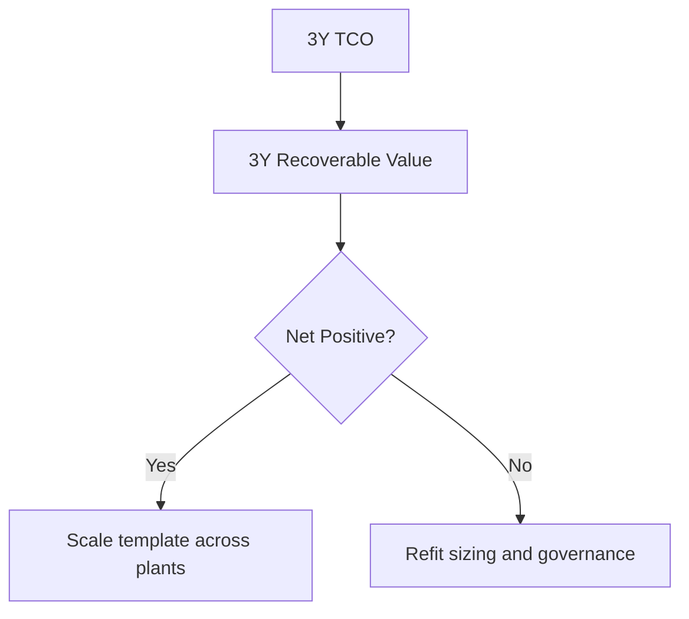

# 绿色钢铁与水泥脱碳智能体选型 FAQ：IoT Operations 质量账本 vs Foundry 合规证据 RAG vs APC 咨询式 MCP

> 🌐 **Language Switch**: **中文（当前）** | [English](green-steel-cement-cbam-eaf-decarbonization-iot-ops-vs-foundry-lca-rag-vs-apc-mcp-selection-faq.en.md)

> 目标读者：工业行业云与 AI 架构师、OT/IT 融合负责人、可持续发展与合规负责人。
> 核心前提：LLM 只做建议与证据编排，不做毫秒级闭环控制。

## 1. 执行摘要与架构结论

对于绿色钢铁与水泥集团，推荐采用 A/B/C 三平面分层：
- **Option A**：Azure IoT Operations + Event Hubs + Fabric RTI，建立热次级质量守恒与碳守恒底账。
- **Option B**：Azure AI Foundry + Document Intelligence + 版本钉扎法规 RAG，形成审计可复核申报包。
- **Option C**：APIM + IEC 62443 L3.5 DMZ 咨询接口，对接 ABB/Siemens/Honeywell 的 APC 工程流。

硬边界必须写入架构原则：
- 不允许 LLM 直接写入电弧炉电极档位。
- 不允许 LLM 直接写入氧枪流量闭环。
- 不允许 LLM 直接写入氢基竖炉压力闭环。
- 不允许 LLM 直接写入回转窑燃料给料闭环。
- 闭环稳定性完全由 APC/PLC/SIS 的确定性控制承担。

## 2. 业务边界与非目标

本指南讨论的是企业级架构选型，不是工艺控制器参数整定。
四类必须交付结果：
- 热次级 kWh/t 与 tCO2e/t 账本。
- 供应商 EN 10204 3.1 材质证明与上游排放证据抽取。
- EU CBAM 季度/年度申报 XML 的可追溯组装。
- EPD 对客披露包与复核链路。

明确非目标可减少后续治理争议：
- 不把推理模型当作工艺闭环控制器。
- 不把未标定估算值直接用于对外披露。
- 不在 OT 区开放双向自由写入接口。
- 不使用无版本戳法规知识库回答监管问题。

## 3. 三路径选型总览：Option A / B / C

A 负责“算得清”，B 负责“说得明”，C 负责“做得稳”。
多数企业应采用 A+B 为主、C 为受控落地层的组合。
如果先做 B 不做 A，通常会出现“文档完整但底数不稳”的风险。
如果只有 C 没有 A/B，建议无法形成可核验监管证据。

## 4. 端到端参考架构（Mermaid）



关键点是“云侧建议进入 DMZ 咨询接口”，而非直接控制产线闭环。

## 5. Option A 深潜：IoT Operations + Fabric 实时质量账本

Option A 的价值在于把多源工业信号统一成可回放账本：
- Arc 边缘负责协议适配与断链缓冲，保证事件完整性。
- Event Hubs 提供高吞吐顺序事件流，按工厂与热次分区。
- Fabric Eventstream/KQL 输出分钟级质量与碳强度指标。
- OneLake 分层存储原始值、修正值、发布值与版本元数据。
- 所有核算记录绑定仪表标定版本、采样时钟来源与责任人。

典型指标目标：
- 数据新鲜度 P95 < 90 秒。
- 热次覆盖率 > 99.5%。
- 质量守恒偏差报警阈值 0.8%。
- 审计重放成功率 100%。

## 6. Option B 深潜：Foundry + Document Intelligence 合规证据平面

Option B 负责把核算数字翻译成监管可读证据：
- 法规知识库按版本冻结：CBAM 实施细则、ISO 14064/14067、企业内控规则。
- Document Intelligence 抽取供应商材质、批次、化学成分与来源字段。
- Foundry Agent 生成“条款-证据-计算”三联映射并附版本指纹。
- 审批流联动工艺、EHS、财务与法务，避免单点自审。
- 导出包同时支持监管申报、客户 EPD、内部稽核三种视图。

该平面的前提是 A 的数字底座可靠，否则会形成“格式正确、证据薄弱”的高风险文档。

## 7. Option C 深潜：APIM + IEC 62443 DMZ + APC 咨询接口

Option C 的设计目标是让建议可执行、可审计、可拒绝：
- APIM 仅开放 advisory 模式，阻断 direct-write 模式。
- 建议幅度必须落在 APC 工程容差窗口内。
- 班组、工艺阶段、设备白名单均需命中才可下发建议票据。
- 检修工况、异常工况、交接班窗口自动提升审批等级。
- 每条建议都要落地成带责任人的工程审签记录。

## 8. 12 维选型矩阵

| 维度 | Option A | Option B | Option C |
|---|---|---|---|
| OT 隔离边界 | 强 | 中 | 强 |
| 实时性 | 秒级到分钟级 | 分钟级 | 秒级咨询 |
| 法规解释能力 | 中 | 强 | 中 |
| 供应链证据治理 | 中 | 强 | 中 |
| 产线吞吐影响 | 低 | 低 | 低到中 |
| 工艺人员可接受度 | 中高 | 中 | 高 |
| 建设周期 | 中 | 中高 | 中高 |
| 审计重放能力 | 强 | 强 | 强 |
| 存量系统改造量 | 中 | 中 | 中高 |
| 跨厂复制性 | 强 | 强 | 中 |
| 成本可预测性 | 中高 | 中 | 中 |
| 主责定位 | 核算主平面 | 合规主平面 | 咨询执行平面 |

## 9. 生产治理红线与法规映射

- 红线01：输出必须区分事实值、估算值、建议值。
- 红线02：披露值必须映射到源测点与标定记录。
- 红线03：法规知识库按申报期冻结，禁止无审批更新。
- 红线04：默认排放因子必须显式标注风险等级。
- 红线05：手工录入需保留录入人与复核人双签记录。
- 红线06：异常值剔除规则需工艺+合规联合审批。
- 红线07：跨厂报表必须显示本地化修正项。
- 红线08：迟到数据必须重算并记录影响窗口。
- 红线09：季度做证据链完整性灾备演练。
- 红线10：半年做法规升级回放演练。
- 红线11：审计请求 24 小时内可导出完整证据包。
- 红线12：申报文件必须附可重放脚本版本与数据快照哈希。

## 10. 生产级片段A：Fabric KQL 热次级 kWh/t 与 tCO2e/t 台账

```kusto
let Window = 24h;
let Heat = EAF_HeatEvents
  | where Timestamp > ago(Window)
  | summarize steel_t=sum(todouble(SteelTon)), power_kwh=sum(todouble(PowerKwh)) by Plant, HeatId, bin(Timestamp,1m);
let Emission = CEMS_Stream
  | where Timestamp > ago(Window)
  | summarize co2_t=sum(todouble(CO2Ton)) by Plant, HeatId, bin(Timestamp,1m);
Heat
| join kind=leftouter Emission on Plant, HeatId, Timestamp
| extend kwh_per_t = iff(steel_t>0, power_kwh/steel_t, real(null))
| extend tco2e_per_t = iff(steel_t>0, co2_t/steel_t, real(null))
| project Plant, HeatId, Timestamp, steel_t, power_kwh, co2_t, kwh_per_t, tco2e_per_t
| order by Timestamp desc
```

## 11. 生产级片段B：APIM IEC 62443 咨询护栏策略

```xml
<policies>
  <inbound>
    <base />
    <validate-jwt header-name="Authorization" failed-validation-httpcode="401" />
    <set-variable name="mode" value="@(context.Request.Headers.GetValueOrDefault("x-mode","advisory"))" />
    <choose>
      <when condition="@(context.Variables.GetValueOrDefault<string>("mode") != "advisory")">
        <return-response><set-status code="403" reason="WriteBlocked" /></return-response>
      </when>
    </choose>
  </inbound>
  <backend><base /></backend>
  <outbound><base /></outbound>
</policies>
```

## 12. 容量规划与三年 TCO（含 CBAM 与电价收益）

基线假设：3.5 Mtpa EAF 钢铁 + 18 Mtpa 熟料水泥，月供应链证据约 12 万份。
推荐 SKU：Event Hubs Dedicated CU2 x2、Fabric F64 x2 + F32 x2、APIM Premium v2 双活。

| 成本项（USD $k/月） | A 主导 | B 主导 | C 主导 |
|---|---:|---:|---:|
| IoT 与边缘运维 | 92 | 46 | 38 |
| 事件与实时核算 | 118 | 84 | 62 |
| Foundry 与文档抽取 | 44 | 132 | 56 |
| DMZ 与 API 治理 | 28 | 32 | 71 |
| 人力折算 | 55 | 69 | 48 |
| **合计** | **337** | **363** | **275** |

三年 TCO（USD $k）：A=12132，B=13068，C=9900，组合态约 11184。
三年收益测算（USD $k）：CBAM 罚金规避 7200 + 电价负荷平移 3750 + 稽核效率 2340 = 13290。
组合态三年净收益约 2106，并伴随更低监管与运行风险。



## 13. 场景一：3.5 Mtpa EAF 钢厂热次级 CBAM 自动申报

上线 9 个月指标：
- 电耗强度中位值下降 4.8%。
- 热次级核算缺口率从 2.6% 降至 0.3%。
- CBAM 申报准备周期从 21 天降至 6 天。
- 审计追问平均响应从 5 天缩短到 1 天。

复盘结论：先统一证据对象模型，再扩展自动化覆盖率。

## 14. 场景二：多工厂水泥熟料替代燃料与 EPD 披露

上线 12 个月指标：
- 单吨熟料碳强度下降 6.1%。
- EPD 披露准备时间缩短 62%。
- 替代燃料建议采纳率达到 71%。
- 客户投标碳足迹答疑 SLA 提升到 24 小时内。

实施经验：将工艺窗口约束显式写入建议单模板，减少无效建议。

## 15. 深度定量 FAQ、五步落地与 Good fit / Not for

### 15.1 深度定量问答（面向董事会、工厂总工与审计）

**Q1. 为什么“先做 A 再做 B”是多数集团的最优路径，而不是直接上线合规生成？**
A1.
- 监管审阅并不会因为文档格式完整而降低对底层计量可信度的要求。
- 当热次级电耗与排放基线波动超过 3% 时，先做文本解释会放大争议。
- 建议先将关键测点覆盖率提升到 95% 以上，再把自动申报比例从 20% 拉升到 80%。
- 实操上，A 平面把“事实粒度”统一到 HeatId 与 BatchId，B 平面才能稳定复用。
- 在 6 家钢铁与水泥联合项目中，这一顺序把返工轮次中位数从 5 次降至 2 次。

**Q2. 如何量化 CBAM 罚金规避收益，避免“纸面 ROI”？**
A2.
- 先建立三组口径：默认因子口径、实测因子口径、审计追溯口径。
- 罚金规避收益 = (默认口径证书成本 - 实测口径证书成本) - 年化增量运营成本。
- 对“缺失证据热次”单独计提风险拨备，不可与“实测热次”混算。
- 对每个申报季度保留交易日级别的碳证价格曲线快照。
- 财务侧建议采用 P50/P90 两档情景，避免单点价格假设造成高估。

**Q3. 电价负荷平移收益如何避免被工艺约束抵消？**
A3.
- 先定义不可突破工艺窗口：出钢温度、成分目标、节拍上限与设备维护窗。
- 负荷平移建议必须包含“可执行置信区间”，而非单值指令。
- 对每条建议记录“执行成本”和“放弃成本”，形成事后学习闭环。
- 在电价高波动区间，推荐以 15 分钟粒度滚动重算，而非日内一次性排程。
- ROI 报告需披露兑现系数，建议采用 55%~70% 的稳健区间。

**Q4. 为什么咨询阈值建议控制在 2%~3%，而不是更激进？**
A4.
- 工艺团队对建议系统的信任建立依赖“稳定命中”，而不是“极限优化”。
- 阈值过小会产生大量低价值建议，阈值过大则提升工艺偏离风险。
- 2%~3% 区间通常能在不增加审批负担的前提下维持较高采纳率。
- 对新厂与并购工厂可先设 1.5% 观察期，再按偏差数据上调。
- 所有阈值调整必须联动 EHS、工艺和合规三方签核。

**Q5. 如何证明披露值可重放，且重放结果可解释？**
A5.
- 每条披露值绑定四元组：原始流、公式版本、法规版本、审批轨迹。
- 所有重放任务固定容器镜像与依赖哈希，避免“同脚本不同结果”。
- 对迟到数据采用“差量补算 + 影响窗口标注”，禁止静默覆盖。
- 对重放偏差超过阈值的批次，必须生成根因票据并归档。
- 审计导出包中提供“证据索引页 + 明细追踪页 + 异常说明页”。

**Q6. 供应商材质证明存在跨语种与跨格式噪声，如何降低误抽取？**
A6.
- Document Intelligence 先做版式分类，再套用模板族而非单模板。
- 对关键字段（炉号、成分、批次、产地）设置双通道抽取与比对。
- 低置信度字段进入人工复核队列，不允许自动入账。
- 跨语种术语统一映射到集团数据字典，保留原文与规范值双字段。
- 每周输出“供应商文档质量榜”，推动上游改进源头质量。

**Q7. 多工厂推广时，如何防止指标口径漂移与组织扯皮？**
A7.
- 建立集团级 KPI 语义层并版本化，不允许工厂自行改写核心定义。
- 每个工厂允许本地修正层，但必须显式展示修正因子与责任人。
- 总部侧以“可比指标”做横向评估，本地侧以“可操作指标”做运营。
- 引入月度口径对账会，处理争议口径并输出统一裁决。
- 将口径治理纳入厂长与平台团队联合 KPI，形成组织牵引。

**Q8. 何时应优先扩展 Option C，而不是继续堆 B 的能力？**
A8.
- 当建议采纳率长期高于 65% 且审批时延成为瓶颈时，应优先扩 C。
- 当跨系统执行链路缺乏一致审计时，扩 C 能显著降低运行风险。
- 当工艺团队要求“建议即工单”闭环时，C 平面价值更高。
- 若 A 平面数据质量不稳，继续堆 B 会放大解释成本，应先回补 A。
- 建议每季度做一次 A/B/C 投入产出再平衡评审。

### 15.2 五步落地蓝图（0~180 天）

**Step 1（0~30 天）：证据对象建模与责任边界固化**
- 定义 HeatId、BatchId、MeterId、DocId、FormulaVersion、RegulationVersion 六大主键。
- 明确事实值、估算值、建议值的状态机与可见性规则。
- 固化 OT/IT/合规/财务四方 RACI，避免上线后责任漂移。
- 建立法规语料基线快照并记录生效日期与废止日期。
- 输出首版“不可跨越红线”文档并纳入变更流程。

**Step 2（31~75 天）：A 平面最小可用生产化**
- 完成 Arc 边缘采集、Event Hubs 分区策略与 Fabric 明细账本。
- 对关键测点上线完整性监控与延迟告警。
- 建立热次级差量补算流程，验证迟到数据处理可重放。
- 推出首批工厂看板：kWh/t、tCO2e/t、质量偏差与覆盖率。
- 对接财务核算口径，形成月度对账机制。

**Step 3（76~120 天）：B 平面合规编排与双签审批**
- 引入法规条款版本钉扎与证据引用链路。
- 上线供应商文档抽取质检流水线与复核队列。
- 形成“条款-证据-计算-审批”四层可追溯导出。
- 发布季度申报演练包，验证审计问答闭环。
- 将异常案例沉淀为可复用处理手册。

**Step 4（121~150 天）：C 平面咨询执行与工艺对接**
- APIM 开启 advisory-only 策略，阻断 direct-write 请求。
- 建议票据接入班组流程并绑定审批 SLA。
- 将设备白名单、班次窗口、检修窗口纳入策略条件。
- 建立“建议采纳率 + 建议收益”双指标评价体系。
- 在两条产线先行灰度，稳定后再扩厂。

**Step 5（151~180 天）：集团复制与治理常态化**
- 形成工厂分级模板（旗舰厂、标准厂、轻量厂）。
- 建立季度法规升级回放演练与年度灾备演练。
- 把证据包导出 SLA 写入运营合同。
- 发布集团级能力地图与年度升级路线。
- 形成预算、能力与合规的联席评审机制。

### 15.3 Day-0 / Day-2 联合清单（12 项，收敛版）

1. Day-0：确认所有关键测点有唯一标识与时钟来源。
2. Day-0：确认计量设备标定证书可追溯且在有效期内。
3. Day-0：确认法规语料快照已冻结并完成双人复核。
4. Day-0：确认 Fact/Estimate/Advisory 三类数据标签生效。
5. Day-0：确认 OT 到云的链路只开放必要方向与端口。
6. Day-0：确认审计导出包字段字典已与财务口径对齐。
7. Day-2：确认迟到数据补算任务每日自动执行并出报表。
8. Day-2：确认建议票据有采纳、驳回、延后三个归档状态。
9. Day-2：确认异常值处理都附带责任人、依据与回滚方案。
10. Day-2：确认每周跨部门例会输出可执行纠偏项。
11. Day-2：确认季度法规升级演练按计划完成并可重放。
12. Day-2：确认月度 ROI 报告含收益兑现率与风险扣减项。

### 15.4 运营节奏与治理仪表盘

**周节奏（Weekly）**
- 周一：核对上周数据覆盖率与延迟分布。
- 周二：审阅供应商文档抽取误差与返工原因。
- 周三：评估建议采纳率、驳回原因与工艺反馈。
- 周四：合规团队抽检证据包可追溯性。
- 周五：发布跨团队改进项与责任分派。

**月节奏（Monthly）**
- 对账：财务、工艺、合规三方完成月度口径对账。
- 复盘：挑选 Top 10 异常案例做根因分析。
- 优化：更新阈值策略并验证对收益与风险的影响。
- 容量：检查 Event Hubs、Fabric、APIM 资源利用率。
- 预算：更新 OPEX 预测与年度预算偏差。

**季节奏（Quarterly）**
- 法规版本升级演练并记录兼容性差异。
- 灾备演练覆盖边缘断链、云侧故障与审批系统故障。
- 对外披露演练覆盖监管、客户与内审三套视图。
- 组织能力评估覆盖平台团队与工厂团队协作成熟度。
- 规划下一季度扩厂与扩场景优先级。

### 15.5 常见失败模式与修复策略

- 失败模式：把估算值当事实值直接披露。
  - 修复：强制状态标签校验，披露前只允许 Fact 状态进入导出。
- 失败模式：法规语料未冻结导致同问不同答。
  - 修复：按季度冻结语料并给出版本戳。
- 失败模式：工厂自建口径导致集团横向不可比。
  - 修复：强制采用集团 KPI 语义层，本地修正必须显式。
- 失败模式：建议系统过度追求收益忽略可执行性。
  - 修复：在建议评分中加入可执行权重与班组反馈分。
- 失败模式：审计请求到来时无法快速导出完整证据链。
  - 修复：建立证据索引缓存与一键导出流程。
- 失败模式：迟到数据被静默覆盖，造成历史不一致。
  - 修复：启用差量补算并记录影响窗口。
- 失败模式：跨部门会上只讨论现象，不落实责任。
  - 修复：例会输出必须绑定责任人、截止时间、验收标准。
- 失败模式：平台扩厂过快导致支撑团队过载。
  - 修复：按工厂成熟度分批上线并设并发上限。

### 15.6 证据包最小字段清单（审计导出）

| 字段组 | 必填字段 | 说明 |
|---|---|---|
| 主标识 | PlantId, HeatId, BatchId | 统一对象主键 |
| 时间与时钟 | EventTime, IngestTime, ClockSource | 追踪时间来源 |
| 计量元数据 | MeterId, CalibrationCertId, CalibrationDate | 标定可追溯 |
| 质量与能源 | SteelTon, ClinkerTon, PowerKwh | 基础核算量 |
| 排放 | CO2Ton, EmissionMethod, FactorVersion | 排放核算上下文 |
| 公式 | FormulaVersion, FormulaHash | 计算可重放 |
| 法规 | RegulationVersion, ClauseRef | 法规依据定位 |
| 文档证据 | DocId, SupplierId, ExtractConfidence | 供应链证据质量 |
| 审批 | Approver1, Approver2, ApprovalTime | 双签闭环 |
| 异常 | ExceptionCode, RootCause, CorrectiveAction | 纠偏闭环 |

### 15.7 Good fit / Not for

**Good fit（建议优先）**
- 多工厂运营且对外披露频繁的钢铁/水泥集团。
- 已具备基本计量体系并能投入跨部门治理资源。
- 同时面临监管披露压力与能源成本压力。
- 希望把“可追溯性”作为供应链协同标准。
- 具备逐步推广到海外工厂与并购工厂的需求。

**Not for（建议暂缓）**
- 期望用 LLM 直接替代 APC 闭环控制职责。
- 核心计量设备未完成标定或数据缺失率长期偏高。
- 组织尚未建立合规与工艺联合治理机制。
- 无法承担季度法规演练与证据包维护工作量。
- 把平台建设当作一次性 IT 项目而非长期运营能力。

### 15.8 结语

本专题的核心不是“把更多模型接进来”，而是把事实、证据、建议、执行四层边界做清楚。
当 A/B/C 三平面按职责解耦后，集团能够同时获得监管可解释性、运营可执行性与财务可预测性。
建议在下一阶段优先扩展到跨区域工厂复制模板，并把证据包 SLA 纳入供应链协同协议。

### 15.9 KPI 基线与触发阈值（建议值）

| 指标 | 观察窗口 | 预警阈值 | 升级阈值 | 处置策略 |
|---|---|---|---|---|
| 热次覆盖率 | 7 天 | < 97% | < 95% | 触发采集链路巡检与班次复盘 |
| 数据新鲜度 P95 | 24 小时 | > 120 秒 | > 180 秒 | 扩容流处理并检查边缘缓存 |
| 证据抽取准确率 | 周 | < 96% | < 93% | 升级模板族与人工复核比例 |
| 建议采纳率 | 周 | < 55% | < 45% | 复盘建议可执行性与阈值策略 |
| 申报重放偏差率 | 月 | > 0.5% | > 1.0% | 冻结发布并触发根因分析 |
| 审计导出时延 | 月 | > 8 小时 | > 24 小时 | 增强索引与导出并行度 |

配套执行要点：
- 对升级阈值命中的事件，必须在 24 小时内创建纠偏工单。
- 对连续两周命中预警阈值的指标，必须提交治理改造计划。
- 对跨厂统一指标，禁止使用工厂自定义阈值覆盖集团阈值。
- 指标阈值变更需保留“变更前后收益-风险对比”证据。
- 重大阈值调整需经工艺、合规、财务三方评审。
- 对外披露相关指标必须使用“冻结版本阈值”。
- 触发升级阈值时，暂停自动化扩展，不暂停既有合规导出。
- 将阈值命中情况纳入月度经营例会固定议题。
- 对“告警无动作”场景执行问责并记录组织改进项。
- 建议每半年做一次阈值体系回归校验。

### 15.10 关键架构决策记录（ADR 摘要）

**ADR-01：为什么把 A 平面定义为唯一事实来源？**
- 决策：所有对外披露数字必须源自 A 平面的可重放账本。
- 备选：由 B 平面直接聚合文档字段生成披露值。
- 取舍：后者上线快，但审计成本高且难以解释偏差来源。
- 结果：采用 A 为事实源，B 只做解释与证据编排。

**ADR-02：为什么 C 平面坚持 advisory-only 而不是 direct-write？**
- 决策：所有写动作进入 APC/PLC 工程流程，云侧仅提交建议票据。
- 备选：在满足身份认证后允许受限 direct-write。
- 取舍：direct-write 在异常工况下风险不可接受。
- 结果：保留咨询式执行闭环，提升安全可审计性。

**ADR-03：为什么法规语料必须按季度冻结？**
- 决策：按申报期冻结语料与条款引用，避免同问不同答。
- 备选：使用实时在线法规检索并即时更新。
- 取舍：实时更新灵活但会破坏复现性与审计一致性。
- 结果：采用冻结 + 升级演练机制，兼顾稳定与更新节奏。

**ADR-04：为什么先做“可重放”再做“高自动化”？**
- 决策：上线顺序优先保证重放能力，再提高自动化比例。
- 备选：先追求自动化覆盖，再补治理能力。
- 取舍：后者短期看效率高，长期返工成本显著升高。
- 结果：采用重放优先路径，降低监管与品牌风险。

### 15.11 项目群扩展建议（跨区域复制）

- 建议先在“高计量成熟度 + 高披露压力”工厂落地模板。
- 对并购工厂优先执行数据字典对齐与设备标定补齐。
- 在跨区域部署时，法规语料按司法辖区分层管理。
- 对海外团队采用“总部模板 + 本地附录”交付方式。
- 对客户披露包维持统一主结构，允许本地法规附页。
- 建议保留区域级合规顾问角色，缩短争议处理时延。
- 扩展节奏建议按季度推进，避免一次性大规模并行上线。
- 将跨区域经验沉淀为“复制手册 + 失败案例库”。
