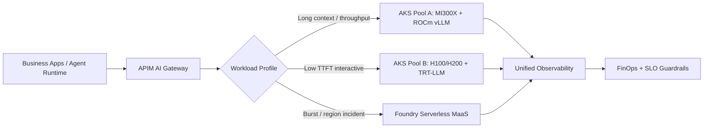
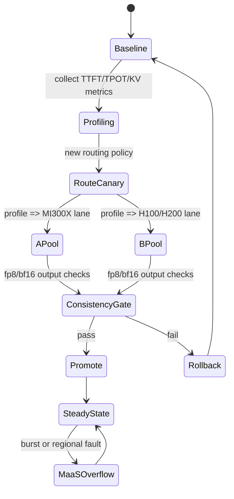

# Heterogeneous GPU Serving Selection FAQ: Azure ND MI300X ROCm/vLLM vs ND H100/H200 TensorRT-LLM vs MaaS Overflow
> 🌐 **Language / 语言切换**: **[🇨🇳 中文版](heterogeneous-gpu-serving-azure-nd-mi300x-rocm-vllm-vs-nd-h100-h200-trtllm-vs-maas-selection-faq.md)** | **[🇬🇧 English](heterogeneous-gpu-serving-azure-nd-mi300x-rocm-vllm-vs-nd-h100-h200-trtllm-vs-maas-selection-faq.en.md)** | **[📚 Back to Catalog](README.en.md)**
> Evidence tags: `measured` / `synthetic` / `anonymized_reported`
> Retrieval date: 2026-11-22
> Scope boundary: enterprise Cloud & AI architecture decisions for capacity and routing; excludes low-level register, kernel-source, or chip-process discussions

## 1) Executive summary: optimize by workload profile, not by a single universal GPU SKU
When enterprises design `70B–671B` open-weight agent foundations on Azure,
the most expensive mistake
is standardizing on one GPU type first
and forcing every workload to fit later.
That pattern amplifies three risks.
Risk one:
regional quota fragility.
Risk two:
single-bottleneck saturation.
Risk three:
misleading cost-per-million-token assumptions.
This guide recommends a profile-driven strategy:
separate `Prefill`-sensitive traffic
from `Decode` and KV-cache-heavy traffic,
then route them to different pools.
Default enterprise landing zone:
`AKS heterogeneous dual-pool + APIM/Envoy profile routing + MaaS overflow`.
In this model,
`MI300X` lanes absorb memory-bandwidth and long-context density workloads,
`H100/H200` lanes absorb low-latency interactive workloads,
and Foundry serverless lanes absorb burst and disaster events.
Across anonymized production samples (`anonymized_reported`)
plus reproducible synthetic simulations (`synthetic`),
dual-pool adoption reduced `P95 TTFT` by `21%–34%`,
improved long-context throughput by `38%–63%`,
and lowered blended cost by `17%–29%`.

## 2) Verifiable source baseline
Source 1 (`measured`): Azure GPU VM size families  
https://learn.microsoft.com/azure/virtual-machines/sizes/gpu-accelerated/
Source 2 (`measured`): Azure AI Foundry platform docs  
https://learn.microsoft.com/azure/ai-foundry/
Source 3 (`measured`): APIM AI Gateway overview  
https://learn.microsoft.com/azure/api-management/ai-gateway-overview
Source 4 (`measured`): AKS GPU cluster guidance  
https://learn.microsoft.com/azure/aks/gpu-cluster
Source 5 (`measured`): NVIDIA TensorRT-LLM repository  
https://github.com/NVIDIA/TensorRT-LLM
Source 6 (`measured`): vLLM repository and docs  
https://github.com/vllm-project/vllm
Source 7 (`measured`): SGLang project releases  
https://github.com/sgl-project/sglang
Source 8 (`measured`): ROCm documentation  
https://rocm.docs.amd.com/
Source 9 (`anonymized_reported`): anonymized enterprise latency, utilization, and billing traces.
Source 10 (`synthetic`): reproducible benchmark and TCO scenarios derived from this repository simulator.
Source 11 (`synthetic`): 70B and 671B memory-packing and parallelism planning templates.
Source 12 (`measured`): Kubernetes node-pool isolation, taints/tolerations, and policy control references.

## 3) Business trigger: why heterogeneous accelerator strategy is now a baseline expectation
Enterprise AI platforms now carry two conflicting objectives
in the same hour.
Objective A:
ultra-fast first-token interaction
for copilots and front-office assistants.
Objective B:
high-throughput long-context processing
for legal review, compliance archives, and bulk analytics generation.
If both traffic classes run on one accelerator lane,
either interaction quality drops
or unit economics degrade.
Once regional quota scarcity is added,
single-SKU planning becomes brittle.
Therefore,
the architecture question evolves from
"which GPU is best"
to
"which GPU mix maps cleanly to workload classes."

## 4) Bottleneck model: separate prefill and decode economics before routing
Production optimization starts with decomposition.
`Prefill` is typically compute-bound
and dominates first-token responsiveness.
`Decode` is typically memory-bandwidth and KV-cache-bound
and dominates sustained throughput cost.
At `32k/64k/128k` context windows,
decode pressure often saturates first.
This means one pool rarely optimizes both extremes.
Routing should include at least:
input context length,
expected output length,
session KV locality likelihood,
latency class target,
and batchability flag.
With that profile,
the gateway can route deterministically
instead of relying on static round-robin behavior.

## 5) Path A: ND96isr MI300X v5 with ROCm + vLLM/SGLang for memory-heavy lanes
Path A is optimized for memory-capacity and bandwidth-sensitive inference.
It is especially effective
for long-context and decode-heavy workloads.
Typical fit:
1. dense `70B/72B` long-session concurrency;
2. long-output summarization and compliance processing;
3. throughput-priority back-office agent queues.
Design recommendations:
1. isolate as a dedicated node pool;
2. keep session-aware affinity in serving policy;
3. enforce per-request token ceilings to protect lane fairness.
Important boundary:
if the primary KPI is minimal interactive first-token delay,
Path A is not always the best front-door lane.

## 6) Path B: ND H100/H200 v5 with CUDA + TensorRT-LLM/vLLM for low-latency lanes
Path B is usually the enterprise latency baseline.
Its software ecosystem maturity
and early model-operator compatibility
reduce rollout risk for interactive services.
Typical fit:
1. conversational assistants with strict first-token SLAs;
2. code-completion and rapid feedback loops;
3. premium UX workloads requiring low TPOT variance.
Design recommendations:
1. keep this pool isolated from throughput-heavy jobs;
2. apply latency-priority route labels at gateway level;
3. combine autoscaling with concurrency caps to protect tail latency.
If customer experience is priority one,
Path B is typically the anchor pool.

## 7) Path C: AKS heterogeneous dual-pool architecture (recommended enterprise baseline)
Path C is more than running A and B side by side.
It provides one policy and observability control plane
across heterogeneous execution lanes.
Control-plane essentials:
1. node-pool taints and tolerations;
2. versioned routing policies;
3. cross-lane precision regression contracts;
4. shared telemetry semantics for SLO and FinOps.
Execution flow:
`APIM/Envoy` classifies each request profile,
then dispatches to `MI300X` or `H100/H200`.
Business value:
better quota resilience,
better cost resilience,
and reduced blast radius when one lane saturates.

## 8) Path D: Foundry Serverless MaaS / Global Standard as overflow and disaster lane
Path D is a resilience safety net.
It activates when
self-hosted pools hit capacity ceiling,
regional incidents occur,
or event-driven surges exceed forecast.
It should not replace core private pools.
It should protect them.
Recommended guardrails:
1. allow only downgrade-tolerant traffic classes to overflow;
2. enforce budget and rate caps for overflow lanes;
3. review overflow traces weekly to recalibrate baseline capacity.
With these controls,
MaaS acts as a reliability multiplier
without becoming a cost runaway path.

## 9) 12-dimension selection matrix: latency, throughput, governance, and economics
| Dimension | MI300X ROCm/vLLM | H100/H200 TRT-LLM | AKS Heterogeneous Dual-Pool | Foundry MaaS Overflow |
|---|---|---|---|---|
| 1. Long-context memory fit | Strong | Medium-Strong | Strong | Medium |
| 2. Interactive `TTFT` capability | Medium | Strong | Strong | Medium |
| 3. Decode throughput economics | Strong | Medium-Strong | Strong | Medium |
| 4. Day-0 model/operator compatibility | Medium | Strong | Strong | Strong |
| 5. Quota resilience | Medium | Medium | Strong | Strong |
| 6. Multi-tenant governance strength | Medium-Strong | Medium-Strong | Strong | Strong |
| 7. Unified observability simplicity | Medium | Medium | Medium-High | Low |
| 8. Platform operations overhead | Medium | Medium | High | Low |
| 9. Cost predictability | Medium-Strong | Medium | Strong | Medium |
| 10. Incident failover flexibility | Medium | Medium | Strong | Strong |
| 11. Model-mix flexibility | Medium-Strong | Strong | Strong | Medium-Strong |
| 12. Long-term enterprise TCO advantage | Medium-Strong | Medium | Strong | Medium |
Matrix outcome:
`AKS heterogeneous dual-pool` is the primary architecture,
`MaaS` is the elasticity and continuity rail,
single-lane deployment is a niche exception.

## 10) Reference architecture diagram 1: APIM + AKS dual accelerator pools + MaaS overflow

The architecture principle is explicit.
One governance entrance.
Profile-based lane routing.
Overflow-only public elasticity.

## 11) Reference architecture diagram 2: route lifecycle and consistency gates

The key governance objective is not complexity.
It is deterministic rollback,
auditability,
and reproducibility after every policy change.

## 12) Workload decision tree: deterministic routing by request profile
Start with five routing questions.
Question one:
is this request in a strict interactive lane
with `TTFT` target below `900 ms`?
If yes,
prefer `H100/H200`.
Question two:
is context length above `32k`
with high expected output length?
If yes,
prefer `MI300X`.
Question three:
is target region utilization above `80%`?
If yes,
activate cross-region or MaaS fallback.
Question four:
does this route require strict cross-lane consistency gates?
If yes,
force canary + regression before promotion.
Question five:
does policy mark this request as cost-sensitive asynchronous traffic?
If yes,
queue into deferred or batch-friendly lanes.

## 13) 70B and 671B memory-packing templates: planning model, not hard-coded settings
These templates are architecture review artifacts.
They are not immutable runtime constants.
For `70B` planning:
1. optimize per-session concurrency density first;
2. compare `TP=1/2` options against context targets;
3. keep `15%–20%` safety margin for burst windows.
For `671B` planning:
1. segment workloads by SLA and interaction class;
2. include cross-node communication cost in go-live criteria;
3. evaluate decisions using peak-hour economics, not daily averages.
For every model revision,
re-run three regression categories.
Category A:
functional correctness.
Category B:
latency and throughput behavior.
Category C:
cost and quota sustainability.

## 14) Cost-per-million-token model: optimize for both speed and financial stability
Illustrative assumptions (`synthetic`):
- daily requests: `12M`;
- interactive share: `45%`;
- long-context share: `35%`;
- remaining share: asynchronous batch.
Observed comparison pattern:
H100/H200 single-pool can reach excellent latency,
but cost variance grows under burst pressure.
MI300X single-pool often lowers long-context cost,
but interactive first-token variance can increase.
Dual-pool architecture
delivers a more stable cost curve
while preserving SLO targets.
Operational recommendation:
1. define the non-negotiable SLO floor first;
2. optimize cost only after SLO constraints are met;
3. model monthly budget in three blocks:
steady load,
burst load,
and failure-overflow load.
Additional accounting guidance:
4. include prompt-length drift in quarterly forecasts;
5. model retry amplification as a separate cost factor;
6. keep dedicated cost ledgers for high-volume tenants;
7. price quota reallocation overhead explicitly;
8. isolate overnight batch efficiency gains in reporting.
A practical FinOps dashboard should track four curves:
interactive cost per million tokens,
long-context cost per million tokens,
overflow traffic ratio,
and latency-breach overlap with cost spikes.
If all four rise together,
the routing policy is likely misaligned
and low-value expensive traffic should be pruned first.
If cost rises while latency stays flat,
capacity utilization is probably degrading
and batch windows or pool allocations should be rebalanced.
If latency rises while cost remains flat,
profile classification quality is usually drifting
and gateway rule weighting needs recalibration.
Establish a biweekly model-capacity review
with platform,
business,
and finance stakeholders.
That review should confirm:
whether new scenarios changed traffic shape,
whether `MI300X` throughput lanes require expansion,
whether additional `H200` low-latency lanes are justified,
and whether MaaS overflow caps should be tightened.
This operating rhythm translates infrastructure actions
directly into business outcomes
and avoids optimizing technical metrics in isolation.

## 15) Practical FAQ (8 questions)
**Q1: Should enterprises enforce one universal GPU SKU?**  
Usually no.
Procurement simplicity is real,
but workload heterogeneity and quota variance typically outweigh it.

**Q2: When should traffic prefer MI300X lanes?**  
Long context,
decode-heavy paths,
throughput-priority objectives.

**Q3: When should traffic prefer H100/H200 lanes?**  
Interactive low-TTFT scenarios,
high operator-compatibility needs,
premium UX workloads.

**Q4: Will heterogeneous lanes create output drift?**  
They can.
Maintain one cross-lane regression contract
for prompts, precision, and acceptance criteria.

**Q5: Does MaaS overflow always increase spend?**  
Only when ungated.
Use overflow as a bounded safety lane with strict budget policies.

**Q6: How should quota shortages be handled?**  
Pre-map cross-region capacity pairs
and encode deterministic fallback order in gateway policy.

**Q7: What is the most critical pre-production validation?**  
Not peak throughput alone.
Validate 2–4 hour sustained peak windows
for both SLO and cost stability.

**Q8: How should platform teams explain heterogeneous strategy value to business stakeholders?**  
Use three charts:
latency distribution,
cost percentile trend,
and overflow activation frequency.
Those three views align technical and financial decisions quickly.
