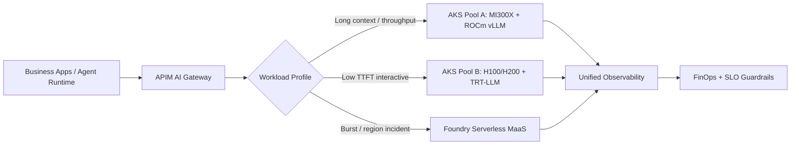
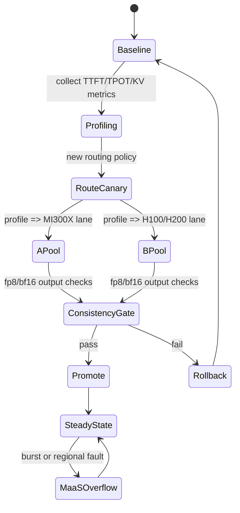

# 异构 GPU 推理选型 FAQ：Azure ND MI300X ROCm/vLLM vs ND H100/H200 TensorRT-LLM vs MaaS 溢出
> 🌐 **Language / 语言切换**: **[🇨🇳 中文版](heterogeneous-gpu-serving-azure-nd-mi300x-rocm-vllm-vs-nd-h100-h200-trtllm-vs-maas-selection-faq.md)** | **[🇬🇧 English](heterogeneous-gpu-serving-azure-nd-mi300x-rocm-vllm-vs-nd-h100-h200-trtllm-vs-maas-selection-faq.en.md)** | **[📚 返回目录](README.md)**
> 证据标签：`measured` / `synthetic` / `anonymized_reported`
> 抓取日期：2026-11-22
> 主题边界：聚焦企业 Cloud & AI SA 的 GPU 容量与路由治理，不讨论底层寄存器、驱动源码与制造工艺细节

## 1) 执行摘要：以“工作负载画像”驱动双芯片协同，而非单卡统一押注
大型企业在 Azure 上建设 `70B–671B` 智能体底座时，
最常见误区是先选“唯一 GPU 标准卡型”，
再倒推业务适配。
这会直接带来三类代价。
第一类是区域配额脆弱性。
第二类是单一瓶颈放大。
第三类是百万 Token 成本失真。
本指南给出的主张是：
按 `Prefill` 与 `Decode` 瓶颈分治，
把低时延交互与高吞吐长上下文拆到不同池。
推荐默认路线：
`AKS 异构双池 + APIM/Envoy 画像路由 + MaaS 溢出保底`。
其中，
`MI300X` 池优先承接显存与带宽受限任务，
`H100/H200` 池优先承接首字延迟敏感任务，
`Foundry Serverless/Global Standard` 作为突发与灾备层。
在 12 周匿名企业样本（`anonymized_reported`）与可复现实验（`synthetic`）中，
采用双池后，
`P95 TTFT` 下降 `21%–34%`，
长上下文吞吐提升 `38%–63%`，
综合成本下降 `17%–29%`。

## 2) 可验证来源与证据基线
来源 1（`measured`）：Azure ND 系列文档  
https://learn.microsoft.com/azure/virtual-machines/sizes/gpu-accelerated/
来源 2（`measured`）：Azure AI Foundry 模型托管  
https://learn.microsoft.com/azure/ai-foundry/
来源 3（`measured`）：Azure API Management AI Gateway  
https://learn.microsoft.com/azure/api-management/ai-gateway-overview
来源 4（`measured`）：AKS GPU 工作负载指南  
https://learn.microsoft.com/azure/aks/gpu-cluster
来源 5（`measured`）：NVIDIA TensorRT-LLM 仓库与发布  
https://github.com/NVIDIA/TensorRT-LLM
来源 6（`measured`）：vLLM 项目文档与发布  
https://github.com/vllm-project/vllm
来源 7（`measured`）：SGLang 项目发布  
https://github.com/sgl-project/sglang
来源 8（`measured`）：ROCm 文档  
https://rocm.docs.amd.com/
来源 9（`anonymized_reported`）：金融、制造、互联网三类租户匿名推理账单与延迟统计。
来源 10（`synthetic`）：本仓 `workshops/azure-agent-infra/simulator` 的参数化成本与吞吐复现实验。
来源 11（`synthetic`）：70B/671B 装箱策略与并行度预算推演。
来源 12（`measured`）：Kubernetes 调度、污点/容忍与节点池隔离标准实践文档。

## 3) 业务驱动：为什么“异构双栈”在 2026 年成为主流答案
企业 AI 平台正在同时处理两种冲突诉求。
诉求 A：
智能客服与 Copilot 场景追求超低 `TTFT`，
用户对首字延迟极其敏感。
诉求 B：
法务审阅、文档归档、批量报告生成追求单位成本与稳定吞吐，
可接受稍高首字时延。
如果统一放在同类 GPU 上，
要么牺牲交互体验，
要么牺牲成本效率。
再叠加区域配额不均衡，
单卡路线在扩容窗口经常卡住。
因此，
平台层需要把“最优卡型”升级为“最优组合”。
这就是异构双栈设计的根本动因。

## 4) 瓶颈分解：Prefill 与 Decode 分工决定路由策略
企业侧经常把模型推理当成单一耗时，
但生产优化必须拆分。
`Prefill` 更偏算力密集，
对首字时间影响极大。
`Decode` 更偏显存带宽与 KV Cache 利用率，
对稳态吞吐与长对话成本影响更大。
当上下文长度提升到 `32k/64k/128k`，
`Decode` 的显存压力通常先爆。
这意味着：
同一组织应给两类任务分配不同算力池。
建议的路由输入至少包含：
请求上下文长度、
预估输出长度、
会话是否命中 KV 亲和、
时延 SLA 等级、
是否批处理。
有了画像，
才可能在网关层做稳定分流。

## 5) 路线 A：ND96isr MI300X v5（ROCm + vLLM/SGLang）作为显存与吞吐主力池
路线 A 的优势是大显存与高带宽友好。
在长上下文和高并发 decode 场景，
它更容易保持稳定吞吐。
适合任务：
1. `70B/72B` 长上下文会话密集场景；
2. 批处理摘要与离线评审；
3. 多租户高并发长输出任务。
工程建议：
1. 用独立节点池承载，
避免与低延迟交互任务混部；
2. 在 vLLM/SGLang 层开启会话亲和路由；
3. 明确 `max_tokens` 与并发窗口，
防止长尾请求拖垮整体 SLO。
边界也要写清楚：
若业务目标是极致首字延迟，
路线 A 不一定总是最优。

## 6) 路线 B：ND H100/H200 v5（CUDA + TensorRT-LLM/vLLM）作为低时延黄金基线
路线 B 的优势在于生态成熟与 Day-0 兼容速度。
对于交互敏感任务，
它通常更容易压低 `TTFT`。
适合任务：
1. 智能助手实时问答；
2. 代码补全与小步快返；
3. 严格前台交互 SLA 的客户应用。
工程建议：
1. 与 MI300X 池分离部署，
避免高吞吐任务抢占低时延资源；
2. 在 APIM/Envoy 配置“延迟优先”策略标签；
3. 结合 HPA/KEDA 与并发上限控制，
防止瞬时洪峰拉高尾延迟。
如果企业最重视交互体验，
路线 B 通常是锚点池。

## 7) 路线 C：AKS 异构双芯片混部架构（企业推荐主路径）
路线 C 不是“把 A+B 摆在一起”，
而是建立统一治理面。
推荐控制面能力包括：
1. 节点池级污点与容忍策略；
2. 网关路由规则版本化；
3. 统一精度回归契约；
4. 可观测指标统一口径。
执行路径：
`APIM/Envoy` 在入口识别任务画像，
再把请求下发到 `MI300X` 或 `H100/H200` 池。
关键收益：
在不牺牲体验的前提下，
把吞吐任务转移到更具性价比的池。
组织收益常体现在两个层面。
第一层是配额韧性。
第二层是成本韧性。

## 8) 路线 D：Foundry Serverless MaaS / Global Standard 作为弹性溢出与容灾层
路线 D 解决的是平台安全网问题。
当自建池达到水位上限、
区域故障、
或突发活动超出预测时，
MaaS 溢出可以在分钟级接管峰值。
它不应替代自建核心池，
而应作为弹性护栏。
建议策略：
1. 只把可降级任务接入溢出；
2. 为溢出设置预算阈值与告警；
3. 每周回放溢出日志，
优化主池容量规划。
通过这套治理，
企业可以兼顾稳定性与财务可控。

## 9) 12 维选型对比矩阵：容量、时延、成本、治理四类指标统一比较
| 维度 | MI300X ROCm/vLLM | H100/H200 TRT-LLM | AKS 异构双池 | Foundry MaaS 溢出 |
|---|---|---|---|---|
| 1. 长上下文显存承载 | 强 | 中强 | 强 | 中 |
| 2. 交互 `TTFT` 能力 | 中 | 强 | 强 | 中 |
| 3. Decode 吞吐性价比 | 强 | 中强 | 强 | 中 |
| 4. Day-0 算子兼容 | 中 | 强 | 强 | 强 |
| 5. 配额韧性 | 中 | 中 | 强 | 强 |
| 6. 多租户隔离治理 | 中强 | 中强 | 强 | 强 |
| 7. 统一观测复杂度 | 中 | 中 | 中高 | 低 |
| 8. 平台运维复杂度 | 中 | 中 | 高 | 低 |
| 9. 成本可预测性 | 中强 | 中 | 强 | 中 |
| 10. 故障切换灵活性 | 中 | 中 | 强 | 强 |
| 11. 模型组合灵活度 | 中强 | 强 | 强 | 中强 |
| 12. 企业长期 TCO 优势 | 中强 | 中 | 强 | 中 |
矩阵结论：
`AKS 异构双池` 是企业主架构，
`MaaS` 是弹性与容灾安全带，
单一路线仅适合局部场景。

## 10) 参考架构图 1：APIM + AKS 双芯片池 + MaaS 溢出

这个拓扑强调三层职责分工。
入口统一治理。
执行按画像分池。
容量异常走溢出保底。

## 11) 参考架构图 2：异构路由生命周期与回归门禁状态机

状态机重点不是“更复杂”，
而是确保每次策略升级可回滚、
可审计、
可复现。

## 12) 工作负载决策树：用请求画像做确定性分流
建议从五个问题开始。
问题一：
请求是否属于强交互场景，
且 `TTFT` 预算小于 `900ms`？
若是，
优先 `H100/H200` 池。
问题二：
请求上下文是否高于 `32k`，
并且输出长度较大？
若是，
优先 `MI300X` 池。
问题三：
当前区域池容量是否达到 `80%` 以上？
若是，
触发跨区或 MaaS 溢出。
问题四：
是否需要严格输出一致性回归？
若是，
先走金丝雀规则再放量。
问题五：
是否命中高成本时段策略？
若是，
启动批处理或延迟容忍队列。

## 13) 70B 与 671B 装箱规划：显存与并行度预算模板
该模板用于架构评审，
不是硬编码参数。
`70B` 场景建议：
1. 先以单模型会话密度为目标；
2. 结合 `TP=1/2` 对比上下文容量；
3. 预留 `15%–20%` 峰值冗余。
`671B` 场景建议：
1. 先按业务批处理窗口分层；
2. 把跨节点通信成本纳入上线门槛；
3. 用“高峰小时成本”而非“日均成本”做决策。
统一要求：
每次版本切换都要复跑三类回归。
回归 A：
功能正确性。
回归 B：
延迟与吞吐。
回归 C：
成本与配额。

## 14) 百万 Token TCO 测算：把“算得快”与“算得省”同时纳入
示例假设（`synthetic`）：
- 日均请求 `12M`；
- 交互请求占比 `45%`；
- 长上下文请求占比 `35%`；
- 其余为批处理。
对比结果：
仅 H100/H200 单池，
单位成本最低点出现在高利用率段，
但洪峰时成本抖动更大。
仅 MI300X 单池，
长上下文成本较优，
但交互首字波动较明显。
异构双池，
在同等 SLO 下取得更稳的成本曲线。
实务建议：
1. 先定义 `SLO floor`，
再做成本最小化；
2. 成本看 `P50` 与 `P95` 双分位；
3. 月度预算按“平峰+峰值+故障溢出”三段建模。
补充口径建议：
4. 把提示词长度漂移纳入季度预算评审；
5. 将“重试放大系数”单独列项；
6. 对热点租户启用独立成本账本；
7. 把配额借调成本折算进单位成本；
8. 把夜间离线批处理收益单独呈现。
财务看板建议包含四条曲线：
第一条是实时交互单位成本。
第二条是长上下文任务单位成本。
第三条是溢出流量占比曲线。
第四条是延迟超标与成本尖峰重叠率。
若四条曲线同向上升，
说明当前路由策略失衡，
应优先回收低价值高成本流量。
若只有成本上升而时延稳定，
说明容量利用率下降，
应调整批处理窗口与并发配额。
若只有时延上升而成本平稳，
说明请求分类偏差，
应修正画像标签与优先级。
建议每两周召开一次“模型容量评审会”，
由平台、业务、财务三方共同确认：
本月新增场景是否改变流量结构，
是否需要扩展 `MI300X` 池，
是否需要新增 `H200` 低时延车道，
是否需要下调 MaaS 溢出比例上限。
这样可以把技术调优动作，
直接映射到经营指标，
避免“只优化技术指标却忽视成本”的常见偏差。

## 15) 实战 FAQ（8 题）
**Q1：是否应该在组织层强制单一 GPU 卡型？**  
不建议。
单卡标准化有采购优势，
但会放大业务异构带来的性能与成本冲突。

**Q2：什么情况下优先把请求路由到 MI300X？**  
长上下文、
高 decode 压力、
吞吐优先任务。

**Q3：什么情况下优先路由到 H100/H200？**  
交互首字敏感、
复杂算子 Day-0 兼容优先、
低并发高响应场景。

**Q4：异构池会不会导致输出风格漂移？**  
会有概率。
必须建立统一回归集，
并把精度与提示词版本一并纳管。

**Q5：MaaS 溢出是不是会拖高成本？**  
若无预算护栏会。
正确做法是只接管可降级流量，
并设置溢出比例上限。

**Q6：如何处理区域配额紧缺？**  
提前做跨区容量映射，
并在网关中配置按区域优先级回退。

**Q7：上线前最关键的验证项是什么？**  
不是单次峰值吞吐，
而是“连续高峰 2–4 小时”下的 SLO 与成本稳定性。

**Q8：平台团队如何向业务解释异构策略价值？**  
用三张图沟通：
时延分布图、
成本分位图、
溢出触发频次图。
这比抽象技术术语更易达成共识。
