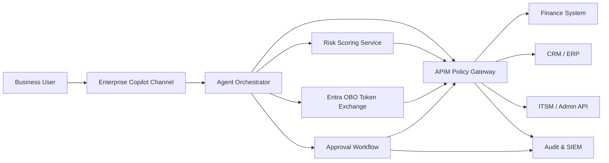
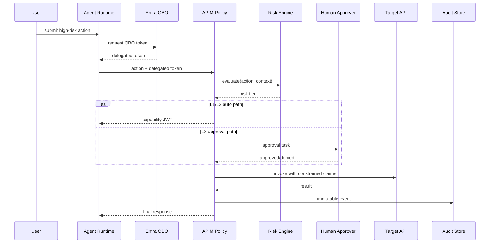

# Enterprise high-risk agent action step-up authorization selection FAQ: Entra OBO vs APIM capability JWT vs approval flow vs hybrid loop

> **Audience**: enterprise Cloud & AI Solution Architects, platform engineering, zero-trust security, compliance and audit leads.  
> **Decision target**: when an agent performs high-impact actions such as payment, delete, configuration mutation, legal notice dispatch, or master-data updates, choose a step-up authorization architecture that preserves execution speed and auditability.

## 1. Problem framing and business loss model

As organizations move agents from assistant mode to execution mode,
the first failure pattern is usually not model hallucination.

The first failure pattern is weak authorization boundaries on action execution.

Read-only mistakes often produce one bad answer.

Write-path mistakes can trigger financial loss,
regulatory penalties,
customer trust damage,
and expensive cross-system compensation.

Frequent incident examples include:

- Procurement agents placing duplicate purchase orders near month-end close.
- Ops agents propagating an unsafe policy into every production region.
- Service agents issuing irreversible refunds to strategic accounts.
- Treasury agents initiating transfer workflows with expired delegation context.
- Legal agents dispatching draft letters as final commitments.

The common thread is:
the model may parse intent correctly,
but authorization context is stale or too coarse at execution time.

This guide therefore focuses on the final authorization control before execution,
not on model quality tuning.

## 2. Four step-up authorization patterns and boundary conditions

We compare four enterprise-ready patterns.

Pattern A:
`Entra Agent ID + OBO + Conditional Access step-up`.

Pattern B:
`APIM-issued capability JWT with strict action claims`.

Pattern C:
`Durable human approval workflow before release`.

Pattern D:
`Risk-tiered hybrid control loop`.

Practical headline:

- No single pattern fits every risk tier.
- A is best where identity lineage is primary.
- B is best where cross-system policy consistency matters.
- C is best where legal accountability dominates.
- D is best for enterprise-scale steady state.

Selection must optimize a portfolio of metrics:
false allow rate,
false deny rate,
approval latency,
and post-incident compensation cost.

## 3. Pattern A: Entra OBO step-up (strongest identity lineage)

Pattern A uses delegated identity as the principal source of truth.

Execution path:

- User requests a high-risk action.
- Agent runtime authenticates as workload identity.
- OBO exchange produces delegated user token.
- Conditional Access evaluates device, session, location, and risk state.
- High-risk actions require MFA or managed-device proof.
- Target API accepts only constrained short-lived scopes.

Strengths:

- Native user attribution.
- Dual-plane audit linkage across Entra and business APIs.
- Operational alignment with enterprise IAM governance.

Trade-offs:

- Non-Microsoft and legacy systems may require adapters.
- Cross-tenant collaboration is harder to model safely.
- Fine-grained action policy still needs business-layer controls.

Architect guidance:

- Use very short TTL on action-bound delegated tokens.
- Encode action type, resource scope, and amount thresholds into claims.
- Route OBO failure, MFA timeout, and risk escalation to approval workflow.

## 4. Pattern B: APIM capability JWT (best cross-system consistency)

Pattern B centralizes execution authorization in the gateway plane.

A capability token is not a generic session token.

It is single-purpose,
short-lived,
and action-constrained.

Typical claim fields:

- `act`: allowed action list.
- `res`: scoped target resource boundary.
- `amt`: value or impact threshold.
- `exp`: expiry timestamp in seconds.
- `jti`: anti-replay idempotency key.
- `risk`: evaluated risk tier at issuance time.

APIM responsibilities:

- Validate caller identity and environment posture.
- Call risk engine for action-tier decisioning.
- Issue capability token only on policy pass.
- Forward minimized claims to downstream systems.
- Reject stale, replayed, or under-scoped invocations.

Strengths:

- Uniform governance across heterogeneous stacks.
- Unified observability for policy, quota, and authorization.
- Easier progressive rollout and emergency rollback.

Trade-offs:

- Requires enterprise key and signing lifecycle management.
- Downstream systems must validate capability semantics.
- Centralized control plane needs strong HA and resilience.

Operational guidance:

- Store signing keys in Key Vault with strict rotation.
- Keep capability JWT TTL between 30 and 120 seconds.
- Standardize denial taxonomies for SOC and business telemetry.

## 5. Pattern C: human approval workflow (best compliance explainability)

Human approval is not a fallback of last resort.

It is the explicit legal accountability mechanism.

Typical mandatory approval actions:

- Fund transfer and high-value refund.
- Customer master-data mutation.
- Contractual or legally binding outbound communication.
- Regulatory filing and filing withdrawal.

Typical components:

- Durable Functions or Logic Apps orchestration.
- Teams, email, or ITSM approval surfaces.
- Timeout, escalation, and delegate approver routing.
- Immutable approval rationale and evidence archive.

Strengths:

- Highest explainability for auditors and regulators.
- Clear separation of automated decision and human sign-off.
- Strong legal defensibility in disputed transactions.

Trade-offs:

- Approval queues can throttle peak throughput.
- Human latency impacts end-user SLA.
- Poor design leads to rubber-stamp behavior.

Architecture guidance:

- Use batch-level approval plus selective sampling when suitable.
- Define explicit SLA, escalation, and timeout actions.
- Prefer fail-closed timeout behavior for high-risk actions.

## 6. Pattern D: hybrid tiered control loop (enterprise default end-state)

Most organizations eventually combine automation and human control.

Recommended tier model:

- L0: read-only actions, no step-up needed.
- L1: low-risk writes, auto-allow under strict policy.
- L2: medium-risk writes, capability token plus checks.
- L3: high-risk writes, human approval and optional dual control.

Critical controls:

- Risk scoring must be explainable, not opaque.
- Every allow/deny decision must emit immutable audit records.
- Emergency mode should force all L2/L3 traffic into approval path.

This pattern preserves velocity for routine actions
while concentrating human review on material risk.

## 7. Reference architecture topology

Topology interpretation:

- Orchestrator extracts action intent and risk metadata.
- APIM enforces policy and capability-token boundaries.
- Entra ensures delegated identity legitimacy.
- Approval workflow handles L3 legal or monetary impact.
- Audit plane receives both automated and human decisions.

## 8. Request path and authorization boundary sequence

Boundary guidance:

- Never cache approval decisions as reusable grants.
- Cache capability token only for retry within same `jti`.
- Cache static risk features only, not final allow verdicts.

## 9. 12-dimension enterprise comparison matrix

| Dimension | A Entra OBO Step-up | B APIM Capability JWT | C Human Approval | D Hybrid Tiered Loop |
|---|---|---|---|---|
| Identity attribution | Very high | High | High | Very high |
| Action-level precision | Medium | Very high | High | Very high |
| Cross-system consistency | Medium | Very high | Medium | High |
| Compliance explainability | High | High | Very high | Very high |
| Peak throughput | High | High | Low to medium | High |
| False allow risk | Medium | Low | Very low | Very low |
| False deny risk | Medium | Medium | Medium | Low |
| Integration effort | Medium | Medium to high | Medium | High |
| Runtime complexity | Medium | Medium to high | Medium | High |
| Rollback readiness | Medium | High | High | Very high |
| Multi-tenant governance | Medium | High | Medium | High |
| Best-fit context | Unified IAM domains | API mesh governance | Regulated sign-off | Enterprise-scale operations |

Matrix usage:

- Filter by regulatory burden first.
- Filter by action criticality second.
- Optimize for operational throughput last.

## 10. Quantitative thresholds and TCO break-even

| Metric | A OBO | B APIM JWT | C Approval | D Hybrid |
|---|---:|---:|---:|---:|
| Added P95 latency on auto path | 45 ms | 55 ms | 1800 ms | 80 ms |
| Human intervention ratio on risky actions | 0% | 0% | 100% | 8% |
| Target false allow rate | 0.30% | 0.15% | 0.05% | 0.04% |
| Governance cost per 1,000 actions (USD) | 1.8 | 2.2 | 6.9 | 2.9 |
| Relative compensation exposure | 1.0x | 0.7x | 0.5x | 0.4x |

Assumption set:

- 120,000 actions per day.
- 6% tagged as high-risk writes.
- Human approval blended cost at USD 0.42 each.
- Incident-loss expectation from historical internal average.

Break-even cues:

- If high-risk ratio exceeds 4%, pure approval becomes costly fast.
- If cross-system write paths exceed 20, gateway policy yields strong ROI.
- Under strict regulatory scrutiny, hybrid usually minimizes total risk-adjusted TCO.

## 11. Anti-patterns and corrective actions

Anti-pattern 1:
reusing long-lived user tokens for high-risk writes.

Mitigation:
enforce short-lived capability token with action hash and `jti`.

Anti-pattern 2:
auto-allow solely on model confidence.

Correction:
combine business threshold, identity posture, and resource sensitivity.

Anti-pattern 3:
approval records only keep approve/deny result.

Correction:
store action summary, policy version, rationale, and replay handle.

Anti-pattern 4:
sending every action to manual approval.

Correction:
adopt L0-L3 tiering and reserve human effort for L3.

## 12. Platform governance and operating model

Recommended responsibility split:

- Platform team defines policy framework and token contract.
- Domain teams maintain action-tier catalog and thresholds.
- Security/compliance teams review policy deltas and evidence.

Release cadence:

- Weekly policy increments with controlled rollout.
- Monthly baseline review for risk drift.
- Mandatory replay tests for every high-risk policy change.

Core observability KPIs:

- Step-up trigger ratio.
- Approval timeout ratio.
- Policy deny hit ratio.
- Emergency fallback activation count.
- Tenant-level governance spend.

## 13. Five-step implementation roadmap

Step 1: action inventory and risk taxonomy.  
Map executable actions, blast radius, and ownership.

Step 2: normalized action contract.  
Define action id, parameter envelope, idempotency key, and audit fields.

Step 3: APIM guardrail first.  
Standardize denial codes and telemetry before full token rollout.

Step 4: add OBO and approval rails.  
Start with finance and master-data workflows.

Step 5: optimize hybrid control loop.  
Tune thresholds using production evidence and quarterly TCO reviews.

## 14. Production readiness checklist

- [ ] Every high-risk action has a unique action id.
- [ ] Capability token TTL, signature, and key rotation are documented.
- [ ] OBO failure path has deterministic error semantics.
- [ ] Approval timeout is fail-closed for high-risk operations.
- [ ] Audit events link user, agent, policy version, and target resource.
- [ ] Progressive rollout supports tenant, action, and region rollback.
- [ ] Load tests cover peak concurrency and approval backlog.
- [ ] SOC alerts are connected to SIEM with runbook drills.

## 15. Field FAQ (8 questions)

**Q1: When is human approval mandatory?**  
A1: Monetary transfer, regulatory filing, legal notice dispatch, and privileged entitlement mutation should default to approval.

**Q2: How is capability JWT different from ordinary JWT?**  
A2: Capability JWT is action-bound, short-lived, and replay-protected rather than broad session authorization.

**Q3: If OBO is in place, why still use APIM capability controls?**  
A3: OBO secures identity lineage; APIM standardizes action governance across heterogeneous APIs.

**Q4: How do we avoid excessive latency from approval?**  
A4: Use risk tiering so most low-risk actions stay automated and only material risk enters approval workflow.

**Q5: How can we prevent rubber-stamp approval behavior?**  
A5: Enforce rationale requirements, periodic sampling, reviewer rotation, and anomaly alerts.

**Q6: How do we prevent tenant-policy leakage in multi-tenant platforms?**  
A6: Use tenant-scoped policy namespaces and explicit tenant claims validated at gateway ingress.

**Q7: What should users see when step-up authorization fails?**  
A7: Return actionable denial categories such as identity failure, policy denial, or approval timeout instead of generic 403.

**Q8: What is the safest adoption sequence?**  
A8: Start with APIM guardrails, add OBO and approval rails, then converge on a hybrid risk-tiered loop.

