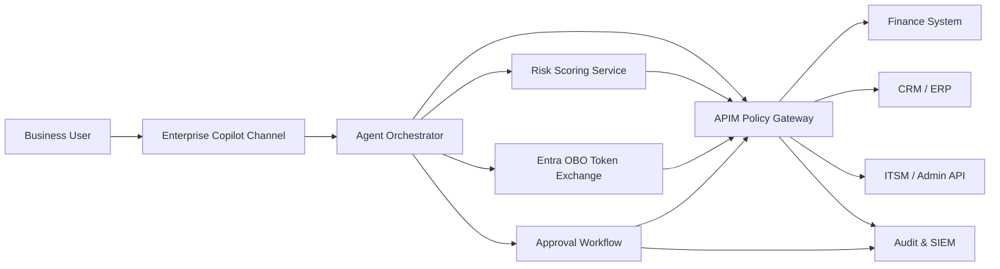
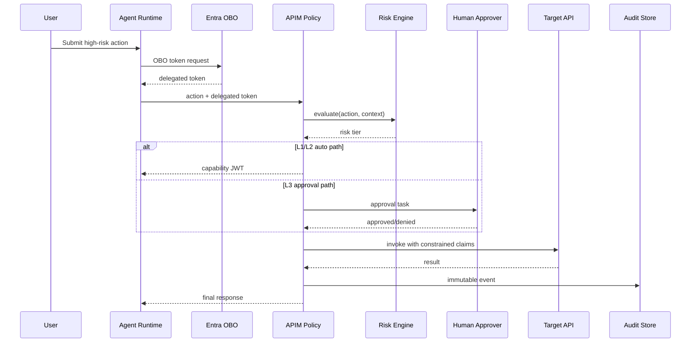

# 企业高风险 Agent 操作“升级授权”选型 FAQ：Entra OBO vs APIM 能力令牌 vs 审批流 vs 混合闭环

> **适用对象**：企业 Cloud & AI Solution Architect、平台工程、零信任安全、合规审计团队。  
> **目标问题**：当智能体要执行“付款、删库、改配置、发外函、改主数据”等高风险动作时，如何在不牺牲交互效率的前提下，建立可审计、可回滚、可分层放量的升级授权架构。

## 1. 场景定义与业务失败代价

企业在把 Agent 从“问答助手”推进到“执行助手”后，
最先暴露的不是推理准确率，
而是执行授权链路缺少分层控制。

低风险查询失败，
通常只造成一次响应错误。

高风险动作误执行，
会直接触发财务损失、
合规处罚、
客户信任受损、
以及跨系统补偿风暴。

典型事故包括：
- 采购 Agent 在季度结账窗口批量重复下单。
- 运维 Agent 误把生产策略同步到全区域。
- 客服 Agent 对关键客户执行不可逆退款。
- 财务 Agent 使用过期委托关系发起付款。
- 法务 Agent 将草稿合同误发为正式函件。

这些事故的共性是：
模型并不一定“胡说”，
但授权上下文在执行瞬间已失效，
或授权粒度不足以表达动作风险级别。

因此本篇不讨论“模型好不好”，
而是聚焦“动作前最后一道升级授权门”。

## 2. 四类升级授权方案总览与边界
本文比较四条主流企业路径。

方案 A：
`Entra Agent ID + OBO + Conditional Access Step-up`。

方案 B：
`APIM 统一能力令牌（Capability JWT）签发与校验`。

方案 C：
`Durable 审批流（Human-in-the-loop）后置放行`。

方案 D：
`风险分层混合闭环（静态规则 + 实时评分 + 人审兜底）`。

核心结论先行：
- 单一方案无法覆盖全部风险层级。
- A 适合身份链完整、系统边界清晰的企业域内动作。
- B 适合多系统、多协议、多供应商的统一闸门。
- C 适合法律效力、资金流、监管报送等强审计动作。
- D 是大规模落地时的现实终态。

评估时不要只看“鉴权通过率”，
要同时看：
误放行率、
拒绝误伤率、
审批等待时延、
以及补偿成本。

## 3. 方案 A：Entra OBO 升级授权（身份链最强）

该方案将“用户身份委托”作为核心真相源。

流程要点：

- 用户在前端触发高风险动作。
- Agent 服务持有自身工作负载身份。
- 通过 OBO 交换获得“代表用户”的访问令牌。
- 条件访问策略检测设备、位置、会话风险。
- 高风险动作触发 MFA/合规设备/受管网络二次验证。
- 目标系统仅接受带特定 `scp/roles` 的短时令牌。

优点：

- 身份归因天然清晰。
- 审计记录可以落在 Entra + 目标业务日志双侧。
- 与现有企业 IAM 流程一致，组织阻力较小。

短板：

- 非 Microsoft 体系或遗留系统接入复杂。
- 跨租户与 B2B 协作链路设计成本高。
- 动作级细粒度策略表达仍需业务侧补充。

架构师实践建议：

- 使用最短 TTL 的动作令牌，
  严禁复用会话长令牌执行高风险写操作。
- 将“动作类型 + 资源范围 + 金额阈值”
  编码进自定义声明。
- 对 OBO 失败、MFA 超时、风险升高三类事件，
  统一回落到审批流。

## 4. 方案 B：APIM 能力令牌（跨系统治理最稳）

该方案把升级授权下沉到网关控制面，
核心是“令牌能力化”。

能力令牌不是通用访问令牌，
而是一次性、短生命周期、动作限定的授权凭据。

常见载荷字段：

- `act`：允许动作集合。
- `res`：资源边界。
- `amt`：金额或影响阈值。
- `exp`：秒级过期时间。
- `jti`：幂等防重放标识。
- `risk`：发放时风险等级。

APIM 负责：

- 入站验证主体令牌与设备态。
- 调用风险评分服务计算动作等级。
- 仅在策略满足时签发能力令牌。
- 出站向下游传递最小化授权上下文。
- 拒绝缺失 `jti` 或过期令牌请求。

优点：

- 对多语言、多框架、第三方 SaaS 更统一。
- 能把审计与配额治理绑定在同一控制面。
- 便于做灰度发布与策略回滚。

短板：

- 需要建立令牌签发与校验密钥治理体系。
- 下游系统必须支持能力声明验证。
- 过度集中会把 APIM 变成关键瓶颈。

生产化建议：

- 使用 Key Vault 托管签名密钥并轮转。
- 能力令牌 TTL 建议 30–120 秒。
- 对失败路径输出标准拒绝码，
  便于 SOC 与业务侧统一告警。

## 5. 方案 C：审批流放行（强监管最可解释）

审批流不是“低效率妥协”，
而是把法律责任链显式化。

适用动作：

- 对公付款与大额退款。
- 客户主数据或权限模型变更。
- 对外发送具有法律效力的文档。
- 监管报表上报与撤回。

典型组件：

- Durable Functions / Logic Apps 编排。
- Teams / Email / ITSM 工单审批接口。
- 超时与替补审批人机制。
- 审批意见与证据归档。

优点：

- 审计证据最完整。
- 组织责任边界清晰。
- 有利于监管访谈与外部审计。

短板：

- 峰值时审批队列可能成为吞吐瓶颈。
- 人工延迟影响终端体验。
- 设计不当会导致“形式审批”失真。

架构建议：

- 对同类低风险批量动作做“批次审批 + 明细抽检”。
- 设定审批 SLA 与自动升级路径。
- 对超时动作默认拒绝而非默认放行。

## 6. 方案 D：混合分层闭环（企业规模化默认答案）

企业通常需要同时兼顾效率与审计，
因此最终落点往往是混合分层。

推荐分层：

- L0：只读查询，免升级授权。
- L1：低风险写入，策略自动放行。
- L2：中风险写入，能力令牌 + 二次校验。
- L3：高风险写入，人审放行并可双人复核。

混合闭环关键点：

- 风险评分必须可解释，
  不可只返回黑盒分值。
- 每次放行都写入不可篡改审计事件。
- 出现策略漂移时允许一键回退到“全审批模式”。

这一路径能够把人力审核集中在真正高价值节点，
同时保留企业级可问责性。

## 7. 参考架构（拓扑视图）

拓扑解释：

- 编排层负责动作语义抽取与风险分层。
- APIM 负责统一策略执行与令牌能力化。
- Entra 负责身份委托链真实性。
- 审批流只介入 L3 高风险路径。
- 审计层统一接收自动与人工两类证据。

## 8. 请求路径与缓存边界（执行流）

缓存边界建议：

- 禁止缓存审批结果跨动作复用。
- 能力令牌缓存仅限同一 `jti` 重试窗口。
- 风险评分可短时缓存只读特征，
  不缓存最终放行结论。

## 9. 12 维企业级选型对比矩阵

| 维度 | A Entra OBO Step-up | B APIM 能力令牌 | C 审批流放行 | D 混合分层 |
|---|---|---|---|---|
| 身份可追溯性 | 很高 | 高 | 高 | 很高 |
| 动作粒度控制 | 中 | 很高 | 高 | 很高 |
| 跨系统一致性 | 中 | 很高 | 中 | 高 |
| 合规可解释性 | 高 | 高 | 很高 | 很高 |
| 峰值吞吐能力 | 高 | 高 | 低到中 | 高 |
| 误放行风险 | 中 | 低 | 很低 | 很低 |
| 误拒绝风险 | 中 | 中 | 中 | 低 |
| 集成改造成本 | 中 | 中到高 | 中 | 高 |
| 运维复杂度 | 中 | 中到高 | 中 | 高 |
| 回滚能力 | 中 | 高 | 高 | 很高 |
| 多租户治理 | 中 | 高 | 中 | 高 |
| 推荐场景 | 内部统一身份域 | 多系统网关治理 | 强监管审批 | 大规模企业常态 |

矩阵使用方式：

- 先按监管强度与动作影响分层。
- 再按组织现有 IAM 成熟度筛选。
- 最后按吞吐目标与审计要求定型。

## 10. 定量门槛与 TCO/时延拐点

| 指标 | A OBO | B APIM JWT | C 审批流 | D 混合 |
|---|---:|---:|---:|---:|
| 自动路径 P95 额外时延 | 45 ms | 55 ms | 1800 ms | 80 ms |
| 高风险动作人工介入率 | 0% | 0% | 100% | 8% |
| 误放行率目标 | 0.30% | 0.15% | 0.05% | 0.04% |
| 每千次动作治理成本（美元） | 1.8 | 2.2 | 6.9 | 2.9 |
| 事故补偿成本暴露（相对） | 1.0x | 0.7x | 0.5x | 0.4x |

测算口径（示例）：

- 日均 12 万次动作调用，其中 6% 属于高风险。
- 人工审批单次综合成本 0.42 美元。
- 安全事故期望损失按历史均值折算。

拐点判断：

- 当高风险占比 > 4% 时，纯人工审批成本快速上升。
- 当跨系统动作 > 20 条链路时，网关能力令牌的治理收益明显。
- 当监管问责强度升高时，混合方案总体 TCO 最优。

## 11. 常见反模式与修正策略

反模式一：
把长效访问令牌直接用于高风险写操作。

改进：
强制短时能力令牌，
并绑定 `jti` 与动作摘要。

反模式二：
仅凭模型信心分就自动放行。

修正：
风险评分必须引入业务阈值、
身份态势、
以及资源敏感等级。

反模式三：
审批流仅记录“同意/拒绝”，
不留证据上下文。

修正：
保留动作参数摘要、
策略版本、
审批意见、
与回放链接。

反模式四：
把所有动作都推给人工审批。

修正：
建立 L0-L3 分层，
把人力集中到 L3。

## 12. 平台治理与组织协同模型

建议采用三层责任模型：

- 平台团队：定义策略框架与令牌规范。
- 业务域团队：维护动作分级与阈值配置。
- 安全合规团队：审查策略变更与审计报表。

发布节奏建议：

- 每周策略小步发布，
  每月一次规则基线回顾。
- 所有策略变更必须带回放测试证据。
- 对高风险规则启用双人评审合并。

可观测性指标：

- 升级授权触发率、审批超时率、策略拒绝命中率。
- 自动回退触发次数与按租户分摊的治理成本。

## 13. 五步落地路线图（企业实践）

第一步：动作资产盘点。  
梳理所有可执行动作与影响范围，建立风险分级字典。

第二步：统一动作描述规范。  
定义动作 ID、参数模板、幂等键与审计字段。

第三步：先落 APIM 网关守门。  
即便暂未全量能力令牌，也先实现统一拒绝码与日志口径。

第四步：引入 OBO 与审批流。  
先覆盖财务与主数据场景，再逐步扩展到运维与客服后台。

第五步：混合闭环优化。  
用真实数据迭代分层阈值，并建立季度级 TCO 复盘机制。

## 14. 生产就绪清单（Go-Live Checklist）

- [ ] 所有高风险动作均有唯一动作 ID。
- [ ] 能力令牌 TTL、签名算法、轮转周期已落库。
- [ ] OBO 失败路径具备明确错误语义与用户提示。
- [ ] 审批超时默认为拒绝并记录原因。
- [ ] 审计事件可关联到用户、Agent、策略版本与目标资源。
- [ ] 灰度发布支持按租户、按动作、按区域回退。
- [ ] 压测覆盖峰值并发与审批拥塞场景。
- [ ] SOC 告警规则已接入 SIEM 并完成演练。

## 15. 实战 FAQ（8 问）

**Q1：何时必须强制人审而不能自动放行？**  
A1：涉及资金划拨、监管报送、法律文书发出、核心权限变更等动作，应默认人审。

**Q2：能力令牌与普通 JWT 最大区别是什么？**  
A2：能力令牌强调“动作限定 + 短时效 + 一次性防重放”，不是通用会话凭据。

**Q3：OBO 已经很安全，为什么还要 APIM？**  
A3：OBO解决身份链真实性，APIM解决跨系统策略一致性与审计统一口径，两者互补。

**Q4：审批流会拖慢业务，怎么平衡？**  
A4：用分层策略把 90% 以上低风险动作自动化，仅将高风险动作导向审批。

**Q5：如何防止审批人“橡皮图章”化？**  
A5：引入抽检、轮岗、审批理由必填、异常模式告警与绩效反馈机制。

**Q6：多租户场景如何避免策略串租？**  
A6：策略命名空间与令牌声明必须显式携带租户边界，并在网关做强制校验。

**Q7：升级授权失败时应返回什么给终端用户？**  
A7：返回可操作的拒绝原因分类（身份失败、策略拒绝、审批超时），避免笼统 403。

**Q8：从哪种方案起步最稳？**  
A8：建议先做 APIM 统一守门，再并行引入 OBO 和审批流，最终收敛到混合分层闭环。

