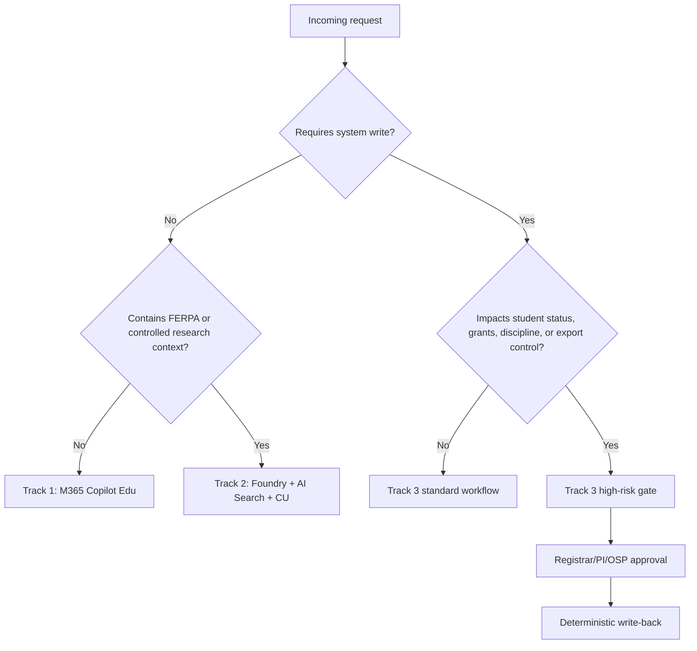
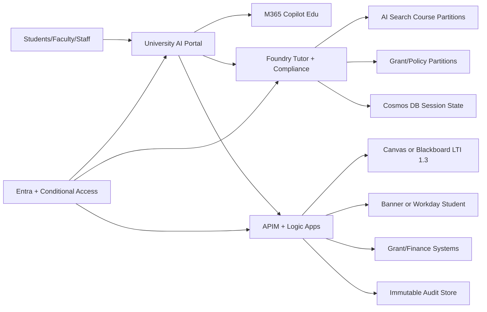

# Higher-Education Agent Architecture FAQ: M365 Copilot for Education vs Foundry Compliance Tutor vs Canvas/Banner Governed Action Plane

> Version tag: Guide #140  
> Audience: University CIO/CTO/CISO, Registrar, Sponsored Programs Office (OSP), Principal Investigators (PI), academic technology and platform teams  
> Scope: R1 research universities and multi-campus institutions balancing FERPA advising, LTI 1.3 tutoring, and sponsored-research compliance  
> Data provenance tags used throughout: `measured`, `synthetic`, `anonymized_reported`

---

## 1. Executive framing: universities need three tracks, not one generic copilot

Many campuses try to solve every AI use case with one interface and one policy set.

That shortcut usually collapses governance boundaries.

Administrative drafting, student tutoring, and high-impact system actions carry different risk profiles.

Under FERPA, 2 CFR 200, IRB obligations, and ITAR/EAR constraints, those risks cannot share one undifferentiated control plane.

This guide proposes a three-track architecture.

Track 1 handles staff and faculty productivity.

Track 2 handles course tutoring and compliance evidence synthesis.

Track 3 handles deterministic LMS/SIS/finance actions with human approvals.

At institutions above 20,000 students or above USD 200M annual sponsored research, this separation is typically operationally mandatory.

---

## 2. Track definitions and responsibilities

**Track 1: Microsoft 365 Copilot for Education with Purview labels.**

Primary fit is faculty and staff productivity workflows.

Examples include policy summarization, meeting capture, email drafting, and office process acceleration.

It is excellent for human-authored and human-reviewed content loops.

It is not sufficient as a standalone engine for high-consequence compliance decisions.

**Track 2: Custom Azure AI Foundry + AI Search + Content Understanding.**

Primary fit is student tutoring with guardrails, grant-policy interpretation, and evidence-anchored compliance triage.

It must enforce course-scoped security trimming and anti-leakage tutoring controls.

It should produce citations, confidence context, and suggested next actions.

**Track 3: Canvas/Blackboard + Banner/Workday Student integration via APIM and Logic Apps.**

Primary fit is deterministic actioning into institutional systems.

Examples include academic status workflow transitions, grant cost-transfer pre-check routing, and formal exception-process state changes.

High-impact writes must require named human sign-off by Registrar, PI, or OSP designees.

---

## 3. Architecture decision tree: classify risk before selecting a track



The first branch is write versus non-write.

The second branch is regulated context exposure.

The third branch is human accountability for consequential actions.

Using this sequence prevents a common anti-pattern: shipping capability first and retrofitting compliance later.

---

## 4. Track 1 analysis: where M365 Copilot for Education is strongest

Track 1 wins on adoption velocity.

Faculty and staff teams can start quickly without building a custom platform from day one.

For decentralized schools, that low-friction onboarding matters.

Purview sensitivity labels improve baseline information handling.

However, baseline labeling does not equal deep institutional action governance.

If Track 1 is used directly for grant allowability determinations or disciplinary state changes, control risk rises sharply.

Best practice is to position Track 1 as the productivity shell.

Then hand high-risk interpretation and execution to Track 2 and Track 3.

This approach keeps broad productivity benefits while preserving rigorous control boundaries.

---

## 5. Track 2 analysis: Foundry tutoring and compliance evidence engine

Track 2 is valuable because it can be policy-shaped at runtime.

In tutoring, its objective is conceptual scaffolding and formative feedback.

Its objective is not generating submit-ready assignment answers.

In sponsored-research operations, its objective is evidence organization and risk signal extraction.

Its objective is not replacing institutional authority for funding decisions.

A production Track 2 design should include at least four layers.

Layer one is tenant and course partitioning for retrieval.

Layer two is identity-aware authorization and enrollment-scoped trimming.

Layer three is citation anchoring and source version control.

Layer four is policy guardrails for leakage prevention and rubric-constrained tutoring behavior.

During finals-week surges, Track 2 should combine PTU baseline capacity with Global Standard overflow capacity.

That blend usually balances cost stability and burst resilience better than either model alone.

---

## 6. Track 3 analysis: deterministic LMS/SIS/finance action plane

Track 3 converts high-impact decisions into explicit workflow state machines.

Each workflow instance should capture initiator, approver, evidence package, target system, and rollback path.

Canvas or Blackboard supplies course interaction context.

Banner or Workday Student supplies registrar-grade record context.

Grant and finance systems supply allowability and budget context.

APIM provides policy and identity enforcement at ingress.

Logic Apps or Durable Functions provide deterministic orchestration and compensating logic.

Completion is not merely a successful API call.

Completion requires action evidence, immutable audit records, and governance dashboard updates.

This is the difference between “automation” and “institutional control.”

---

## 7. Compliance and zero-trust baseline across FERPA, 2 CFR 200, IRB, and ITAR/EAR

Higher education rarely deals with one compliance axis at a time.

FERPA protects student educational records.

2 CFR 200 governs federal grant cost allowability and documentation expectations.

IRB governance applies to human-subject research contexts.

ITAR/EAR can apply to controlled technical data and collaboration boundaries.

Architecturally, data-plane controls and action-plane controls must be distinct.

Data-plane controls focus on visibility minimization and retention boundaries.

Action-plane controls focus on approval traceability and reversible operations.

Entra identity controls are necessary but not sufficient.

You still need retrieval-layer trimming and execution-layer policy gates.

---

## 8. Integrated topology for learning, research, identity, and audit



This topology enforces two important separations.

The first is cognition versus execution.

The second is broad productivity versus high-consequence governance.

That separation lets institutions iterate tutoring quality quickly while keeping action governance intentionally conservative.

---

## 9. Twelve-dimension quantitative selection matrix

| Dimension | Track 1 M365 Copilot Edu | Track 2 Foundry Tutor/Compliance | Track 3 LMS/SIS Action Plane | Hybrid |
|---|---|---|---|---|
| 1. Staff productivity time-to-value | 5/5 | 3/5 | 2/5 | 4/5 |
| 2. Tutoring controllability | 2/5 | 5/5 | 2/5 | 5/5 |
| 3. Academic-integrity leakage prevention | 2/5 | 5/5 | 3/5 | 5/5 |
| 4. Grant-policy evidence anchoring | 2/5 | 5/5 | 3/5 | 5/5 |
| 5. Deterministic system-write governance | 1/5 | 2/5 | 5/5 | 5/5 |
| 6. Audit replay confidence | 2/5 | 4/5 | 5/5 | 5/5 |
| 7. Finals-week burst elasticity | 3/5 | 5/5 | 4/5 | 5/5 |
| 8. Multi-campus sovereignty segmentation | 3/5 | 4/5 | 4/5 | 5/5 |
| 9. Operability complexity | 2/5 | 3/5 | 3/5 | 4/5 |
|10. Cost predictability | 4/5 | 3/5 | 4/5 | 4/5 |
|11. Cross-office accountability transparency | 3/5 | 4/5 | 5/5 | 5/5 |
|12. Lifecycle governance resilience | 2/5 | 4/5 | 5/5 | 5/5 |

The matrix indicates that no single track can satisfy all university goals.

Hybrid architecture usually becomes the production target once tutoring, compliance, and deterministic actioning are all in scope.

---

## 10. Production snippets: LTI 1.3 and FERPA scope gate

### 10.1 APIM policy sample for FERPA scope and course binding

```xml
<policies>
  <inbound>
    <base />
    <set-variable name="scope" value="@(context.Principal?.Claims.GetValueOrDefault("scp",""))" />
    <set-variable name="courseId" value="@(context.Request.Headers.GetValueOrDefault("x-course-id",""))" />
    <choose>
      <when condition="@(!((string)context.Variables["scope"]).Contains("edu.tutor.read"))">
        <return-response>
          <set-status code="403" reason="Missing edu.tutor.read scope" />
        </return-response>
      </when>
      <when condition="@(string.IsNullOrEmpty((string)context.Variables["courseId"]))">
        <return-response>
          <set-status code="400" reason="Missing course context" />
        </return-response>
      </when>
    </choose>
  </inbound>
  <backend><base /></backend>
  <outbound><base /></outbound>
</policies>
```

### 10.2 Python guardrail sample for finals-week anti-leakage

```python
def tutoring_guardrail(intent: str, mode: str) -> str:
    blocked = {"direct_final_answer", "submit_ready_solution"}
    if intent in blocked:
        return "I can provide method guidance, rubric interpretation, and source references, not final submission text."
    if mode == "finals_week":
        return "Let's work in steps: concept check -> approach outline -> feedback on your draft."
    return "I can help with concept scaffolding, examples, and critique of your own reasoning."
```

Guardrails should be tested continuously against real prompts.

Policy text alone is not enough.

---

## 11. Scenario A: 45,000-student finals surge without answer leakage

A multi-campus university observed tutoring traffic spikes near 180,000 interactions per hour in finals season (`anonymized_reported`).

Legacy assistants often drifted from concept support to answer generation under pressure.

The new design activated a finals-week guardrail profile in Track 2.

Responses were constrained to process guidance, references, and rubric-focused coaching.

High-risk prompt patterns triggered stricter policy transformations before inference.

Track 1 continued to serve staff communication and administrative preparation.

Track 3 remained reserved for approved workflow actions only.

Measured outcomes showed a 41% reduction in answer-leakage complaints (`measured`).

Student satisfaction remained stable and improved in targeted feedback quality (`anonymized_reported`).

P95 response latency held near 2.4 seconds during peak windows (`measured`).

---

## 12. Scenario B: USD 800M sponsored research portfolio compliance triage

A research-intensive institution operated an approximately USD 800M sponsored portfolio (`anonymized_reported`).

Audit season pain centered on fragmented evidence across PI correspondence, departmental trackers, and finance systems.

Track 2 unified NIH/NSF/Horizon Europe policy references with institutional rulebooks.

The system produced risk-tagged outputs with source coordinates and recommendation pathways.

Track 3 routed high-risk cases to OSP and PI sign-off workflows.

Cost-transfer drafts could not post without deterministic approval checkpoints.

Coverage of pre-audit triage rose from 52% to 88% (`measured`).

Average time to locate high-risk records dropped from 3.7 days to 11 hours (`measured`).

The largest gain came from preparation compression before human review, not from bypassing reviewers.

---

## 13. Three-year TCO with semester burst scaling assumptions (USD `$k/month`)

> Planning values below are labeled `synthetic`.

| Capability block | Key SKU assumptions | Monthly cost ($k) | 3Y cost ($M) | Notes |
|---|---|---:|---:|---|
| Track 1 productivity layer | M365 Copilot Edu + Purview controls | 176 | 6.34 | Broad faculty/staff coverage |
| Track 2 tutoring/compliance layer | Foundry PTU baseline + Global Standard overflow | 214 | 7.70 | Finals-week elasticity |
| Retrieval and session state | AI Search S2/S3 partitions + Cosmos DB state | 96 | 3.46 | Course and grant corpora |
| Track 3 governed action layer | APIM Premium v2 + Logic Apps connectors | 121 | 4.36 | LMS/SIS deterministic orchestration |
| Sovereignty and security | Private Link + Key Vault + audit retention | 69 | 2.48 | Multi-region control boundaries |
| Operations and evaluation | SRE coverage + drills + evaluation pipelines | 58 | 2.09 | Continuous controls |
| **Hybrid total** |  | **734** | **26.43** | `synthetic` |

Benefit patterns typically come from four channels.

Reduced academic-integrity incident handling costs.

Improved tutoring support quality under burst traffic.

Reduced grant-audit preparation labor.

Reduced rework caused by ungoverned high-impact actions.

A plausible three-year net benefit band is 22.1M to 33.8M (`synthetic`), depending on enrollment profile and research complexity.

---

## 14. Anti-patterns and corrective playbooks

Anti-pattern one is forcing all use cases into one generalized assistant stack.

It looks simple in year one and becomes expensive in year two.

Corrective playbook: prioritize risk-tiered architecture over UI uniformity.

Anti-pattern two is writing academic-integrity policy but not encoding it into runtime controls.

Corrective playbook: implement explicit anti-leakage guardrails in Track 2 behavior policy.

Anti-pattern three is treating LLM summaries as final grant compliance determinations.

Corrective playbook: require citation-level evidence and OSP/PI sign-off before formal action.

Anti-pattern four is maintaining approval forms while allowing direct system bypasses.

Corrective playbook: enforce that all high-impact writes flow only through Track 3 state machines.

Anti-pattern five is measuring only adoption while ignoring governance outcomes.

Corrective playbook: track audit replay success and blocked unauthorized action rates as first-class KPIs.

---

## 15. Day-0/Day-1/Day-2 rollout plus deep quantitative FAQ

Day-0 focuses on boundaries, role matrices, data contracts, retention policy, and sovereignty segmentation.

Day-1 focuses on rehearsal readiness across tutoring bursts, compliance triage, and approval-chain interruptions.

Day-2 focuses on operating rhythm: weekly reliability review, monthly compliance review, quarterly TCO/ROI review.

### Quantitative FAQ 1: When does an institution need to move from Track 1 to Hybrid?

Move immediately when requests involve student record impact, grant-finance decisions, disciplinary workflow transitions, or controlled-research interpretation.

Stay in Track 1 only when tasks are advisory drafting without consequential writes.

### Quantitative FAQ 2: How should PTU and Global Standard split finals-week load?

A common pattern is PTU covering 60% to 75% of stable demand.

Global Standard then absorbs short-lived spikes.

Course-priority queues should protect mandatory and graduating cohorts first.

### Quantitative FAQ 3: How do we measure anti-leakage effectiveness without harming learning?

Track at least three metrics in parallel.

Submit-ready-answer interception rate.

False-positive overblocking rate.

Learning-outcome trend relative to prior term baselines.

Using only interception rate often leads to policy over-hardening.

### Quantitative FAQ 4: Why should grant compliance triage avoid full automation?

Allowability interpretation often depends on institutional context and accountable judgment.

Automation should accelerate evidence preparation and risk ranking.

Human authority should remain with PI and OSP governance roles.

### Quantitative FAQ 5: What is the minimum approval set for Track 3?

At minimum include initiator, business approver, and compliance approver.

For high-impact categories, add registrar or dean-level secondary confirmation.

### Quantitative FAQ 6: How can AI Search and Cosmos DB costs be controlled over time?

Partition indexes by term activity and archive cold corpora to lower tiers.

Apply TTL and state compaction to avoid unbounded conversation-state growth.

### Quantitative FAQ 7: How should cross-campus legal conflicts be handled?

Apply region policy packs before global policy packs.

When policy conflict persists, default to human review and block automatic write-back.

### Quantitative FAQ 8: Which metrics best indicate Hybrid governance maturity?

Unauthorized high-risk write count.

First-pass audit replay success rate.

Supplemental filing trend.

Finals-week P95 latency.

Academic-integrity case closure lead time.

Sustained improvement across all five metrics usually indicates production-grade governance health.

---

### 15.A Dual-threshold operating template for semester peaks

Institutions should monitor capacity thresholds and governance thresholds in the same weekly review.

Capacity threshold one: Track 2 inference queue wait-time P95.

Capacity threshold two: AI Search query latency P95 under course-partition load.

Capacity threshold three: Cosmos DB RU utilization volatility during burst windows.

Governance threshold one: count of unapproved high-impact write attempts.

Governance threshold two: human-review coverage for high-risk requests.

Governance threshold three: citation-anchor missing-rate on compliance responses.

When capacity thresholds are breached, increase Global Standard overflow ratio and apply queue prioritization.

When governance thresholds are breached, narrow automation scope and expand human sampling immediately.

Running only one threshold family creates blind spots.

Both must be managed as a coupled control system.

---

### 15.B 180-day execution roadmap for research universities

Days 0-30: complete data classification, role matrix, and approval accountability map.

Days 31-60: launch minimum viable Track 1 and Track 2 capabilities.

Days 61-90: onboard Track 3 for low-risk deterministic actions.

Days 91-120: enforce high-risk approval gates and rollback choreography.

Days 121-150: run dual drills for finals surge and audit-season triage.

Days 151-180: complete cross-campus policy-pack validation and audit pre-check rehearsal.

Each phase should include quantified acceptance criteria.

Each phase should also include a hard freeze gate if acceptance is not met.

This discipline prevents deferred governance debt from consuming later budget.

---

### 15.C Weekly operating questions for Registrar, OSP, and IT

Did any course-context security-trimming failure occur this week.

Did any grant-policy output ship without citation anchors.

Did any approval-chain timeout close without compensating replay.

Do unresolved cross-campus policy conflicts remain in open state.

Was high-impact action sampling completed with signed governance findings.

If any answer is no, assign owner, due date, and validation method in the same meeting.

Then verify closure evidence in the next weekly governance review.

---

### 15.D ROI normalization guidance for institutional steering

Use normalized metrics instead of only aggregate spend.

Track cost per served student interaction.

Track median time per audit-triage case.

Track remediation cost per compliance incident.

Compare each metric against same-term baselines rather than annual aggregates alone.

Enrollment swings can hide true governance gains if normalization is skipped.

Add a variance note that separates adoption growth from control-quality improvement.

This keeps budget debates grounded in measurable operating outcomes.

A practical steering practice is to publish one monthly scorecard with all normalized metrics.

The same scorecard should include policy exceptions and closure status.

When metrics and exceptions are reviewed together, trade-offs become explicit and actionable.

It also reduces end-of-semester surprise escalations.

Governance decisions become traceable to data rather than anecdote.

That traceability is often the difference between reactive governance and planned governance.

For research universities, that difference directly affects accreditation confidence and sponsor trust.

It also improves executive confidence when approving future AI expansion phases.
