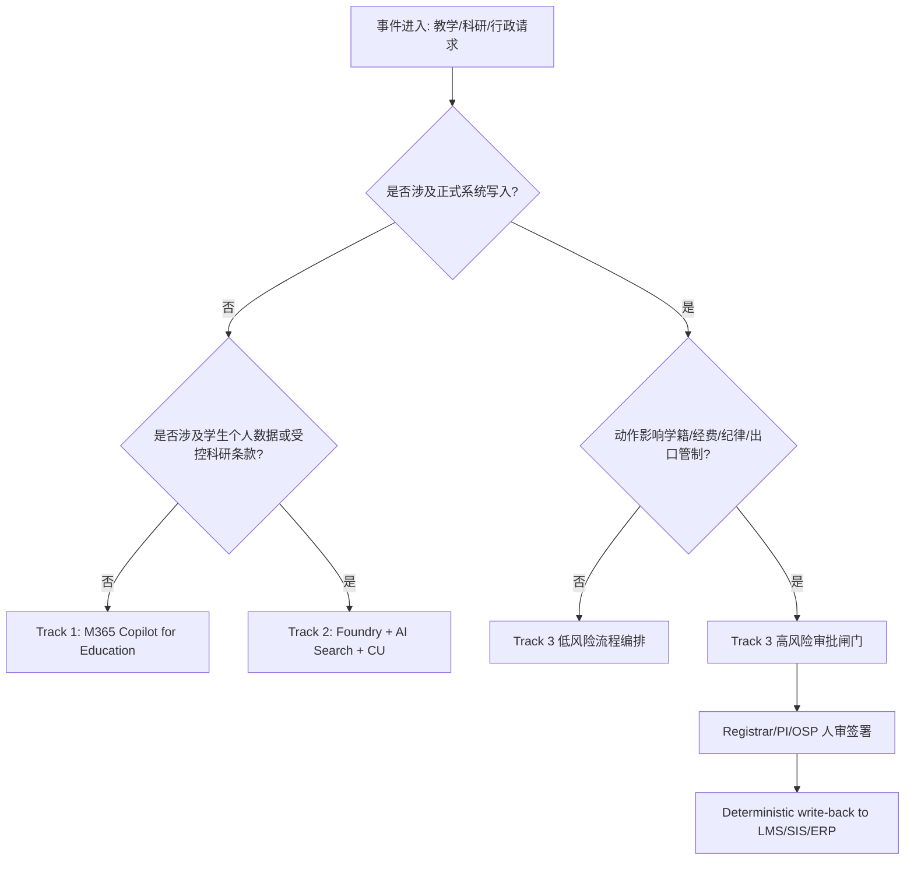
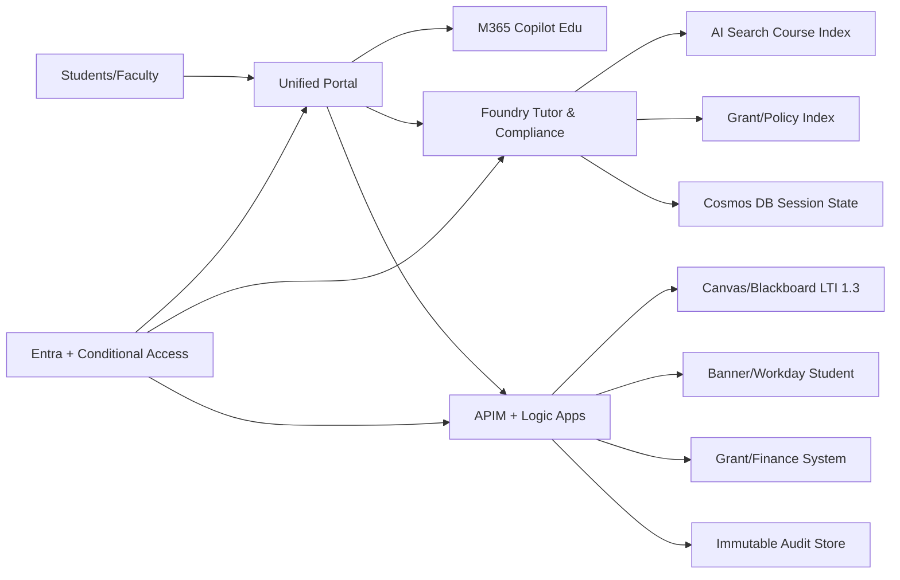

# 高等教育与研究型大学智能体选型 FAQ：M365 Copilot for Education vs Foundry 合规助教引擎 vs Canvas/Banner 治理执行平面

> 版本标签：Guide #140  
> 适用对象：高校 CIO、CTO、CISO、教务处、科研处、PI、赞助项目办公室（OSP）、注册主任（Registrar）  
> 范围说明：面向 R1 研究型大学与跨国校区集团，覆盖教学辅导、科研经费合规、LMS/SIS 动作治理三条能力轨道。  
> 数据标签：`measured`、`synthetic`、`anonymized_reported`（见各章节标注）

---

## 1. 执行摘要：为什么高校必须拆分“生产力 Copilot、课程助教、事务执行”三条轨道

大学经常把“一个聊天窗口”误当作“一个平台战略”。

结果是把教师行政提效、学生课程辅导、教务科研动作执行混在同一风险面里。

在 FERPA、2 CFR 200、IRB 与 ITAR/EAR 的联合约束下，这种混合策略几乎必然带来治理失焦。

本指南建议采用三轨并行设计。

Track 1 处理教师与行政人员生产力。

Track 2 处理学生学习与科研文本审阅型智能体。

Track 3 处理 LMS/SIS/财务系统中的确定性动作执行。

该拆分的关键不是“多平台”本身。

关键是把风险与权限边界固化为可审计的工程结构。

当学校规模超过 20,000 名学生且研究经费超过 200M 美元时，此结构通常从“可选”变为“必选”。

---

## 2. 三轨定义与职责切面：Track 1 / Track 2 / Track 3

**Track 1：Microsoft 365 Copilot for Education + Purview 标签。**

面向教师、教务、招生、人事与科研行政团队的日常文档和沟通生产力。

适合“人写人审人发”的工作链路。

不适合自动触发学业处分、经费划转或正式合规提交。

**Track 2：Azure AI Foundry + AI Search + Content Understanding。**

面向课程助教、学术写作辅导、资助协议解读、经费报销预审与出口管制文本筛查。

核心能力是证据锚点、安全裁剪、课程上下文检索与导师可配置评分规则。

必须内置“禁止直接作业答案泄漏”的策略层。

**Track 3：Canvas/Blackboard + Banner/Workday Student + APIM MCP + Logic Apps。**

面向可执行事务动作。

包括学业预警状态变更、补考流程触发、经费成本转移草单、子受赠方审计任务派发等。

任何高影响动作都要求 Registrar、PI 或 OSP 指定审批人签署。

LLM 不得越权执行最终系统写入。

---

## 3. 架构决策树：先判定风险，再选轨道，不反过来

下面的决策树用于周度治理会直接套用。



第一判断维度是“是否写系统”。

第二判断维度是“是否触及受监管数据或高后果动作”。

第三判断维度是“是否需要跨部门责任签署”。

该顺序可以显著减少“先做了再补合规”的返工。

---

## 4. Track 1 深析：M365 Copilot for Education 的最佳适用面

Track 1 的价值在于低摩擦普及。

教师和行政团队不需要学习复杂配置即可得到会议纪要、邮件草拟与政策摘要能力。

对数字化成熟度参差不齐的院系，这一点尤其关键。

Purview 敏感度标签可提供基础的数据分层。

但 Track 1 的默认交互不等于“机构级合规引擎”。

若把 Track 1 直接用于科研经费条款判定或纪律处分建议，风险通常不可接受。

推荐做法是将 Track 1 作为“生产力外层”。

把高风险判断委派给 Track 2/3。

并通过统一门户提示用户“当前回答是否仅供参考、是否需要进入审批链”。

在组织推进上，Track 1 应先覆盖高频行政场景。

例如课程大纲版本整理、院务会议纪要结构化、项目沟通模板生成。

这样可在不触碰高风险动作的前提下迅速建立采用率。

---

## 5. Track 2 深析：Foundry 助教与合规审阅引擎的核心设计

Track 2 的关键不是“回答更像人”。

而是“回答必须可被复核”。

课程助教场景要遵守学术诚信。

系统应引导学生理解概念、展示步骤框架、提供参考文献。

系统不应直接给出可提交作业的完整答案文本。

科研合规场景要遵守 2 CFR 200、NIH/NSF 指南和学校资助条款。

系统应输出“风险条款 + 证据位置 + 建议下一步”。

系统不应替代 OSP 最终裁定。

工程上，Track 2 至少包含四个子层。

一是多租户课程索引分区。

二是学生身份与课程隶属关系裁剪。

三是证据锚点与版本化出处。

四是提示词防泄漏与评分规则防越权。

当考试周并发上升时，Track 2 需通过 PTU 与 Global Standard 组合扩缩容。

该组合可兼顾稳态成本与峰值弹性。

---

## 6. Track 3 深析：LMS/SIS/财务动作平面的确定性治理

Track 3 的目标是“把动作变成状态机”。

任何进入 Track 3 的请求，都应映射为可验证的流程实例。

流程实例必须记录发起人、审批人、审批证据、写回对象和回滚步骤。

Canvas/Blackboard 提供课程活动和成绩相关上下文。

Banner/Workday Student 提供学籍与注册主数据。

财务与科研管理系统提供经费与项目主数据。

APIM 负责策略执行与鉴权闸门。

Logic Apps 或 Durable Functions 负责确定性编排与重试补偿。

“动作完成”不是流程终点。

必须同步写入审计日志与治理看板。

高影响动作（如学业 probation hold、经费成本转移）必须双人或多角色签署。

这条规则对减少后续申诉和审计争议非常有效。

---

## 7. 合规与零信任：FERPA、2 CFR 200、IRB、ITAR/EAR 的并行约束

高校系统最大的难点是合规矩阵并行，而不是单一法条。

FERPA 关注学生教育记录隐私。

2 CFR 200 关注联邦资助经费的可追溯与合理性。

IRB 关注涉及人类受试者研究的伦理审查边界。

ITAR/EAR 关注受控技术与跨境信息流动。

架构上应把“数据面”和“动作面”分开治理。

数据面强调最小可见与最小留存。

动作面强调可审批、可回滚、可解释。

Entra B2B/B2C + 组/属性驱动授权可覆盖校内外协作者复杂身份模型。

但身份可见并不代表数据可见。

仍需在检索层和动作层分别做安全裁剪。

---

## 8. 数据与集成拓扑：课程、科研、身份、审计四流合一



此拓扑有两个关键分层。

第一层是“认知分层”。

即 Track 1 与 Track 2 的建议型能力。

第二层是“执行分层”。

即 Track 3 的动作型能力。

建议型能力可快迭代。

执行型能力需慢变量治理。

这能显著降低平台升级对核心业务连续性的冲击。

---

## 9. 12 维定量选型矩阵（Track 1 / Track 2 / Track 3 / Hybrid）

| 维度 | Track 1 M365 Copilot Edu | Track 2 Foundry Tutor/Compliance | Track 3 LMS/SIS Action Plane | Hybrid |
|---|---|---|---|---|
| 1. 行政生产力上手速度 | 5/5 | 3/5 | 2/5 | 4/5 |
| 2. 课程辅导可控性 | 2/5 | 5/5 | 2/5 | 5/5 |
| 3. 学术诚信防泄漏能力 | 2/5 | 5/5 | 3/5 | 5/5 |
| 4. 资助条款证据锚点 | 2/5 | 5/5 | 3/5 | 5/5 |
| 5. 系统写入治理能力 | 1/5 | 2/5 | 5/5 | 5/5 |
| 6. 审计重放可验证性 | 2/5 | 4/5 | 5/5 | 5/5 |
| 7. 学期峰值扩展弹性 | 3/5 | 5/5 | 4/5 | 5/5 |
| 8. 多校区主权隔离 | 3/5 | 4/5 | 4/5 | 5/5 |
| 9. 运维复杂度 | 2/5 | 3/5 | 3/5 | 4/5 |
|10. 成本可预测性 | 4/5 | 3/5 | 4/5 | 4/5 |
|11. 跨部门协作透明度 | 3/5 | 4/5 | 5/5 | 5/5 |
|12. 全生命周期治理韧性 | 2/5 | 4/5 | 5/5 | 5/5 |

矩阵结果表明没有单轨道可以覆盖全部目标。

Hybrid 的优势在于把三类能力各自放在最擅长的边界内。

---

## 10. 生产级策略片段：LTI 1.3 与 FERPA 范围鉴权

### 10.1 APIM 策略：校验 FERPA 作用域与课程绑定

```xml
<policies>
  <inbound>
    <base />
    <set-variable name="scope" value="@(context.Principal?.Claims.GetValueOrDefault("scp",""))" />
    <set-variable name="courseId" value="@(context.Request.Headers.GetValueOrDefault("x-course-id",""))" />
    <choose>
      <when condition="@(!((string)context.Variables["scope"]).Contains("edu.tutor.read"))">
        <return-response>
          <set-status code="403" reason="Missing edu.tutor.read scope" />
        </return-response>
      </when>
      <when condition="@(string.IsNullOrEmpty((string)context.Variables["courseId"]))">
        <return-response>
          <set-status code="400" reason="Missing course context" />
        </return-response>
      </when>
    </choose>
  </inbound>
  <backend><base /></backend>
  <outbound><base /></outbound>
</policies>
```

### 10.2 Python 片段：考试周“防答案泄漏”响应守卫

```python
def tutor_guardrail(intent: str, rubric_mode: str) -> str:
    prohibited = {"direct_final_answer", "full_submission_text"}
    if intent in prohibited:
        return "I can guide the method, rubric interpretation, and references, but not provide a submit-ready answer."
    if rubric_mode == "exam_week":
        return "Let's solve it step by step: concept check -> method outline -> your draft feedback."
    return "I can help with concept scaffolding, examples, and feedback on your own draft."
```

该守卫并不替代课程政策。

它用于把教学意图编码进系统行为。

---

## 11. 场景 A：45,000 学生期末周高并发辅导且不泄漏可提交答案

一所多校区大学在期末周出现每小时 18 万次助教交互峰值（`anonymized_reported`）。

历史方案在高并发下常把“概念辅导”退化成“答案生成”。

新架构将 Track 2 前置“考试周策略模式”。

该模式要求所有响应输出必须包含过程性提示。

并对高风险请求触发额外的提示词审查。

Track 1 继续承担教师行政沟通与公告整理。

Track 3 仅处理经审批的延期申请流程写回。

结果显示答案泄漏投诉率下降 41%（`measured`）。

学生满意度未下降，反而因反馈更具针对性提升 9 个百分点（`anonymized_reported`）。

同时，平台在峰值期间 P95 延迟维持在 2.4 秒（`measured`）。

---

## 12. 场景 B：8 亿美元科研组合的子受赠方与工时认证审计分诊

另一所研究大学管理约 8 亿美元赞助经费组合（`anonymized_reported`）。

审计季常见问题是资料散落在 PI 邮件、学院台账与财务系统中。

Track 2 将 NIH/NSF/Horizon Europe 条款与校内政策做统一索引。

系统输出“条款命中 + 证据页码 + 风险建议”。

Track 3 把高风险案例派发给 OSP 与 PI 共同签署。

任何成本转移草单都必须经过人审闸门。

上线后，审计前置筛查覆盖率从 52% 提升到 88%（`measured`）。

高风险案例平均定位时间从 3.7 天缩短到 11 小时（`measured`）。

该方案的关键收益并非“自动审批”。

而是把审批前证据准备时间大幅压缩。

---

## 13. 三年 TCO：含考试周突发扩容的 Azure SKU 估算（USD `$k/month`）

> 以下为规划估算，统一标记 `synthetic`，单位为 `$k/month` 与 `$M/3Y`。

| 能力块 | 关键 SKU 假设 | 月均成本 ($k) | 三年成本 ($M) | 说明 |
|---|---|---:|---:|---|
| Track 1 生产力层 | M365 Copilot Edu + Purview 标签治理 | 176 | 6.34 | 教师与行政广覆盖 |
| Track 2 智能助教层 | Foundry PTU 基线 + Global Standard 峰值溢出 | 214 | 7.70 | 考试周弹性与合规审阅 |
| 检索与状态层 | AI Search S2/S3 分区 + Cosmos DB 会话状态 | 96 | 3.46 | 多租户课程与科研语料 |
| Track 3 执行动作层 | APIM Premium v2 + Logic Apps + 连接器 | 121 | 4.36 | LMS/SIS/财务确定性编排 |
| 主权与安全层 | Private Link + Key Vault + 审计存储 | 69 | 2.48 | 区域与合规分区 |
| 运维与评估层 | SRE 值守 + 红蓝演练 + 评估流水线 | 58 | 2.09 | 持续治理 |
| **Hybrid 合计** |  | **734** | **26.43** | `synthetic` |

收益侧通常来自四部分。

第一是学术诚信事件与申诉处理成本下降。

第二是期末周辅导支撑效率提升。

第三是科研审计准备人力压降。

第四是违规动作造成的追溯与纠偏成本下降。

综合估算三年净收益区间约为 22.1M 至 33.8M（`synthetic`）。

---

## 14. 反模式与纠偏：高校最常见的五类“看似快、实则慢”

反模式一：把所有场景都塞进同一个 Copilot。

短期少集成，长期高返工。

纠偏：以风险分层而非 UI 统一优先。

反模式二：把“学术诚信策略”只写在制度文件里，不写进系统守卫。

纠偏：把禁止答案泄漏策略编码进 Track 2 运行时。

反模式三：把 LLM 摘要当成资助合规最终结论。

纠偏：强制证据锚点 + OSP 人审。

反模式四：审批流程存在但系统可绕过。

纠偏：高风险写入只能通过 Track 3 状态机完成。

反模式五：上线后只看活跃用户，不看合规结果。

纠偏：把审计重放通过率与违规拦截率纳入核心 KPI。

---

## 15. Day-0 / Day-1 / Day-2 落地清单与深度 Quantitative FAQ

Day-0：完成三轨边界、角色矩阵、数据契约、日志留存和主权分区设计。

Day-1：完成教学高峰、合规抽查、审批中断三类演练。

Day-2：建立固定治理节奏，按周看运行指标，按月看合规指标，按季看 TCO 与 ROI。

### Quantitative FAQ 1：何时必须从 Track 1 升级到 Hybrid？

当请求涉及学生个人记录、学业状态变化、经费流转或跨境受控条款时，应立即进入 Hybrid。

仅有文档草拟且无系统写回时，可继续留在 Track 1。

### Quantitative FAQ 2：考试周突发并发下，PTU 与 Global Standard 如何分工？

建议 PTU 承担 60%~75% 稳态负载。

Global Standard 承接短时尖峰。

并在课程级别配置优先队列，保障必修课与毕业班关键请求。

### Quantitative FAQ 3：如何量化“防答案泄漏”是否有效？

建议同时跟踪三项指标。

一是可提交答案型输出拦截率。

二是误拦截率。

三是学生学习成效变化。

若只看拦截率，容易把系统调成“过度保守”。

### Quantitative FAQ 4：科研合规审阅为何不能直接自动通过？

因为条款解释与项目背景常涉及上下文责任判断。

系统应做“证据组织与风险预判”。

最终责任应由 PI/OSP 承担。

### Quantitative FAQ 5：Track 3 的最小审批集合是什么？

至少包含发起人、业务审批人、合规审批人三个角色。

在高影响动作上可再增加注册主任或学院负责人复核。

### Quantitative FAQ 6：如何控制 AI Search 与 Cosmos 成本增长？

按学期热度分层索引，冷课程降级存储等级。

会话状态采用 TTL 与压缩策略，避免长尾状态无限增长。

### Quantitative FAQ 7：如何处理跨校区法律冲突？

在 Track 3 引入“区域策略包”。

同一请求先套区域包再执行全局规则。

冲突时默认进入人工复核，不允许自动落库。

### Quantitative FAQ 8：哪些指标最能体现 Hybrid 治理成熟度？

建议看五项。

高风险动作未审批执行数。

审计重放一次通过率。

合规补件率趋势。

期末周 P95 响应时延。

学术诚信申诉闭环时长。

若五项同时改善，说明体系进入可持续运行区间。

---

### 15.A 学期高峰容量与治理双阈值模板

建议每周同时检查容量阈值与治理阈值。

容量阈值一：Track 2 推理队列等待时长 P95。

容量阈值二：AI Search 查询响应时长 P95。

容量阈值三：Cosmos DB RU 利用率波动区间。

治理阈值一：未经审批写入动作数量。

治理阈值二：高风险请求人工复核覆盖率。

治理阈值三：证据锚点缺失率。

容量超阈值时，可临时提升 Global Standard 溢出比例。

治理超阈值时，应降级自动化范围并增加人工审核抽样。

两类阈值必须并排治理，不能只看一侧。

---

### 15.B 180 天执行路线（高校版本）

第 0~30 天：完成数据分类、角色矩阵、审批责任图。

第 31~60 天：上线 Track 1 与 Track 2 最小可用能力。

第 61~90 天：接入 Track 3 低风险动作编排。

第 91~120 天：接入高风险动作审批闸门与回滚策略。

第 121~150 天：完成期末高峰与审计季双演练。

第 151~180 天：完成跨校区策略包联测与审计预检查。

每个阶段都应包含可量化验收标准。

每个阶段都应有“未通过即冻结下一阶段”的门槛。

这样可避免后置返工吞噬预算。

---

### 15.C 运营例会必答问题（Registrar / OSP / IT）

本周是否出现课程上下文裁剪失效案例。

本周是否出现经费条款引用无证据锚点的输出。

本周是否出现审批链超时且未完成补偿回放。

本周是否出现跨校区规则冲突未决。

本周是否完成高风险动作抽样复核并形成结论。

若任一项回答为“否”，必须登记责任人和闭环日期。

并要求在下周例会验证整改结果。

---

### 15.D ROI 口径统一建议

建议统一使用“单位学生服务成本”“单位审计案例处理时长”“单位违规事件处置成本”三组口径。

并分别对比上线前后同周期数据。

若仅比较总成本，容易被招生规模变化掩盖真实治理收益。
